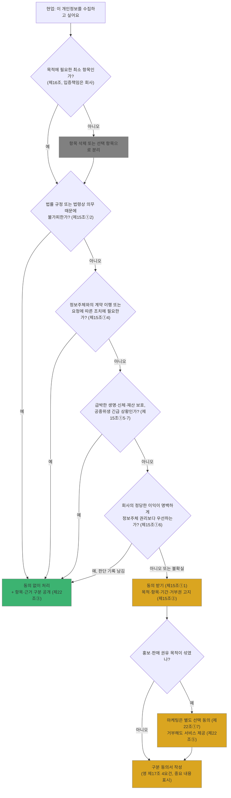

# Week 2 · Ch01. 수집·이용의 적법 근거

> [← 이전 챕터](../1주차_개인정보_기초/ch05_보호위원회의_역할과_제재_체계.md) · [📚 전체 목차](../../README.md) · [다음 챕터 →](./ch02_민감정보_고유식별정보_주민등록번호.md)

| 항목 | 내용 |
|---|---|
| 예상 학습 시간 | 85분 |
| 법령 기준일 | 2026-11-17 |
| 핵심 근거 | 개인정보 보호법 제15조, 제16조, 제22조 / 시행령 제14조의2, 제17조 / 표준지침 제6조, 제12조 |
| 관련 용어 | [동의](../../용어집.md#동의), [구분 동의](../../용어집.md#구분-동의), [계약 이행](../../용어집.md#계약-이행), [정당한 이익](../../용어집.md#정당한-이익), [추가적 이용·제공](../../용어집.md#추가적-이용제공), [필수 정보 / 선택 정보](../../용어집.md#필수-선택-정보), [행태정보](../../용어집.md#행태정보) |
| 선수 챕터 | [W1-ch01](../1주차_개인정보_기초/ch01_개인정보의_정의와_판단_기준.md), [W1-ch04](../1주차_개인정보_기초/ch04_보호_원칙과_처리자의_기본_의무.md) |

---

## 1. 학습 목표

이 챕터를 마치면 담당자님은 다음을 할 수 있습니다.

1. 법 제15조제1항의 **7가지 수집·이용 근거**를 구분하고, 현업 요청에 맞는 근거를 고를 수 있다.
2. 동의를 받을 때 **알려야 할 사항, 구분 동의, 중요 내용 표시** 요건을 확인할 수 있다.
3. **필수/선택 항목을 나눈 동의서**를 작성할 수 있다.

---

## 2. 한 줄 비유

> 💡 **개인정보를 수집하려면 "열쇠"가 필요합니다. 동의는 그 열쇠 꾸러미 중 하나일 뿐이고, 계약 이행·법령상 의무·정당한 이익 같은 다른 열쇠가 문에 더 잘 맞을 때도 많습니다.**

단, 비유의 한계가 있습니다. 열쇠를 골랐다고 끝나지 않습니다. 동의가 아닌 열쇠로 열었더라도 **어떤 열쇠로 열었는지 공개**해야 하고, 그 열쇠가 맞는다는 **입증책임은 회사**에 있습니다(법 제22조제3항).

---

## 3. 개념 설명 및 법령 조문

### 3-1. 관련 조문

> 📌 **조문 주소 읽는 법**: 조 → 항(①②) → 호(1. 2.) → 목(가. 나.). 자세한 설명은 [W1-ch01 3-2](../1주차_개인정보_기초/ch01_개인정보의_정의와_판단_기준.md#3-2-관련-조문)를 보세요.

#### 📜 개인정보 보호법 제15조제1항 (수집·이용의 7가지 근거)

처리자는 다음 중 **하나**에 해당하면 개인정보를 수집할 수 있고, 수집 목적의 범위에서 이용할 수 있습니다.

| 호 | 원문 요지 | 쉬운 이름 | 사내 예시 |
|---|---|---|---|
| 1 | 정보주체의 **동의**를 받은 경우 | 동의 | 마케팅 수신, 선택 설문, 맞춤형 광고용 행태정보 |
| 2 | **법률에 특별한 규정**이 있거나 **법령상 의무**를 준수하기 위하여 **불가피한** 경우 | 법령상 근거·의무 | 세금 신고, 4대 보험 신고, 법정 거래기록 보존 `[출처: 일반 지식, 원문 확인 권장]` |
| 3 | **공공기관**이 법령 등에서 정하는 소관 업무 수행을 위하여 불가피한 경우 | 공공기관 소관 업무 | (민간 기업은 해당 없음) |
| 4 | 정보주체와 체결한 **계약을 이행**하거나 계약 체결 과정에서 **정보주체의 요청에 따른 조치**를 이행하기 위하여 **필요한** 경우 | 계약 이행 | 주문 상품 배송 주소, 결제 정보, 견적 요청 회신 연락처, 근로계약에 따른 급여 계좌 |
| 5 | 명백히 정보주체 또는 제3자의 **급박한 생명·신체·재산**의 이익을 위하여 필요하다고 인정되는 경우 | 급박한 이익 보호 | 매장 내 응급환자 발생 시 보호자 연락 |
| 6 | 처리자의 **정당한 이익**을 달성하기 위하여 필요하고 **명백하게 정보주체의 권리보다 우선**하는 경우 (상당한 관련성·합리적 범위 한정) | 정당한 이익 | 결제 부정 이용 탐지 기록, 시설 보안 출입 기록 `[출처: 일반 지식, 원문 확인 권장]` |
| 7 | **공중위생 등 공공의 안전과 안녕**을 위하여 긴급히 필요한 경우 | 공공 안전 긴급 | 감염병 확산 시 방역 당국 요청에 따른 출입자 확인 `[출처: 일반 지식, 원문 확인 권장]` |

| 구분 | 내용 |
|---|---|
| **쉬운 풀이** | 7개 근거는 **동등합니다.** 동의가 1호라서 "1순위"인 것이 아닙니다. 업무의 성격에 **가장 잘 맞는 근거**를 고르면 됩니다. 단, 2·3·5·6·7호는 요건이 엄격하니 "불가피", "급박", "명백하게"라는 단어를 가볍게 보지 마세요. |
| **시행일** | 2026. 9. 11. 시행 법률 제21445호 기준 (<개정 2023. 3. 14.>) |
| **실무 포인트** | **계약 이행(4호)**은 "그 계약을 하려면 그 정보가 꼭 있어야 하나?"로 판단합니다. 배송에 주소는 필요하지만 생년월일은 보통 필요 없습니다. 근로계약은 표준지침 제6조제6항이 "「근로기준법」에 따른 임금지급, 교육, 증명서 발급, 근로자 복지제공을 위하여 근로자의 동의 없이" 수집·이용할 수 있다고 명시합니다.[^std-6] |

근거 원문은 각주를 참고하세요.[^law-15-1]

> ⚠️ 확인 필요: 표준지침 제6조제2항은 같은 근거를 "수집·이용하지 않고는 … 이행하기 **곤란한** 경우"(제5호) 등 **현행 법 제15조제1항과 다른 표현**으로 씁니다. 이 교재는 [최신 법령 우선 원칙](../../3_작성_템플릿/README.md#3-1-근거의-우선순위)에 따라 **현행 법 제15조제1항의 "필요한 경우"**를 기준으로 합니다.

#### 📜 개인정보 보호법 제15조제2항 (동의를 받을 때 알릴 사항)

| 구분 | 내용 |
|---|---|
| **원문 요지** | 동의(제1항제1호)를 받을 때는 다음을 알려야 하고, 이 중 하나라도 **바뀌면 다시 알리고 동의**를 받아야 한다. 1. 수집·이용 **목적** 2. 수집하려는 **항목** 3. **보유 및 이용 기간** 4. 동의를 **거부할 권리**가 있다는 사실과, 거부에 따른 **불이익**이 있으면 그 내용 |
| **쉬운 풀이** | 동의서에는 **"왜(목적) / 무엇을(항목) / 언제까지(기간) / 안 하면(거부권·불이익)"** 네 가지가 반드시 들어가야 합니다. |
| **시행일** | 2026. 9. 11. 시행 법률 제21445호 기준 |
| **실무 포인트** | "보유기간: 회원 탈퇴 시까지"처럼 **끝나는 시점**을 구체적으로 씁니다. "관련 법령에 따라"처럼 모호한 표현만 쓰면 안 됩니다 → [W2-ch05](./ch05_보유기간_관리와_파기.md) |

근거 원문은 각주를 참고하세요.[^law-15-2]

#### 📜 개인정보 보호법 제15조제3항 + 시행령 제14조의2 (추가적 이용)

| 구분 | 내용 |
|---|---|
| **원문 요지** | 처리자는 **당초 수집 목적과 합리적으로 관련된 범위**에서 정보주체에게 불이익이 발생하는지, 암호화 등 안전성 확보 조치를 했는지 등을 고려해 **동의 없이** 개인정보를 이용할 수 있다. 시행령은 고려사항을 정한다: ① 당초 수집 목적과의 **관련성** ② 수집 정황·처리 관행에 비춘 **예측 가능성** ③ 정보주체 이익의 **부당한 침해** 여부 ④ **가명처리·암호화** 등 안전조치 여부. 추가적 이용이 **지속적으로** 발생하면 판단 기준을 **처리방침에 공개**하고 CPO가 점검해야 한다. |
| **쉬운 풀이** | "원래 목적의 연장선"이라면 새로 동의를 받지 않아도 됩니다. 예를 들어 배송 주소로 **배송 지연 안내**를 하는 것입니다. 하지만 "원래 목적과 다른 일"(예: 배송 주소로 광고 전단 발송)은 해당하지 않습니다. |
| **시행일** | 2026. 9. 11. 시행 법률 제21445호 기준 (제3항 <신설 2020. 2. 4.>), 시행령 제14조의2 (<개정 2023. 9. 12.>) |
| **실무 포인트** | 추가적 이용으로 판단했다면 네 가지 고려사항을 하나씩 적은 **판단 기록**을 남기세요. 반복되는 유형이면 처리방침에 공개합니다. |

근거 원문은 각주를 참고하세요.[^law-15-3]

#### 📜 개인정보 보호법 제22조 (동의를 받는 방법)

| 항 | 원문 요지 | 쉬운 풀이 |
|---|---|---|
| ① | 동의 사항을 **구분**해 명확히 인지하도록 알리고 동의를 받아야 한다. 특히 다음은 **각각** 동의를 받아야 한다: 1. 수집·이용(제15조) 2. 제3자 제공(제17조) 3. 목적 외 이용·제공(제18조) 4. 제공받은 자의 이용·제공(제19조) 5. 민감정보(제23조) 6. 고유식별정보(제24조) 7. **재화·서비스 홍보 또는 판매 권유** 8. 그 밖에 시행령으로 정한 경우 | "전체 동의" 버튼 하나로 끝내면 안 됩니다. 수집·제공·마케팅·민감정보는 **칸을 나눠** 받습니다. |
| ② | 서면(전자문서 포함)으로 동의를 받을 때는 시행령이 정한 **중요한 내용**을 위원회 고시 방법에 따라 **명확히 표시**해 알아보기 쉽게 해야 한다. | 중요한 내용은 **크게·굵게·눈에 띄게** 표시합니다(3-2 표). |
| ③ | **동의 없이 처리할 수 있는** 개인정보는 그 항목과 **법적 근거**를 동의받는 정보와 **구분하여** 처리방침에 공개하거나 전자우편 등으로 알려야 한다. **동의 없이 처리할 수 있다는 입증책임은 처리자**에게 있다. | 계약 이행·법령 근거로 처리하는 항목도 **숨기면 안 됩니다.** 처리방침에 "동의 없이 처리하는 항목: ○○ (근거: 법 제15조제1항제4호)"처럼 나눠 적습니다. |
| ⑤ | 정보주체가 **선택적으로 동의할 수 있는 사항**이나 **홍보·판매 권유 동의(제1항제7호)**, 목적 외 이용 동의(제1항제3호)를 하지 않는다는 이유로 재화·서비스 제공을 **거부하면 안 된다**. | 마케팅 동의를 안 했다고 **회원가입을 막으면 위법**입니다. |

| 구분 | 내용 |
|---|---|
| **시행일** | 2026. 9. 11. 시행 법률 제21445호 기준 (<개정 2023. 3. 14.>, 제4항·제6항 삭제 <2023. 3. 14.>) |

근거 원문은 각주를 참고하세요.[^law-22]

#### 📜 개인정보 보호법 시행령 제17조 (동의를 받는 방법)

| 구분 | 내용 |
|---|---|
| **원문 요지** | ① 동의를 받을 때는 다음 조건을 **모두** 충족해야 한다: 1. **자유로운 의사**로 결정할 수 있을 것 2. 내용이 **구체적이고 명확**할 것 3. **쉽게 읽고 이해**할 수 있는 문구일 것 4. 동의 여부를 **명확하게 표시**할 수 있는 방법을 제공할 것. ② 동의 방법: 서면 서명·날인, 전화(확인 또는 인터넷 확인 후 재통화), 홈페이지에서 동의 여부 표시, 전자우편 회신, 그 밖에 이에 준하는 방법. ④ 구분 동의를 받을 때는 **동의 여부를 선택할 수 있다는 사실**을 명확하게 알 수 있도록 표시해야 한다. |
| **쉬운 풀이** | "모르고 누른 동의", "미리 체크된 동의", "깨알 같은 글씨의 동의"는 **유효한 동의가 아닐 수 있습니다.** |
| **시행일** | 2026. 11. 10. 시행 대통령령 제36804호 기준 (제1항 <신설 2023. 9. 12.>) |
| **실무 포인트** | 전화로 동의를 받으며 녹취할 때는 **녹취 사실을 알려야** 합니다(표준지침 제12조제6항).[^std-12] |

근거 원문은 각주를 참고하세요.[^decree-17]

### 3-2. 서면 동의 시 "중요한 내용" (시행령 제17조제3항)

| # | 중요한 내용 | 예시 문구 |
|---|---|---|
| 1 | **홍보·판매 권유 등을 위해 연락할 수 있다는 사실** | "신상품 안내 문자·전화를 드릴 수 있습니다" |
| 2 | 처리 항목 중 **민감정보**, **여권번호·운전면허번호·외국인등록번호** | "건강 상태(민감정보)", "운전면허번호" |
| 3 | **보유 및 이용 기간** (제공 시에는 제공받는 자의 기간) | "이벤트 종료 후 3개월" |
| 4 | **제공받는 자**와 그의 **이용 목적** | "㈜○○보험 / 보험상품 안내" |

근거 원문은 각주를 참고하세요.[^decree-17]

### 3-3. 동의 외 근거를 고를 때의 주의점

| 상황 | 표준지침의 기준 | 실무 의미 |
|---|---|---|
| **명함**을 직접 받음 | 명함을 주는 정황 등에 비추어 **사회통념상 동의 의사가 있었다고 인정되는 범위**에서만 이용 (제6조제3항) | 상담 후속 연락은 가능하지만, 명함으로 대량 광고 문자를 보내는 것은 범위를 벗어날 수 있음 |
| **홈페이지 등 공개된 매체**에서 수집 | 동의 의사가 명확히 표시되었거나 표시 내용에 비추어 **사회통념상 동의 의사가 인정되는 범위**에서만 이용 (제6조제4항) | 협력사 홈페이지의 "제휴 문의" 연락처로 제휴 제안은 가능. 그 연락처를 마케팅 DB에 넣는 것은 범위를 넘을 수 있음 |
| **대리인**과 거래 | 대리권 확인 목적으로만 대리인 정보 수집·이용 (제6조제5항) | 대리인 신분증 사본을 다른 용도로 쓰지 않음 |
| **근로계약** | 임금지급·교육·증명서 발급·복지 제공을 위해 동의 없이 수집·이용 (제6조제6항) | 입사 서류의 기본 인사정보는 동의서가 필수가 아님. 단, 동의 없이 처리하는 항목과 근거는 **공개**(법 제22조제3항) |

근거 원문은 각주를 참고하세요.[^std-6]

---

## 4. 사내 실무 적용

### 🎭 상황극 1. 마케팅팀의 이벤트 경품 배송 요청

> **📨 마케팅팀 강 대리**: "다음 달 SNS 댓글 이벤트를 해요. 응모할 때 **이름, 휴대폰 번호, 주소, 생년월일, 이메일**을 다 받아서 당첨자에게 경품을 보내고, 응모자 전원에게는 나중에 **신상품 광고 문자**도 보내려고요. 응모 화면에 '개인정보 수집에 동의합니다' 체크박스 하나 넣으면 되죠?"

**🙋 담당자 답변**

| 구분 | 내용 |
|---|---|
| **결론** | ⚠️ **조건부 가능** — 체크박스 하나로는 안 됩니다. ① 응모·경품 배송용 수집과 ② 광고 수신 동의를 **나눠야** 하고, 항목도 **줄여야** 합니다. |
| **근거** | 개인정보 보호법 제15조제1항·제2항, 제16조제1항(최소 수집), 제22조제1항제7호(홍보·판매 권유는 **별도 동의**), 제22조제5항(광고 동의를 안 했다고 응모를 막으면 안 됨), 시행령 제17조제3항제1호(광고 연락 사실은 **중요한 내용**으로 표시) |
| **다음 행동** | ① **응모 단계**: 당첨자 연락에 필요한 **이름·휴대폰 번호**만 받습니다. 생년월일·이메일은 용도가 없으면 뺍니다. ② **주소는 당첨자에게만** 따로 받습니다. 응모자 전원의 주소는 필요 없습니다. ③ **광고 문자 수신**은 별도의 **선택** 동의로 분리하고, 동의하지 않아도 응모할 수 있게 합니다. ④ 동의서마다 목적·항목·보유기간·거부권을 적습니다(Q4 실습 양식). ⑤ 경품 배송업체에 주소를 넘기면 **처리위탁**이므로 위탁 계약과 공개를 확인합니다 → [W2-ch03](./ch03_제3자_제공과_처리위탁_구분.md) ⑥ 이벤트가 끝나면 정한 기간 안에 **파기**합니다. |

**응모·배송 정보는 동의가 꼭 필요할까요?** 이벤트 응모를 회사와 응모자 사이의 약정(경품 제공 약속)으로 보면, 당첨자 연락·배송에 필요한 정보는 **계약 이행 근거**(제15조제1항제4호)로 볼 여지가 있습니다. ⚠️ 이벤트 응모를 계약으로 볼 수 있는지 직접 다룬 위원회 해석은 찾지 못했습니다 `[출처: 일반 지식, 원문 확인 권장]`. 다만 위원회는 제4호에 "계약을 체결하는 과정에서 정보주체의 요청에 따른 조치"도 포함되고, 이때 개인정보 수집에 대한 별도의 구체적 요청이 꼭 있어야 하는 것은 아니라고 봅니다(Q66). 또 당첨 안내에 필요한 정보 외에 **동거 여부 같은 사생활 정보나 주민등록번호**를 요구하는 것은 최소 수집 범위를 벗어난다고 안내합니다(Q67). [출처: 1. 개인정보 질의응답 모음집(2025.12.).pdf, Q66 (인쇄 p.77), Q67 (인쇄 p.78)] 실무에서는 사내 방침(동의로 받을지, 계약 근거로 받고 공개할지)을 정해 일관되게 적용하세요. 어느 쪽이든 **광고 목적은 반드시 별도 동의**입니다.

### 🎭 상황극 2. 인사팀의 "입사 서류도 동의서를 다 받아야 하나요?"

> **📨 인사팀 임 대리**: "신입사원 입사 서류 패키지에 '개인정보 수집·이용 동의서(필수)'가 있는데, 동의 안 한다는 사람이 있으면 어떡하죠? 급여 계좌, 주민등록번호, 가족 사항, 증명사진, 비상연락처 다 들어가 있어요."

**🙋 담당자 답변**

| 구분 | 내용 |
|---|---|
| **결론** | ⚠️ **조건부 가능 (동의서 구조를 바꿀 것)** — 근로계약 이행과 법령상 의무에 필요한 정보는 **동의 없이** 처리할 수 있습니다. 동의서에는 **진짜 선택 항목만** 남기는 것이 맞습니다. |
| **근거** | 개인정보 보호법 제15조제1항제2호·제4호, 제22조제3항(동의 없이 처리하는 항목·근거의 구분 공개), 표준지침 제6조제6항(근로계약 시 임금지급·교육·증명서 발급·복지제공), 주민등록번호는 별도 법령 근거 필요(제24조의2 → [W2-ch02](./ch02_민감정보_고유식별정보_주민등록번호.md)) |
| **다음 행동** | ① 항목을 세 갈래로 나눕니다. **계약·법령 근거**(성명, 급여 계좌, 4대 보험 등 법정 신고 정보) / **법령에 구체적 근거가 있어야만 처리 가능한 정보**(주민등록번호) / **선택 동의**(가족 사항 중 복지 신청용 정보, 사내 홍보용 사진 등). ② 첫째 갈래는 동의서 대신 **"임직원 개인정보 처리 안내"**(항목·목적·근거·보유기간)로 알리고, 사내 처리방침에 공개합니다. ③ 셋째 갈래만 선택 동의서로 받고, 거부해도 입사에 불이익이 없게 합니다. ④ 비상연락처는 근로자 본인이 아닌 **가족의 개인정보**이므로 최소 항목(이름·관계·연락처)만 받습니다. |

**왜 그런가요?** 계약에 꼭 필요한 정보를 "필수 동의"로 받으면, 동의를 철회하는 순간 근로계약 이행이 불가능해지는 모순이 생깁니다. 그래서 동의는 **정보주체가 실제로 선택할 수 있는 항목**에만 쓰는 것이 맞습니다. 4대 보험 신고·원천징수의 근거 조문 예(고용보험법 시행령 제7조·제10조, 국민건강보험법 제8조제2항, 소득세법 제164조제1항 등)는 [정답 및 해설 W2-ch02](../../정답과_해설.md#w2-ch02) Q4의 2번 항목에 정리했습니다.

---

## 5. 수집 근거 선택 플로우



**그림 읽는 법**: 질문 순서는 우선순위가 아니라 **점검 순서**입니다. 동의 외 근거(녹색)에 해당하면 동의서 없이 처리할 수 있지만 **공개 의무**가 따라옵니다. 어느 근거에도 확신이 없으면 동의(황색)로 갑니다. 이때도 **마케팅은 반드시 따로**입니다.

---

## 6. 개인정보보호위원회 처분 사례

### ⚖️ 사례: 구글·메타의 불명확한 동의 방식 (2022. 9. 의결) — "동의 방법" 관점

> 이 사례는 [W1-ch01](../1주차_개인정보_기초/ch01_개인정보의_정의와_판단_기준.md#6-개인정보보호위원회-처분-사례)에서 "행태정보도 개인정보인가"의 관점으로 봤습니다. 여기서는 **"어떻게 동의를 받아야 하나"**의 관점으로 다시 봅니다.

| 단계 | 내용 |
|---|---|
| **사건 개요** | 구글은 가입 시 타사 행태정보 수집·이용 사실을 명확히 알리지 않고, 설정 화면을 **'옵션 더보기'에 가려 둔 채 기본값을 '동의'**로 설정했습니다. 메타는 계정 생성 시 한 번에 다섯 줄밖에 보이지 않는 스크롤 화면에 **694줄(공백 포함 약 14,600자)**의 데이터 정책 전문을 올려 두었을 뿐, 법정 고지사항을 따로 알리고 동의받지 않았습니다. 반면 구글은 유럽 이용자에게는 행태정보 수집·맞춤형 광고 등을 **단계별로 구분해 직접 선택**하게 했습니다. 조사 결과 한국 이용자 대다수가 수집 허용 상태(구글 82% 이상, 메타 98% 이상)였습니다. |
| **위반 조항** | 의결 당시: 구 개인정보 보호법 **제39조의3제1항**(정보통신서비스 제공자의 동의). 현행으로 보면 **제15조제1항·제2항**(동의와 고지 사항), **제22조제1항**(구분 동의), **시행령 제17조제1항**(자유로운 의사, 구체·명확, 쉬운 문구, 명확한 표시 방법)에 해당하는 쟁점입니다. ⚠️ 현행 조항 대응은 이 교재의 해석입니다. |
| **처분 결과** | 시정명령(이용자가 쉽고 명확하게 인지해 자유롭게 결정할 수 있도록 알리고 동의받을 것), 과징금 총 1,000억 4,700만 원(구글 692억 4,100만 원, 메타 308억 600만 원), 처분 결과 공표 |
| **교훈** | ① **기본값 '동의'**, **숨겨 둔 설정**, **긴 약관 전문 게시**는 유효한 동의로 인정받기 어렵습니다. ② 시정명령의 문구("쉽고 명확하게 인지하여 자유로운 결정권을 행사할 수 있도록")가 2023년 신설된 시행령 제17조제1항의 4요건과 같은 방향입니다. ③ 같은 회사가 다른 나라에서는 더 나은 동의 화면을 제공했다는 점도 지적되었습니다. **"할 수 있는데 안 한 것"**은 변명이 되지 않습니다. |
| **출처** | 개인정보보호위원회 보도자료, 「개인정보위, 구글과 메타의 개인정보 불법 수집 제재」(2022. 9. 14. 의결·발표)[^case-google] |

> 💬 **사수의 한마디**: 우리 회사 가입 화면을 휴대폰으로 직접 열어 보세요. **"전체 동의" 버튼 하나로 마케팅까지 체크되는지**, 선택 항목이 **미리 체크되어 있는지**, 고지 문구가 **스크롤 속에 숨어 있는지**. 이 세 가지만 확인해도 이 사례의 약점을 대부분 찾을 수 있습니다.

---

## 7. 오답노트

| # | ❌ 잘못된 생각 | ✅ 올바른 이해 | 근거 조문 |
|---|---|---|---|
| 1 | "개인정보는 무조건 동의부터 받아야 해요. 동의가 제일 안전하죠." | 동의는 7가지 근거 중 **하나**입니다. 계약 이행·법령상 의무에 필요한 정보를 "필수 동의"로 받으면 동의 철회 시 계약을 이행할 수 없는 모순이 생깁니다. 업무에 맞는 근거를 고르세요. | 법 제15조제1항 |
| 2 | "동의 없이 처리하는 정보는 굳이 알릴 필요 없잖아요." | 동의 없이 처리하는 항목과 그 **법적 근거**를 동의 항목과 **구분해 공개**해야 하고, 동의 없이 처리할 수 있다는 **입증책임**은 회사에 있습니다. | 법 제22조제3항 |
| 3 | "'전체 동의' 버튼 하나 있으면 충분해요." | 수집·이용, 제3자 제공, 목적 외 이용, 민감정보, 고유식별정보, **홍보·판매 권유**는 각각 **구분해서** 동의를 받아야 합니다. 편의상 "전체 동의"를 두더라도 개별 선택이 가능해야 합니다. | 법 제22조제1항, 영 제17조제4항 |
| 4 | "마케팅 수신에 동의 안 하면 회원가입을 못 하게 하죠." | 선택 동의나 홍보·판매 권유 동의를 하지 않는다는 이유로 **서비스 제공을 거부하면 안 됩니다.** | 법 제22조제5항, 제16조제3항 |
| 5 | "명함 받았으니까 그 번호로 광고 문자 보내도 되죠." | 명함으로 받은 정보는 **사회통념상 동의 의사가 인정되는 범위**에서만 이용할 수 있습니다. 상담 후속 연락과 대량 광고는 다릅니다. | 표준지침 제6조제3항 |
| 6 | "배송 주소는 이미 있으니까 매장 전단 보내는 것도 추가적 이용이에요." | 추가적 이용은 **당초 목적과 합리적으로 관련된 범위**여야 합니다. 배송과 광고는 목적이 다르므로 별도 동의가 필요합니다. ⚠️ 구체적 판단은 영 제14조의2의 4가지 고려사항으로 기록하세요. | 법 제15조제3항, 제18조, 영 제14조의2 |

---

## 8. 업무 체크리스트

**📋 수집 화면·동의서 셀프 점검표**

| 점검 주기 | 신규 수집 양식 오픈 전 + 연 1회 전체 점검 | 점검자 | 개인정보보호 담당자 | 점검일 | ____-__-__ |
|---|---|---|---|---|---|

- [ ] 수집 항목마다 **근거**(동의 / 계약 이행 / 법령상 의무 / 정당한 이익 등)를 정해 항목표에 적었다 (법 제15조제1항)
- [ ] 항목마다 **용도**를 한 줄로 쓸 수 있고, 쓰지 못한 항목은 삭제했다 (제16조제1항)
- [ ] 동의 없이 처리하는 항목과 근거를 처리방침에 **동의 항목과 구분해** 공개했다 (제22조제3항)
- [ ] 동의서에 **목적·항목·보유기간·거부권과 불이익** 네 가지가 모두 있다 (제15조제2항)
- [ ] 수집·이용, 제3자 제공, 마케팅(홍보·판매 권유), 민감정보, 고유식별정보 동의가 **각각 구분**되어 있다 (제22조제1항)
- [ ] 선택 항목과 마케팅 동의가 **미리 체크되어 있지 않다** (영 제17조제1항제1호·제4호)
- [ ] 마케팅 동의를 거부해도 **가입·구매·응모가 가능**하다 (제22조제5항)
- [ ] 서면·화면 동의서에서 **광고 연락 사실, 민감정보·여권·운전면허·외국인등록번호, 보유기간, 제공받는 자와 목적**이 눈에 띄게 표시되어 있다 (영 제17조제3항)
- [ ] 고지 문구가 **쉬운 말**로 되어 있고, 스크롤 속 약관 전문에만 숨어 있지 않다 (영 제17조제1항제3호)
- [ ] 전화 동의를 녹취한다면 **녹취 사실**을 알린다 (표준지침 제12조제6항)
- [ ] 추가적 이용을 한 경우 영 제14조의2의 **4가지 고려사항 판단 기록**이 있다

---

## 9. 실습 과제 / 퀴즈

### 객관식

**Q1.** 개인정보 보호법 제15조제1항에 규정된 **수집·이용 근거가 아닌 것**은?

1. 정보주체와 체결한 계약을 이행하기 위하여 필요한 경우
2. 처리자의 정당한 이익을 달성하기 위하여 필요한 경우로서 명백하게 정보주체의 권리보다 우선하는 경우
3. 공중위생 등 공공의 안전과 안녕을 위하여 긴급히 필요한 경우
4. 동종 업계에서 관행적으로 수집하고 있는 경우

**Q2.** 정보주체의 동의를 받을 때 법 제15조제2항에 따라 **알려야 하는 사항이 아닌 것**은?

1. 개인정보의 수집·이용 목적
2. 개인정보의 보유 및 이용 기간
3. 동의를 거부할 권리가 있다는 사실 및 거부에 따른 불이익의 내용
4. 개인정보를 처리하는 서버의 제조사와 모델명

**Q3.** 서면(전자문서 포함)으로 동의를 받을 때 시행령 제17조제3항에 따라 **명확히 표시해야 하는 "중요한 내용"이 아닌 것**은?

1. 재화나 서비스의 홍보·판매 권유를 위해 연락할 수 있다는 사실
2. 처리하려는 항목 중 민감정보
3. 개인정보를 제공받는 자 및 그의 이용 목적
4. 회사의 설립 연도와 대표자 학력

### 🛠️ 실습: 이벤트 응모 동의서 작성

**Q4.** 상황극 1의 SNS 댓글 이벤트를 위한 **응모 화면 동의 문구**를 작성하세요. 아래 조건을 지키세요.

- 응모 단계에서는 당첨자 연락에 필요한 최소 항목만 받는다.
- 당첨자 배송 주소는 이 동의서에 넣지 않는다(당첨 후 따로 수집).
- 신상품 광고 문자 수신은 **선택** 동의로 분리한다.
- 보유기간은 구체적으로 쓴다. 기간은 담당자님이 합리적으로 정한다.

**[양식]**

```
[필수] 이벤트 응모 및 당첨자 안내를 위한 개인정보 수집·이용 동의
 - 수집·이용 목적: 
 - 수집 항목: 
 - 보유 및 이용 기간: 
 - 동의를 거부할 권리 및 불이익: 
 □ 동의합니다   □ 동의하지 않습니다

[선택] 신상품·이벤트 광고성 정보 수신 동의
 - 수집·이용 목적: 
 - 수집 항목: 
 - 보유 및 이용 기간: 
 - 동의를 거부할 권리 및 불이익: 
 □ 동의합니다   □ 동의하지 않습니다
```

> ✅ 다 풀었다면 [정답 및 해설](../../정답과_해설.md#w2-ch01)에서 확인하세요. 틀린 문제는 **7. 오답노트**에 한 줄씩 추가하세요.

---

## 10. 더 읽을거리

| 자료 | 발행 | 참고자료 파일명 | 이 챕터와의 관계 |
|---|---|---|---|
| 개인정보 보호법 | 법률 제21445호 | `개인정보 보호법(법률)(제21445호)(20260911).pdf` | 제15조, 제16조, 제22조 |
| 개인정보 보호법 시행령 | 대통령령 제36804호 | `개인정보 보호법 시행령(대통령령)(제36804호)(20261110).pdf` | 제14조의2(추가적 이용), 제17조(동의 방법·중요한 내용) |
| 표준 개인정보 보호지침 | 고시 제2025-4호 | `표준 개인정보 보호지침(개인정보보호위원회고시)(제2025-4호)(20250411).pdf` | 제6조(명함·공개 매체·대리인·근로계약), 제12조(동의 방법, 전화 녹취, 친목단체) |
| 2026 개인정보 처리방침 작성지침 | 개인정보보호위원회, 2026. 4. | `2026 개인정보 처리방침 작성지침.pdf` | 동의 없이 처리하는 항목의 공개 방법 → W2-ch06 |
| 개인정보위 보도자료 (구글·메타) | 개인정보보호위원회, 2022. 9. | `220915 (조간) 개인정보위, 구글과 메타의 개인정보 불법 수집 제재(조사1과).pdf` | 6절 처분 사례, 참고 3(유럽 동의 화면 비교) |
| 개정법을 반영한 동의 관련 안내서 | 개인정보보호위원회 | (참고자료 미보유) | 동의서 작성 예시. 구판(2022. 3.)은 개정 전 자료라 사용하지 않음 |

---

> [← 이전 챕터](../1주차_개인정보_기초/ch05_보호위원회의_역할과_제재_체계.md) · [📚 전체 목차](../../README.md) · [📖 용어집](../../용어집.md) · [다음 챕터 →](./ch02_민감정보_고유식별정보_주민등록번호.md)

[^law-15-1]: [출처: [개인정보 보호법(법률)(제21445호)(20260911).pdf](<../../2_참고자료/개인정보 보호법(법률)(제21445호)(20260911).pdf>), 제15조제1항제1호~제7호 (<개정 2023. 3. 14.>)]
[^law-15-2]: [출처: [개인정보 보호법(법률)(제21445호)(20260911).pdf](<../../2_참고자료/개인정보 보호법(법률)(제21445호)(20260911).pdf>), 제15조제2항제1호~제4호]
[^law-15-3]: [출처: [개인정보 보호법(법률)(제21445호)(20260911).pdf](<../../2_참고자료/개인정보 보호법(법률)(제21445호)(20260911).pdf>), 제15조제3항 (<신설 2020. 2. 4.>)] / [출처: [개인정보 보호법 시행령(대통령령)(제36804호)(20261110).pdf](<../../2_참고자료/개인정보 보호법 시행령(대통령령)(제36804호)(20261110).pdf>), 제14조의2제1항·제2항]
[^law-22]: [출처: [개인정보 보호법(법률)(제21445호)(20260911).pdf](<../../2_참고자료/개인정보 보호법(법률)(제21445호)(20260911).pdf>), 제22조제1항~제3항·제5항·제7항 (제4항·제6항 삭제 <2023. 3. 14.>)]
[^decree-17]: [출처: [개인정보 보호법 시행령(대통령령)(제36804호)(20261110).pdf](<../../2_참고자료/개인정보 보호법 시행령(대통령령)(제36804호)(20261110).pdf>), 제17조제1항~제5항]
[^std-6]: [출처: [표준 개인정보 보호지침(개인정보보호위원회고시)(제2025-4호)(20250411).pdf](<../../2_참고자료/표준 개인정보 보호지침(개인정보보호위원회고시)(제2025-4호)(20250411).pdf>), 제6조제2항~제6항]
[^std-12]: [출처: [표준 개인정보 보호지침(개인정보보호위원회고시)(제2025-4호)(20250411).pdf](<../../2_참고자료/표준 개인정보 보호지침(개인정보보호위원회고시)(제2025-4호)(20250411).pdf>), 제12조제6항]
[^case-google]: [출처: [220915 (조간) 개인정보위, 구글과 메타의 개인정보 불법 수집 제재(조사1과).pdf](<../../2_참고자료/220915 (조간) 개인정보위, 구글과 메타의 개인정보 불법 수집 제재(조사1과).pdf>), p.2 (동의 방식), p.5~6 「참고 2」 (행위사실, 694줄·14,600여 자, 시정조치), p.7~9 「참고 3」 (유럽 가입 화면 비교)]
