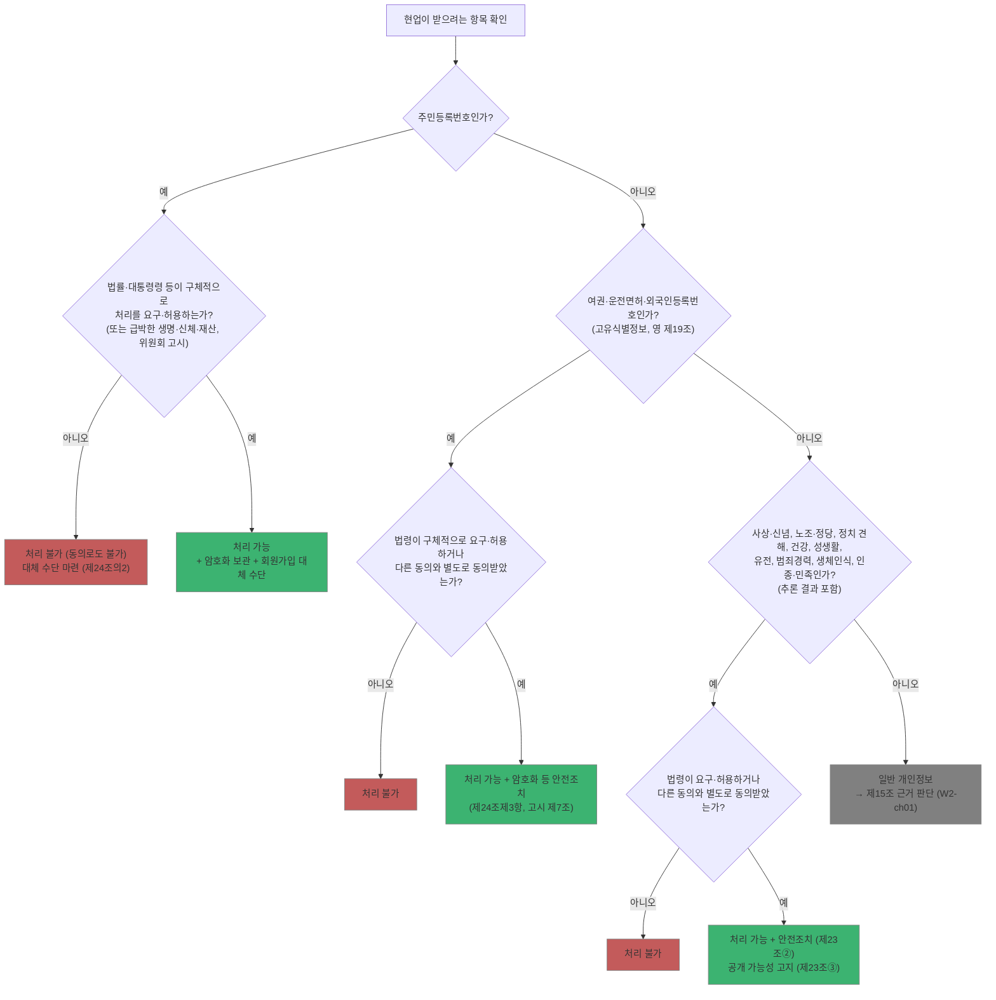

# Week 2 · Ch02. 민감정보·고유식별정보·주민등록번호 처리 제한

> [← 이전 챕터](./ch01_수집_이용의_적법_근거.md) · [📚 전체 목차](../../README.md) · [다음 챕터 →](./ch03_제3자_제공과_처리위탁_구분.md)

| 항목 | 내용 |
|---|---|
| 예상 학습 시간 | 75분 |
| 법령 기준일 | 2026-11-17 |
| 핵심 근거 | 개인정보 보호법 제23조, 제24조, 제24조의2 / 시행령 제18조, 제19조, 제21조, 제21조의2 / 안전성 확보조치 기준 제7조 |
| 관련 용어 | [민감정보](../../용어집.md#민감정보), [고유식별정보](../../용어집.md#고유식별정보), [주민등록번호 처리 제한](../../용어집.md#주민등록번호-처리-제한), [생체인식정보](../../용어집.md#생체인식정보), [암호화](../../용어집.md#암호화), [행태정보](../../용어집.md#행태정보) |
| 선수 챕터 | [W2-ch01 수집·이용의 적법 근거](./ch01_수집_이용의_적법_근거.md) |

---

## 1. 학습 목표

이 챕터를 마치면 담당자님은 다음을 할 수 있습니다.

1. **민감정보·고유식별정보·주민등록번호**의 범위를 시행령 목록으로 구분할 수 있다.
2. 세 유형마다 **처리할 수 있는 요건**(별도 동의, 법령 근거의 수준)과 **안전조치 의무**를 판단할 수 있다.
3. 현업 요청 항목이 이 유형에 해당하는지 확인하고 **처리 가능 여부**를 회신할 수 있다.

---

## 2. 한 줄 비유

> 💡 **일반 개인정보가 "일반 우편"이라면, 민감정보·고유식별정보는 "등기 우편"(별도 서명 필요), 주민등록번호는 "법원 송달 서류"(법이 허락한 경우에만 취급)입니다.**

단, 비유의 한계가 있습니다. 등기 우편은 서명만 받으면 되지만, 주민등록번호는 **정보주체가 동의해도 처리할 수 없습니다.** 법령이 구체적으로 요구하거나 허용해야 합니다. 이 차이가 이 챕터의 핵심입니다.

---

## 3. 개념 설명 및 법령 조문

### 3-1. 세 유형 한눈에 비교

| 구분 | 민감정보 | 고유식별정보 | 주민등록번호 |
|---|---|---|---|
| **범위** | 사상·신념, 노조·정당 가입·탈퇴, 정치적 견해, **건강**, 성생활 + 시행령: **유전정보**, **범죄경력자료**, 특정 개인을 알아볼 목적으로 기술적으로 생성한 **생체인식정보**, **인종·민족** | **주민등록번호, 여권번호, 운전면허번호, 외국인등록번호** (4종) | 주민등록번호 (고유식별정보 중 가장 엄격) |
| **원칙** | 처리 금지 | 처리 금지 | 처리 금지 |
| **예외 ① 동의** | ✅ 다른 동의와 **별도로** 동의 | ✅ 다른 동의와 **별도로** 동의 | ❌ **동의로는 불가** |
| **예외 ② 법령** | 법령에서 처리를 **요구하거나 허용** | 법령에서 **구체적으로** 처리를 요구하거나 허용 | **법률·대통령령**·국회규칙·대법원규칙 등에서 **구체적으로** 요구·허용 / 급박한 생명·신체·재산 보호 / 위원회 고시로 정한 경우 |
| **안전조치** | 법 제29조에 따른 안전조치 (제23조제2항) | 시행령으로 정한 **암호화 등** 안전조치 (제24조제3항) | **암호화하여 보관** (제24조의2제2항) + 회원가입 시 **대체 수단 제공** (제3항) |
| **위반 시** | 과징금 대상 (법 제64조의2제1항제3호) | 과징금 대상 (제4호) | 과징금 대상 (제4호) |

근거 원문은 각주를 참고하세요.[^law-23-24] [^decree-18-19]

### 3-2. 관련 조문

> 📌 **조문 주소 읽는 법**: 조 → 항(①②) → 호(1. 2.) → 목(가. 나.). 자세한 설명은 [W1-ch01 3-2](../1주차_개인정보_기초/ch01_개인정보의_정의와_판단_기준.md#3-2-관련-조문)를 보세요.

#### 📜 개인정보 보호법 제23조 (민감정보의 처리 제한) + 시행령 제18조

| 구분 | 내용 |
|---|---|
| **원문 요지** | ① 사상·신념, 노동조합·정당의 가입·탈퇴, 정치적 견해, 건강, 성생활 등에 관한 정보, 그 밖에 사생활을 현저히 침해할 우려가 있는 정보로서 시행령으로 정하는 정보(민감정보)를 처리해서는 안 된다. 단, 1. 제15조제2항 또는 제17조제2항의 사항을 알리고 **다른 개인정보의 처리에 대한 동의와 별도로 동의**를 받은 경우 2. **법령에서 민감정보의 처리를 요구하거나 허용**하는 경우는 예외다. ② 민감정보를 처리하는 경우 유출등이 되지 않도록 제29조에 따른 **안전조치**를 해야 한다. ③ 재화·서비스 제공 과정에서 **공개되는 정보에 민감정보가 포함**되어 사생활 침해 위험이 있으면, 제공 전에 **공개 가능성과 비공개 선택 방법**을 알기 쉽게 알려야 한다. / (영 제18조) 1. 유전자검사 등으로 얻은 **유전정보** 2. **범죄경력자료** 3. 신체적·생리적·행동적 특징에 관한 정보로서 **특정 개인을 알아볼 목적**으로 기술적 수단을 통해 생성한 정보 4. **인종·민족** 정보 |
| **쉬운 풀이** | "알려지면 차별받거나 사생활이 크게 침해될 수 있는 정보"입니다. 일반 동의서 안에 섞지 말고 **따로 떼어** 동의받거나, 법령 근거가 있어야 합니다. |
| **시행일** | 2026. 9. 11. 시행 법률 제21445호 기준 (제2항 <개정 2026. 3. 10.>, 제3항 <신설 2023. 3. 14.>) |
| **실무 포인트** | 민감정보는 **직접 묻지 않아도 생깁니다.** 행태정보를 분석해 종교·정치 성향·성적 지향을 **추론**하면 그 결과가 민감정보입니다(6절 메타 사례). 건강 앱의 복약 기록, 사원 병가 사유, 장애인 고용 관련 정보도 '건강' 정보에 해당할 수 있습니다. `[출처: 일반 지식, 원문 확인 권장]` |

근거 원문은 각주를 참고하세요.[^law-23-24] [^decree-18-19]

> 💡 **생체정보와 생체인식정보의 차이**: 안전조치 고시는 지문·얼굴·홍채·정맥·음성·필적 등 신체적·생리적·행동적 특징 정보를 "**생체정보**"라 하고, 그중 **특정 개인을 인증 또는 식별할 목적**으로 기술적 수단을 통해 처리되는 정보를 "**생체인식정보**"라고 정의합니다.[^safety-2] 얼굴 사진 자체는 생체정보지만, 얼굴인식 출입 시스템에 쓰는 **얼굴 특징값(템플릿)**은 생체인식정보이자 민감정보(영 제18조제3호)가 됩니다. ⚠️ 이 구분의 구체적 적용은 해석 사항이니 사안별로 확인하세요.

#### 📜 개인정보 보호법 제24조 (고유식별정보의 처리 제한) + 시행령 제19조·제21조

| 구분 | 내용 |
|---|---|
| **원문 요지** | ① 법령에 따라 개인을 고유하게 구별하기 위해 부여된 식별정보로서 시행령으로 정한 정보(고유식별정보)는 1. 제15조제2항 또는 제17조제2항 사항을 알리고 **다른 동의와 별도로 동의**를 받은 경우 2. 법령에서 **구체적으로** 처리를 요구하거나 허용하는 경우 외에는 처리할 수 없다. ③ 처리하는 경우 유출등이 되지 않도록 시행령에 따라 **암호화 등** 안전조치를 해야 한다. ④ 위원회는 일정 기준 처리자의 안전조치 이행 여부를 **정기적으로 조사**한다. / (영 제19조) 1. 주민등록번호 2. 여권번호 3. 운전면허 면허번호 4. 외국인등록번호 / (영 제21조) 정기조사 대상: 1만 명 이상 처리 공공기관, **공공기관 외 5만 명 이상 처리자** 등, **3년마다 1회 이상** 조사. 개인정보 보호 인증 등을 받으면 조사를 실시한 것으로 본다. |
| **쉬운 풀이** | 번호 하나로 "그 사람"이 확정되는 정보 4종입니다. 민감정보와 달리 법령 근거는 "**구체적으로**" 요구·허용해야 합니다. |
| **시행일** | 2026. 9. 11. 시행 법률 제21445호 / 2026. 11. 10. 시행 대통령령 제36804호 기준 |
| **실무 포인트** | 렌터카처럼 **법령이 면허 확인을 요구하는 업종**이 아니라면 운전면허번호를 받을 이유가 거의 없습니다. 신분 확인이 필요하면 **번호를 저장하지 않고 확인만** 하는 방법(대면 확인, 본인인증 서비스)을 먼저 검토하세요. `[출처: 일반 지식, 원문 확인 권장]` |

근거 원문은 각주를 참고하세요.[^law-23-24] [^decree-18-19] [^decree-21]

#### 📜 개인정보 보호법 제24조의2 (주민등록번호 처리의 제한) + 시행령 제21조의2

| 구분 | 내용 |
|---|---|
| **원문 요지** | ① 제24조제1항에도 불구하고 다음 경우 외에는 주민등록번호를 처리할 수 없다. 1. **법률·대통령령·국회규칙·대법원규칙·헌법재판소규칙·중앙선거관리위원회규칙 및 감사원규칙**에서 **구체적으로** 처리를 요구하거나 허용한 경우 2. 정보주체 또는 제3자의 **급박한 생명·신체·재산**의 이익을 위해 명백히 필요한 경우 3. 제1호·제2호에 준해 불가피한 경우로서 **위원회가 고시**로 정하는 경우. ② 주민등록번호가 유출등이 되지 않도록 **암호화 조치를 통하여 안전하게 보관**해야 한다. ③ 제1항에 따라 처리하는 경우에도 **인터넷 홈페이지 회원가입 단계**에서는 주민등록번호 없이도 가입할 수 있는 방법을 제공해야 한다. / (영 제21조의2) 암호화 대상: 주민등록번호를 **전자적인 방법으로 보관**하는 처리자 (적용 시기: 100만 명 미만 2017. 1. 1., 100만 명 이상 2018. 1. 1.) |
| **쉬운 풀이** | 주민등록번호에는 **동의 예외가 없습니다.** 법률이나 대통령령 등이 "주민등록번호를 처리하라(해도 된다)"고 **구체적으로** 적어 둔 경우에만 처리합니다. 처리하더라도 전자 파일이면 **반드시 암호화**해야 합니다. |
| **시행일** | 2026. 9. 11. 시행 법률 제21445호 기준 (제2항 <개정 2026. 3. 10.>) |
| **실무 포인트** | 현업이 주민등록번호를 받겠다고 하면 **"어느 법률(또는 대통령령) 몇 조에 근거가 있나요?"**를 먼저 묻고, 조문을 받아 확인하세요. 시행규칙·고시·내부 규정·계약서는 제1호의 근거가 될 수 없습니다(제3호의 위원회 고시는 별도 예외). |

근거 원문은 각주를 참고하세요.[^law-24-2] [^decree-21-2]

#### 📜 안전성 확보조치 기준 제7조 (암호화) — 이 챕터 관련 부분

| 대상 | 기준 | 조항 |
|---|---|---|
| **이용자**의 주민·여권·운전면허·외국인등록번호, 신용카드·계좌번호, 생체인식정보 | 저장 시 **암호화** | 제7조제2항 |
| 이용자가 아닌 정보주체(예: 직원)의 **고유식별정보**를 인터넷망·DMZ에 저장 | **암호화** | 제7조제3항제1호 |
| 이용자가 아닌 정보주체의 고유식별정보를 **내부망**에 저장 | **주민등록번호는 암호화**. 그 외 고유식별정보는 영향평가 결과 또는 **위험도 분석** 결과에 따라 적용 여부·범위 결정 | 제7조제3항제2호 |
| 업무용 **PC·모바일·USB**에 저장 | **이용자**의 개인정보(종류 불문)와 이용자가 아닌 정보주체의 **고유식별정보·생체인식정보**는 **암호화** | 제7조제5항 |

근거 원문은 각주를 참고하세요.[^safety-7] 암호화 방법과 실습은 [W3-ch03](../3주차_보호조치_실습/ch03_암호화.md)에서 다룹니다.

> 🕒 **시행 예정 (2027. 3. 9.)**: AI 개발 특례에 따라 위원회 심의·의결을 받으면 제23조·제24조·제24조의2 등 일부 조항의 적용이 제외될 수 있습니다(제28조의15). 위원회 심의·의결과 위험요인평가가 전제됩니다. → [W4-ch04](../4주차_사고대응과_새로운_이슈/ch04_AI와_생성형_AI_도입.md) [출처: 개인정보 보호법(법률)(제21445호)(20260911).pdf, 제28조의12~제28조의15 `[시행일: 2027. 3. 9.]`]

---

## 4. 사내 실무 적용

### 🎭 상황극 1. 고객센터의 "본인 확인하려면 주민번호 뒷자리가 필요해요"

> **📨 고객센터 문 팀장**: "전화로 주문 취소나 배송지 변경을 요청하는 고객이 본인인지 확인하려고 **주민등록번호 뒷자리 7자리**를 묻고 시스템에 입력하고 있어요. 고객도 동의하고 말해 주니까 괜찮죠?"

**🙋 담당자 답변**

| 구분 | 내용 |
|---|---|
| **결론** | ❌ **불가** — 주민등록번호는 고객이 동의해도 처리할 수 없습니다. 쇼핑몰의 전화 본인 확인에 주민등록번호 처리를 **구체적으로 요구·허용하는 법령**이 없다면 즉시 중단해야 합니다. |
| **근거** | 개인정보 보호법 제24조의2제1항(동의 예외 없음, 법률·대통령령 등의 구체적 근거 필요), 제64조의2제1항제4호(위반 시 과징금 대상) |
| **다음 행동** | ① 주민등록번호 질문과 입력을 **즉시 중단**하도록 상담 스크립트를 바꿉니다. ② 대체 확인 수단(가입 휴대전화로 인증번호 발송, 주문번호 + 수령인 이름 확인 등)을 정합니다. ③ 이미 입력된 주민등록번호를 **찾아서 파기**하고 파기 기록을 남깁니다(제21조). ④ 상담 녹취에 주민등록번호가 녹음되어 있는지도 확인해 처리 방안을 정합니다. ⑤ 같은 관행이 다른 부서(반품, A/S, 정산)에도 있는지 점검합니다. |

**왜 그런가요?** 제24조의2제1항에는 제15조나 제23조·제24조와 달리 **"정보주체의 동의를 받은 경우"라는 예외가 아예 없습니다.** "뒷자리만" 받는 것도 주민등록번호의 처리입니다. ⚠️ 주민등록번호의 일부만 처리하는 경우의 판단은 참고자료에서 직접 확인하지 못했습니다. 실무상 안전하게 **주민등록번호 처리로 보고** 대응하세요. `[출처: 일반 지식, 원문 확인 권장]`

### 🎭 상황극 2. 총무팀의 "얼굴인식 출입 시스템을 도입하려고요"

> **📨 총무팀 배 과장**: "사원증을 자꾸 잃어버려서 본사 출입 게이트를 **얼굴인식**으로 바꾸려고 해요. 전 직원 얼굴을 등록하면 되는데, 회사 출입 관리니까 동의는 따로 필요 없죠?"

**🙋 담당자 답변**

| 구분 | 내용 |
|---|---|
| **결론** | ⚠️ **조건부 가능** — 얼굴인식용 특징 정보는 **생체인식정보 = 민감정보**입니다. 다른 동의와 **별도로 동의**를 받거나 법령상 근거가 있어야 하고, 동의하지 않는 직원을 위한 **대체 수단**(사원증)을 남겨야 합니다. 저장 시 **암호화**도 필수입니다. |
| **근거** | 개인정보 보호법 제23조제1항(별도 동의 또는 법령 근거), 시행령 제18조제3호(특정 개인을 알아볼 목적으로 기술적 수단을 통해 생성한 정보), 안전조치 고시 제2조제10호(생체인식정보), 제7조(생체인식정보 암호화) |
| **다음 행동** | ① 목적(출입 통제), 항목(얼굴 특징값), 보유기간(퇴사 시 즉시 삭제 등), 거부권과 **거부 시 대체 수단**을 적은 **별도 동의서**를 만듭니다. ② 원본 얼굴 사진을 저장하는지, **특징값(템플릿)만** 저장하는지 공급업체에 확인합니다. 원본 보관은 최소화합니다. ③ 저장 위치(단말기, 서버, 클라우드)와 **암호화** 여부를 확인합니다. ④ 업체가 데이터를 관리하면 **처리위탁** 계약을 맺습니다 → [W2-ch03](./ch03_제3자_제공과_처리위탁_구분.md) ⑤ 사내 처리방침에 반영합니다. |

**왜 그런가요?** 출입 관리가 정당한 목적이더라도, 얼굴 특징값은 시행령이 정한 민감정보입니다. 민감정보에는 계약 이행이나 정당한 이익 근거가 적용되지 않고 **별도 동의 또는 법령 근거**만 인정됩니다(제23조제1항 각 호). 또 근로 관계에서는 직원이 거절하기 어려우므로, 대체 수단이 있어야 **자유로운 의사**에 따른 동의가 됩니다(영 제17조제1항제1호). 위원회도 **근태 관리용 안면·지문 정보**는 별도 동의나 법령 근거 없이는 쓸 수 없다고 보고(Q77), 안면인식 출입을 도입할 때는 원하지 않는 사람이 **출입카드·비밀번호 등 대체 수단**으로 출입할 수 있어야 한다고 안내합니다(Q80, 헬스장 고객 사례). 일반 얼굴 사진은 민감정보가 아니지만, 인증·식별 목적으로 기술적으로 처리하면 민감정보가 됩니다(Q76). [출처: 1. 개인정보 질의응답 모음집(2025.12.).pdf, Q76 (인쇄 p.89), Q77 (인쇄 p.90), Q80 (인쇄 p.93)] ⚠️ 근로 관계에서 동의가 자유로운지를 직접 다룬 위원회 해석은 찾지 못했습니다. 대체 수단 요구는 고객 사례(Q80)를 직원에게 적용한 이 교재의 해석입니다.

---

## 5. 처리 요건 판별 플로우

**그림 읽는 법**: **가장 엄격한 것부터** 묻습니다(주민등록번호 → 고유식별정보 → 민감정보 → 일반). 주민등록번호 경로에는 "동의" 분기가 **없다**는 점이 핵심입니다. 녹색으로 끝나도 안전조치(암호화 등)가 함께 따라옵니다.

---

## 6. 개인정보보호위원회 처분 사례

### ⚖️ 사례: 메타의 합법 근거 없는 민감정보 수집·활용 (2024. 11. 의결)

| 단계 | 내용 |
|---|---|
| **사건 개요** | 메타는 과거 페이스북 프로필로 국내 이용자 **약 98만 명**의 종교관·정치관, 동성과 결혼 여부 등 **민감정보**를 수집했습니다. 또 이용자가 '좋아요'를 누른 페이지, 클릭한 광고 등 **행태정보를 분석**해 특정 종교, 동성애, 트랜스젠더, 북한이탈주민 등 **민감정보 관련 광고 주제**를 만들어 운영했습니다. 이 정보를 광고주에게 제공해 **약 4,000개 광고주**가 이용했습니다. 데이터 정책에 불분명하게 적기만 하고 **별도 동의를 받지 않았고** 추가 보호조치도 없었습니다. 이 밖에 이용자의 개인정보 열람 요구를 정당한 사유 없이 거절했습니다. 또 사용하지 않는 계정 복구 페이지를 방치해, 위조 신분증으로 타인 계정 비밀번호가 재설정되어 이용자 10명의 개인정보가 유출되었습니다. |
| **위반 조항** | 보도자료 표 기준 (舊 보호법): 민감정보의 처리 제한 **§23①**, 안전조치의무 **§29**, 개인정보의 열람 **§35③** |
| **처분 결과** | 과징금 **216억 1,300만 원**, 과태료 **1,020만 원** (합계 216억 2,320만 원), 시정명령(민감정보 처리 시 합법 근거 마련, 안전성 확보조치, 열람 요구에 성실히 응할 것) |
| **교훈** | ① 민감정보는 **직접 묻지 않아도 생깁니다.** 행태정보를 분석해 종교·정치 성향 등을 **추론**하는 순간 민감정보를 처리하는 것입니다. ② 데이터 정책에 "적어 두는 것"은 **별도 동의**가 아닙니다(제23조제1항제1호). ③ 해외 글로벌 사업자에게도 우리 법의 민감정보 규정이 똑같이 적용됩니다. ④ 회사는 조사 중 수집을 중단(2021. 8.)하고 광고 주제를 파기(2022. 3.)하는 등 자진 시정했지만 처분을 피하지는 못했습니다. |
| **출처** | 개인정보보호위원회 보도자료, 「개인정보위, 합법 처리근거 없이 민감정보를 수집·활용한 메타 제재」(2024. 11. 4. 의결, 11. 5. 보도)[^case-meta] |

> 💬 **사수의 한마디**: 우리 회사 마케팅팀이 고객을 "세그먼트"로 나누고 있다면 세그먼트 이름 목록을 받아 보세요. "임산부 추정", "당뇨 관심", "특정 종교 행사 관심" 같은 이름이 있다면 **추론된 민감정보**일 수 있습니다. 이 사례가 정확히 그 문제였습니다.

---

## 7. 오답노트

| # | ❌ 잘못된 생각 | ✅ 올바른 이해 | 근거 조문 |
|---|---|---|---|
| 1 | "고객이 동의하면 주민등록번호도 받을 수 있어요." | 주민등록번호는 **동의 예외가 없습니다.** 법률·대통령령 등이 구체적으로 요구·허용하거나 급박한 생명·신체·재산 보호, 위원회 고시에 해당해야 합니다. | 법 제24조의2제1항 |
| 2 | "민감정보 동의는 일반 동의서에 한 줄 추가하면 되죠." | 민감정보·고유식별정보는 **다른 개인정보 처리에 대한 동의와 별도로** 동의받아야 합니다. | 법 제23조제1항제1호, 제24조제1항제1호, 제22조제1항제5호·제6호 |
| 3 | "고객이 직접 알려 준 게 아니라 우리가 분석해서 추정한 거니까 민감정보가 아니에요." | 행태정보 분석으로 종교·정치 성향·성적 지향 등을 **추론**해 처리하면 민감정보 처리입니다. 메타는 이 문제로 216억 원의 과징금을 받았습니다. | 법 제23조제1항 |
| 4 | "사내망 엑셀이니까 주민등록번호를 암호화 안 해도 돼요." | 주민등록번호를 **전자적인 방법으로 보관**하는 처리자는 모두 암호화 대상입니다. 내부망이라도 주민등록번호는 암호화해야 합니다. | 법 제24조의2제2항, 영 제21조의2제1항, 안전조치 고시 제7조제3항제2호 |
| 5 | "얼굴 사진은 그냥 사진이니까 일반 개인정보죠." | 얼굴 사진 자체는 생체정보지만, **특정 개인을 알아볼 목적으로 기술적 수단을 통해 생성한 정보**(얼굴인식 특징값 등)는 시행령상 민감정보입니다. | 영 제18조제3호, 안전조치 고시 제2조제9호·제10호 |
| 6 | "시행규칙이나 업무 매뉴얼에 주민번호를 받으라고 되어 있으니 근거가 있는 거예요." | 주민등록번호 처리 근거는 **법률·대통령령·국회규칙·대법원규칙·헌법재판소규칙·중앙선거관리위원회규칙·감사원규칙**의 **구체적** 규정이어야 합니다. 시행규칙·내부 매뉴얼은 해당하지 않습니다. | 법 제24조의2제1항제1호 |

---

## 8. 업무 체크리스트

**📋 민감정보·고유식별정보·주민등록번호 처리 현황 점검표**

| 점검 주기 | 연 1회 전수 점검 + 신규 양식·시스템 도입 시 | 점검자 | 개인정보보호 담당자 | 점검일 | ____-__-__ |
|---|---|---|---|---|---|

- [ ] 사내 모든 수집 양식·시스템에서 **주민등록번호 수집 항목**을 찾아 목록화했다
- [ ] 주민등록번호 항목마다 **근거 법령(법률·대통령령 등)의 조문 번호**를 확인해 적었고, 근거가 없는 항목은 중단·파기했다 (법 제24조의2제1항)
- [ ] 홈페이지 회원가입에서 **주민등록번호 없이 가입**할 수 있다 (제24조의2제3항)
- [ ] 전자적으로 보관하는 주민등록번호가 **모두 암호화**되어 있다 (DB, 엑셀, 첨부파일, 백업 포함) (제24조의2제2항, 영 제21조의2)
- [ ] 여권·운전면허·외국인등록번호를 받는 업무마다 **법령 근거 또는 별도 동의**가 있다 (제24조제1항)
- [ ] 건강·노조·정치·종교·생체인식 등 **민감정보 항목**을 찾아 목록화했고, 각각 **별도 동의서 또는 법령 근거**가 있다 (제23조제1항)
- [ ] 마케팅·분석 부서의 고객 세그먼트·프로파일에 **추론된 민감정보**가 있는지 확인했다
- [ ] 회원 프로필·게시판 등 **공개되는 화면**에 민감정보가 노출될 수 있으면, 제공 전에 공개 가능성과 비공개 방법을 안내한다 (제23조제3항)
- [ ] 생체인식정보(지문·얼굴인식 등)를 쓰는 시스템의 **저장 방식과 암호화** 여부를 확인했고, **대체 수단**이 있다 (안전조치 고시 제7조)
- [ ] 우리 회사가 **고유식별정보 5만 명 이상** 처리자인지 확인했다 (영 제21조제2항제3호, 위원회 정기조사 대상)

---

## 9. 실습 과제 / 퀴즈

### 객관식

**Q1.** 개인정보 보호법과 시행령상 **민감정보에 해당하지 않는 것**은?

1. 노동조합 가입·탈퇴에 관한 정보
2. 「형의 실효 등에 관한 법률」에 따른 범죄경력자료에 해당하는 정보
3. 인종이나 민족에 관한 정보
4. 최종 학력과 졸업 학교 정보

**Q2.** 시행령 제19조에 따른 **고유식별정보가 아닌 것**은?

1. 여권번호
2. 운전면허의 면허번호
3. 외국인등록번호
4. 사내 인사시스템의 사원번호

**Q3.** 민간 기업이 주민등록번호를 처리할 수 있는 경우로 **옳은 것**은?

1. 정보주체에게 목적·항목·기간을 알리고 별도로 동의를 받은 경우
2. 법률 또는 대통령령에서 구체적으로 주민등록번호의 처리를 요구하거나 허용한 경우
3. 회사 내부 규정에 주민등록번호 수집 절차를 정해 둔 경우
4. 동종 업계 대부분이 본인 확인용으로 주민등록번호를 수집하는 경우

### 🛠️ 실습: 항목별 처리 가능 여부 판단

**Q4.** 아래 현업 요청마다 **① 정보 유형**(주민등록번호 / 고유식별정보 / 민감정보 / 일반 개인정보) **② 처리 가능 여부**(가능 / 조건부 가능 / 불가) **③ 필요한 조건 또는 대안**을 쓰세요.

| # | 부서 | 요청 내용 | ① 유형 | ② 가능 여부 | ③ 조건·대안 |
|---|---|---|---|---|---|
| 1 | 고객센터 | 전화 본인 확인용으로 주민등록번호 뒷자리 수집 | | | |
| 2 | 인사팀 | 신규 입사자의 원천징수·4대 보험 신고를 위한 주민등록번호 수집 | | | |
| 3 | 복지팀 | 임직원 건강검진 결과를 받아 맞춤형 건강관리 프로그램 제공 | | | |
| 4 | 마케팅팀 | 구매 이력으로 "임신 추정 고객" 세그먼트를 만들어 육아용품 광고 | | | |
| 5 | 총무팀 | 해외 출장자 항공권 발권을 위한 여권번호 수집 | | | |
| 6 | 영업팀 | B2B 고객사 담당자 명함의 이름·직함·회사 전화번호 저장 | | | |

> ✅ 다 풀었다면 [정답 및 해설](../../정답과_해설.md#w2-ch02)에서 확인하세요. 틀린 문제는 **7. 오답노트**에 한 줄씩 추가하세요.

---

## 10. 더 읽을거리

| 자료 | 발행 | 참고자료 파일명 | 이 챕터와의 관계 |
|---|---|---|---|
| 개인정보 보호법 | 법률 제21445호 | `개인정보 보호법(법률)(제21445호)(20260911).pdf` | 제23조, 제24조, 제24조의2, 제64조의2제1항제3호·제4호 |
| 개인정보 보호법 시행령 | 대통령령 제36804호 | `개인정보 보호법 시행령(대통령령)(제36804호)(20261110).pdf` | 제18조(민감정보 범위), 제19조(고유식별정보 범위), 제21조(정기조사), 제21조의2(주민등록번호 암호화) |
| 개인정보의 안전성 확보조치 기준 | 고시 제2026-9호 | `개인정보의 안전성 확보조치 기준(개인정보보호위원회고시)(제2026-9호)(20260701).pdf` | 제2조제9호·제10호(생체정보·생체인식정보), 제7조(암호화) |
| 개인정보의 안전성 확보조치 기준 안내서 | 개인정보보호위원회, 2026. 11. | `개인정보의 안전성 확보조치 기준 안내서(2026.11).pdf` | 제7조 해설(암호화 대상·방법), 부록 위험도 분석 기준 |
| 개인정보위 보도자료 (메타) | 개인정보보호위원회, 2024. 11. | `241105 (석간) 개인정보위  합법 처리근거 없이 민감정보를 수집·활용한 메타 제재(조사1과).pdf` | 6절 처분 사례 원문, p.3 위반 조항 표 |

---

> [← 이전 챕터](./ch01_수집_이용의_적법_근거.md) · [📚 전체 목차](../../README.md) · [📖 용어집](../../용어집.md) · [다음 챕터 →](./ch03_제3자_제공과_처리위탁_구분.md)

[^law-23-24]: [출처: [개인정보 보호법(법률)(제21445호)(20260911).pdf](<../../2_참고자료/개인정보 보호법(법률)(제21445호)(20260911).pdf>), 제23조제1항~제3항, 제24조제1항·제3항·제4항, 제64조의2제1항제3호·제4호]
[^decree-18-19]: [출처: [개인정보 보호법 시행령(대통령령)(제36804호)(20261110).pdf](<../../2_참고자료/개인정보 보호법 시행령(대통령령)(제36804호)(20261110).pdf>), 제18조제1호~제4호, 제19조제1호~제4호]
[^decree-21]: [출처: [개인정보 보호법 시행령(대통령령)(제36804호)(20261110).pdf](<../../2_참고자료/개인정보 보호법 시행령(대통령령)(제36804호)(20261110).pdf>), 제21조제2항~제4항]
[^law-24-2]: [출처: [개인정보 보호법(법률)(제21445호)(20260911).pdf](<../../2_참고자료/개인정보 보호법(법률)(제21445호)(20260911).pdf>), 제24조의2제1항~제3항]
[^decree-21-2]: [출처: [개인정보 보호법 시행령(대통령령)(제36804호)(20261110).pdf](<../../2_참고자료/개인정보 보호법 시행령(대통령령)(제36804호)(20261110).pdf>), 제21조의2제1항·제2항]
[^safety-2]: [출처: [개인정보의 안전성 확보조치 기준(개인정보보호위원회고시)(제2026-9호)(20260701).pdf](<../../2_참고자료/개인정보의 안전성 확보조치 기준(개인정보보호위원회고시)(제2026-9호)(20260701).pdf>), 제2조제9호·제10호]
[^safety-7]: [출처: [개인정보의 안전성 확보조치 기준(개인정보보호위원회고시)(제2026-9호)(20260701).pdf](<../../2_참고자료/개인정보의 안전성 확보조치 기준(개인정보보호위원회고시)(제2026-9호)(20260701).pdf>), 제7조제2항·제3항·제5항]
[^case-meta]: [출처: [241105 (석간) 개인정보위  합법 처리근거 없이 민감정보를 수집·활용한 메타 제재(조사1과).pdf](<../../2_참고자료/241105 (석간) 개인정보위  합법 처리근거 없이 민감정보를 수집·활용한 메타 제재(조사1과).pdf>), p.1 (처분 개요·98만 명·4,000개 광고주), p.2 (별도 동의 미수집, 자진 시정, 열람 거절, 유출 경위), p.3 (위반 조항 표·처분 내용)]
