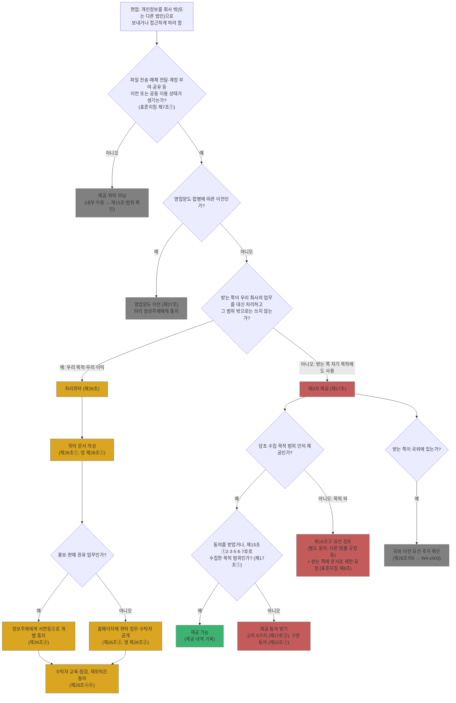

# Week 2 · Ch03. 제3자 제공과 처리위탁 구분

> [← 이전 챕터](./ch02_민감정보_고유식별정보_주민등록번호.md) · [📚 전체 목차](../../README.md) · [다음 챕터 →](./ch04_아동_개인정보_처리.md)

| 항목 | 내용 |
|---|---|
| 예상 학습 시간 | 90분 |
| 법령 기준일 | 2026-11-17 |
| 핵심 근거 | 개인정보 보호법 제17조, 제18조, 제19조, 제26조, 제27조 / 시행령 제28조 / 표준지침 제7조, 제8조, 제16조, 제17조 |
| 관련 용어 | [제3자 제공](../../용어집.md#제3자-제공), [처리위탁](../../용어집.md#처리위탁), [위탁자](../../용어집.md#위탁자), [수탁자](../../용어집.md#수탁자), [재수탁자](../../용어집.md#재수탁자), [목적 외 이용·제공](../../용어집.md#목적-외-이용제공), [추가적 이용·제공](../../용어집.md#추가적-이용제공) |
| 선수 챕터 | [W1-ch03 핵심 용어와 역할](../1주차_개인정보_기초/ch03_핵심_용어와_역할.md), [W2-ch01](./ch01_수집_이용의_적법_근거.md) |

---

## 1. 학습 목표

이 챕터를 마치면 담당자님은 다음을 할 수 있습니다.

1. **"누구의 목적과 이익을 위해 넘기는가"**를 기준으로 제3자 제공과 처리위탁을 구분할 수 있다.
2. 제공일 때 필요한 **동의 고지 5가지**와, 위탁일 때 필요한 **위탁 문서·공개·감독** 의무를 확인할 수 있다.
3. 현업의 데이터 이전 요청을 **판단 플로우차트**로 분류하고 다음 행동을 안내할 수 있다.

---

## 2. 한 줄 비유

> 💡 **처리위탁은 "우리 집 이삿짐을 이삿짐센터에 맡기는 것", 제3자 제공은 "우리 집 물건을 이웃에게 주는 것"입니다. 이삿짐센터는 짐을 옮기기만 하고 자기 집에 쓰면 안 되지만, 이웃은 받은 물건을 자기 용도로 씁니다.**

단, 비유의 한계가 있습니다. 이삿짐센터가 사고를 내면 **맡긴 사람도 책임**을 집니다(법 제26조제7항). 또 이웃에게 "줘도 된다"는 허락(동의)은 물건 주인인 **정보주체**에게서 받아야 합니다. 우리 회사가 마음대로 줄 수는 없습니다.

---

## 3. 개념 설명 및 법령 조문

### 3-1. 제공 vs 위탁 핵심 비교

| 구분 | 제3자 제공 | 처리위탁 |
|---|---|---|
| **누구의 목적·이익?** | **받는 쪽**의 목적·이익 (받은 쪽이 자기 업무에 사용) | **우리 회사**의 목적·이익 (받은 쪽은 우리 업무를 대신 처리) |
| **받는 쪽의 지위** | 독립된 개인정보처리자 (제3자) | 수탁자 (표준지침상 "제3자"에서 **제외**) |
| **관리·감독** | 받은 뒤에는 받는 쪽의 책임 (단, 목적 외 이용·제공 제한, 제19조) | 위탁자가 **교육·감독** 의무를 지고, 손해배상책임에서 수탁자는 **위탁자의 소속 직원**으로 봄 |
| **정보주체에게** | **동의**(고지 5가지) 또는 법률상 근거 | 위탁 업무 내용과 수탁자를 **공개**. 홍보·판매 권유 위탁은 **개별 통지** |
| **필요한 문서** | (동의서) + 제공 계약 등 | 법정 사항이 들어간 **위탁 문서** |
| **사내 예시** | 제휴 보험사 마케팅용 명단 전달, 그룹 계열사 공동 마케팅, 경찰의 법적 요청에 따른 제공 | 택배사 배송, 콜센터 대행, 급여 아웃소싱, 클라우드 운영 대행, 경품 발송 대행 |
| **근거** | 법 제17조, 제18조, 제19조 | 법 제26조, 영 제28조 |

> ⚠️ 확인 필요: "누구의 목적·이익을 위한 것인가"로 제공과 위탁을 가르는 기준은 법조문에 정의로 적혀 있지 않습니다. 법 제26조제5항(수탁자는 위탁받은 업무 범위를 초과해 이용·제공 금지)과 표준지침 제7조제2항(제3자에서 수탁자 제외)의 취지에서 나온 **실무상 판단 기준**입니다. `[출처: 일반 지식, 원문 확인 권장]` 관련 원문은 각주를 참고하세요.[^std-7]

### 3-2. 관련 조문

> 📌 **조문 주소 읽는 법**: 조 → 항(①②) → 호(1. 2.) → 목(가. 나.). 자세한 설명은 [W1-ch01 3-2](../1주차_개인정보_기초/ch01_개인정보의_정의와_판단_기준.md#3-2-관련-조문)를 보세요.

#### 📜 표준지침 제7조 (개인정보의 제공) — "제공"과 "제3자"의 뜻

| 구분 | 내용 |
|---|---|
| **원문 요지** | ① "제공"이란 저장 매체나 출력물·책자의 **물리적 이전**, 네트워크를 통한 **전송**, 제3자에게 **접근권한 부여**, 처리자와 제3자의 **공유** 등 개인정보의 **이전 또는 공동 이용 상태를 초래하는 모든 행위**를 말한다. ② 법 제17조의 "제3자"란 정보주체와 그 정보를 수집·보유한 처리자를 **제외한 모든 자**를 의미하며, 정보주체의 대리인(명백히 대리 범위 내)과 **법 제26조제2항에 따른 수탁자는 제외**한다. ③ 제공받는 자를 알릴 때는 그 **성명(명칭)과 연락처**를 함께 알려야 한다. |
| **쉬운 풀이** | 파일을 보내는 것만 제공이 아닙니다. 상대방에게 **우리 시스템 계정을 열어 주는 것**도 제공입니다. 그리고 **수탁자는 제3자가 아니므로** 수탁자에게 넘기는 것은 제17조의 제공이 아니라 제26조의 위탁으로 규율됩니다. |
| **시행일** | 2025. 4. 11. 시행 고시 제2025-4호 기준 |

근거 원문은 각주를 참고하세요.[^std-7]

#### 📜 개인정보 보호법 제17조 (개인정보의 제공)

| 구분 | 내용 |
|---|---|
| **원문 요지** | ① 다음 경우 제3자에게 **제공(공유 포함)**할 수 있다. 1. 정보주체의 **동의**를 받은 경우 2. 제15조제1항**제2호, 제3호 및 제5호부터 제7호**까지에 따라 수집한 목적 범위에서 제공하는 경우. ② 동의를 받을 때 알릴 사항: 1. **제공받는 자** 2. 제공받는 자의 **이용 목적** 3. 제공하는 **항목** 4. 제공받는 자의 **보유·이용 기간** 5. **거부권**과 거부 시 불이익. ④ 당초 수집 목적과 **합리적으로 관련된 범위**에서 시행령 기준에 따라 동의 없이 제공할 수 있다(추가적 제공). |
| **쉬운 풀이** | 제공은 원칙적으로 **동의**가 필요합니다. 동의 없이 제공하려면 법령상 의무, 급박한 생명·신체·재산 보호, 정당한 이익, 공중위생 긴급 등의 근거로 수집한 정보를 **그 목적 범위에서** 제공하는 경우여야 합니다. |
| **시행일** | 2026. 9. 11. 시행 법률 제21445호 기준 (제3항 삭제 <2023. 3. 14.>, 제4항 <신설 2020. 2. 4.>) |
| **실무 포인트** | ⚠️ 제1항제2호의 목록에 **제15조제1항제4호(계약 이행)가 없습니다.** 계약 이행 근거로 수집한 정보를 제3자에게 **제공**할 때는 이 호로 처리할 수 없습니다. 계약 이행을 위해 남에게 넘겨야 한다면 그것이 실제로는 **위탁**인지 먼저 따져 보세요. 위탁이 아닌 제공이라면 동의 등 다른 근거가 필요합니다. |

근거 원문은 각주를 참고하세요.[^law-17]

#### 📜 개인정보 보호법 제18조·제19조 (목적 외 제공, 제공받은 자의 제한)

| 구분 | 내용 |
|---|---|
| **원문 요지** | (제18조) ① 제15조제1항·제17조제1항·제28조의8제1항의 범위를 **초과하여** 이용하거나 제3자에게 제공해서는 안 된다. ② 단, **별도의 동의**, **다른 법률의 특별한 규정**, 급박한 생명·신체·재산 이익 등의 경우에는 정보주체 또는 제3자의 이익을 부당하게 침해할 우려가 있을 때를 제외하고 목적 외 이용·제공이 가능하다(제5호~제9호는 공공기관만). (제19조) 제공받은 자는 **별도 동의** 또는 **다른 법률의 특별한 규정**이 없으면 제공받은 목적 외로 이용하거나 다시 제3자에게 제공해서는 안 된다. |
| **쉬운 풀이** | 수사기관 요청처럼 **처음 수집 목적과 다른** 제공은 제18조 문제입니다. 그리고 우리가 준 정보를 받은 회사가 또 다른 곳에 넘기는 것은 제19조가 막습니다. |
| **시행일** | 2026. 9. 11. 시행 법률 제21445호 기준 |
| **실무 포인트** | 목적 외 제공을 할 때는 받는 쪽에 이용 목적·방법·기간·형태를 제한하거나 안전조치를 마련하도록 **문서로 요청**하고, 책임관계를 명확히 해야 합니다(표준지침 제8조). |

근거 원문은 각주를 참고하세요.[^law-18-19] [^std-8]

#### 📜 개인정보 보호법 제26조 (업무위탁에 따른 처리 제한) + 시행령 제28조

| 항 | 원문 요지 | 실무 포인트 |
|---|---|---|
| ① + 영 제28조제1항 | 위탁은 다음 내용이 포함된 **문서**로 해야 한다: 1. 위탁업무 수행 **목적 외 처리 금지** 2. **기술적·관리적 보호조치** 3. (시행령) 위탁업무의 **목적·범위**, **재위탁 제한**, **접근 제한 등 안전성 확보 조치**, 관리 현황 **점검 등 감독**, 의무 위반 시 **손해배상 등 책임** | 위탁 계약서(또는 부속 합의서)에 이 7개 사항이 모두 있는지 체크 |
| ② + 영 제28조제2항·제3항 | 위탁 업무 내용과 **수탁자(재수탁자 포함)**를 정보주체가 언제든 쉽게 확인할 수 있게 **공개**. 원칙은 **홈페이지에 지속적으로 게재**. 홈페이지가 없으면 사업장 게시, 신문, 정기 간행물, 계약서 기재 등 | 처리방침의 "위탁 현황" 표를 최신으로 유지 → [W2-ch06](./ch06_개인정보_처리방침_작성_실습.md) |
| ③ + 영 제28조제4항·제5항 | **홍보·판매 권유 업무**를 위탁하면 위탁 업무 내용과 수탁자를 정보주체에게 **서면등의 방법으로 알려야** 함(변경 시에도). 과실 없이 알릴 수 없으면 홈페이지 **30일 이상** 게재 | 텔레마케팅 대행은 **공개만으로 부족**. 개별 통지 필요 |
| ④ + 영 제28조제6항 | 유출등이 되지 않도록 수탁자를 **교육**하고, **처리 현황 점검** 등으로 감독 | 연 1회 이상 교육 자료 제공·점검 체크리스트 회수 기록 |
| ⑤ | 수탁자는 위탁받은 업무 범위를 **초과하여 이용·제공 금지** | 수탁자가 우리 고객 정보로 자기 영업을 하면 위반 |
| ⑥ | **재위탁** 시 위탁자의 **동의** 필요 | 재위탁 승인 절차를 계약서에 명시 |
| ⑦ | 손해배상책임에서 수탁자를 위탁자의 **소속 직원**으로 봄 | 위탁해도 책임은 같이 짐 |
| ⑧ | 수탁자에게 처리자 의무 다수 **준용**(제15조~제18조, 제29조, 제31조, 제34조 등) | 수탁자도 안전조치·CPO·유출 통지 의무가 있음 |

근거 원문은 각주를 참고하세요.[^law-26] [^decree-28] 표준지침은 수탁자를 선정할 때 **인력·물적 시설·재정 부담 능력·기술 보유 정도·책임능력** 등 개인정보 처리·보호 역량을 종합적으로 고려하라고 정합니다(제16조). 또 수탁자는 안전성 확보조치 기준 고시에 따른 조치를 해야 합니다(제17조).[^std-16-17]

#### 📜 개인정보 보호법 제27조 (영업양도 등에 따른 이전)

| 구분 | 내용 |
|---|---|
| **원문 요지** | 영업의 전부 또는 일부의 **양도·합병** 등으로 개인정보를 다른 사람에게 이전하는 경우, **미리** 이전 사실 등을 시행령이 정한 방법(서면등의 방법)으로 정보주체에게 알려야 한다. |
| **쉬운 풀이** | 사업부 매각·합병은 제공도 위탁도 아닌 **세 번째 유형**입니다. 동의 대신 **사전 통지**가 핵심입니다. |
| **실무 포인트** | 사업 양수도 일정이 잡히면 법무팀과 **통지 일정**을 함께 잡으세요. 세부 통지 사항은 법 제27조 원문을 확인하세요. |

근거 원문은 각주를 참고하세요.[^law-27]

---

## 4. 사내 실무 적용

### 🎭 상황극 1. 마케팅팀의 "배송업체에 넘기는 것도 제3자 제공 동의를 받아야죠?"

> **📨 마케팅팀 강 대리**: "지난번 이벤트 당첨자 주소를 **경품 발송 대행사**에 넘겨야 해요. 그리고 같이 이벤트를 한 **제휴 화장품 회사**도 응모자 명단을 달라고 해요. 자기네 신제품 샘플을 보내고 싶대요. 둘 다 '제3자 제공 동의'를 한꺼번에 받으면 되죠?"

**🙋 담당자 답변**

| 구분 | 내용 |
|---|---|
| **결론** | ⚠️ **두 건을 나눠서 처리** — 발송 대행사는 **처리위탁**(동의 불필요, 위탁 문서 + 공개), 제휴 화장품 회사는 **제3자 제공**(별도 동의 필요)입니다. |
| **근거** | 개인정보 보호법 제26조제1항·제2항(위탁 문서, 공개), 제17조제1항제1호·제2항(제공 동의와 고지 5가지), 제22조제1항제2호(제공 동의는 구분해서), 표준지침 제7조제2항(수탁자는 제3자가 아님) |
| **다음 행동** | **[발송 대행사]** ① 위탁 계약서에 영 제28조제1항의 사항이 있는지 확인합니다. ② 처리방침의 위탁 현황에 추가합니다. ③ 발송 완료 후 파기 확인서를 받습니다. **[제휴 화장품 회사]** ① 응모자에게 **선택** 제공 동의를 받습니다. 고지 사항은 제공받는 자(명칭·연락처), 이용 목적(신제품 샘플 발송·광고), 항목, 제공받는 자의 보유기간, 거부권입니다. ② 동의한 응모자 정보만 넘깁니다. ③ 이미 받은 응모자 전원 명단을 그대로 넘기면 **동의 없는 제3자 제공**이 됩니다. |

**왜 그런가요?** 발송 대행사는 **우리 회사의 경품 발송 업무**를 대신하므로 수탁자입니다. 제휴 화장품 회사는 **자기 회사 신제품 홍보**라는 자기 목적으로 받으므로 제3자입니다. 동의 없는 제3자 제공은 과징금 대상(법 제64조의2제1항제1호)이자 형사처벌 대상(제71조제1호)입니다.

### 🎭 상황극 2. IT팀의 "협력사에 우리 CRM 계정만 열어 주면 파일을 넘기는 게 아니니까 괜찮죠?"

> **📨 IT팀 신 과장**: "AS 접수를 외부 수리 협력사가 맡게 됐어요. 고객 파일을 보내는 대신 **우리 CRM 시스템에 협력사 직원 계정**을 만들어 주려고요. 데이터를 넘기는 게 아니니까 제공도 위탁도 아니죠?"

**🙋 담당자 답변**

| 구분 | 내용 |
|---|---|
| **결론** | ⚠️ **조건부 가능** — 계정을 열어 주는 것도 개인정보의 **이전·공동 이용 상태**를 만듭니다. 이 경우는 우리 회사의 AS 업무를 대신하므로 **처리위탁**입니다. 위탁 절차와 접근통제를 모두 갖춰야 합니다. |
| **근거** | 표준지침 제7조제1항(접근권한 부여도 제공 행위의 한 형태), 제7조제2항(수탁자는 제3자에서 제외), 법 제26조(위탁), 안전성 확보조치 기준 제5조(접근 권한 최소·차등 부여, 계정 공유 금지) |
| **다음 행동** | ① 협력사와 **위탁 계약**(영 제28조제1항 사항 포함)을 맺고 처리방침에 공개합니다. ② 협력사 직원마다 **개별 계정**을 발급하고, AS 처리에 필요한 화면·항목만 볼 수 있게 **권한을 최소화**합니다(예: 연락처·주소·제품 정보만, 결제 정보는 차단). ③ 접속기록을 남기고 정기 점검 대상에 넣습니다 → [W3-ch02](../3주차_보호조치_실습/ch02_접근권한_관리와_접근통제.md) ④ 계약 종료나 인력 교체 시 **즉시 계정 말소**합니다. ⑤ 수탁자 교육과 연 1회 점검 일정을 잡습니다. |

**왜 그런가요?** 표준지침은 "제3자의 접근권한 부여"도 제공 행위의 한 형태로 봅니다. "파일을 안 보냈으니 괜찮다"는 생각은 틀렸습니다. 다만 협력사가 우리 업무를 대신하는 **수탁자**라면 제17조가 아니라 제26조의 위탁 규율을 받습니다.

---

## 5. 제공·위탁 판단 플로우차트 (사내 표준)

**그림 읽는 법**: 핵심 질문은 가운데의 **"받는 쪽이 우리 업무를 대신 처리하고 그 범위 밖으로는 쓰지 않는가?"** 하나입니다. 황색(위탁)은 **문서·공개·감독**, 적색(제공)은 **동의 또는 법적 근거**가 필요합니다. 받는 쪽이 해외에 있으면 위탁이든 제공이든 **국외 이전 요건**이 추가됩니다(그림에서는 제공 쪽에만 표시했지만 위탁도 같습니다).

---

## 6. 개인정보보호위원회 처분 사례

### ⚖️ 사례: 카카오페이·애플·알리페이 (2025. 1. 의결) — "제공과 위탁의 구분" 관점

> 이 사례는 [W1-ch02](../1주차_개인정보_기초/ch02_개인정보_법체계_지도.md#6-개인정보보호위원회-처분-사례)에서 "법체계(보호법과 신용정보법)" 관점으로 봤습니다. 여기서는 **한 사건 안에 제공 관계와 위탁 관계가 함께 있는 구조**로 다시 봅니다.

| 단계 | 내용 |
|---|---|
| **사건 구조** | 보도자료의 사건 개념도는 관계를 이렇게 나눕니다. **카카오페이 → 애플: 제3자 제공 관계**. **애플 → 알리페이: 위수탁 관계**(애플이 NSF 점수 산출을 포함한 결제 처리 업무를 알리페이에 위탁). 카카오페이가 알리페이에 데이터를 직접 보냈더라도, 법적으로는 **애플(제공받는 자)의 수탁자에게 보낸 것**이므로 애플에 대한 제공으로 본 것입니다. |
| **각 회사의 문제** | **카카오페이**: 애플 결제 이용자가 아닌 사람까지 포함한 전체 이용자 약 4천만 명의 정보를 **제3자 제공 동의와 국외이전 동의 없이** 전송 / **애플**: 알리페이에 처리를 위탁하면서 처리방침 등으로 **국외 위탁 사실과 수탁자를 공개하지 않음**(NHN KCP만 공개) / **알리페이**: 위법하게 받은 정보로 NSF 점수 산출 모델을 구축 |
| **위반 조항** | 보도자료에는 조항 번호가 없습니다. 카카오페이의 행위는 "적법 처리 근거 없는 국외이전", 애플의 행위는 "국외 수탁자 미공개·미고지(과징금)", "위탁 사실 미공개(과태료)"로 설명됩니다. ⚠️ 확인 필요: 적용 조항은 의결서로 확인하세요. 동의 없는 제3자 제공 부분은 금융위원회가 신용정보법에 따라 별도 처분할 예정이라고 밝혔습니다. |
| **처분 결과** | 카카오페이 과징금 59억 6,800만 원·시정명령·공표명령 / 애플 과징금 24억 500만 원·과태료 220만 원·시정명령(알리페이에 대한 국외이전(위탁) 사실을 처리방침 등에 공개)·공표명령 / 알리페이 NSF 점수 산출 모델 **파기** 시정명령 |
| **교훈** | ① **데이터가 실제로 어디로 흘렀는지**가 아니라 **누구의 목적을 위한 이전인지**로 관계를 판단합니다. ② 위탁도 **공개 의무**를 빠뜨리면 처분 대상입니다. 애플은 위탁 미공개로 과징금과 과태료를 함께 받았습니다. ③ 제공하는 쪽은 **필요한 범위**만 넘겨야 합니다. 애플 결제 이용자는 20% 미만이었는데 전체 이용자 정보를 보냈습니다. |
| **출처** | 개인정보보호위원회 보도자료, 「개인정보위, 개인정보 무단 국외 이전한 카카오페이·애플에 총 83억 7,520만 원 과징금·과태료 부과」(2025. 1. 22. 의결, 1. 23. 보도)[^case-kakaopay] |

> 💬 **사수의 한마디**: 제휴 계약서를 검토할 때 **"데이터 흐름도"**를 꼭 그려 보세요. 화살표마다 "누구의 목적인가?"를 적으면 제공인지 위탁인지 바로 보입니다. 이 사건도 흐름도 한 장으로 정리됩니다.

---

## 7. 오답노트

| # | ❌ 잘못된 생각 | ✅ 올바른 이해 | 근거 조문 |
|---|---|---|---|
| 1 | "회사 밖으로 나가면 다 제3자 제공이니 동의를 받아야죠." | 우리 업무를 대신 처리하는 **수탁자는 제3자가 아닙니다.** 위탁은 동의가 아니라 **위탁 문서·공개·감독**이 필요합니다. 불필요한 "제공 동의"는 정보주체를 혼란스럽게 하고, 거부하면 업무를 못 하는 문제도 생깁니다. | 표준지침 제7조제2항, 법 제26조 |
| 2 | "파일을 보낸 게 아니라 계정만 열어 줬으니 제공이 아니에요." | 제3자에게 **접근권한을 부여**하는 것도 이전·공동 이용 상태를 만드는 행위입니다. | 표준지침 제7조제1항 |
| 3 | "같은 그룹 계열사니까 제3자가 아니에요." | 계열사도 **별개 법인**이면 정보를 수집·보유한 처리자 외의 자이므로 제3자입니다. 계열사가 자기 목적으로 쓰면 제공, 우리 업무를 대신하면 위탁입니다. `[출처: 일반 지식, 원문 확인 권장]` | 표준지침 제7조제2항, 법 제17조 |
| 4 | "위탁했으니 사고 나면 수탁자 책임이죠." | 위탁자는 수탁자를 **교육·감독**해야 하고, 손해배상책임에서 수탁자는 **위탁자의 소속 직원**으로 봅니다. 수탁자 관리 소홀은 과징금 대상이기도 합니다. | 법 제26조제4항·제7항, 제64조의2제1항제5호 |
| 5 | "텔레마케팅 대행사도 위탁이니까 홈페이지에 공개만 하면 돼요." | **홍보·판매 권유 업무 위탁**은 정보주체에게 **서면등의 방법으로 개별 통지**해야 합니다. | 법 제26조제3항, 영 제28조제4항 |
| 6 | "계약 이행에 필요한 정보니까 제휴사에 동의 없이 넘겨도 돼요." | 동의 없는 제공 근거(제17조제1항제2호)에는 **계약 이행(제15조제1항제4호)이 빠져 있습니다.** 계약 이행을 위해 넘긴다면 그 관계가 위탁인지 먼저 확인하고, 제공이라면 동의 등 다른 근거가 필요합니다. | 법 제17조제1항제2호 |

---

## 8. 업무 체크리스트

**📋 제공·위탁 관리 셀프 점검표**

| 점검 주기 | 신규 계약 체결·갱신 시 + 연 1회 전수 점검 | 점검자 | 개인정보보호 담당자 | 점검일 | ____-__-__ |
|---|---|---|---|---|---|

**[공통]**
- [ ] 회사 밖으로 개인정보가 나가는 모든 흐름(파일 전송, 계정 부여, API 연동, 공유 폴더)을 **데이터 흐름 목록**으로 정리했다 (표준지침 제7조제1항)
- [ ] 흐름마다 **제공 / 위탁 / 영업양도** 중 무엇인지 판단하고 근거를 적었다

**[위탁]**
- [ ] 수탁자마다 위탁 계약서에 **목적 외 처리 금지, 기술적·관리적 보호조치, 목적·범위, 재위탁 제한, 접근 제한 등 안전조치, 점검 등 감독, 손해배상 책임** 7개 사항이 있다 (법 제26조제1항, 영 제28조제1항)
- [ ] 처리방침(홈페이지)에 **수탁자와 위탁 업무 내용**이 최신으로 공개되어 있다. 재수탁자도 포함한다 (제26조제2항, 영 제28조제2항)
- [ ] 홍보·판매 권유 위탁은 정보주체에게 **개별 통지**했다 (제26조제3항)
- [ ] 수탁자별 **연 1회 이상 교육 자료 제공·처리 현황 점검** 기록이 있다 (제26조제4항)
- [ ] 수탁자의 **재위탁 요청과 우리 회사의 동의** 기록이 있다 (제26조제6항)
- [ ] 위탁 종료 시 **반환·파기 확인서**를 받는다
- [ ] 수탁자를 선정할 때 개인정보 보호 역량(인력, 시설, 재정, 기술, 책임능력)을 평가했다 (표준지침 제16조)

**[제공]**
- [ ] 제공마다 **동의(고지 5가지 + 구분 동의)** 또는 **법적 근거**가 기록되어 있다 (법 제17조)
- [ ] 동의서의 "제공받는 자"에 **명칭과 연락처**가 있다 (표준지침 제7조제3항)
- [ ] 수사기관 등 **목적 외 제공** 요청은 근거 법률 조문을 확인하고, 받는 쪽에 **문서로 제한 사항을 요청**하며, 제공 내역을 기록한다 (법 제18조, 표준지침 제8조)

---

## 9. 실습 과제 / 퀴즈

### 객관식

**Q1.** 다음 중 개인정보 **처리위탁**에 해당하는 것은?

1. 제휴 보험사가 자사 상품 안내를 위해 우리 회원 중 동의자 명단을 받는 경우
2. 택배사가 우리 쇼핑몰의 주문 상품 배송을 위해 수령인 주소를 받는 경우
3. 그룹 계열 카드사가 자사 카드 발급 마케팅을 위해 우리 회원 정보를 받는 경우
4. 경찰이 수사를 위해 법률에 근거해 특정 회원의 정보를 요청하는 경우

**Q2.** 정보주체에게 **제3자 제공 동의**를 받을 때 법 제17조제2항에 따라 알려야 하는 사항이 **아닌 것**은?

1. 개인정보를 제공받는 자
2. 제공받는 자의 개인정보 이용 목적
3. 제공받는 자의 개인정보 보유 및 이용 기간
4. 제공받는 자의 최근 3년간 매출액

**Q3.** 우리 회사가 텔레마케팅 업체에 **신상품 판매 권유 전화 업무**를 위탁했습니다. 법 제26조에 따라 **추가로** 해야 하는 일은?

1. 정보주체 전원에게서 제3자 제공 동의를 받는다.
2. 위탁 업무 내용과 수탁자를 정보주체에게 서면등의 방법으로 알린다.
3. 개인정보보호위원회에 위탁 사실을 신고한다.
4. 아무것도 필요 없다. 위탁이기 때문이다.

### 🛠️ 실습: 제공·위탁 구분하기

**Q4.** 아래 사례를 **제3자 제공 / 처리위탁 / 영업양도 이전 / 해당 없음** 중 하나로 분류하고, **필요한 조치**를 쓰세요. 5절 플로우차트를 따라 판단하세요.

| # | 사례 | 분류 | 필요한 조치 |
|---|---|---|---|
| 1 | 급여 계산·지급 업무를 외부 노무법인에 맡기고 직원 급여 정보를 보냄 | | |
| 2 | 공동 이벤트를 한 제휴사가 응모자 명단을 받아 자사 뉴스레터를 보냄 | | |
| 3 | 회원 DB를 국내 클라우드 사업자 서버에 저장하고, 클라우드 사업자는 서버 운영만 함 | | |
| 4 | 온라인 쇼핑몰 사업부를 다른 회사에 매각하면서 회원 DB를 넘김 | | |
| 5 | 콜센터 대행사가 우리 고객 상담 중 알게 된 연락처로 자기 회사 부업(보험 대리점) 영업을 함 | | |
| 6 | 법원의 문서제출명령에 따라 특정 고객의 주문 기록을 제출 | | |
| 7 | 우리 회사 마케팅팀이 CS팀 상담 기록을 받아 고객 만족도 분석에 사용 | | |
| 8 | AS 협력사 직원에게 우리 CRM 조회 계정을 발급 (AS 처리용) | | |

> ✅ 다 풀었다면 [정답 및 해설](../../정답과_해설.md#w2-ch03)에서 확인하세요. 틀린 문제는 **7. 오답노트**에 한 줄씩 추가하세요.

---

## 10. 더 읽을거리

| 자료 | 발행 | 참고자료 파일명 | 이 챕터와의 관계 |
|---|---|---|---|
| 개인정보 보호법 | 법률 제21445호 | `개인정보 보호법(법률)(제21445호)(20260911).pdf` | 제17조~제19조, 제26조, 제27조 |
| 개인정보 보호법 시행령 | 대통령령 제36804호 | `개인정보 보호법 시행령(대통령령)(제36804호)(20261110).pdf` | 제28조(위탁 문서 사항·공개 방법), 제29조(영업양도 통지) |
| 표준 개인정보 보호지침 | 고시 제2025-4호 | `표준 개인정보 보호지침(개인정보보호위원회고시)(제2025-4호)(20250411).pdf` | 제7조(제공·제3자의 뜻), 제8조(목적 외 제공), 제16조·제17조(수탁자 선정·보호조치) |
| 2026 개인정보 처리방침 작성지침 | 개인정보보호위원회, 2026. 4. | `2026 개인정보 처리방침 작성지침.pdf` | 처리방침의 제3자 제공·위탁 현황 작성 방법 → W2-ch06 |
| 개인정보위 보도자료 (카카오페이·애플) | 개인정보보호위원회, 2025. 1. | `250123 (석간) 개인정보위, 개인정보 무단 국외 이전한 카카오페이·애플에 총 83억 7,520만 원 과징금·과태료 부과(조사3팀).pdf` | p.2 사건 개념도(제공 관계·위수탁 관계) |
| 개인정보위 보도자료 (테무) | 개인정보보호위원회, 2025. 5. | `250515 (석간) 국외이전 규정 등 개인정보 보호법 위반한 테무에 13억 6,900만 원 과징금 부과(조사1과).pdf` | 수탁자 관리·감독 미실시, 위탁 미공개 사례 → W1-ch03 |

---

> [← 이전 챕터](./ch02_민감정보_고유식별정보_주민등록번호.md) · [📚 전체 목차](../../README.md) · [📖 용어집](../../용어집.md) · [다음 챕터 →](./ch04_아동_개인정보_처리.md)

[^std-7]: [출처: [표준 개인정보 보호지침(개인정보보호위원회고시)(제2025-4호)(20250411).pdf](<../../2_참고자료/표준 개인정보 보호지침(개인정보보호위원회고시)(제2025-4호)(20250411).pdf>), 제7조제1항~제3항] / [출처: [개인정보 보호법(법률)(제21445호)(20260911).pdf](<../../2_참고자료/개인정보 보호법(법률)(제21445호)(20260911).pdf>), 제26조제5항]
[^law-17]: [출처: [개인정보 보호법(법률)(제21445호)(20260911).pdf](<../../2_참고자료/개인정보 보호법(법률)(제21445호)(20260911).pdf>), 제17조제1항·제2항·제4항 (제3항 삭제 <2023. 3. 14.>)]
[^law-18-19]: [출처: [개인정보 보호법(법률)(제21445호)(20260911).pdf](<../../2_참고자료/개인정보 보호법(법률)(제21445호)(20260911).pdf>), 제18조제1항·제2항, 제19조]
[^std-8]: [출처: [표준 개인정보 보호지침(개인정보보호위원회고시)(제2025-4호)(20250411).pdf](<../../2_참고자료/표준 개인정보 보호지침(개인정보보호위원회고시)(제2025-4호)(20250411).pdf>), 제8조제1항~제3항]
[^law-26]: [출처: [개인정보 보호법(법률)(제21445호)(20260911).pdf](<../../2_참고자료/개인정보 보호법(법률)(제21445호)(20260911).pdf>), 제26조제1항~제8항]
[^decree-28]: [출처: [개인정보 보호법 시행령(대통령령)(제36804호)(20261110).pdf](<../../2_참고자료/개인정보 보호법 시행령(대통령령)(제36804호)(20261110).pdf>), 제28조제1항~제6항]
[^std-16-17]: [출처: [표준 개인정보 보호지침(개인정보보호위원회고시)(제2025-4호)(20250411).pdf](<../../2_참고자료/표준 개인정보 보호지침(개인정보보호위원회고시)(제2025-4호)(20250411).pdf>), 제16조, 제17조]
[^law-27]: [출처: [개인정보 보호법(법률)(제21445호)(20260911).pdf](<../../2_참고자료/개인정보 보호법(법률)(제21445호)(20260911).pdf>), 제27조제1항] / [출처: [개인정보 보호법 시행령(대통령령)(제36804호)(20261110).pdf](<../../2_참고자료/개인정보 보호법 시행령(대통령령)(제36804호)(20261110).pdf>), 제29조제1항]
[^case-kakaopay]: [출처: [250123 (석간) 개인정보위, 개인정보 무단 국외 이전한 카카오페이·애플에 총 83억 7,520만 원 과징금·과태료 부과(조사3팀).pdf](<../../2_참고자료/250123 (석간) 개인정보위, 개인정보 무단 국외 이전한 카카오페이·애플에 총 83억 7,520만 원 과징금·과태료 부과(조사3팀).pdf>), p.2 「사건 개념도: 카카오페이-애플(제3자 제공 관계), 애플-알리페이(위수탁 관계)」, p.3 (애플의 처리방침 미공개, 처분), p.4 (애플 과징금·과태료, 알리페이 시정명령, 금융위원회 별도 처분 예정)]
