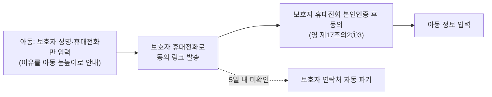
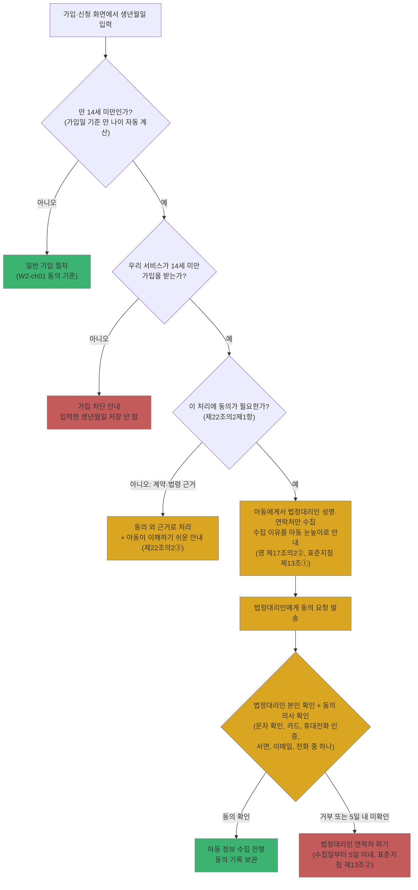

# Week 2 · Ch04. 아동(만 14세 미만) 개인정보 처리

> [← 이전 챕터](./ch03_제3자_제공과_처리위탁_구분.md) · [📚 전체 목차](../../README.md) · [다음 챕터 →](./ch05_보유기간_관리와_파기.md)

| 항목 | 내용 |
|---|---|
| 예상 학습 시간 | 65분 |
| 법령 기준일 | 2026-11-17 |
| 핵심 근거 | 개인정보 보호법 제22조의2, 제38조제2항, 제64조의2제1항제2호 / 시행령 제17조의2 / 표준지침 제13조 / 2026 개인정보 처리방침 작성지침 |
| 관련 용어 | [아동 (만 14세 미만)](../../용어집.md#아동), [법정대리인 동의](../../용어집.md#법정대리인-동의), [동의](../../용어집.md#동의), [행태정보](../../용어집.md#행태정보), [열람](../../용어집.md#열람) |
| 선수 챕터 | [W2-ch01 수집·이용의 적법 근거](./ch01_수집_이용의_적법_근거.md) |

> [!IMPORTANT]
> **🎯 이 챕터 핵심 3줄**
> 1. 만 14세 미만 아동은 **법정대리인 동의를 받고, 그 동의를 확인**해야 합니다. 체크박스는 확인이 아닙니다.
> 2. 아동에게서 먼저 받을 수 있는 건 **법정대리인 성명·연락처뿐**이고, 동의가 확인되지 않으면 **5일 이내 파기**합니다.
> 3. 위반하면 과태료가 아니라 **과징금** 대상입니다.

---

## 1. 학습 목표

이 챕터를 마치면 담당자님은 다음을 할 수 있습니다.

1. 만 14세 미만 아동의 개인정보를 처리할 때 **법정대리인 동의가 필요한 경우와 확인 방법**을 설명할 수 있다.
2. 법정대리인 동의를 받기 위해 아동에게서 받을 수 있는 **최소 정보와 그 파기 기한**을 확인할 수 있다.
3. 아동 대상 서비스의 **법정대리인 동의 절차**를 설계할 수 있다.

---

## 2. 한 줄 비유

> [!TIP]
> 💡 아동의 개인정보는 **"놀이공원 보호자 동반 놀이기구"**와 같습니다. 아이가 타고 싶다고 해도 보호자가 함께 왔는지 확인해야 탈 수 있고, 매표소에서는 보호자를 부르는 데 필요한 정보만 아이에게 물어볼 수 있습니다.

단, 비유의 한계가 있습니다.

- 법정대리인 동의는 **"동의가 필요한 처리"**에만 필요합니다.
- 계약 이행이나 법령상 의무처럼 동의가 아닌 근거로 처리하는 정보에는 법정대리인 동의 규정이 그대로 적용되지 않습니다(제22조의2제1항 "이 법에 따른 동의를 받아야 할 때에는").

> [!WARNING]
> ⚠️ 다만 아동이 **스스로 계약을 맺을 수 있는지**는 민법 문제로, 이 교재 범위를 벗어납니다. `[출처: 일반 지식, 원문 확인 권장]`

---

## 3. 개념 설명 및 법령 조문

### 3-1. 관련 조문

> [!NOTE]
> 📌 **조문 주소 읽는 법**: 조 → 항(①②) → 호(1. 2.) → 목(가. 나.). 자세한 설명은 [W1-ch01 3-2](../1주차_개인정보_기초/ch01_개인정보의_정의와_판단_기준.md#3-2-관련-조문)를 보세요.

> 아래 법 조문은 모두 **2026. 9. 11. 시행 법률 제21445호** 기준입니다. 시행령은 **2026. 11. 10. 시행 대통령령 제36804호** 기준입니다.

#### 📜 제22조의2 (아동의 개인정보 보호)

| 항 | 핵심 |
|---|---|
| ① | 동의가 필요할 때 **법정대리인 동의**를 받고, 동의했는지 **확인** |
| ② | 동의를 받기 위한 **최소 정보**는 아동에게서 직접 수집 가능 |
| ③ | 아동에게는 **이해하기 쉬운 양식과 언어**로 고지 |
| ④ | 동의·확인 방법은 시행령으로 |

- **뜻**: 동의를 **받는 것**과 **확인하는 것**은 다른 의무입니다. 아동이 "엄마가 허락했어요"라고 체크하는 것만으로는 **확인**이 아닙니다.
- **시행일 메모**: [본조신설 2023. 3. 14.]

> [!TIP]
> **실무 포인트**: 위반하면 **과징금** 대상입니다(법 제64조의2제1항제2호: "법정대리인의 동의를 받지 아니하고 만 14세 미만인 아동의 개인정보를 처리한 경우"). 과태료가 아니라 과징금이라는 점에서 위원회가 이 의무를 얼마나 무겁게 보는지 알 수 있습니다.

📖 원문 요지 보기

- ① 만 14세 미만 아동의 개인정보를 처리하기 위하여 이 법에 따른 동의를 받아야 할 때에는 그 법정대리인의 동의를 받아야 하며, 법정대리인이 동의하였는지를 확인하여야 한다.
- ② 법정대리인의 동의를 받기 위하여 필요한 최소한의 정보로서 시행령으로 정하는 정보는 법정대리인의 동의 없이 해당 아동으로부터 직접 수집할 수 있다.
- ③ 만 14세 미만 아동에게 개인정보 처리 관련 고지 등을 할 때에는 이해하기 쉬운 양식과 명확하고 알기 쉬운 언어를 사용하여야 한다.
- ④ 동의 및 동의 확인 방법은 시행령으로 정한다.

근거 원문은 각주를 참고하세요.[^law-22-2]

#### 📜 시행령 제17조의2 (아동의 개인정보 보호)

**법정대리인 동의 확인 방법 7가지** (어느 하나)

| # | 방법 |
|---|---|
| 1 | 사이트 동의 표시 → 법정대리인 **휴대전화 문자**로 확인 사실 알림 |
| 2 | 사이트 동의 표시 + 법정대리인 **카드정보** 제공 |
| 3 | 사이트 동의 표시 + 법정대리인 **휴대전화 본인인증** 등 |
| 4 | **서면** 전달 → 법정대리인 **서명날인** 후 제출 |
| 5 | **전자우편** 발송 → 동의 의사 적힌 회신 |
| 6 | **전화**로 동의, 또는 인터넷주소 안내 후 **다시 전화**로 동의 |
| 7 | 그 밖에 이에 준하는 방법 |

- **공통점**: 일곱 가지 모두 **"법정대리인 본인이 직접 의사를 표시했다는 증거가 남는다"**는 것입니다.
- **아동에게서 받을 수 있는 정보** (제2항): **법정대리인의 성명 및 연락처**
- **시행일 메모**: [본조신설 2023. 9. 12.]

> [!TIP]
> **실무 포인트**: 처리방침에는 법령 문구를 나열하지 말고 **우리 회사가 실제로 쓰는 확인 방법**을 적어야 합니다(작성지침 p.31).[^policy-p31]

📖 원문 요지 보기

- ① 법정대리인의 동의 확인 방법 (어느 하나): 1. 동의 내용을 게재한 사이트에 법정대리인이 동의 표시 → 확인 사실을 법정대리인 휴대전화 문자메시지로 알림 2. 사이트 동의 표시 + 법정대리인의 신용카드·직불카드 등 카드정보 제공 3. 사이트 동의 표시 + 법정대리인 휴대전화 본인인증 등 4. 동의 내용 서면을 직접 발급·우편·팩스로 전달하고 법정대리인이 서명날인 후 제출 5. 동의 내용 전자우편 발송 → 동의 의사가 적힌 전자우편 회신 6. 전화로 동의 내용을 알리고 동의를 받거나, 인터넷주소 등을 안내하고 다시 전화로 동의를 받음 7. 그 밖에 이에 준하는 방법.
- ② 법정대리인 동의 없이 아동에게서 직접 받을 수 있는 정보: 법정대리인의 성명 및 연락처.
- ③ 수집 매체 특성상 동의 내용을 전부 표시하기 어려우면 인터넷주소나 사업장 전화번호 등 확인 방법을 안내할 수 있다.

근거 원문은 각주를 참고하세요.[^decree-17-2]

#### 📜 표준지침 제13조 (법정대리인의 동의)

- **알릴 것** (제1항): 법정대리인 성명·연락처를 받을 때 아동에게 **회사의 신분과 연락처, 수집하려는 이유**를 알립니다.
- **목적 제한·파기** (제2항): 부모님 연락처는 **동의 요청용**으로만 쓰고, 동의가 거부되거나 확인되지 않으면 **수집일로부터 5일 이내 파기**합니다. 그 번호로 광고를 보내면 안 됩니다.
- **시행일**: 2025. 4. 11. 시행 고시 제2025-4호 기준

> [!TIP]
> **실무 포인트**: 시스템에 **"법정대리인 동의 대기" 상태와 5일 자동 파기 배치**를 만들어 두세요. 사람이 기억해서 지우는 방식은 반드시 누락이 생깁니다.

📖 원문 요지 보기

- ① 법정대리인의 성명·연락처를 수집할 때는 해당 아동에게 자신의 신분과 연락처, 법정대리인의 성명과 연락처를 수집하려는 이유를 알려야 한다.
- ② 그렇게 수집한 법정대리인의 개인정보는 법정대리인의 동의를 얻기 위한 목적으로만 이용해야 하며, 동의 거부가 있거나 동의 의사가 확인되지 않으면 수집일로부터 5일 이내에 파기해야 한다.

근거 원문은 각주를 참고하세요.[^std-13]

#### 📜 제38조제2항 (법정대리인의 권리 행사)

- **뜻**: 만 14세 미만 아동의 법정대리인은 아동 개인정보의 **열람등요구**(열람·전송·정정·삭제·처리정지·동의 철회·자동화된 결정 거부·설명 요구)를 할 수 있습니다.
- **작성지침 예시**: "14세 미만 아동의 권리 행사는 **법정대리인이 직접** 해야 하며, 14세 이상의 미성년자는 **본인이 직접** 또는 **법정대리인을 통하여** 권리를 행사할 수 있다"[^policy-p68]

| 나이 | 권리 행사 |
|---|---|
| 만 14세 미만 | 법정대리인이 직접 |
| 만 14세 이상 미성년자 | 본인 직접 또는 법정대리인을 통해 |

> [!TIP]
> **실무 포인트**: 법정대리인의 요구를 받으면 **법정대리인 관계 확인**(가족관계 확인 서류 등)이 필요합니다. 확인 절차는 [W4-ch02](../4주차_사고대응과_새로운_이슈/ch02_정보주체_권리_행사_대응.md)에서 다룹니다.

근거 원문은 각주를 참고하세요.[^law-38]

### 3-2. 아동 서비스 운영 시 추가로 챙길 것

| 항목 | 핵심 | 근거 |
|---|---|---|
| **아동용 처리방침** | 주 이용자가 아동이면 **따로 마련** 권장 | 작성지침 p.31[^policy-p31] |
| **처리방침 기재 사항** | 법정대리인 동의용 처리 정보 + **실제 확인 방법** | 작성지침 p.31 |
| **맞춤형 광고** | 아동 행태정보는 법정대리인 사전 동의 없이 **맞춤형 광고에 쓰지 않음** | 작성지침 p.59, p.62[^policy-p59] |
| **14세 이상 청소년** | 눈높이에 맞는 표현 | 작성지침 p.32 |
| **나이 확인** | 생년월일 입력, 본인인증 결과 활용이 일반적 | ⚠️ `[출처: 일반 지식, 원문 확인 권장]` |

📖 항목별 상세 보기

- **아동용 처리방침**: 서비스의 주된 이용 대상이 14세 미만 아동이면 아동용 개인정보 처리방침을 따로 마련하는 것을 권장합니다. 작성지침 부록에 '아동을 위한 개인정보 처리방침 작성방안 및 예시'가 있습니다.
- **처리방침 기재 사항**: 법정대리인 동의를 받기 위해 처리하는 개인정보(법정대리인 성명, 휴대전화번호 등)를 기재합니다. 법정대리인 동의를 받아 수집한다는 사실과 실제 확인 방법을 구분해 기재하도록 권장합니다.
- **맞춤형 광고**: 작성지침의 작성 예시는 "14세 미만임을 알고 있는 아동에게 맞춤형 광고를 제공하려는 경우 사전에 법정대리인의 동의를 받고 … 이외에는 맞춤형 광고를 목적으로 아동의 행태정보를 수집하지 않"는다고 씁니다. 아동을 주 이용자로 하는 서비스는 아동 행태정보를 맞춤형 광고 목적으로 수집하지 않는다는 문구를 작성하도록 권고합니다.
- **14세 이상 청소년**: 청소년에게 안내할 때도 눈높이에 맞는 표현을 쓰도록 안내합니다.
- **나이 확인**: 법령은 연령 확인의 구체적 방법을 정하지 않습니다.

> [!NOTE]
> 💡 **"만 14세 미만"은 어떻게 계산하나요?** 오늘(기준일)을 기준으로 **만 나이 14세가 되지 않은 사람**입니다. 2026. 11. 17. 기준이면 **2012. 11. 18. 이후 출생자**가 만 14세 미만입니다. 학년이나 '연 나이'로 판단하면 안 됩니다. 시스템에서는 가입일 기준으로 자동 계산하세요. `[출처: 일반 지식, 원문 확인 권장]`

> [!WARNING]
> ⚠️ 확인 필요: 작성지침은 「아동청소년 개인정보 보호 가이드라인」(2024. 12.)을 참고자료로 인용합니다. 이 가이드라인은 참고자료에 없어 이 교재에서 직접 확인하지 못했습니다.

> ✅ **3절 한 줄 정리**: 법정대리인 연락처만 먼저 → 법정대리인 본인 확인·동의 → 그다음에 아동 정보. 안 되면 5일 내 파기.

---

## 4. 사내 실무 적용

> 결론 표시: 🟢 가능 · 🟡 조건부 가능 · 🔴 불가

### 🎭 상황극 1. 교육사업팀의 "초등학생 코딩 캠프 신청 받으려고요"

> **📨 교육사업팀 노 매니저**: "여름방학 **초등학생 코딩 캠프** 신청 페이지를 만들고 있어요. 아이 이름, 학교·학년, 생년월일, 알레르기 여부, 보호자 연락처를 받으려는데, 신청은 보통 아이가 직접 해요. 신청 화면에 '보호자 동의를 받았습니다' 체크박스를 넣으면 되죠?"

**🙋 담당자 판단**

| 결론 | 근거 |
|---|---|
| 🟡 **조건부 가능**: 체크박스는 **확인**이 아닙니다. 아동이 신청하면 **법정대리인 성명·연락처만** 먼저 받고, 법정대리인에게서 **직접** 동의를 받는 절차로 바꿔야 합니다. 알레르기 여부는 **민감정보(건강)**이므로 별도 동의가 필요합니다. | 법 제22조의2제1항·제2항, 시행령 제17조의2제1항·제2항, 표준지침 제13조, 법 제23조제1항(건강정보 = 민감정보) |

**✅ 다음 행동**

- [ ] **① 설계 변경 (가장 좋음)**: 신청 자체를 보호자 계정(보호자가 직접 신청)으로 받으면 법정대리인이 처음부터 직접 동의합니다.
- [ ] **② 아동 직접 신청 유지 시**: 아래 흐름처럼 법정대리인 연락처 → 본인인증 동의 → 아동 정보 순서로 받습니다.
- [ ] **③ 5일 자동 파기**: 5일 안에 동의가 확인되지 않으면 보호자 연락처를 자동 파기합니다.
- [ ] **④ 건강정보 별도 동의**: 알레르기 등 건강 정보는 별도 동의 항목으로 분리하고, 캠프 안전 관리 목적에 한정합니다.
- [ ] **⑤ 항목 재검토**: 학교·학년, 생년월일이 꼭 필요한지 다시 따져 봅니다(연령 확인용 생년월일은 필요할 수 있음).
- [ ] **⑥ 쉬운 말**: 신청 화면과 안내문은 초등학생이 이해할 수 있는 말로 씁니다(제22조의2제3항).

**💬 왜 그런가요?**

- 제22조의2제1항은 동의를 "받아야" 할 뿐 아니라 법정대리인이 동의했는지를 "**확인하여야**" 한다고 정합니다.
- 아동이 누르는 체크박스는 법정대리인의 의사를 확인한 증거가 될 수 없습니다.

### 🎭 상황극 2. 앱서비스팀의 "생년월일 입력에서 14세 미만이면 그냥 가입 막을래요"

> **📨 앱서비스팀 표 책임**: "법정대리인 동의 절차를 만들기가 번거로워서, 가입 화면에서 생년월일을 넣으면 **만 14세 미만은 가입을 막으려고** 해요. 그러면 아동 개인정보 문제는 아예 없는 거죠?"

**🙋 담당자 판단**

| 결론 | 근거 |
|---|---|
| 🟡 **조건부 가능**: 아동 대상 서비스가 아니라면 14세 미만 가입을 받지 않는 정책도 선택할 수 있습니다. 다만 ① 차단 과정에서 받은 **생년월일 처리**, ② 나이를 속이고 가입한 **아동을 알게 된 경우의 처리**, ③ **처리방침 안내**까지 정해야 "문제없음"이 됩니다. | 법 제22조의2제1항, 제16조제1항(최소 수집), 제21조제1항(불필요해진 정보의 파기), 작성지침 p.59(14세 미만임을 알고 있는 아동에 대한 맞춤형 광고 작성 예시) |

**✅ 다음 행동**

- [ ] **① 생년월일 미저장**: 14세 미만으로 판정되어 가입이 막힌 경우 입력된 생년월일을 저장하지 않도록 개발합니다.
- [ ] **② 사후 발견 절차**: 가입 후 고객 문의 등으로 14세 미만임을 알게 된 경우의 처리 절차(계정 정지, 법정대리인 동의 요청 또는 정보 파기)를 내부 기준으로 만듭니다.
- [ ] **③ 처리방침**: "만 14세 미만 아동의 회원가입을 받지 않는다"는 내용과 위 절차를 적습니다.
- [ ] **④ 광고 제한**: 마케팅팀에 14세 미만으로 확인된 이용자에게 맞춤형 광고를 하지 않도록 안내합니다.

**💬 왜 그런가요?**

- 가입 차단은 법정대리인 동의 의무를 피하는 정당한 방법이 될 수 있습니다.
- 하지만 "막았으니 끝"이 아니라 **차단하면서 생긴 정보와 예외 상황**도 관리해야 합니다.

> [!WARNING]
> ⚠️ "알게 된 경우"의 구체적 처리 기준은 참고자료에서 직접 확인하지 못한 실무 권고입니다. `[출처: 일반 지식, 원문 확인 권장]`

> ✅ **4절 한 줄 정리**: 받든 막든, 아동 여부 판단부터 파기·예외 처리까지 시스템으로 정해 두세요.

---

## 5. 아동 회원가입·동의 플로우

**그림 읽는 법**

| 칸 | 의미 |
|---|---|
| 🟨 황색 | **법정대리인 동의 절차** 구간 |
| 🟩 녹색 | 정상 진행 |
| 🟥 적색 | 차단·파기 (**자동화** 권장) |

> [!TIP]
> 아동에게서 받는 것은 **법정대리인 연락처뿐**이고, 아동 본인의 정보는 법정대리인 동의를 **확인한 뒤에** 받습니다.

---

## 6. 처분 사례

> [!WARNING]
> ⚠️ 참고자료에는 아동 개인정보 관련 처분 보도자료가 없어 이 챕터에서는 처분 사례를 다루지 않습니다. 법정대리인의 동의를 받지 않고 만 14세 미만 아동의 개인정보를 처리하면 **과징금** 대상이라는 점(법 제64조의2제1항제2호)만 기억하세요.[^law-22-2]

> [!TIP]
> 💬 **사수의 한마디**: 아동 대상이 아니라고 생각하는 서비스(게임, 동영상, 학습 앱, 캐릭터 쇼핑몰)에도 실제로는 초등학생이 많이 가입합니다. **가입자 나이 분포 통계**를 한번 뽑아 보세요. 14세 미만 비율이 의미 있게 나온다면 이 챕터의 절차가 필요합니다.

---

## 7. 오답노트

| # | ❌ 잘못된 생각 | ✅ 올바른 이해 | 근거 |
|---|---|---|---|
| 1 | "아이가 '부모님 동의 받았어요'에 체크하면 돼요." | 동의를 받고 **그 동의를 확인** | 법 제22조의2제1항, 영 제17조의2제1항 |
| 2 | "부모님 번호, 나중에 이벤트 안내에도 쓰죠." | **동의 요청용으로만**, 미확인 시 **5일 내 파기** | 영 제17조의2제2항, 표준지침 제13조제2항 |
| 3 | "아동 동의 위반은 과태료 정도겠죠." | **과징금** 대상 | 법 제64조의2제1항제2호 |
| 4 | "초등학교 6학년까지만 14세 미만이죠." | 학년이 아니라 **만 나이** | 법 제22조의2제1항 ("만 14세 미만") |
| 5 | "아동용 안내문도 성인용 그대로 쓰면 돼요." | **이해하기 쉬운 양식과 언어** | 법 제22조의2제3항, 작성지침 p.31 |

**🔎 번호별 보충 설명**

1. 확인은 문자, 카드정보, 휴대전화 본인인증, 서면, 이메일, 전화 등 법정대리인 본인의 의사표시가 남는 방법이어야 합니다.
2. 법정대리인 정보는 동의를 얻기 위한 목적으로만 이용해야 하고, 동의가 확인되지 않으면 5일 이내 파기해야 합니다.
3. 법정대리인 동의 없이 14세 미만 아동의 개인정보를 처리하면 과징금 대상입니다.
4. 중학생도 생일 전이면 만 14세 미만일 수 있습니다. 생년월일로 계산하세요. `[출처: 일반 지식, 원문 확인 권장]`
5. 아동에게 고지할 때는 이해하기 쉬운 양식과 명확하고 알기 쉬운 언어를 써야 합니다. 주 이용자가 아동이면 아동용 처리방침을 따로 마련하는 것이 권장됩니다.

---

## 8. 업무 체크리스트

**📋 아동 개인정보 처리 셀프 점검표**

| 점검 주기 | 점검자 | 점검일 |
|---|---|---|
| 아동 대상 서비스 오픈 전 + 연 1회 | 개인정보보호 담당자 | `____-__-__` |

**① 정책·연령 판단**

- [ ] 우리 서비스의 **14세 미만 이용자 비율**을 확인했고, 아동 가입을 받을지 정책을 정했다
- [ ] 가입·신청 시 **생년월일로 만 나이를 자동 계산**해 14세 미만 여부를 판단한다
- [ ] 14세 미만 가입을 받지 않는다면, 차단 시 입력된 생년월일을 **저장하지 않는다**

**② 법정대리인 동의 절차**

- [ ] 14세 미만 가입을 받는다면, 아동에게서는 **법정대리인 성명·연락처만** 먼저 받는다 (영 제17조의2제2항)
- [ ] 법정대리인 연락처를 받을 때 아동에게 **회사의 신분·연락처와 수집 이유**를 알린다 (표준지침 제13조제1항)
- [ ] 법정대리인 동의 확인 방법이 **영 제17조의2제1항의 7가지 중 하나**이고, **확인 기록**이 남는다
- [ ] 동의가 거부되거나 **5일 내 확인되지 않으면** 법정대리인 정보를 자동 파기한다 (표준지침 제13조제2항)

**③ 안내·광고·권리 행사**

- [ ] 아동 대상 안내문·동의 화면이 **아동이 이해하기 쉬운 말**로 되어 있다 (법 제22조의2제3항)
- [ ] 처리방침에 **법정대리인 동의를 위해 처리하는 정보와 실제 확인 방법**이 적혀 있다 (작성지침 p.31)
- [ ] 14세 미만으로 확인된 이용자의 행태정보를 **맞춤형 광고에 쓰지 않는다** (또는 법정대리인 사전 동의) (작성지침 p.59)
- [ ] 법정대리인의 열람·삭제 등 요구를 받았을 때의 **법정대리인 관계 확인 절차**가 있다 (법 제38조제2항)

---

## 9. 실습 과제 / 퀴즈

### 📝 객관식

**Q1.** 만 14세 미만 아동의 법정대리인 동의를 받기 위해 시행령상 **법정대리인 동의 없이 아동에게서 직접 수집할 수 있는 정보**는?

1. 아동의 이름, 생년월일, 주소
2. 법정대리인의 성명 및 연락처
3. 법정대리인의 주민등록번호
4. 아동과 법정대리인의 가족관계증명서

**Q2.** 시행령 제17조의2제1항의 **법정대리인 동의 확인 방법에 해당하지 않는 것**은?

1. 동의 내용 게재 사이트에 법정대리인이 동의 표시를 하고, 법정대리인 휴대전화 본인인증으로 본인 여부를 확인
2. 동의 내용이 적힌 서면을 법정대리인에게 보내고, 서명날인한 서면을 받음
3. 아동이 가입 화면의 "보호자 동의를 받았습니다" 체크박스에 표시함
4. 동의 내용이 적힌 전자우편을 보내고, 동의 의사가 적힌 전자우편을 회신받음

**Q3.** 법정대리인 동의를 받기 위해 수집한 법정대리인 연락처에 대해, 법정대리인의 동의 의사가 확인되지 않은 경우 표준지침에 따른 **파기 기한**은?

1. 수집일로부터 5일 이내
2. 수집일로부터 30일 이내
3. 아동이 만 14세가 될 때까지
4. 회원 탈퇴 시까지

### 🛠️ 실습: 법정대리인 동의 절차 설계

**Q4.** 상황극 1의 **초등학생 코딩 캠프**를 아동이 직접 신청하는 구조로 운영하려고 합니다. 아래 양식에 맞춰 **법정대리인 동의 절차**를 설계하세요.

1. **단계별 흐름** (5단계 이상, 각 단계에서 수집하는 정보와 근거 조문 포함)
2. **아동에게 보여 줄 안내 문구** (법정대리인 연락처를 받는 이유, 초등학생 눈높이로 3문장 이내)
3. **법정대리인에게 보낼 동의 요청 문자** (90자 내외, 확인 링크 포함)
4. **예외 처리** (법정대리인이 동의를 거부하거나 응답하지 않을 때)

> [!NOTE]
> ✅ 다 풀었다면 [정답 및 해설](../../정답과_해설.md#w2-ch04)에서 확인하세요. 틀린 문제는 **7. 오답노트**에 한 줄씩 추가하세요.

---

## 10. 더 읽을거리

| 자료 | 이 챕터와의 관계 |
|---|---|
| **개인정보 보호법** 법률 제21445호 | 제22조의2, 제38조제2항, 제64조의2제1항제2호 |
| **개인정보 보호법 시행령** 대통령령 제36804호 | 제17조의2(확인 방법 7가지, 최소 수집 정보) |
| **표준 개인정보 보호지침** 고시 제2025-4호 | 제13조(아동에게 알릴 사항, 5일 내 파기) |
| **2026 개인정보 처리방침 작성지침** 개인정보보호위원회, 2026. 4. | PDF p.31~32(14세 미만 처리 사항), p.59·62(아동 맞춤형 광고), p.68(권리 행사), 부록(아동용 처리방침 예시) |
| **아동청소년 개인정보 보호 가이드라인** 개인정보보호위원회, 2024. 12. (참고자료 미보유) | 아동 서비스 설계 기준 전반 |

📁 참고자료 파일명 보기

- `개인정보 보호법(법률)(제21445호)(20260911).pdf`
- `개인정보 보호법 시행령(대통령령)(제36804호)(20261110).pdf`
- `표준 개인정보 보호지침(개인정보보호위원회고시)(제2025-4호)(20250411).pdf`
- `2026 개인정보 처리방침 작성지침.pdf`

---

> [← 이전 챕터](./ch03_제3자_제공과_처리위탁_구분.md) · [📚 전체 목차](../../README.md) · [📖 용어집](../../용어집.md) · [다음 챕터 →](./ch05_보유기간_관리와_파기.md)

[^law-22-2]: [출처: [개인정보 보호법(법률)(제21445호)(20260911).pdf](<../../2_참고자료/개인정보 보호법(법률)(제21445호)(20260911).pdf>), 제22조의2제1항~제4항 ([본조신설 2023. 3. 14.]), 제64조의2제1항제2호]
[^decree-17-2]: [출처: [개인정보 보호법 시행령(대통령령)(제36804호)(20261110).pdf](<../../2_참고자료/개인정보 보호법 시행령(대통령령)(제36804호)(20261110).pdf>), 제17조의2제1항~제3항 ([본조신설 2023. 9. 12.])]
[^std-13]: [출처: [표준 개인정보 보호지침(개인정보보호위원회고시)(제2025-4호)(20250411).pdf](<../../2_참고자료/표준 개인정보 보호지침(개인정보보호위원회고시)(제2025-4호)(20250411).pdf>), 제13조제1항·제2항]
[^law-38]: [출처: [개인정보 보호법(법률)(제21445호)(20260911).pdf](<../../2_참고자료/개인정보 보호법(법률)(제21445호)(20260911).pdf>), 제38조제1항·제2항]
[^policy-p31]: [출처: [2026 개인정보 처리방침 작성지침.pdf](<../../2_참고자료/2026 개인정보 처리방침 작성지침.pdf>), PDF p.31 「4. 14세 미만 아동의 개인정보 처리에 관한 사항」, p.32 작성 예시]
[^policy-p59]: [출처: [2026 개인정보 처리방침 작성지침.pdf](<../../2_참고자료/2026 개인정보 처리방침 작성지침.pdf>), PDF p.59 작성 예시 ⑥, p.62 「아동을 주 이용자로 하는 서비스인 경우」 작성 권고]
[^policy-p68]: [출처: [2026 개인정보 처리방침 작성지침.pdf](<../../2_참고자료/2026 개인정보 처리방침 작성지침.pdf>), PDF p.68 작성 예시 ① ※ 문구]
