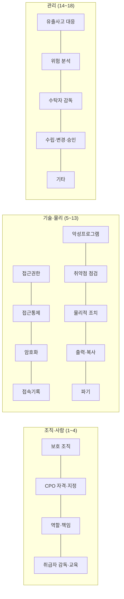
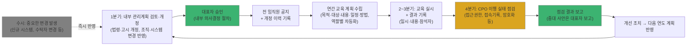
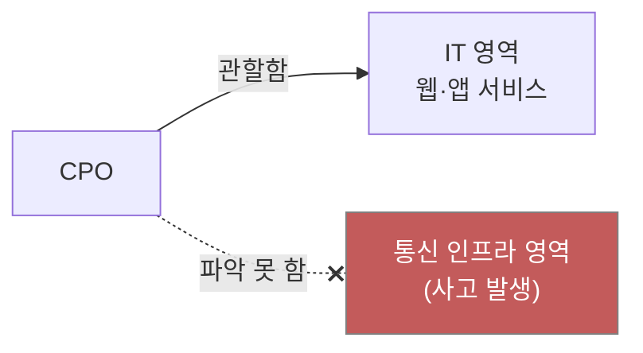

# Week 3 · Ch01. 내부 관리계획 수립과 개인정보취급자 교육

> [← 이전 챕터](../2주차_처리_생애주기/ch06_개인정보_처리방침_작성_실습.md) · [📚 전체 목차](../../README.md) · [다음 챕터 →](./ch02_접근권한_관리와_접근통제.md)

| 항목 | 내용 |
|---|---|
| 예상 학습 시간 | 75분 |
| 법령 기준일 | 2026-11-17 |
| 핵심 근거 | 개인정보 보호법 제28조, 제29조 / 시행령 제30조제1항제1호 / 안전성 확보조치 기준 제3조, 제4조 / 안전성 확보조치 기준 안내서(2026. 11.) |
| 관련 용어 | [내부 관리계획](../../용어집.md#내부-관리계획), [안전성 확보조치](../../용어집.md#안전성-확보조치), [개인정보취급자](../../용어집.md#개인정보취급자), [개인정보 보호책임자](../../용어집.md#개인정보-보호책임자), [위험도 분석](../../용어집.md#위험도-분석) |
| 선수 챕터 | [W1-ch03 핵심 용어와 역할](../1주차_개인정보_기초/ch03_핵심_용어와_역할.md), [W1-ch04](../1주차_개인정보_기초/ch04_보호_원칙과_처리자의_기본_의무.md) |

> [!IMPORTANT]
> **🎯 이 챕터 핵심 3줄**
> 1. 내부 관리계획은 **18개 사항**을 담아 **대표자 승인**을 받고, 중요한 변경은 **즉시 반영**합니다.
> 2. 교육은 CPO와 취급자를 대상으로 **역할별로 차등화**해 정기적으로 하고, **기록**을 남깁니다.
> 3. CPO는 내부 관리계획 이행 실태를 **연 1회 이상** 점검합니다.

---

## 1. 학습 목표

이 챕터를 마치면 담당자님은 다음을 할 수 있습니다.

1. 내부 관리계획에 **반드시 들어가야 할 18개 사항**과 수립·변경·점검 절차를 확인할 수 있다.
2. 개인정보 보호책임자와 개인정보취급자를 대상으로 **차등화된 정기 교육 계획**을 세울 수 있다.
3. CPO의 **연 1회 이상 이행 실태 점검** 계획과 결과 기록을 준비할 수 있다.

---

## 2. 한 줄 비유

> [!TIP]
> 💡 내부 관리계획은 **"회사 개인정보 보호의 헌법"**, 이행 실태 점검은 **"그 헌법이 지켜지는지 확인하는 연례 감사"**, 취급자 교육은 **"헌법을 모든 직원에게 알리는 시민 교육"**입니다.

단, 비유의 한계가 있습니다.

- 헌법처럼 한 번 만들어 액자에 걸어 두면 안 됩니다.
- 처리 방법이나 시스템에 **중요한 변경이 있으면 즉시 고쳐야** 하고, 고친 **이력도 남겨야** 합니다(고시 제4조제3항).

---

## 3. 개념 설명 및 법령 조문

### 3-1. 관련 조문

> [!NOTE]
> 📌 **조문 주소 읽는 법**: 조 → 항(①②) → 호(1. 2.) → 목(가. 나.). 자세한 설명은 [W1-ch01 3-2](../1주차_개인정보_기초/ch01_개인정보의_정의와_판단_기준.md#3-2-관련-조문)를 보세요.

#### 📜 법 제29조 + 시행령 제30조제1항제1호 (안전조치의무와 내부 관리계획)

- **뜻**: 내부 관리계획은 Week 3에서 배울 모든 안전조치를 **한 문서로 묶는 상위 규정**입니다.
- **시행일**: 법 2026. 9. 11. / 영 2026. 11. 10. 시행 기준

**내부 관리계획에 포함할 것** (영 제30조제1항제1호)

| 목 | 내용 |
|---|---|
| 가 | 개인정보취급자에 대한 **관리·감독 및 교육** |
| 나 | **CPO 지정 등 보호 조직**의 구성·운영 |
| 다 | 제2호~제8호 조치(접근권한, 접근통제, 암호화, 접속기록 등)를 이행하기 위한 **세부 사항** |

📖 원문 요지 보기

- **법 제29조**: 처리자는 개인정보가 유출등이 되지 않도록 내부 관리계획 수립, 접속기록 보관 등 시행령으로 정하는 바에 따라 안전성 확보에 필요한 기술적·관리적·물리적 조치를 해야 한다.
- **영 제30조제1항제1호**: 위 가~다를 포함하는 내부 관리계획의 수립·시행 및 점검

근거 원문은 각주를 참고하세요.[^decree-30]

#### 📜 안전성 확보조치 기준 제3조 (적용 원칙)

- **뜻**: 고시는 **최소 기준**이고, 회사 규모와 위험에 맞게 **더 강하게** 정할 수 있습니다.
- **주의**: 다른 회사 내부 관리계획을 그대로 베끼면 안 되는 이유입니다.

📖 원문 요지 보기

처리자는 처리하는 개인정보의 보유 수, 유형 및 정보주체에게 미치는 영향 등을 고려해 스스로의 환경에 맞는 안전성 확보에 필요한 조치를 적용해야 한다.

근거 원문은 각주를 참고하세요.[^safety-3-4]

#### 📜 안전성 확보조치 기준 제4조 (내부 관리계획의 수립·시행 및 점검)

| 항 | 의무 | 실무 포인트 |
|---|---|---|
| ① | **내부 의사결정 절차**로 18개 사항 포함 계획 수립·시행 (1만 명 미만 소상공인·개인·단체는 생략 가능) | 대표자 결재 등 **승인 기록**이 있어야 함 |
| ② | CPO·취급자 대상 **차등화된 정기 교육** (목적·대상, 내용, 일정·방법) | 같은 동영상 한 편만 틀어 주는 것은 "차등화"가 아님 |
| ③ | 중요한 변경은 **즉시 반영** + **수정 이력 관리** | 개정 이력표(버전, 일자, 변경 내용, 승인자)를 문서 앞에 |
| ④ | **CPO**가 이행 실태를 **연 1회 이상** 점검·관리 | 점검 **계획**과 **결과 보고서**를 매년 남김 |

📖 원문 요지 보기

- ① 내부 의사결정 절차를 통해 다음 18개 사항을 포함하는 내부 관리계획을 수립·시행해야 한다. 다만, 1만 명 미만의 정보주체에 관한 개인정보를 처리하는 소상공인·개인·단체는 생략할 수 있다. (18개 사항은 3-2 표)
- ② 교육 목적·대상, 교육 내용, 교육 일정·방법을 정해 CPO와 개인정보취급자를 대상으로 사업규모, 보유 수, 업무성격 등에 따라 차등화해 정기적으로 교육해야 한다.
- ③ 18개 사항에 중요한 변경이 있으면 즉시 반영해 수정·시행하고, 수정 이력을 관리해야 한다.
- ④ CPO는 접근권한 관리, 접속기록 보관·점검, 암호화 조치 등 내부 관리계획의 이행 실태를 연 1회 이상 점검·관리해야 한다.

근거 원문은 각주를 참고하세요.[^safety-3-4]

> [!NOTE]
> 💡 **소상공인 예외의 범위**: 안내서는 1만 명 미만을 처리하는 소상공인·개인·단체가 내부 관리계획을 수립하지 않을 수 있더라도 "그 외 이 기준에서 정한 해당되는 다른 안전조치 의무사항은 **이행하여야 한다**"고 설명합니다. 소상공인은 「소상공인기본법」상 광업·제조업·건설업·운수업은 상시 근로자 10명 미만, 그 외 업종은 5명 미만인 자입니다.[^guide-p44] 내부 관리계획만 면제되고 **다른 안전조치는 면제되지 않습니다.**

### 3-2. 내부 관리계획 18개 필수 사항과 이 교재의 대응

| # | 고시 제4조제1항 사항 | 자세히 배우는 곳 |
|---|---|---|
| 1 | 개인정보 보호 조직의 구성 및 운영 | [W1-ch03](../1주차_개인정보_기초/ch03_핵심_용어와_역할.md) |
| 2 | CPO의 자격요건 및 지정 | [W1-ch03](../1주차_개인정보_기초/ch03_핵심_용어와_역할.md) (영 [별표 1]) |
| 3 | CPO와 개인정보취급자의 역할 및 책임 | [W1-ch03](../1주차_개인정보_기초/ch03_핵심_용어와_역할.md) |
| 4 | 개인정보취급자에 대한 관리·감독 및 교육 | 이 챕터 3-3 |
| 5 | 접근 권한의 관리 | [W3-ch02](./ch02_접근권한_관리와_접근통제.md) |
| 6 | 접근 통제 | [W3-ch02](./ch02_접근권한_관리와_접근통제.md) |
| 7 | 개인정보의 암호화 조치 | [W3-ch03](./ch03_암호화.md) |
| 8 | 접속기록 보관 및 점검 | [W3-ch04](./ch04_접속기록_보관과_점검.md) |
| 9 | 악성프로그램 등 방지 | [W3-ch05](./ch05_악성프로그램_물리적_보호_출력물.md) |
| 10 | 유출·도난 방지 등을 위한 **취약점 점검** | [W3-ch05](./ch05_악성프로그램_물리적_보호_출력물.md) |
| 11 | 물리적 안전조치 | [W3-ch05](./ch05_악성프로그램_물리적_보호_출력물.md) |
| 12 | 출력·복사 시 안전조치 | [W3-ch05](./ch05_악성프로그램_물리적_보호_출력물.md) |
| 13 | 개인정보의 파기 | [W2-ch05](../2주차_처리_생애주기/ch05_보유기간_관리와_파기.md) |
| 14 | 개인정보 **유출사고 대응 계획** 수립·시행 | [W4-ch01](../4주차_사고대응과_새로운_이슈/ch01_유출_사고_대응.md) |
| 15 | **위험 분석 및 관리** | 이 챕터 3-4 |
| 16 | 위탁 시 **수탁자 관리·감독** | [W2-ch03](../2주차_처리_생애주기/ch03_제3자_제공과_처리위탁_구분.md) |
| 17 | 내부 관리계획의 **수립, 변경 및 승인** | 이 챕터 |
| 18 | 그 밖에 필요한 사항 | — |

📖 안내서의 내부 관리계획 목차 예시 (8장 27개 조)

안내서는 위 사항을 담은 **내부 관리계획 목차 예시**(8장 27개 조)를 제시합니다.

1. 총칙
2. 수립·시행·점검
3. 보호 조직
4. 교육 계획
5. 기술적 안전조치
6. 관리적 안전조치
7. 물리적 안전조치
8. 그 밖의 사항

해당 내용이 없으면 목차에서 빼거나 **"해당 없음"**으로 적을 수 있고, 제외 사유는 "15. 위험 분석 및 관리"에 기술할 수 있습니다.[^guide-p45]

> [!NOTE]
> 💡 **처리방침 vs 내부 관리계획**: 안내서는 두 문서를 이렇게 구분합니다. 처리방침은 **정보주체에게 공개**하는 문서(법 제30조)이고, 내부 관리계획은 개인정보를 안전하게 처리하기 위해 **조직 전체를 대상으로** 하는 내부 규정(법 제29조)입니다. 내부 관리계획은 대표자의 승인을 받아 **모든 임직원과 관련자에게 알려** 준수하게 해야 합니다.[^guide-p45]

### 3-3. 개인정보취급자 교육

| 요소 | 핵심 | 근거 |
|---|---|---|
| **계획에 넣을 것** | 목적·대상, 내용, 일정·방법 | 고시 제4조제2항, 안내서 PDF p.64 |
| **차등화** | 대상자·업무·권한·직급별 | 안내서 PDF p.64 |
| **방법** | 사내·외부·위탁, 집체·온라인 등 조직 여건에 맞게 | 안내서 PDF p.64 |
| **결과 기록** | **일시·내용·참석자** 확인 가능하게 | 안내서 PDF p.65 |
| **활용 자원** | 개인정보배움터(edu.privacy.go.kr) | 안내서 PDF p.65 |

**차등화의 예**

| 기준 | 구분 |
|---|---|
| 대상자 유형별 | CPO, 보호담당자, 취급자, 수탁자 |
| 업무 유형별 | IT 담당자·운영자, 개발자, 일반 취급자 |
| 권한별 | 주요직무자, 일반직무자 |
| 직급별 | 신규 입사자, 부서장 |

📖 교육 내용 예시 12가지 · 기록 방법 · 자원 상세 보기

**교육 내용 예시** (안내서 PDF p.64)

1. 개인정보 보호의 중요성
2. 내부 관리계획 등 규정 제·개정 사항
3. 처리시스템의 안전한 운영·사용법
4. 안전성 확보조치 기준
5. 위·수탁 시 안전조치
6. 보호업무 절차·책임·방법
7. 처리 절차별 준수·금지 사항
8. 유출·침해신고 시 사실 확인·보고·피해구제 절차
9. 정보주체 권리 보장
10. 기술 발전과 위협 동향
11. 가명정보 처리 시 조치
12. AI 개발·활용 단계별 조치

**계획 형식**: 내부 관리계획에 규정하거나 "○○년 개인정보보호 교육 계획(안)" 형태로 수립합니다.

**결과 기록**: "○○년 개인정보보호 교육 결과"로 교육 일시·내용·참석자를 확인할 수 있게 기록합니다. 수료증, 출입 기록, 서명 명단 등을 활용합니다.

**활용 자원**: 개인정보배움터(edu.privacy.go.kr)의 교육 프로그램·교재·강사, '개인정보 보호 교육 업무 안내서' (해당 안내서는 참고자료 미보유)

근거 원문은 각주를 참고하세요.[^guide-p64]

### 3-4. 위험 분석 및 관리 (18개 사항 중 15번)

- **정의**: "위험도 분석"이란 개인정보 유출에 영향을 미칠 수 있는 다양한 위험요소를 **식별·평가**하고 적절히 **통제**할 수 있는 방안 마련을 위해 종합적으로 분석하는 행위 (고시 제2조제13호)
- **참고 자료**: 안내서 부록 제2장 「개인정보 위험도 분석 기준 해설」(목차상 인쇄 p.168)

**어디에 쓰이나**

1. 내부망에 저장하는 주민등록번호 외 고유식별정보의 **암호화 적용 여부·범위** 결정 (고시 제7조제3항제2호나목)
2. 일일평균 100만 명 이상 처리자의 **인터넷망 차단 예외** 판단 (제6조의2제2항)
3. 내부 관리계획에서 **"해당 없음"으로 제외한 사유** 기술

근거 원문은 각주를 참고하세요.[^safety-2-13]

> ✅ **3절 한 줄 정리**: 18개 사항을 담아 승인받고, 바뀌면 즉시 고치고, 역할별로 교육하고, CPO가 매년 점검합니다.

---

## 4. 사내 실무 적용

> 결론 표시: 🟢 가능 · 🟡 조건부 가능 · 🔴 불가

### 🎭 상황극 1. 경영기획팀의 "내부 관리계획은 작년 거 날짜만 바꿔서 올리죠"

> **📨 경영기획팀 남 대리**: "연초라 내부 관리계획 갱신 결재를 올려야 하는데, 작년 파일에서 **날짜만 바꿔서** 대표님 결재 받으면 되죠? 내용이 바뀐 게 없잖아요."

**🙋 담당자 판단**

| 결론 | 근거 |
|---|---|
| 🟡 **조건부 가능**: 실제로 **중요한 변경이 없다면** 내용을 그대로 유지할 수 있습니다. 하지만 날짜만 바꾸기 전에 **작년 한 해의 변경 사항**과 **법령·고시 개정**을 확인해야 합니다. 또 CPO의 **연간 이행 실태 점검 결과**가 반영되어야 합니다. | 안전성 확보조치 기준 제4조제1항(내부 의사결정 절차), 제3항(중요한 변경 즉시 반영·수정 이력 관리), 제4항(CPO 연 1회 이상 이행 점검) |

**✅ 다음 행동**

- [ ] **① 변경 사항 목록**: 조직 개편(CPO·담당자 변경), 신규 시스템·클라우드 이전, 수탁자 변경, 법령·고시 개정(2026. 7. 1. 고시 개정, 2026. 9. 11. 법 개정 등)을 정리합니다.
- [ ] **② 점검 결과 반영**: CPO 이행 실태 점검 결과에서 나온 개선 사항을 반영합니다.
- [ ] **③ 개정 이력표**: 바뀐 부분을 개정 이력표(버전·일자·변경 내용·승인자)에 적습니다.
- [ ] **④ 승인·공지·교육**: 대표자 결재 후 전 임직원에게 공지하고, 교육에 개정 내용을 넣습니다.

**💬 왜 그런가요?**

- 2026년에는 고시(7. 1.)와 법률(9. 11.)이 모두 개정·시행되었습니다.
- 작년 파일의 조문 번호와 기준을 **현행 법령·고시와 하나씩 대조**해야 합니다.
- 예를 들어 CPO 업무는 현행 법 제31조제4항에 있고, 접속기록 점검 주기는 내부 관리계획에서 정하도록 되어 있습니다 → [W3-ch04](./ch04_접속기록_보관과_점검.md).

### 🎭 상황극 2. 인사팀의 "개인정보 교육은 법정의무교육 동영상 하나로 전 직원 끝내죠"

> **📨 인사팀 지 과장**: "개인정보보호 교육도 법정의무교육이니까, **전 직원 대상 온라인 동영상 30분짜리 하나**로 끝내려고요. 수료율만 100% 맞추면 되죠?"

**🙋 담당자 판단**

| 결론 | 근거 |
|---|---|
| 🟡 **조건부 가능**: 전 직원 기본 교육으로는 괜찮지만, 그것만으로는 부족합니다. 고시는 CPO와 취급자를 대상으로 **업무성격 등에 따라 차등화**한 교육을 요구합니다. 고객 DB를 다루는 상담원, 시스템 관리자, 개발자, 수탁자 등에게는 **역할별 교육**을 추가해야 합니다. | 법 제28조제2항(취급자 정기 교육), 안전성 확보조치 기준 제4조제2항(목적·대상·내용·일정·방법을 정하고 차등화해 정기적으로), 안내서 PDF p.64~65(차등화 예, 교육 내용 예시, 결과 기록) |

**✅ 다음 행동**

- [ ] **① 교육 대상 매트릭스**: 전 직원(기본) / 취급자(처리 절차·금지 사항) / IT·DB 관리자(접근통제·접속기록·암호화) / 개발자(테스트 데이터, 보안 코딩) / 신규 입사자 / 부서장 / 수탁자로 나눕니다.
- [ ] **② 내용 배치**: 역할별로 교육 내용을 안내서 예시에서 골라 배치합니다.
- [ ] **③ 결과 기록**: 일시·내용·참석자가 남도록 기록합니다(수료증, 서명 명단 등).
- [ ] **④ 다음 해 반영**: 다음 해 계획에 사고·민원 사례를 반영합니다.

**💬 왜 그런가요?**

- 위원회는 사고가 난 회사에 **"전 직원 대상 개인정보 보호 교육을 주기적으로 실시"**하라는 시정명령을 내린 적이 있습니다(골프존, 2024. 5.).[^golfzon-p2]
- 교육은 **했다는 기록**과 **업무에 맞는 내용**이 함께 있어야 의미가 있습니다.

> ✅ **4절 한 줄 정리**: 문서는 "날짜만 바꾸기" 전에 변경 사항부터, 교육은 "동영상 하나" 위에 역할별 과정을 얹으세요.

---

## 5. 내부 관리계획 연간 운영 사이클

**그림 읽는 법**: 내부 관리계획은 **1년 단위로 도는 사이클**입니다.

| 표시 | 의미 |
|---|---|
| 점선 | 연중 **중요한 변경**이 생기면 다음 해를 기다리지 말고 **즉시 반영** (고시 제4조제3항) |
| 🟨 황색 | CPO 이행 점검, **연 1회 이상** 필수 |

---

## 6. 개인정보보호위원회 처분 사례

### ⚖️ 사례: SK텔레콤의 내부 관리계획 점검 소홀과 CPO 관할 공백 (2025. 8. 의결) — "거버넌스" 관점

> 이 사례는 [W1-ch05](../1주차_개인정보_기초/ch05_보호위원회의_역할과_제재_체계.md#6-개인정보보호위원회-처분-사례)에서 "제재 체계" 관점으로 봤습니다. 여기서는 **내부 관리계획과 CPO 조직**의 관점으로 다시 봅니다.

| 단계 | 내용 |
|---|---|
| **한 줄 요약** | 내부 관리계획 점검 소홀 + **CPO 관할이 IT 영역에 한정**되어 인프라 영역 공백 |
| **처분 결과** | 과징금 1,347억 9,100만 원 + 과태료 960만 원 + 시정명령 (**CPO의 실질적 역할 보장**) + 개선권고 |
| **출처** | 개인정보보호위원회 보도자료, 「개인정보위, 'SK텔레콤 개인정보 유출사고' 제재처분 의결」(2025. 8. 27. 의결, 8. 28. 보도)[^case-skt] |

**📌 내부 관리계획 관점의 교훈**

1. 내부 관리계획과 내부 규정이 **있어도 지켜지지 않으면** 위반입니다. **"자체 마련한 내부규정 다수 위반"**이 보도자료에 따로 적혔습니다.
2. 내부 관리계획의 **적용 범위**에 회사의 모든 개인정보 처리 영역이 들어가야 합니다. CPO가 모르는 영역은 그 자체로 **가장 위험한 영역**입니다.
3. CPO의 이행 실태 점검(고시 제4조제4항)이 실제로 **전사**를 대상으로 했다면 공백을 미리 찾을 수 있었습니다.

📖 사건 상세 보기 (확인된 위반·CPO 관할 공백·처분 내역)

**사건 개요**

- 2,300여만 명의 USIM 정보 등이 유출된 SK텔레콤 사건에서, 위원회는 접근통제·암호화 등 기술적 위반 외에 "내부 관리계획 수립·시행 및 점검 소홀, 접속기록 미보관 등 안전조치의무를 준수하지 않았고, SKT가 자체 마련한 내부규정도 다수 위반"한 사실을 확인했습니다.
- SK텔레콤은 IT 영역과 통신 인프라 영역 모두에서 개인정보를 처리했는데도 CPO의 역할을 IT 영역(웹·앱 서비스)에 한정해 운영했습니다.
- 그 결과 사고가 난 인프라 영역은 CPO가 처리 실태조차 파악하지 못해 관리·감독이 사실상 이루어지지 않았습니다.

**위반 내용**: 안전조치의무 위반(내부 관리계획 수립·시행 및 점검 소홀 포함), 개인정보 보호책임자 지정 및 업무 수행 소홀 등

> ⚠️ 보도자료에 조항 번호는 없습니다(현행 법 제29조, 제31조, 고시 제4조에 해당하는 쟁점으로 보임).

**처분 내역**

- 과징금 1,347억 9,100만 원, 과태료 960만 원
- 시정명령: "CPO의 실질적 역할 보장(예시: 전사 관할, 이사회에 정기 보고 등)", 위·수탁 관리·감독 철저 등을 포함한 재발방지 대책을 3개월 내 수립·보고
- 개선권고: ISMS-P 인증 범위를 이동통신 네트워크 시스템으로 확대

> [!TIP]
> 💬 **사수의 한마디**: 내부 관리계획 제3조(적용범위)를 다시 읽어 보세요. "본 계획은 회사의 **모든** 개인정보처리시스템과 개인정보 처리 업무에 적용한다"고 써 놓고, 실제로 이행 점검은 **고객 홈페이지만** 하고 있지 않나요? 생산·물류·인프라·연구소의 개인정보 처리도 점검 대상 목록에 있는지 확인하세요.

---

## 7. 오답노트

| # | ❌ 잘못된 생각 | ✅ 올바른 이해 | 근거 |
|---|---|---|---|
| 1 | "직원 30명이니 내부 관리계획 안 만들어도 돼요." | 생략은 **1만 명 미만 + 소상공인·개인·단체**뿐 | 고시 제4조제1항 단서, 안내서 PDF p.44 |
| 2 | "담당자가 만들어 공유 폴더에 올리면 돼요." | **내부 의사결정 절차** + 전 임직원 공지 | 고시 제4조제1항, 안내서 PDF p.45 |
| 3 | "시스템이 바뀌어도 연초에 한 번만 고치면 돼요." | 중요한 변경은 **즉시 반영** + 이력 관리 | 고시 제4조제3항 |
| 4 | "전 직원 동영상 교육 한 번이면 끝이에요." | **차등화된 정기** 교육 + 기록 | 법 제28조제2항, 고시 제4조제2항, 안내서 PDF p.64~65 |
| 5 | "이행 점검은 감사팀 일, CPO는 결과만 봐요." | **CPO 책임하에** 수행, 중대 사안은 대표자 보고 | 고시 제4조제4항, 안내서 PDF p.66 |
| 6 | "소상공인이라 다른 안전조치도 안 해도 돼요." | 면제는 **내부 관리계획뿐** | 안내서 PDF p.44 |

**🔎 번호별 보충 설명**

1. 소상공인은 업종에 따라 상시 근로자 5명 또는 10명 미만입니다. 30명 규모 기업은 해당하지 않습니다.
2. 대표자 결재 등 내부 의사결정 절차를 거쳐 수립하고, 모든 임직원과 관련자에게 알려 준수하게 해야 합니다.
3. 중요한 변경이 있으면 즉시 반영해 수정·시행하고 수정 이력을 관리해야 합니다.
4. CPO와 취급자를 대상으로 사업규모·보유 수·업무성격에 따라 차등화해 정기적으로 교육해야 합니다. 교육 일시·내용·참석자 기록도 남겨야 합니다.
5. 점검은 감사팀이나 외부 전문업체가 수행할 수 있지만 CPO의 책임하에 수행해야 합니다. 중대한 사안은 대표자에게 보고하고 대책을 마련해야 합니다.
6. 면제되는 것은 내부 관리계획 수립·시행뿐입니다. 그 밖의 해당 안전조치 의무는 이행해야 합니다.

---

## 8. 업무 체크리스트

**📋 내부 관리계획·교육 운영 점검표**

| 점검 주기 | 점검자 | 점검일 |
|---|---|---|
| 연 1회 정기 + 중요한 변경 발생 시 | 개인정보보호 담당자 (CPO 책임) | `____-__-__` |

**① 내부 관리계획**

- [ ] 내부 관리계획에 고시 제4조제1항의 **18개 사항**이 모두 있고, 해당 없는 사항은 "해당 없음"과 그 사유가 적혀 있다
- [ ] 적용 범위가 회사의 **모든** 개인정보처리시스템·처리 업무(고객, 임직원, 인프라, 연구, 수탁자 포함)를 포괄한다
- [ ] **대표자 승인**(결재) 기록이 있다 (내부 의사결정 절차)
- [ ] **개정 이력표**(버전·일자·변경 내용·승인자)가 있고, 최근 중요한 변경이 반영되어 있다 (고시 제4조제3항)
- [ ] 최근 법령·고시 개정(2026. 7. 1. 고시, 2026. 9. 11. 법률, 2026. 11. 10. 시행령)을 반영했다
- [ ] 개정 사실을 **전 임직원과 관련자**에게 공지했다

**② 교육**

- [ ] 연간 교육 계획에 **목적·대상·내용·일정·방법**이 있다 (고시 제4조제2항)
- [ ] 교육이 **역할별로 차등화**되어 있다 (CPO, 보호담당자, 취급자, IT·개발자, 신규 입사자, 부서장, 수탁자)
- [ ] 교육 결과에 **일시·내용·참석자**를 확인할 수 있는 기록이 있다 (안내서 PDF p.65)
- [ ] 미이수자 추가 교육 절차가 있다

**③ CPO 이행 실태 점검**

- [ ] 올해 **이행 실태 점검 계획**(대상·시기, 조직·인력, 항목·내용, 방법·절차, 결과 기록, 후속조치)이 있다 (안내서 PDF p.66)
- [ ] 점검이 **CPO 책임하에** 수행되었고, 결과 보고서가 있다 (고시 제4조제4항)
- [ ] 중대한 사안은 **대표자에게 보고**하고 개선 대책을 마련했다

---

## 9. 실습 과제 / 퀴즈

### 📝 객관식

**Q1.** 안전성 확보조치 기준 제4조제1항 단서에 따라 내부 관리계획 수립을 **생략할 수 있는 경우**는?

1. 상시 근로자 30명인 제조업체가 고객 5천 명의 개인정보를 처리하는 경우
2. 1만 명 미만의 정보주체에 관한 개인정보를 처리하는 소상공인
3. 개인정보처리시스템을 클라우드로 운영하는 모든 처리자
4. 개인정보 보호 인증(ISMS-P)을 받은 처리자

**Q2.** 내부 관리계획의 **이행 실태 점검**에 관한 설명으로 **옳은 것**은?

1. 개인정보취급자 각자가 스스로 점검하면 된다.
2. 개인정보 보호책임자가 연 1회 이상 점검·관리해야 한다.
3. 3년에 한 번 외부 기관의 점검을 받으면 된다.
4. 사고가 발생한 경우에만 점검한다.

**Q3.** 고시 제4조제2항에 따라 개인정보 보호 교육 계획에 **정해야 하는 사항이 아닌 것**은?

1. 교육 목적 및 대상
2. 교육 내용
3. 교육 일정 및 방법
4. 교육 강사의 학력과 경력

### 🛠️ 실습: 내부 관리계획 목차와 연간 교육 계획 작성

**Q4.** 우리 회사(온라인 쇼핑몰, 직원 120명, 회원 30만 명, 콜센터·배송·클라우드 위탁)의 **내부 관리계획 목차**와 **연간 교육 계획표**를 작성하세요.

**(1) 내부 관리계획 목차**: 안내서의 8장 구성(총칙 / 수립·시행·점검 / 보호 조직 / 교육 / 기술적 / 관리적 / 물리적 / 그 밖의 사항)을 따르고, 고시 제4조제1항 18개 사항이 **어느 조에 들어가는지** 표시하세요.

**(2) 연간 교육 계획표**

| 교육 대상 | 교육 내용 (3개 이상) | 시기 | 방법 | 결과 기록 방법 |
|---|---|---|---|---|
| 전 임직원 | | | | |
| 고객센터 상담원 (취급자) | | | | |
| IT 시스템·DB 관리자 | | | | |
| 개발자 | | | | |
| 신규 입사자 | | | | |
| 수탁자 (콜센터·배송) | | | | |

> [!NOTE]
> ✅ 다 풀었다면 [정답 및 해설](../../정답과_해설.md#w3-ch01)에서 확인하세요. 틀린 문제는 **7. 오답노트**에 한 줄씩 추가하세요.

---

## 10. 더 읽을거리

| 자료 | 이 챕터와의 관계 |
|---|---|
| **개인정보의 안전성 확보조치 기준** 고시 제2026-9호 | 제2조제13호(위험도 분석), 제3조, 제4조 |
| **개인정보의 안전성 확보조치 기준 안내서** 개인정보보호위원회, 2026. 11. | 제4조 해설: PDF p.43~66 (인쇄 p.35~58). 목차 예시 PDF p.45~46, 교육 PDF p.64~65, 이행 점검 PDF p.66. 부록 위험도 분석 기준 해설 |
| **개인정보 보호법 시행령** 대통령령 제36804호 | 제30조제1항(안전성 확보 조치) |
| **정보보호 및 개인정보보호 관리체계 인증 등에 관한 고시 [별표 7]** 고시 제2024-8호 | 관리체계 수립·운영(1.1 경영진 참여, 최고책임자 지정 등) 참고 |
| **개인정보 영향평가 수행안내서** 개인정보보호위원회, 2025. 10. | 위험 분석 방법 참고 (민간은 영향평가 노력 의무) |
| **개인정보 보호 교육 업무 안내서** 개인정보보호위원회 (참고자료 미보유) | 교육 계획 수립 참고 |

📁 참고자료 파일명 보기

- `개인정보의 안전성 확보조치 기준(개인정보보호위원회고시)(제2026-9호)(20260701).pdf`
- `개인정보의 안전성 확보조치 기준 안내서(2026.11).pdf`
- `개인정보 보호법 시행령(대통령령)(제36804호)(20261110).pdf`
- `[별표 7] 인증기준(제23조 관련)(정보보호 및 개인정보보호 관리체계 인증 등에 관한 고시).pdf`
- `개인정보 영향평가 수행안내서(25.10.).pdf`

---

> [← 이전 챕터](../2주차_처리_생애주기/ch06_개인정보_처리방침_작성_실습.md) · [📚 전체 목차](../../README.md) · [📖 용어집](../../용어집.md) · [다음 챕터 →](./ch02_접근권한_관리와_접근통제.md)

[^decree-30]: [출처: [개인정보 보호법(법률)(제21445호)(20260911).pdf](<../../2_참고자료/개인정보 보호법(법률)(제21445호)(20260911).pdf>), 제29조] / [출처: [개인정보 보호법 시행령(대통령령)(제36804호)(20261110).pdf](<../../2_참고자료/개인정보 보호법 시행령(대통령령)(제36804호)(20261110).pdf>), 제30조제1항제1호]
[^safety-3-4]: [출처: [개인정보의 안전성 확보조치 기준(개인정보보호위원회고시)(제2026-9호)(20260701).pdf](<../../2_참고자료/개인정보의 안전성 확보조치 기준(개인정보보호위원회고시)(제2026-9호)(20260701).pdf>), 제3조, 제4조제1항~제4항]
[^guide-p44]: [출처: [개인정보의 안전성 확보조치 기준 안내서(2026.11).pdf](<../../2_참고자료/개인정보의 안전성 확보조치 기준 안내서(2026.11).pdf>), PDF p.44 (인쇄 p.36)]
[^guide-p45]: [출처: [개인정보의 안전성 확보조치 기준 안내서(2026.11).pdf](<../../2_참고자료/개인정보의 안전성 확보조치 기준 안내서(2026.11).pdf>), PDF p.45~46 (인쇄 p.37~38) 「개인정보 내부 관리계획 목차(예시)」 및 처리방침과의 차이]
[^guide-p64]: [출처: [개인정보의 안전성 확보조치 기준 안내서(2026.11).pdf](<../../2_참고자료/개인정보의 안전성 확보조치 기준 안내서(2026.11).pdf>), PDF p.64~65 (인쇄 p.56~57) 교육 차등화·교육 내용 예시·결과 기록, PDF p.66 (인쇄 p.58) 이행 실태 점검 계획 예시]
[^safety-2-13]: [출처: [개인정보의 안전성 확보조치 기준(개인정보보호위원회고시)(제2026-9호)(20260701).pdf](<../../2_참고자료/개인정보의 안전성 확보조치 기준(개인정보보호위원회고시)(제2026-9호)(20260701).pdf>), 제2조제13호, 제6조의2제2항, 제7조제3항제2호]
[^golfzon-p2]: [출처: [240509 (석간) 개인정보위, ㈜골프존 개인정보 유출사고에 대해 과징금 75억 원, 과태료 540만 원 및 시정명령 부과(조사1과).pdf](<../../2_참고자료/240509 (석간) 개인정보위, ㈜골프존 개인정보 유출사고에 대해 과징금 75억 원, 과태료 540만 원 및 시정명령 부과(조사1과).pdf>), p.2 시정명령 "전 직원 대상 개인정보 보호 교육을 주기적으로 실시"]
[^case-skt]: [출처: [250828 (석간) 개인정보위  ‘SK텔레콤 개인정보 유출사고’ 제재처분 의결(조사2과)_최종(붙임 포함).pdf](<../../2_참고자료/250828 (석간) 개인정보위  ‘SK텔레콤 개인정보 유출사고’ 제재처분 의결(조사2과)_최종(붙임 포함).pdf>), p.6 (내부 관리계획 점검 소홀·내부규정 위반, CPO 역할 IT 영역 한정), p.7 (시정명령·개선권고), p.12 (CPO 실질적 역할 보장 예시)]
