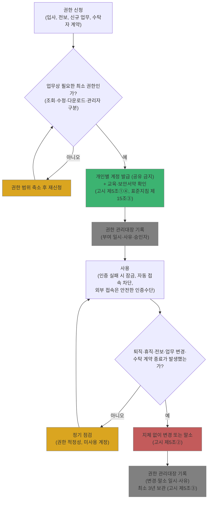

# Week 3 · Ch02. 접근권한 관리와 접근통제

> [← 이전 챕터](./ch01_내부_관리계획과_취급자_교육.md) · [📚 전체 목차](../../README.md) · [다음 챕터 →](./ch03_암호화.md)

| 항목 | 내용 |
|---|---|
| 예상 학습 시간 | 85분 (실습 포함) |
| 법령 기준일 | 2026-11-17 |
| 핵심 근거 | 개인정보 보호법 제29조 / 시행령 제30조제1항제2호·제3호 / 안전성 확보조치 기준 제5조, 제6조, 제6조의2 / 표준지침 제15조 / 안전성 확보조치 기준 안내서 |
| 관련 용어 | [접근 권한 관리](../../용어집.md#접근-권한-관리), [접근통제](../../용어집.md#접근통제), [자동 접속 차단](../../용어집.md#자동-접속-차단), [인증정보](../../용어집.md#인증정보), [개인정보처리시스템](../../용어집.md#개인정보처리시스템), [P2P / 공유설정](../../용어집.md#p2p-공유설정), [인터넷망 차단 조치](../../용어집.md#인터넷망-차단-조치) |
| 선수 챕터 | [W3-ch01 내부 관리계획](./ch01_내부_관리계획과_취급자_교육.md) |

---

## 1. 학습 목표

이 챕터를 마치면 담당자님은 다음을 할 수 있습니다.

1. 접근권한의 **최소·차등 부여, 지체 없는 변경·말소, 3년 기록 보관, 계정 공유 금지** 기준을 적용할 수 있다.
2. 외부 접속 시 **안전한 인증수단**, 공유설정·P2P 차단, **자동 접속 차단** 등 접근통제 요건을 점검할 수 있다.
3. **권한 관리대장**을 작성하고 정기 점검할 수 있다.

---

## 2. 한 줄 비유

> 💡 **접근권한 관리는 "건물 출입카드 관리", 접근통제는 "건물 경비 시스템"입니다. 출입카드는 필요한 층만 열리게 개인별로 발급하고 퇴사하면 바로 회수합니다. 경비 시스템은 외부인이 정문을 못 넘게 막고, 오래 비어 있는 사무실은 자동으로 잠급니다.**

단, 비유의 한계가 있습니다. 실물 카드와 달리 시스템 계정은 **회수했는지 눈에 보이지 않습니다.** 그래서 부여·변경·말소를 **기록**하고 그 기록을 **3년 이상** 보관하라고 정한 것입니다(고시 제5조제3항).

---

## 3. 개념 설명 및 법령 조문

### 3-1. 관련 조문

> 📌 **조문 주소 읽는 법**: 조 → 항(①②) → 호(1. 2.) → 목(가. 나.). 자세한 설명은 [W1-ch01 3-2](../1주차_개인정보_기초/ch01_개인정보의_정의와_판단_기준.md#3-2-관련-조문)를 보세요.

#### 📜 안전성 확보조치 기준 제5조 (접근 권한의 관리)

| 항 | 원문 요지 | 쉬운 풀이와 실무 포인트 |
|---|---|---|
| ① | 개인정보처리시스템 접근 권한을 업무 수행에 필요한 **최소한의 범위로 차등 부여** | "팀원 전체 관리자 권한"은 위반 소지. 조회/수정/다운로드/관리자 권한을 나눕니다. 안내서는 DB에 **직접** 접근하는 권한은 DB 운영·관리자에게만 주라고 설명합니다.[^guide-p69] |
| ② | 취급자나 취급자의 업무가 **변경되면 지체 없이** 권한을 변경 또는 말소 | 퇴직·휴직·전보, **수탁자 계약 변경·종료**도 포함. 퇴직 점검표에 "계정 말소" 항목을 넣습니다.[^guide-p69] |
| ③ | ①·②의 **부여, 변경, 말소 내역을 기록**하고 **최소 3년간 보관** | 권한 관리대장(실습 Q4)이 바로 이 기록입니다 |
| ④ | 정당한 사유가 없으면 **취급자별로 계정을 발급**하고 **공유되지 않도록** | 부서 공용 계정, 선임 계정 빌려 쓰기 금지 |
| ⑤ | 취급자 또는 정보주체의 **인증수단**을 안전하게 적용·관리 | 비밀번호, OTP, 생체인증, 패스키 등 환경에 맞게 자율 선택 |
| ⑥ | **일정 횟수 이상 인증에 실패**하면 접근을 제한하는 등 필요한 조치 | 횟수는 고시에 없음. 안내서는 **웹사이트 일반 이용자**도 대상에 포함된다고 설명[^guide-p153] |

근거 원문은 각주를 참고하세요.[^safety-5]

> 💡 **가명정보 권한 분리**: 가명정보를 처리할 때는 가명정보 접근 담당자와 **추가 정보** 접근 담당자를 **반드시 구분**해야 합니다. 둘을 같은 사람이 가지면 재식별이 쉬워지기 때문입니다.[^guide-p69] → [W4-ch05](../4주차_사고대응과_새로운_이슈/ch05_가명정보_기본과_활용.md)

#### 📜 안전성 확보조치 기준 제6조 (접근통제)

| 항 | 원문 요지 | 쉬운 풀이와 실무 포인트 |
|---|---|---|
| ① | 불법 접근·침해사고 방지를 위해 1. 접속 권한을 **IP 주소 등으로 제한** 2. 접속한 IP 주소 등을 **분석해 유출 시도 탐지·대응** | 방화벽·침입탐지 장비를 **설치만** 하면 부족합니다. 안내서 FAQ는 정책 업데이트와 운영·관리가 지속되어야 한다고 설명합니다.[^guide-p155] |
| ② | 정당한 접근 권한자(정보주체 제외)가 **외부에서** 정보통신망으로 접속할 때는 **인증서, 보안토큰, 일회용 비밀번호(OTP) 등 안전한 인증수단** 적용. 단, **이용자가 아닌 정보주체**(예: 임직원)의 개인정보를 처리하는 시스템은 **가상사설망(VPN) 등 안전한 접속수단** 또는 안전한 인증수단 적용 가능 | 재택근무·외부 접속에 **ID·비밀번호만**으로는 부족합니다(6절 골프존 사례). 안내서는 비밀번호 외에 OTP 등 **추가 인증수단**을 예로 듭니다.[^guide-p77] |
| ③ | 개인정보가 **홈페이지, P2P, 공유설정** 등을 통해 권한 없는 자에게 공개·유출되지 않도록 시스템, 취급자 PC, 모바일 기기에 조치 | 공유설정은 **기본적으로 쓰지 않는 것이 원칙**. 불가피하면 비밀번호 등 접근통제를 하고, 사용 후 **제거**. 원격접속 프로그램도 공유설정에 준해 관리[^guide-p81] |
| ④ | 취급자가 **일정시간 이상 업무처리를 하지 않으면 자동으로 접속이 차단**되도록 | 시간은 고시에 없음. 환경에 맞게 정하되 최소한으로 → Windows 화면 잠금 실습 [W3-ch07](./ch07_윈도우11_실습.md) |
| ⑤ | 업무용 **모바일 기기** 분실·도난 대비 **비밀번호 설정** 등 보호조치 | 업무폰 화면 잠금, 원격 초기화 등 |

근거 원문은 각주를 참고하세요.[^safety-6]

#### 📜 안전성 확보조치 기준 제6조의2 (인터넷망의 차단 조치)

| 구분 | 내용 |
|---|---|
| **원문 요지** | 전년도 말 기준 직전 3개월간 저장·관리하는 **이용자 수가 일일평균 100만 명 이상**인 처리자는 1. 처리시스템 **접근 권한을 설정**할 수 있는 취급자 2. 처리시스템에서 개인정보를 **다운로드 또는 파기**할 수 있는 취급자의 컴퓨터 등에 **인터넷망 차단 조치**를 해야 한다. 클라우드로 처리시스템을 운영하면 해당 서비스 접속 외의 인터넷을 차단한다. 제2호 대상은 위험 분석 결과 위험이 현저히 낮거나 감소 조치를 적용하면 예외가 가능하나, **민감정보·제7조제1항·제2항 정보**(인증정보, 이용자의 고유식별정보·카드·계좌·생체인식정보)를 다운로드·파기할 수 있는 취급자는 예외 없음. |
| **쉬운 풀이** | 대규모 사업자의 **핵심 권한자 PC**는 인터넷과 분리합니다(이른바 망분리). |
| **실무 포인트** | 우리 회사가 일일평균 100만 명 기준에 해당하는지 먼저 확인하세요. 해당하지 않아도 관리자 PC의 인터넷 사용 통제는 좋은 보호조치입니다. |

근거 원문은 각주를 참고하세요.[^safety-6-2]

---

## 4. 사내 실무 적용

### 🎭 상황극 1. 영업팀의 "퇴사자 계정은 인수인계 끝나면 한 달 뒤에 지워 주세요"

> **📨 영업팀 엄 팀장**: "이번 달 퇴사하는 김 과장 CRM 계정이요, 고객 이력 인수인계 때문에 **퇴사 후 한 달 정도는 살려 두고**, 그동안 후임자가 그 계정으로 들어가서 정리하게 하려고요. 괜찮죠?"

**🙋 담당자 답변**

| 구분 | 내용 |
|---|---|
| **결론** | ❌ **불가** — 퇴사자 계정은 **지체 없이 말소**해야 하고, 후임자가 다른 사람 계정을 쓰는 것은 **계정 공유**입니다. 인수인계는 후임자 **본인 계정의 권한**으로 해야 합니다. |
| **근거** | 안전성 확보조치 기준 제5조제2항(업무 변경 시 지체 없이 변경·말소), 제5조제3항(내역 기록·3년 보관), 제5조제4항(취급자별 계정, 공유 금지) |
| **다음 행동** | ① 퇴사일(또는 마지막 근무일)에 맞춰 **계정 말소**를 예약합니다. ② 인수인계가 필요한 고객 이력은 후임자 계정에 **필요한 권한을 부여**하거나, 퇴사 전에 담당자 이관 기능으로 옮깁니다. ③ 말소·부여 내역을 **권한 관리대장**에 기록합니다. ④ 인사팀 퇴직 절차(퇴직 점검표)에 "개인정보처리시스템 계정 말소 확인" 항목이 있는지 확인합니다. |

**왜 그런가요?** 퇴사자 계정이 살아 있으면 퇴사자 본인이나 그 계정 정보를 아는 사람이 접근할 수 있습니다. 또 후임자가 그 계정을 쓰면 **접속기록에 엉뚱한 사람이 남아** 사고 때 책임을 추적할 수 없습니다. 안내서는 퇴직 점검표에 사용자 계정 말소 항목을 반영하라고 설명합니다.[^guide-p69]

### 🎭 상황극 2. IT팀의 "재택근무자는 VPN 아이디·비밀번호만으로 접속하게 할게요"

> **📨 IT팀 하 책임**: "재택근무가 늘어서 VPN을 새로 도입했어요. 사내 시스템이랑 같은 **아이디·비밀번호로 VPN에 접속**하면 바로 고객 DB 관리 화면까지 들어갈 수 있게 했어요. 편하죠?"

**🙋 담당자 답변**

| 구분 | 내용 |
|---|---|
| **결론** | ❌ **현재 구성은 불가** — 고객(이용자) 개인정보를 처리하는 시스템에 외부에서 접속할 때는 **인증서, 보안토큰, OTP 등 안전한 인증수단**을 적용해야 합니다. ID·비밀번호만으로는 부족합니다. |
| **근거** | 안전성 확보조치 기준 제6조제2항(외부 접속 시 안전한 인증수단, 이용자가 아닌 정보주체 시스템만 VPN 등 안전한 접속수단으로 대체 가능), 제6조제1항(IP 제한·유출 시도 탐지), 안내서 PDF p.77~78 |
| **다음 행동** | ① VPN 또는 처리시스템 로그인에 **OTP 등 추가 인증수단**을 적용합니다(다중 인증). ② VPN 접속 후에도 고객 DB 관리 화면은 **업무상 필요한 사람만** 접근할 수 있게 권한을 제한합니다. ③ VPN 장비의 **알려진 취약점**을 조치하고 최신 상태로 유지합니다(안내서 PDF p.78). ④ 비정상 시간대·해외 IP 접속, 반복 로그인 실패를 **탐지·알림**하도록 설정합니다. ⑤ 서버 관리자 계정은 외부 접속을 별도로 통제합니다. |

**왜 그런가요?** 고시 제6조제2항 단서의 "VPN 등 안전한 접속수단"으로 대체할 수 있는 경우는 **이용자가 아닌 정보주체**(예: 임직원)의 개인정보만 처리하는 시스템입니다. 고객 정보 시스템은 안전한 **인증수단**이 필요합니다. 골프존 사고는 해커가 탈취한 VPN 계정(ID·PW)으로 업무망에 들어온 데서 시작됐습니다(6절).

---

## 5. 접근권한 생애주기 플로우

**그림 읽는 법**: 권한은 **신청 → 최소 범위 확인 → 개인 계정 발급 → 사용 → 변경·말소**로 돕니다. 회색 칸(권한 관리대장)이 **두 번** 나오는 점이 중요합니다. 부여할 때와 회수할 때 모두 기록해야 3년 보관 의무를 지킬 수 있습니다.

---

## 6. 개인정보보호위원회 처분 사례

### ⚖️ 사례: ㈜골프존의 VPN 계정 탈취와 공유 파일서버 (2024. 5. 의결) — "접근통제" 관점

> 이 사례는 [W1-ch04](../1주차_개인정보_기초/ch04_보호_원칙과_처리자의_기본_의무.md#6-개인정보보호위원회-처분-사례)에서 "원칙과 파기" 관점으로 봤습니다. 여기서는 **접근통제 실패 구조**로 다시 봅니다.

| 단계 | 내용 |
|---|---|
| **사건 개요** | 코로나19로 재택근무가 급증하자 골프존은 새 가상사설망(VPN)을 긴급 도입하면서 외부에서 내부 업무망에 **ID와 PW만으로 접속**할 수 있게 허용했습니다. 그런데 업무망 안의 파일서버에 대해 개인정보 유출 보안위협을 검토하지 않았고 필요한 안전조치도 하지 않았습니다. 그 결과 외부에서 서버로의 원격접속 등 **불필요한 접근이 허용**되었고, **서버 간 원격접속과 업무망 내 모든 서버의 인터넷 통신이 허용**되었습니다. 해커는 직원들의 VPN 계정정보(**서버 관리자 계정 포함**)를 탈취해 파일서버에 원격 접속했습니다. 이 파일서버는 **Windows 공유폴더 기능**으로 임직원 PC에 공유되던 서버였습니다. 약 221만 명 이상의 개인정보가 유출되었습니다. |
| **위반 조항** | 보도자료 붙임 기준: 안전조치의무 **§29** (+ 파기 §21①, 주민등록번호 §24의2②) |
| **처분 결과** | 과징금 75억 400만 원, 과태료 540만 원, 시정명령("**공유설정 등을 통해 개인정보가 유출되지 않도록 조치**하는 등 안전조치의무 준수" 등), 공표명령 |
| **접근통제 관점의 교훈** | ① 외부 접속을 **ID·PW만으로** 허용한 것은 현행 고시 제6조제2항(안전한 인증수단)에 정면으로 걸리는 구조입니다. ② **관리자 계정**이 VPN으로 외부 접속 가능했던 점이 피해를 키웠습니다. 관리자 권한은 최소화하고 외부 접속을 따로 통제해야 합니다(제5조제1항). ③ **공유폴더**로 개인정보를 전사에 공유한 것은 제6조제3항(공유설정을 통한 유출 방지) 문제입니다. ④ **긴급 도입**한 시스템일수록 보안 검토가 빠지기 쉽습니다. 변경 시 내부 관리계획 반영(제4조제3항)이 필요합니다. |
| **출처** | 개인정보보호위원회 보도자료, 「개인정보위, ㈜골프존 개인정보 유출사고에 대해 과징금 75억 원, 과태료 540만 원 및 시정명령 부과」(2024. 5. 8. 의결, 5. 9. 보도)[^case-golfzon] |

> 💬 **사수의 한마디**: 엘지유플러스 처분(2023. 7.)에도 "개인정보처리시스템 접근권한 부여·변경·말소 내역 보관을 소홀히 함"이 위반 사항으로 있었습니다.[^case-lgu-p4] 권한 관리대장은 **사고가 나야 비로소 찾게 되는 문서**입니다. 평소에 3년치를 바로 꺼낼 수 있는지 지금 확인해 보세요.

---

## 7. 오답노트

| # | ❌ 잘못된 생각 | ✅ 올바른 이해 | 근거 조문 |
|---|---|---|---|
| 1 | "인수인계 때문에 퇴사자 계정은 한 달쯤 살려 둬도 돼요." | 취급자가 변경되면 **지체 없이** 권한을 변경·말소해야 합니다. 인수인계는 후임자 본인 계정으로 합니다. | 고시 제5조제2항 |
| 2 | "팀 공용 계정 하나로 같이 쓰면 관리가 편하죠." | 정당한 사유가 없으면 **취급자별로 계정**을 발급하고 **공유되지 않도록** 해야 합니다. 공용 계정은 접속기록으로 책임을 추적할 수 없습니다. | 고시 제5조제4항 |
| 3 | "권한 부여는 시스템에서 바로 하니까 따로 기록할 필요 없어요." | 권한 **부여·변경·말소 내역을 기록**하고 **최소 3년** 보관해야 합니다. | 고시 제5조제3항 |
| 4 | "VPN을 쓰니까 아이디·비밀번호만으로 외부 접속해도 안전해요." | 이용자(고객) 개인정보 처리시스템에 외부에서 접속할 때는 **인증서·보안토큰·OTP 등 안전한 인증수단**이 필요합니다. VPN 등 접속수단으로 대체할 수 있는 것은 **이용자가 아닌 정보주체**의 시스템뿐입니다. | 고시 제6조제2항 |
| 5 | "방화벽 장비를 샀으니 접근통제 의무는 끝났어요." | 장비를 설치하는 것만으로는 부족합니다. **정책을 지속적으로 업데이트**하고, 접속 IP를 분석해 유출 시도를 **탐지·대응**해야 합니다. | 고시 제6조제1항, 안내서 PDF p.155 |
| 6 | "고시가 비밀번호 규칙을 없앴으니 아무 비밀번호나 써도 돼요." | 고시가 구성 규칙을 정하지 않을 뿐, 인증수단을 **안전하게 적용·관리**할 의무는 그대로입니다. 회사가 환경에 맞는 **관리기준을 자율적으로** 마련해야 합니다. | 고시 제5조제5항, 안내서 PDF p.153 |

---

## 8. 업무 체크리스트

**📋 접근권한·접근통제 점검표**

| 점검 주기 | 권한 관리대장: 월 1회 / 전체 권한 적정성: 반기 1회 이상 권장 / 접근통제 설정: 분기 1회 | 점검자 | 개인정보보호 담당자 + IT 보안 담당 | 점검일 | ____-__-__ |
|---|---|---|---|---|---|

**[접근권한 관리 — 고시 제5조]**
- [ ] 처리시스템별로 **권한 등급**(조회/수정/다운로드/관리자)이 정의되어 있고, 업무별 최소 권한 기준이 있다 (①)
- [ ] DB **직접 접근** 권한은 DB 운영·관리자에게만 있다 (안내서 PDF p.69)
- [ ] 인사팀 퇴직·휴직·전보 정보가 IT팀에 **자동 또는 즉시** 전달되어 권한이 지체 없이 회수된다 (②)
- [ ] **수탁자** 계약 종료 시 수탁자 직원 계정도 회수된다 (②)
- [ ] **권한 관리대장**에 부여·변경·말소 내역이 기록되고 **3년 이상** 보관된다 (③)
- [ ] **공용 계정**이 없다. 불가피한 공용 계정은 사유·사용자·관리 방법이 문서화되어 있다 (④)
- [ ] 인증수단 관리기준(비밀번호 기준, 다중 인증 적용 대상)이 내부 관리계획에 있다 (⑤)
- [ ] 일정 횟수 이상 인증 실패 시 **계정 잠금** 등이 적용된다. 고객 웹사이트도 포함한다 (⑥)

**[접근통제 — 고시 제6조]**
- [ ] 처리시스템 접속이 **허용된 IP 등으로 제한**되어 있다 (①1)
- [ ] 접속 IP 분석으로 **비정상 접속·대량 다운로드**를 탐지하고 대응 절차가 있다 (①2)
- [ ] 외부에서 처리시스템에 접속할 때 **OTP·인증서 등 안전한 인증수단**을 쓴다 (②)
- [ ] 취급자 PC의 **공유폴더·P2P·원격접속 프로그램** 사용 현황을 점검하고 불필요한 것은 제거했다 (③)
- [ ] 처리시스템에 **자동 접속 차단**(세션 타임아웃)이 설정되어 있다 (④)
- [ ] 업무용 **모바일 기기**에 화면 잠금 등 보호조치가 있다 (⑤)
- [ ] 우리 회사가 일일평균 이용자 **100만 명** 이상인지 확인했고, 해당하면 인터넷망 차단 대상 PC 목록이 있다 (제6조의2)

---

## 9. 실습 과제 / 퀴즈

### 객관식

**Q1.** 안전성 확보조치 기준 제5조제3항에 따라 개인정보처리시스템 접근 권한의 부여·변경·말소 내역을 **보관해야 하는 최소 기간**은?

1. 6개월
2. 1년
3. 2년
4. 3년

**Q2.** 고객(이용자)의 개인정보를 처리하는 개인정보처리시스템에 취급자가 **외부(재택)에서 접속**할 때 고시 제6조제2항에 따라 적용해야 하는 것은?

1. 아이디와 비밀번호
2. 인증서, 보안토큰, 일회용 비밀번호(OTP) 등 안전한 인증수단
3. 접속할 때마다 팀장의 구두 승인
4. 외부 접속은 어떤 경우에도 금지

**Q3.** 다음 중 고시 제5조·제6조에 비추어 **적절한 조치**는?

1. 퇴사자 계정을 인수인계가 끝날 때까지 한 달간 유지하고 후임자가 사용하게 한다.
2. 부서원 5명이 하나의 관리자 계정을 함께 사용한다.
3. 일정 시간 동안 업무처리가 없으면 처리시스템 접속이 자동으로 차단되도록 설정한다.
4. 업무 편의를 위해 고객 명단 폴더를 전 직원 PC에 공유설정한다.

### 🛠️ 실습: 권한 관리대장 작성

**Q4.** 아래 상황을 보고 **권한 관리대장**을 작성하세요. 그리고 대장을 보고 **문제가 있는 항목**을 찾아 조치 방안을 쓰세요.

> **상황 (2026년 11월, 고객관리시스템 CRM)**
> - 11/3: 신규 입사자 박○○(고객지원팀, 상담원) — 상담 이력 **조회·수정** 권한 신청, 팀장 승인
> - 11/5: 이○○(마케팅팀) — 캠페인 분석을 위해 고객 **전체 다운로드** 권한 신청, 팀장 승인 (분석은 통계만 필요)
> - 11/10: 김○○(영업팀) 퇴사 — 퇴사일 11/10, 계정 말소일 **미기재**
> - 11/12: 외주 콜센터 ㈜D콜 직원 3명 — **공용 계정 1개**로 조회 권한 요청
> - 11/20: 최○○(고객지원팀) → 재무팀 전보 — 기존 CRM 권한 **변경 내역 없음**

**[양식]**

| 번호 | 일자 | 구분 (부여/변경/말소) | 대상자 (소속) | 시스템 | 권한 (조회/수정/다운로드/관리자) | 사유 | 신청자 | 승인자 | 처리자 | 처리 일시 | 비고 |
|---|---|---|---|---|---|---|---|---|---|---|---|
| | | | | | | | | | | | |

> 💡 엑셀로 작성한다면 **"처리 일시"**와 **"말소 예정일"** 열을 두고, 말소 예정일이 지났는데 처리 일시가 비어 있으면 빨간색으로 표시되게 조건부 서식을 걸어 보세요. 단, 문서 공유 시에는 색에 의존하지 말고 "미처리" 같은 글자 표시도 함께 남기세요.

> ✅ 다 풀었다면 [정답 및 해설](../../정답과_해설.md#w3-ch02)에서 확인하세요. 틀린 문제는 **7. 오답노트**에 한 줄씩 추가하세요.

---

## 10. 더 읽을거리

| 자료 | 발행 | 참고자료 파일명 | 이 챕터와의 관계 |
|---|---|---|---|
| 개인정보의 안전성 확보조치 기준 | 고시 제2026-9호 | `개인정보의 안전성 확보조치 기준(개인정보보호위원회고시)(제2026-9호)(20260701).pdf` | 제5조, 제6조, 제6조의2, 제16조(공공시스템) |
| 개인정보의 안전성 확보조치 기준 안내서 | 개인정보보호위원회, 2026. 11. | `개인정보의 안전성 확보조치 기준 안내서(2026.11).pdf` | 제5조 해설 PDF p.67~73, 제6조 해설 PDF p.74~83, 제6조의2 PDF p.84~, FAQ PDF p.153~157(비밀번호 기준, API, 접근통제 장치, 최대 접속시간) |
| 표준 개인정보 보호지침 | 고시 제2025-4호 | `표준 개인정보 보호지침(개인정보보호위원회고시)(제2025-4호)(20250411).pdf` | 제15조(취급자 최소화, 권한 차등, 보안서약, 인사이동 시 변경·말소) |
| 개인정보위 보도자료 (골프존) | 개인정보보호위원회, 2024. 5. | `240509 (석간) 개인정보위, ㈜골프존 개인정보 유출사고에 대해 과징금 75억 원, 과태료 540만 원 및 시정명령 부과(조사1과).pdf` | 6절 처분 사례, p.4 유출 과정 |
| 개인정보위 보도자료 (엘지유플러스) | 개인정보보호위원회, 2023. 7. | `230713 (조간) 개인정보위, ㈜엘지유플러스 개인정보 유출사고에 대해 과징금 68억 원, 과태료 2,700만 원 및 시정명령 부과(조사2과)FN.pdf` | p.4 권한 내역 보관 소홀, 비밀번호 작성규칙 미적용(당시 고시) |

---

> [← 이전 챕터](./ch01_내부_관리계획과_취급자_교육.md) · [📚 전체 목차](../../README.md) · [📖 용어집](../../용어집.md) · [다음 챕터 →](./ch03_암호화.md)

[^safety-5]: [출처: [개인정보의 안전성 확보조치 기준(개인정보보호위원회고시)(제2026-9호)(20260701).pdf](<../../2_참고자료/개인정보의 안전성 확보조치 기준(개인정보보호위원회고시)(제2026-9호)(20260701).pdf>), 제5조제1항~제6항]
[^safety-6]: [출처: [개인정보의 안전성 확보조치 기준(개인정보보호위원회고시)(제2026-9호)(20260701).pdf](<../../2_참고자료/개인정보의 안전성 확보조치 기준(개인정보보호위원회고시)(제2026-9호)(20260701).pdf>), 제6조제1항~제5항 (제6항 삭제)]
[^safety-6-2]: [출처: [개인정보의 안전성 확보조치 기준(개인정보보호위원회고시)(제2026-9호)(20260701).pdf](<../../2_참고자료/개인정보의 안전성 확보조치 기준(개인정보보호위원회고시)(제2026-9호)(20260701).pdf>), 제6조의2제1항·제2항]
[^guide-p69]: [출처: [개인정보의 안전성 확보조치 기준 안내서(2026.11).pdf](<../../2_참고자료/개인정보의 안전성 확보조치 기준 안내서(2026.11).pdf>), PDF p.69 (인쇄 p.61) DB 직접 접근 권한, 가명정보·추가 정보 권한 분리, 인사이동·수탁 계약 종료 시 권한 회수] / 퇴직 점검표: 같은 안내서 PDF p.70
[^guide-p77]: [출처: [개인정보의 안전성 확보조치 기준 안내서(2026.11).pdf](<../../2_참고자료/개인정보의 안전성 확보조치 기준 안내서(2026.11).pdf>), PDF p.77~78 (인쇄 p.69~70) 안전한 인증수단·접속수단, VPN 취약점 조치]
[^guide-p81]: [출처: [개인정보의 안전성 확보조치 기준 안내서(2026.11).pdf](<../../2_참고자료/개인정보의 안전성 확보조치 기준 안내서(2026.11).pdf>), PDF p.81 (인쇄 p.73) P2P·공유설정 관련 안전조치(예시)]
[^guide-p153]: [출처: [개인정보의 안전성 확보조치 기준 안내서(2026.11).pdf](<../../2_참고자료/개인정보의 안전성 확보조치 기준 안내서(2026.11).pdf>), PDF p.153 (인쇄 p.145) 부록 FAQ: 인증 실패 제한 대상에 일반 이용자 포함, "권고하는 비밀번호 작성규칙이 있는지요?"]
[^guide-p155]: [출처: [개인정보의 안전성 확보조치 기준 안내서(2026.11).pdf](<../../2_참고자료/개인정보의 안전성 확보조치 기준 안내서(2026.11).pdf>), PDF p.155 (인쇄 p.147) 부록 FAQ 「5. 접근통제」]
[^case-golfzon]: [출처: [240509 (석간) 개인정보위, ㈜골프존 개인정보 유출사고에 대해 과징금 75억 원, 과태료 540만 원 및 시정명령 부과(조사1과).pdf](<../../2_참고자료/240509 (석간) 개인정보위, ㈜골프존 개인정보 유출사고에 대해 과징금 75억 원, 과태료 540만 원 및 시정명령 부과(조사1과).pdf>), p.1 (VPN 계정 탈취, 공유폴더), p.2 (VPN ID·PW 허용, 서버 원격접속·인터넷 통신 허용, 시정명령), p.4 (위반 조항 표, 유출 과정)]
[^case-lgu-p4]: [출처: [230713 (조간) 개인정보위, ㈜엘지유플러스 개인정보 유출사고에 대해 과징금 68억 원, 과태료 2,700만 원 및 시정명령 부과(조사2과)FN.pdf](<../../2_참고자료/230713 (조간) 개인정보위, ㈜엘지유플러스 개인정보 유출사고에 대해 과징금 68억 원, 과태료 2,700만 원 및 시정명령 부과(조사2과)FN.pdf>), p.4 「참고1」 "접근권한 부여·변경·말소 내역 보관을 소홀히 함", "비밀번호 작성규칙 적용을 하지 않음 (고시§5)"]
