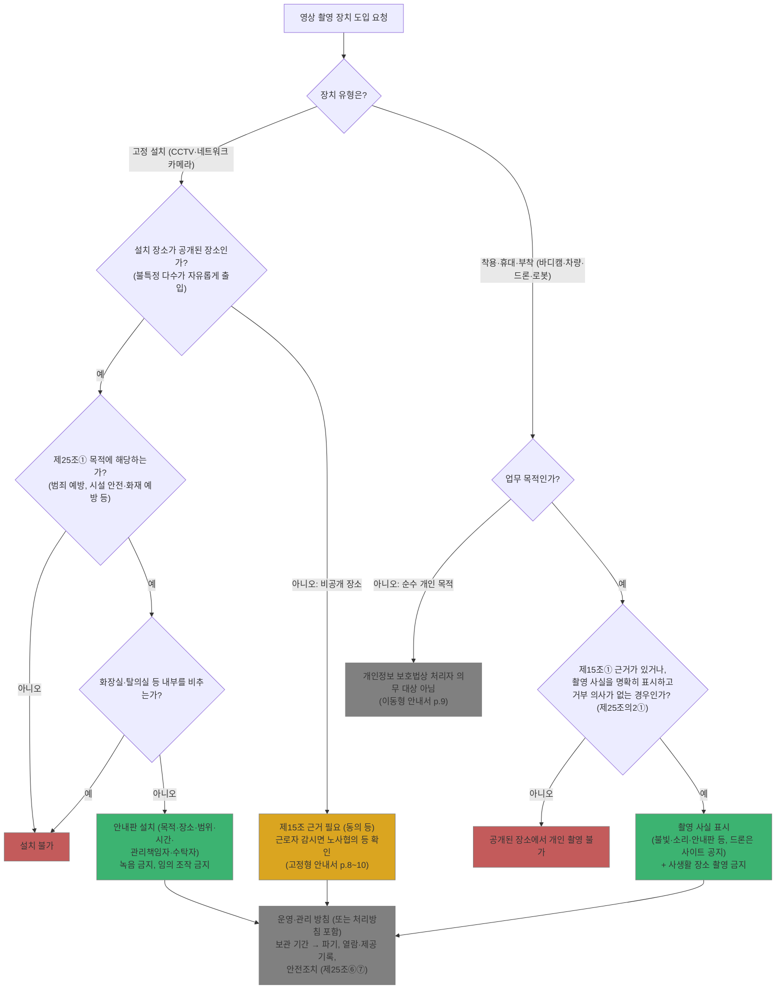

# Week 3 · Ch06. 고정형·이동형 영상정보처리기기(CCTV 등) 운영

> [← 이전 챕터](./ch05_악성프로그램_물리적_보호_출력물.md) · [📚 전체 목차](../../README.md) · [다음 챕터 →](./ch07_윈도우11_실습.md)

| 항목 | 내용 |
|---|---|
| 예상 학습 시간 | 75분 |
| 법령 기준일 | 2026-11-17 |
| 핵심 근거 | 개인정보 보호법 제2조제7호·제7호의2, 제25조, 제25조의2, 제58조제2항 / 시행령 제22조~제27조의3 / 표준지침 제35조~제48조 / 고정형 영상정보처리기기 설치·운영 안내서(2024. 12.) / 이동형 영상정보처리기기 안내서(2024. 9.) |
| 관련 용어 | [고정형 영상정보처리기기](../../용어집.md#고정형-영상정보처리기기), [이동형 영상정보처리기기](../../용어집.md#이동형-영상정보처리기기), [개인영상정보](../../용어집.md#개인영상정보), [공개된 장소](../../용어집.md#공개된-장소) |
| 선수 챕터 | [W1-ch02 법체계 지도](../1주차_개인정보_기초/ch02_개인정보_법체계_지도.md) (제58조제2항), [W2-ch01](../2주차_처리_생애주기/ch01_수집_이용의_적법_근거.md) |

---

## 1. 학습 목표

이 챕터를 마치면 담당자님은 다음을 할 수 있습니다.

1. **공개된 장소와 비공개 장소**를 구분해 CCTV 설치 근거(제25조 vs 제15조)를 판단할 수 있다.
2. 고정형 CCTV의 **안내판, 녹음 금지, 운영·관리 방침, 보관·파기, 열람 대응** 기준을 적용할 수 있다.
3. 바디캠·차량 카메라·드론 등 **이동형 기기**의 촬영 요건과 **촬영 사실 표시** 방법을 확인할 수 있다.

---

## 2. 한 줄 비유

> 💡 **고정형 CCTV는 "가게 출입문의 경비원", 이동형 기기는 "순찰하며 기록하는 경비원"입니다. 둘 다 "여기 경비원이 있어요"라고 알려야 하고(안내판·촬영 표시), 대화를 몰래 녹음하면 안 되며(녹음 금지), 화장실 안은 들여다볼 수 없습니다.**

단, 비유의 한계가 있습니다. 경비원의 기억은 흐려지지만 CCTV 영상은 **그대로 남습니다.** 그래서 보관 기간을 정하고, 지나면 **파기**하고, 누가 열람했는지 **기록**해야 합니다(표준지침 제41조·제42조).

---

## 3. 개념 설명 및 법령 조문

### 3-1. 관련 조문

> 📌 **조문 주소 읽는 법**: 조 → 항(①②) → 호(1. 2.) → 목(가. 나.). 자세한 설명은 [W1-ch01 3-2](../1주차_개인정보_기초/ch01_개인정보의_정의와_판단_기준.md#3-2-관련-조문)를 보세요.

#### 📜 개인정보 보호법 제25조 (고정형 영상정보처리기기의 설치·운영 제한)

| 항 | 원문 요지 | 실무 포인트 |
|---|---|---|
| ① | 누구든지 다음 경우 외에는 **공개된 장소**에 고정형 기기를 설치·운영할 수 없다: 1. 법령에서 구체적으로 허용 2. **범죄 예방·수사** 3. **시설 안전·관리, 화재 예방**(정당한 권한을 가진 자) 4. 교통단속 5. 교통정보 수집·분석·제공 6. 영상을 **저장하지 않는** 경우로서 시행령으로 정한 경우 | 매장·로비·주차장 CCTV는 보통 2호·3호 근거 |
| ② | **목욕실, 화장실, 발한실, 탈의실** 등 사생활을 현저히 침해할 우려가 있는 장소의 **내부를 볼 수 있도록** 설치·운영 금지 (교도소 등 법령상 구금·보호 시설 예외) | 탈의실 입구 방향 카메라 각도도 점검 |
| ③ | 공공기관과 ②단서 시설은 공청회·설명회 등 **의견 수렴** 절차 | 민간 기업은 일반적으로 해당 없음 |
| ④ | 정보주체가 쉽게 인식하도록 **안내판** 설치: 1. 설치 **목적 및 장소** 2. 촬영 **범위 및 시간** 3. **관리책임자 연락처** 4. 시행령 사항 (군사시설·국가중요시설 등 예외) | 표준지침 제39조: 위탁 시 **수탁자 명칭·연락처**도 기재 |
| ⑤ | 설치 목적과 다른 목적으로 **임의 조작**하거나 **다른 곳을 비춰서는** 안 되며, **녹음기능은 사용할 수 없다** | 매장 CCTV로 고객·직원 대화 녹음 금지 |
| ⑥ | 유출등이 되지 않도록 제29조에 따른 **안전조치** | 녹화기(NVR) 비밀번호, 접근 권한, 열람 기록 |
| ⑦ | **운영·관리 방침** 마련. 단, 처리방침에 CCTV 운영·관리 사항을 포함하면 생략 가능 | 처리방침 21번 항목 → [W2-ch06](../2주차_처리_생애주기/ch06_개인정보_처리방침_작성_실습.md) |
| ⑧ | 설치·운영 사무를 **위탁**할 수 있음 | 보안업체 관제 위탁 → 위탁 계약·안내판 기재 |

근거 원문은 각주를 참고하세요.[^law-25]

> 💡 **제58조제2항과의 관계**: 제25조제1항 각 호에 따라 **공개된 장소**에 설치한 고정형 기기로 처리되는 개인정보에는 제15조(수집 근거), 제22조(동의 방법), 제22조의2(아동), 제27조제1항·제2항(영업양도), 제34조(유출 통지·신고), 제37조(처리정지)를 **적용하지 않습니다.** 동의를 받을 수 없는 CCTV의 특성 때문입니다. 대신 **제25조 자체의 의무**(안내판, 녹음 금지, 안전조치, 방침)는 모두 지켜야 합니다.[^law-58-2] → [W1-ch02](../1주차_개인정보_기초/ch02_개인정보_법체계_지도.md)

#### 📜 개인정보 보호법 제25조의2 (이동형 영상정보처리기기의 운영 제한) — 2023. 3. 14. 신설

| 항 | 원문 요지 | 실무 포인트 |
|---|---|---|
| ① | **업무를 목적으로** 이동형 기기를 운영하려는 자는 다음 경우 외에는 **공개된 장소**에서 사람 또는 관련 사물의 영상(개인정보인 경우)을 촬영할 수 없다: 1. **제15조제1항 각 호**에 해당하는 경우 2. **촬영 사실을 명확히 표시**했는데도 정보주체가 **촬영 거부 의사를 밝히지 않은** 경우 (권리를 부당하게 침해할 우려가 없고 합리적 범위 내) 3. 시행령으로 정한 경우 | 배달로봇·업무 차량 카메라·현장 바디캠 등 |
| ② | 목욕실·화장실·탈의실 등 **내부를 볼 수 있는 곳**에서 촬영 금지 (인명 구조·구급 예외) | |
| ③ | 촬영 시 **불빛, 소리, 안내판** 등 시행령에 따라 **촬영 사실을 표시**하고 알려야 한다 | 영 제27조의2: 불빛, 소리, 안내판, 안내서면, 안내방송 등. 드론 항공촬영처럼 표시가 어려우면 **위원회 구축 인터넷 사이트에 공지** |
| ④ | 제25조제6항~제8항(안전조치, 운영·관리 방침, 위탁) 준용 | |

근거 원문은 각주를 참고하세요.[^law-25-2] [^decree-27-2]

> 💡 **개인 목적은 제외**: 이동형 안내서는 업무 목적이 아닌 **순수한 개인적 활동**(여행 기념 촬영, 취미용 드론, 교통사고 증거용 **개인 차량 블랙박스** 등)은 개인정보처리자의 처리로 보지 않는다고 설명합니다.[^mobile-p9] 회사 **업무용 차량**의 블랙박스·관제 카메라는 업무 목적이므로 다르게 봐야 합니다. ⚠️ 업무용 차량 블랙박스의 구체적 판단은 안내서 본문을 확인하세요.

### 3-2. 공개된 장소 vs 비공개 장소

| 구분 | 공개된 장소 | 비공개 장소 |
|---|---|---|
| **뜻** | 공원, 도로, 지하철, **상가 내부**, 주차장 등 **불특정 또는 다수**가 제한 없이 접근·통행 (표준지침 제2조제11호) | 입주자만 이용하는 시설, **직원만 출입 가능한 사무실**, 권한이 있는 자만 접근 가능한 통제구역 (고정형 안내서 p.9 예시) |
| **설치 근거** | **법 제25조제1항** 각 호 (범죄 예방, 시설 안전 등) | 법 제25조가 적용되지 않음 → **법 제15조제1항**(정보주체 동의 등) 또는 법률의 근거 |
| **안내판** | 의무 (제25조제4항) | 제25조 의무는 아니지만, 안내서는 비공개 장소에서도 촬영 사실 안내, 임의 조작·녹음 금지 준수, 사생활 침해 최소화를 권장 |
| **근로자 감시** | — | 사업장에 **근로자 감시 설비**로 설치하려면 「근로자참여법」상 노사협의(상시 근로자 **30인 이상**) 등도 확인 (고정형 안내서 p.8·p.10) |

근거 원문은 각주를 참고하세요.[^std-2-11] [^fixed-p8]

> 💡 **같은 사무실이라도 달라집니다**: 고정형 안내서는 "출입이 통제되어 직원 등 특정한 사람만 들어갈 수 있다면 공개된 장소로 볼 수 없"지만, "사무실이라고 하더라도 출입이 통제되지 않아 민원인이나 불특정 다수"가 출입하면 공개된 장소가 될 수 있다고 설명합니다.[^fixed-p8]

### 3-3. 운영 단계별 핵심 기준 (표준지침·안내서)

| 단계 | 기준 | 근거 |
|---|---|---|
| **설치** | 목적·장소·촬영 범위 결정, 사생활 침해 장소 제외, 안내판 설치(목적·장소, 범위·시간, 관리책임자 연락처, 위탁 시 수탁자) | 법 제25조, 표준지침 제39조 |
| **안내판 위치** | 촬영 범위 내에서 정보주체가 알아보기 쉬운 장소에 누구라도 판독할 수 있게. 크기·위치는 자율. 건물 안에 여러 대면 **출입구 등에 전체 설치 지역 표시** 가능 | 표준지침 제39조제2항, 영 제24조제1항 단서 |
| **운영** | 임의 조작·다른 곳 비추기 금지, **녹음 금지**, 관리책임자 지정 | 법 제25조제5항, 표준지침 제37조 |
| **보관** | 운영·관리 방침에 보관 기간 명시. 최소 기간을 산정하기 곤란하면 **수집 후 30일 이내**. 단, 안내서는 반드시 30일 이내일 필요는 없고 목적 달성에 필요한 최소 기간이 30일을 넘으면 그 기간으로 정할 수 있다고 설명 | 표준지침 제41조제2항, 고정형 안내서 p.34 |
| **파기** | 보관 기간 경과 등 불필요해지면 **지체 없이** 파기. 출력물은 파쇄·소각, 파일은 복원 불가능하게 영구 삭제 | 표준지침 제41조제1항·제3항 |
| **이용·제공** | 목적 외 이용·제3자 제공 제한. 수사기관 요청은 법적 절차(영장·제출명령 등) 확인 후 **해당 부분만** 열람·제공 | 표준지침 제40조, 고정형 안내서 p.31 |
| **기록** | 이용·제3자 제공·파기 내역을 **기록·관리** (개인영상정보 관리대장) | 표준지침 제42조, 제45조 |
| **열람 청구** | 정보주체의 존재 확인·열람·삭제 요청에 **지체 없이** 조치. 필요하면 **제3자 모자이크** 처리 | 표준지침 제44조, 고정형 안내서 p.33·p.36 |
| **점검** | 설치·운영 현황 정기 점검 | 표준지침 제48조 |

근거 원문은 각주를 참고하세요.[^std-35-48]

---

## 4. 사내 실무 적용

### 🎭 상황극 1. 매장운영팀의 "진상 고객 대비해서 CCTV에 녹음도 켤게요"

> **📨 매장운영팀 연 점장**: "요즘 폭언하는 고객이 많아서 매장 계산대 CCTV에 **녹음 기능**까지 켜려고요. 직원 보호 목적이니까 괜찮죠? 안내판에 '녹음 중'이라고 써 놓을게요."

**🙋 담당자 답변**

| 구분 | 내용 |
|---|---|
| **결론** | ❌ **불가** — 공개된 장소(매장)에 설치한 고정형 CCTV는 **녹음기능을 사용할 수 없습니다.** 안내판에 써 붙여도 마찬가지입니다. |
| **근거** | 개인정보 보호법 제25조제5항("녹음기능은 사용할 수 없다"), 고정형 안내서 p.19 Q2(고질 민원 고객이나 고객의 폭력 행사에 대비해 매장 CCTV로 녹음할 수 있는지 → **녹음은 금지**) |
| **다음 행동** | ① CCTV 녹음 기능을 **즉시 끄고**, 이미 녹음된 파일이 있으면 파기합니다. ② 직원 보호가 목적이라면 **다른 수단**을 검토합니다. 예를 들어 녹음 사실을 알리고 동의를 받는 별도 녹음 장치, 신고 체계, 직원 보호 매뉴얼 등입니다. ⚠️ 별도 녹음 장치의 적법성은 다른 법률(통신비밀보호법 등)과도 관련될 수 있어 법무팀과 검토가 필요합니다 `[출처: 일반 지식, 원문 확인 권장]`. ③ 매장 CCTV 안내판에 목적·장소·범위·시간·관리책임자 연락처가 있는지 함께 점검합니다. |

**왜 그런가요?** 제25조제5항은 예외 없이 "녹음기능은 사용할 수 없다"고 정합니다. 위원회 안내서도 정확히 같은 질문(매장, 폭력 고객 대비)에 녹음은 금지된다고 답합니다.[^fixed-p19]

### 🎭 상황극 2. 총무팀의 "사무실 안에도 CCTV를 달아서 근태 확인에 쓸게요"

> **📨 총무팀 탁 과장**: "본사 3층 사무실은 **직원만 출입**하는데, 도난 방지용으로 CCTV를 달면서 **지각·자리 비움 확인**에도 쓰려고요. 회사 시설이니까 안내판만 붙이면 되죠?"

**🙋 담당자 답변**

| 구분 | 내용 |
|---|---|
| **결론** | ⚠️ **조건부 가능** — 직원만 출입하는 사무실은 **비공개 장소**라 제25조가 아니라 **제15조**(동의 등) 근거가 필요합니다. 근로자 감시 설비라면 **노사협의** 등 다른 법률 절차도 확인해야 합니다. 도난 방지 목적과 **근태 확인**은 별개의 목적이므로, 근태 확인 목적이 추가되면 그에 대한 근거·고지도 따로 필요합니다. |
| **근거** | 개인정보 보호법 제15조제1항, 제3조제1항·제2항(목적 명확, 목적 외 이용 금지), 고정형 안내서 p.8~10(비공개 장소, 근로자참여법상 노사협의) |
| **다음 행동** | ① 설치 목적을 **도난 방지**로 한정할지, 근태 확인까지 포함할지 정합니다. 근태 확인은 출입카드 기록 등 **덜 침해적인 수단**이 있는지 먼저 검토합니다(원칙 ⑥). ② 근거를 정합니다(직원 동의 또는 법률상 근거). 상시 근로자 30인 이상이면 **노사협의회 협의** 등 「근로자참여법」 절차를 인사·법무팀과 확인합니다. ③ 촬영 범위를 출입구·자산 보관 구역으로 한정하고 개인 모니터가 찍히지 않게 합니다. ④ 직원에게 목적·범위·보관 기간·열람 절차를 알립니다. ⑤ 녹음은 하지 않습니다(안내서는 비공개 장소에서도 녹음 금지 준수를 권장). |

**왜 그런가요?** 고정형 안내서는 "외부인의 출입이 통제되는 근로 공간은 원칙적으로 '비공개 장소'"이며, 사업장에 근로자 감시 설비로 설치하려면 「근로자참여법」상 노사협의(상시근로자 30인 이상)를 별도로 거쳐야 한다고 안내합니다.[^fixed-p8] ⚠️ 「근로자참여법」 원문은 참고자료에 없어 안내서 설명으로만 확인했습니다.

---

## 5. 영상정보처리기기 설치·운영 판단 플로우

**그림 읽는 법**: 먼저 **고정형인지 이동형인지**, 다음으로 **공개된 장소인지(고정형) 또는 업무 목적인지(이동형)**를 봅니다. 녹색은 설치·촬영이 가능하되 **표시 의무**가 따르는 경우, 황색(비공개 장소)은 **제15조 근거와 노사 절차**를 확인해야 하는 경우입니다. 모든 경로는 운영·관리 방침과 보관·파기로 모입니다.

---

## 6. 처분·해석 사례

### ⚠️ 참고자료에 영상정보처리기기 관련 처분 사례가 없습니다

> ⚠️ **확인 필요**: 참고자료 폴더에는 CCTV·이동형 기기 관련 **개인정보보호위원회 처분 보도자료가 없습니다.** 이 교재는 확인할 수 없는 처분 사례를 만들어 쓰지 않습니다. 대신 위원회가 발간한 **고정형 안내서의 공식 Q&A**(처분이 아닌 **해석 사례**)를 정리합니다. 실제 처분 사례는 위원회 누리집(pipc.go.kr)의 의결서·보도자료에서 "영상정보처리기기"로 검색해 확인하세요.

### 📘 해석 사례: 위원회 고정형 영상정보처리기기 안내서(2024. 12.)의 Q&A

| # | 질문 | 위원회 안내서의 답변 요지 | 교훈 | 출처 |
|---|---|---|---|---|
| 1 | 사무실은 공개된 장소인가? | 출입이 통제되어 직원 등 특정한 사람만 들어갈 수 있다면 공개된 장소로 볼 수 없다. 출입이 통제되지 않아 민원인 등 불특정 다수가 출입하면 공개된 장소가 될 수 있다. | 장소의 이름이 아니라 **출입 통제 여부**로 판단 | 고정형 안내서 PDF p.9 |
| 2 | 출입이 통제되는 사무실에 CCTV를 설치하려면? | 비공개 장소의 CCTV에는 법 제25조가 적용되지 않으나, 제15조제1항(정보주체 동의 등) 근거가 필요하다. 근로자 감시 설비라면 「근로자참여법」상 노사협의(상시근로자 30인 이상)를 별도로 거쳐야 한다. | 비공개 장소는 **동의 등 근거 + 노사 절차** | 고정형 안내서 PDF p.9~10 |
| 3 | 고질 민원·폭력 고객 대비 매장 CCTV로 녹음해도 되는가? | 공개된 장소에 법 제25조에 따라 CCTV를 설치할 수 있으나, CCTV를 통한 **녹음은 금지**된다. 공공기관 사무실이라도 민원인이 자유롭게 출입하면 공개된 장소이고 녹음은 금지된다. | 목적이 정당해도 **녹음은 안 됨** | 고정형 안내서 PDF p.19 |
| 4 | 경찰·검찰이 수사 목적으로 CCTV 영상을 요청하면? | 법적 절차(영장, 제출명령 등)를 거친 요청인지 등을 확인하고, 운영자가 먼저 관련 영상을 확인한 뒤 **해당 부분만** 열람·제공하는 것이 바람직하다. | 요청 근거 확인 + **필요한 부분만** 제공 | 고정형 안내서 PDF p.31 |
| 5 | 영상 보관기간은 반드시 30일 이내여야 하는가? | 반드시 그렇지는 않다. 설치 목적 등 특성에 따라 목적 달성에 필요한 최소 기간이 30일을 넘으면 그 기간으로 정할 수 있다. | "30일"은 산정이 곤란할 때의 **기본값** | 고정형 안내서 PDF p.34, 표준지침 제41조제2항 |

근거 원문은 각주를 참고하세요.[^fixed-qa]

> 💬 **사수의 한마디**: 우리 회사 CCTV 현황을 점검할 때 가장 많이 나오는 문제는 **① 안내판 내용 누락(관리책임자 연락처, 수탁 보안업체), ② 녹화기(NVR) 기본 비밀번호, ③ 보관 기간이 정해져 있지 않아 녹화기가 꽉 찰 때까지 덮어쓰기만 하는 것**입니다. 이 세 가지부터 확인하세요. ⚠️ 이 "가장 많은 문제" 목록은 실무 경험에 따른 설명입니다. `[출처: 일반 지식, 원문 확인 권장]`

---

## 7. 오답노트

| # | ❌ 잘못된 생각 | ✅ 올바른 이해 | 근거 조문 |
|---|---|---|---|
| 1 | "직원 보호 목적이면 매장 CCTV로 녹음해도 돼요. 안내판에 써 두면 되죠." | 공개된 장소의 고정형 CCTV는 **녹음기능을 사용할 수 없습니다.** 예외가 없습니다. | 법 제25조제5항, 고정형 안내서 p.19 |
| 2 | "사무실도 회사 시설이니까 CCTV 안내판만 붙이면 돼요." | 직원만 출입하는 사무실은 **비공개 장소**입니다. 제25조가 아니라 **제15조 근거**(동의 등)가 필요하고, 근로자 감시 설비라면 노사협의 등도 확인해야 합니다. | 법 제15조제1항, 고정형 안내서 p.8~10 |
| 3 | "CCTV는 동의를 못 받으니까 개인정보 보호법이 아예 적용 안 돼요." | 공개된 장소 CCTV는 제15조·제22조·제34조 등 **일부 조문만** 적용이 제외됩니다. **제25조**(안내판, 녹음 금지, 안전조치, 방침)와 그 밖의 조문은 적용됩니다. | 법 제58조제2항, 제25조 |
| 4 | "녹화기 용량이 찰 때까지 자동 덮어쓰기하니까 보관 기간은 따로 안 정해도 돼요." | 운영·관리 방침에 **보관 기간을 명시**하고, 지나면 **지체 없이 파기**해야 합니다. 산정이 곤란하면 **수집 후 30일 이내**로 합니다. | 표준지침 제41조제1항·제2항 |
| 5 | "현장 직원 바디캠은 회사 장비니까 그냥 켜고 다니면 돼요." | 업무 목적 이동형 기기로 공개된 장소에서 촬영하려면 **제15조 근거** 또는 **촬영 사실 표시 + 거부 의사 없음** 등이 필요하고, **불빛·소리·안내판** 등으로 촬영 사실을 알려야 합니다. | 법 제25조의2제1항·제3항, 영 제27조의2 |
| 6 | "경찰이 전화로 영상 달라고 하면 협조해야죠." | 법적 절차에 따른 요청인지 확인하고, 필요한 **해당 부분만** 제공하며, 제공 내역을 **기록**합니다. | 표준지침 제40조·제42조, 고정형 안내서 p.31 |

---

## 8. 업무 체크리스트

**📋 영상정보처리기기 운영 점검표**

| 점검 주기 | 반기 1회 + 신규 설치·이전 시 | 점검자 | 개인정보보호 담당자 + 총무·시설 | 점검일 | ____-__-__ |
|---|---|---|---|---|---|

**[고정형]**
- [ ] 전 사업장 CCTV **현황표**(위치, 공개/비공개 구분, 설치 목적, 촬영 범위, 관리책임자, 위탁 업체)가 있다
- [ ] 공개된 장소 CCTV마다 제25조제1항의 **설치 근거**(범죄 예방·시설 안전 등)가 적혀 있다
- [ ] 화장실·탈의실 등 **내부를 비추는** 카메라가 없다 (카메라 각도 실사 확인) (제25조②)
- [ ] **안내판**에 목적·장소, 범위·시간, **관리책임자 연락처**, 위탁 시 **수탁자 명칭·연락처**가 있다 (제25조④, 표준지침 제39조)
- [ ] **녹음 기능**이 꺼져 있다 (제25조⑤)
- [ ] 비공개 장소 CCTV는 **제15조 근거**와 노사협의 등 절차를 확인했다 (고정형 안내서 p.8~10)
- [ ] **운영·관리 방침**이 있거나 처리방침에 CCTV 항목이 있다 (제25조⑦)
- [ ] **보관 기간**이 정해져 있고 기간 경과 시 파기된다 (표준지침 제41조)
- [ ] 녹화기(NVR) 접근 **비밀번호 변경**, 접근 권한 제한, 열람 장소 통제가 되어 있다 (제25조⑥)
- [ ] 영상 열람·제공·파기 내역이 **개인영상정보 관리대장**에 기록된다 (표준지침 제42조·제45조)
- [ ] 정보주체 **열람 청구** 절차(본인 확인, 제3자 모자이크)가 있다 (표준지침 제44조)

**[이동형]**
- [ ] 업무용 바디캠·차량 카메라·드론·로봇 **현황표**가 있다
- [ ] 공개된 장소 촬영의 **근거**(제15조 또는 표시 + 거부 의사 없음)를 정했다 (제25조의2①)
- [ ] **촬영 사실 표시** 방법(불빛·소리·안내판 등)이 장비에 적용되어 있다. 드론은 사이트 공지 절차가 있다 (제25조의2③, 영 제27조의2)
- [ ] 이동형 기기 영상의 보관·파기·안전조치 기준이 있다 (제25조의2④)

---

## 9. 실습 과제 / 퀴즈

### 객관식

**Q1.** 공개된 장소에 설치하는 고정형 영상정보처리기기 **안내판에 법 제25조제4항에 따라 포함해야 하는 사항이 아닌 것**은?

1. 설치 목적 및 장소
2. 촬영 범위 및 시간
3. 관리책임자의 연락처
4. 설치 업체의 사업자등록번호

**Q2.** 공개된 장소에 설치한 고정형 영상정보처리기기에 관한 설명으로 **옳은 것**은?

1. 직원 보호 목적이라면 녹음기능을 사용할 수 있다.
2. 녹음기능은 사용할 수 없다.
3. 안내판에 녹음 사실을 적으면 녹음할 수 있다.
4. 고객의 동의를 받으면 녹음할 수 있다.

**Q3.** 표준지침 제41조제2항에 따라 고정형 영상정보처리기기운영자가 **보유 목적 달성을 위한 최소 기간을 산정하기 곤란할 때**의 보관 기간은?

1. 수집 후 7일 이내
2. 수집 후 30일 이내
3. 수집 후 90일 이내
4. 수집 후 1년 이내

### 🛠️ 실습: CCTV 안내판 문구 작성과 현황 점검

**Q4.** 우리 회사 **강남 직영매장**(고객 출입 자유, 매장 내부 CCTV 4대, 매장 출입구 1대, 직원 휴게실 1대, 관제는 ㈜세이프가드에 위탁)에 대해 다음을 작성하세요.

**(1) 매장 출입구에 붙일 안내판 문구** (법 제25조제4항과 표준지침 제39조 사항을 모두 포함)

**(2) 아래 현황에서 문제를 찾고 개선 방안을 쓰세요.**

| 카메라 | 위치 | 현황 |
|---|---|---|
| CAM-1~4 | 매장 내부 | 녹음 기능 켜짐, 영상 보관 기간 "녹화기가 찰 때까지" |
| CAM-5 | 매장 출입구 | 안내판 없음 |
| CAM-6 | 직원 휴게실 (직원만 출입, 탈의 공간 일부 포함) | 도난 방지 목적, 직원 동의·안내 없음 |
| 녹화기 | 매장 창고 | 관리자 비밀번호 "admin/1234" (초기값) |

> ✅ 다 풀었다면 [정답 및 해설](../../정답과_해설.md#w3-ch06)에서 확인하세요. 틀린 문제는 **7. 오답노트**에 한 줄씩 추가하세요.

---

## 10. 더 읽을거리

| 자료 | 발행 | 참고자료 파일명 | 이 챕터와의 관계 |
|---|---|---|---|
| 고정형 영상정보처리기기 설치·운영 안내서 (공공 및 민간분야 통합본) | 개인정보보호위원회, 2024. 12. | `★고정형 영상정보처리기기 설치 운영 안내서(2024.12).pdf` | 공개/비공개 장소(PDF p.8~10), 녹음 금지(p.18~19), 수사기관 제공(p.31), 열람·모자이크(p.33·p.36), 보관기간(p.34) |
| 이동형 영상정보처리기기를 위한 개인영상정보 보호·활용 안내서 | 개인정보보호위원회, 2024. 9. | `이동형 영상정보처리기기를 위한 개인영상정보 보호·활용 안내서(2024.9.).pdf` | 적용 대상(업무 목적 vs 개인 목적, PDF p.6~9), 기기 유형(p.11~13) |
| 표준 개인정보 보호지침 | 고시 제2025-4호 | `표준 개인정보 보호지침(개인정보보호위원회고시)(제2025-4호)(20250411).pdf` | 제2조제8호~제11호, 제35조~제48조 (영상정보처리기기 장) |
| 개인정보 보호법 시행령 | 대통령령 제36804호 | `개인정보 보호법 시행령(대통령령)(제36804호)(20261110).pdf` | 제3조(기기 범위), 제22조~제27조의3 |
| 2026 개인정보 처리방침 작성지침 | 개인정보보호위원회, 2026. 4. | `2026 개인정보 처리방침 작성지침.pdf` | 처리방침 21번(고정형)·22번(이동형) 항목 |

---

> [← 이전 챕터](./ch05_악성프로그램_물리적_보호_출력물.md) · [📚 전체 목차](../../README.md) · [📖 용어집](../../용어집.md) · [다음 챕터 →](./ch07_윈도우11_실습.md)

[^law-25]: [출처: [개인정보 보호법(법률)(제21445호)(20260911).pdf](<../../2_참고자료/개인정보 보호법(법률)(제21445호)(20260911).pdf>), 제2조제7호, 제25조제1항~제8항] / [출처: [표준 개인정보 보호지침(개인정보보호위원회고시)(제2025-4호)(20250411).pdf](<../../2_참고자료/표준 개인정보 보호지침(개인정보보호위원회고시)(제2025-4호)(20250411).pdf>), 제39조제1항]
[^law-58-2]: [출처: [개인정보 보호법(법률)(제21445호)(20260911).pdf](<../../2_참고자료/개인정보 보호법(법률)(제21445호)(20260911).pdf>), 제58조제2항]
[^law-25-2]: [출처: [개인정보 보호법(법률)(제21445호)(20260911).pdf](<../../2_참고자료/개인정보 보호법(법률)(제21445호)(20260911).pdf>), 제2조제7호의2, 제25조의2제1항~제4항 ([본조신설 2023. 3. 14.])]
[^decree-27-2]: [출처: [개인정보 보호법 시행령(대통령령)(제36804호)(20261110).pdf](<../../2_참고자료/개인정보 보호법 시행령(대통령령)(제36804호)(20261110).pdf>), 제27조의2 ([본조신설 2023. 9. 12.]), 제24조제1항]
[^mobile-p9]: [출처: [이동형 영상정보처리기기를 위한 개인영상정보 보호·활용 안내서(2024.9.).pdf](<../../2_참고자료/이동형 영상정보처리기기를 위한 개인영상정보 보호·활용 안내서(2024.9.).pdf>), PDF p.9 '사적 목적 이용자' 예시]
[^std-2-11]: [출처: [표준 개인정보 보호지침(개인정보보호위원회고시)(제2025-4호)(20250411).pdf](<../../2_참고자료/표준 개인정보 보호지침(개인정보보호위원회고시)(제2025-4호)(20250411).pdf>), 제2조제11호]
[^fixed-p8]: [출처: [★고정형 영상정보처리기기 설치 운영 안내서(2024.12).pdf](<../../2_참고자료/★고정형 영상정보처리기기 설치 운영 안내서(2024.12).pdf>), PDF p.8~10 (비공개 장소, 사무실 Q1·Q2, 근로 공간·근로자참여법)]
[^fixed-p19]: [출처: [★고정형 영상정보처리기기 설치 운영 안내서(2024.12).pdf](<../../2_참고자료/★고정형 영상정보처리기기 설치 운영 안내서(2024.12).pdf>), PDF p.18~19 「임의조작·녹음 금지」 Q1·Q2]
[^std-35-48]: [출처: [표준 개인정보 보호지침(개인정보보호위원회고시)(제2025-4호)(20250411).pdf](<../../2_참고자료/표준 개인정보 보호지침(개인정보보호위원회고시)(제2025-4호)(20250411).pdf>), 제35조~제48조, 특히 제39조, 제41조, 제42조, 제44조] / [출처: [★고정형 영상정보처리기기 설치 운영 안내서(2024.12).pdf](<../../2_참고자료/★고정형 영상정보처리기기 설치 운영 안내서(2024.12).pdf>), PDF p.31, p.33~34, p.36]
[^fixed-qa]: [출처: [★고정형 영상정보처리기기 설치 운영 안내서(2024.12).pdf](<../../2_참고자료/★고정형 영상정보처리기기 설치 운영 안내서(2024.12).pdf>), PDF p.9~10, p.19, p.31, p.34 Q&A]
