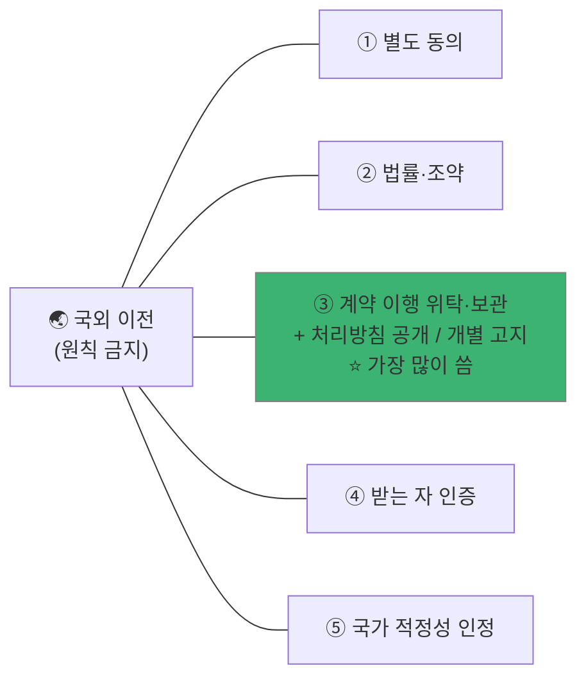
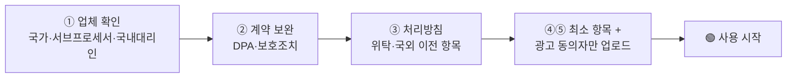
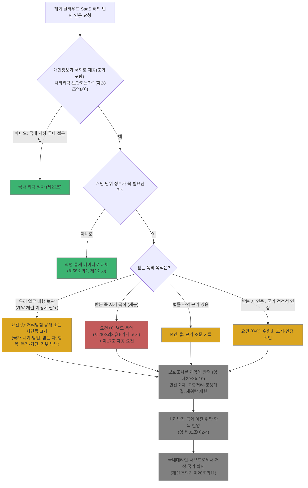

# Week 4 · Ch03. 국외 이전과 클라우드·SaaS 이용 시 확인할 점

> [← 이전 챕터](./ch02_정보주체_권리_행사_대응.md) · [📚 전체 목차](../../README.md) · [다음 챕터 →](./ch04_AI와_생성형_AI_도입.md)

| 항목 | 내용 |
|---|---|
| 예상 학습 시간 | 80분 (실습 포함) |
| 법령 기준일 | 2026-11-17 |
| 핵심 근거 | 개인정보 보호법 제26조, 제28조의8~제28조의11, 제31조의2, 제64조의2제1항제7호·제8호 / 시행령 제29조의7~제29조의12, 제31조제1항제2호·제4호 / 안전성 확보조치 기준 제6조의2, 제11조 |
| 관련 용어 | [국외 이전](../../용어집.md#국외-이전), [국외 이전 중지 명령](../../용어집.md#국외-이전-중지-명령), [처리위탁](../../용어집.md#처리위탁), [수탁자](../../용어집.md#수탁자), [국내대리인](../../용어집.md#국내대리인), [개인정보 처리방침](../../용어집.md#개인정보-처리방침) |
| 선수 챕터 | [W2-ch03 제공 vs 위탁](../2주차_처리_생애주기/ch03_제3자_제공과_처리위탁_구분.md), [W2-ch06 처리방침](../2주차_처리_생애주기/ch06_개인정보_처리방침_작성_실습.md) |

> [!IMPORTANT]
> **🎯 이 챕터 핵심 3줄**
> 1. 국외 **제공(조회 포함)·처리위탁·보관** 모두 국외 이전입니다. "저장만", "조회만"도 해당합니다.
> 2. 해외 SaaS 위탁·보관은 보통 **처리방침 공개 또는 개별 고지**(요건 ③), 해외 **제공**은 보통 **별도 동의**(요건 ①)입니다.
> 3. 어느 요건이든 **보호조치 계약 반영 + 처리방침 기재 + 재위탁·국내대리인 확인**은 공통입니다.

---

## 1. 학습 목표

이 챕터를 마치면 담당자님은 다음을 할 수 있습니다.

1. 해외 클라우드·SaaS 이용이 **국외 이전(제공·처리위탁·보관)**에 해당하는지 판단할 수 있다.
2. 국외 이전의 **5가지 적법 요건**과 각 요건에 따른 **고지·공개·보호조치** 의무를 적용할 수 있다.
3. 해외 SaaS 도입 전 **개인정보 확인표**를 작성하고 계약·처리방침에 반영할 수 있다.

---

## 2. 한 줄 비유

> [!TIP]
> 💡 국외 이전은 **"해외 창고에 물건을 맡기거나 보내는 것"**입니다. 국내 창고에 맡길 때보다 서류가 하나 더 필요합니다. 어느 나라 창고인지, 누가 관리하는지, 어떻게 보호하는지를 주인(정보주체)이 알 수 있게 해야 합니다.

단, 비유의 한계가 있습니다.

- 물건을 직접 보내지 않아도 **해외에서 조회만 할 수 있게** 해도 이전입니다(법 제28조의8제1항 "제공(조회되는 경우를 포함한다)").
- 해외 본사 직원이 우리 고객 DB를 볼 수 있는 구조라면 그것도 검토 대상입니다.

---

## 3. 개념 설명 및 법령 조문

### 3-1. 관련 조문

> [!NOTE]
> 📌 **조문 주소 읽는 법**: 조 → 항(①②) → 호(1. 2.) → 목(가. 나.). 자세한 설명은 [W1-ch01 3-2](../1주차_개인정보_기초/ch01_개인정보의_정의와_판단_기준.md#3-2-관련-조문)를 보세요.

#### 📜 제28조의8 (개인정보의 국외 이전) — 2023. 3. 14. 신설

국외로 **제공(조회 포함)·처리위탁·보관**("이전")은 원칙적으로 금지이고, 아래 **5개의 "문"** 중 하나를 통과해야 합니다.

| 호 | 요건 |
|---|---|
| ①1 | 국외 이전에 관한 **별도의 동의** |
| ①2 | **법률, 대한민국을 당사자로 하는 조약**·국제협정의 특별한 규정 |
| ①3 | **계약 체결·이행**을 위한 **처리위탁·보관** + (처리방침 **공개** 또는 서면등 **고지**) |
| ①4 | 이전받는 자의 **인증** + 안전조치·권리보장·이행 조치 |
| ①5 | 이전 **국가·국제기구**의 보호 수준이 **실질적으로 동등**하다고 위원회 **인정** |

**동의 시 미리 알릴 5가지** (제2항)

1. 이전되는 **항목**
2. 이전되는 **국가, 시기 및 방법**
3. 이전받는 자의 **성명(법인은 명칭과 연락처)**
4. 이전받는 자의 **이용목적 및 보유·이용 기간**
5. 이전을 **거부하는 방법, 절차 및 거부의 효과**

- **변경 시** (제3항): 알리고 다시 동의
- **보호조치** (제4항): 이 법의 다른 규정, 제17조~제19조, 제5장(권리 보장) 준수 + 시행령 보호조치
- **계약 금지** (제5항): 이 법을 위반하는 내용의 국외 이전 계약 금지

> [!TIP]
> **쉬운 풀이**: 기업이 가장 많이 쓰는 문은 **③ 계약 이행을 위한 처리위탁·보관 + 처리방침 공개**입니다(해외 클라우드에 서비스 데이터 저장 등). 제휴사 마케팅처럼 **해외 제3자에게 "제공"**하는 경우는 ③으로 처리할 수 없어 보통 **① 별도 동의**가 필요합니다.

📖 원문 요지 보기 (제28조의8 전체)

- ① 개인정보를 국외로 제공(조회되는 경우 포함)·처리위탁·보관(이하 "이전")해서는 안 된다. 다만 다음 중 하나에 해당하면 이전할 수 있다.
  - 1. 정보주체로부터 국외 이전에 관한 별도의 동의를 받은 경우
  - 2. 법률, 대한민국을 당사자로 하는 조약 또는 그 밖의 국제협정에 특별한 규정이 있는 경우
  - 3. 정보주체와의 계약의 체결 및 이행을 위해 처리위탁·보관이 필요한 경우로서 가. 제2항 각 호 사항을 처리방침에 공개했거나 나. 전자우편 등 서면등의 방법으로 정보주체에게 알린 경우
  - 4. 이전받는 자가 제32조의2에 따른 개인정보 보호 인증 등 위원회가 고시하는 인증을 받은 경우로서, 안전조치·권리보장 조치와 인증 사항을 이전 국가에서 이행하기 위한 조치를 모두 한 경우
  - 5. 이전되는 국가 또는 국제기구의 보호 체계 등이 이 법과 실질적으로 동등한 수준이라고 위원회가 인정한 경우
- ② 동의를 받을 때 미리 알릴 사항: 위 5가지
- ③ ② 사항을 변경하면 알리고 다시 동의를 받아야 한다.
- ④ 국외 이전 시 이 법의 다른 규정, 제17조~제19조, 제5장(권리 보장)을 준수하고 시행령의 보호조치를 해야 한다.
- ⑤ 이 법을 위반하는 사항을 내용으로 하는 국외 이전 계약을 체결해서는 안 된다.

근거 원문은 각주를 참고하세요.[^law-28-8]

**시행령 관련 기준**

| 구분 | 내용 |
|---|---|
| **보호조치** (영 제29조의10) | 1. **안전성 확보 조치**(영 제30조) 2. **고충처리 및 분쟁해결** 3. 그 밖의 필요한 조치 → 이전받는 자와 **미리 협의해 계약에 반영** |
| **알리는 방법** (영 제29조의7) | ①3나목의 "전자우편 등"은 **서면등의 방법**(서면, 전자우편, 팩스, 전화, 문자 등) |
| **처리방침 기재** (영 제31조제1항제2호·제4호) | 국외 이전의 **근거**와 제28조의8제2항 각 호 사항, 국외에서 직접 수집해 처리하면 **처리 국가명** |

근거 원문은 각주를 참고하세요.[^decree-29-7] [^decree-31]

#### 📜 제28조의9~제28조의11 (중지 명령, 상호주의, 재이전)

| 조 | 핵심 |
|---|---|
| 제28조의9 | 위반·보호 수준 부적정 시 위원회가 **국외 이전 중지 명령**, **7일 이내** 이의 제기 |
| 제28조의10 | 국외 이전을 제한하는 국가의 처리자에게 **상호주의** 제한 |
| 제28조의11 | 이전받은 자의 **제3국 재이전**에도 준용 |

📖 원문 요지 보기

- **제28조의9**: 위원회는 국외 이전이 계속되거나 예상되는 경우로서 1. 제28조의8제1항·제4항·제5항 위반 2. 이전받는 자나 이전 국가의 보호 수준이 부적정해 피해가 발생하거나 우려가 현저한 경우 국외 이전 중지를 명령할 수 있다. 명령을 받으면 7일 이내 이의를 제기할 수 있다.
- **제28조의10**: 국외 이전을 제한하는 국가의 처리자에게는 상호주의에 따라 같은 수준의 제한을 할 수 있다.
- **제28조의11**: 이전받은 자가 다시 제3국으로 이전하는 경우에도 제28조의8·제28조의9를 준용한다.

근거 원문은 각주를 참고하세요.[^law-28-9]

> [!WARNING]
> 💡 **위반하면**: 제28조의8제1항을 위반한 국외 이전과 중지 명령 불이행은 **과징금** 대상입니다(법 제64조의2제1항제7호·제8호).[^law-64-2]

### 3-2. 해외 클라우드·SaaS 유형별 판단

| 유형 | 국외 이전? | 주로 쓰는 요건 |
|---|---|---|
| **해외 리전 클라우드**에 서비스 데이터 저장 | 🔴 **예** (보관·위탁) | ③ + 공개·고지 |
| **국내 리전** + **해외 지원 인력 접근** | 🟡 **검토 필요** | 접근 범위·통제 확인 |
| **해외 SaaS** (CRM, 메일 발송, 설문, 챗봇) | 🔴 **예** (위탁·보관) | ③ + 공개, 또는 ① 동의 |
| **해외 제휴사**가 자기 목적으로 이용 | 🔴 **예** (제공) | 보통 ① **별도 동의** |
| **해외 계열사**(본사) 공유 | 🔴 **예** (목적에 따라 제공·위탁) | ① 또는 ③ |
| **국내 리전·국내 사업자**, 해외 접근 없음 | 🟢 아니오 (국내 위탁) | 제26조 |

📖 유형별 예시와 추가 확인 사항 보기

| 유형 | 예시 | 추가 확인 |
|---|---|---|
| 해외 리전 클라우드 | 회원 DB를 해외 리전 IaaS·DBaaS에 저장 | 위탁 계약(W2-ch03), 보호조치 계약 반영 |
| 국내 리전 + 해외 접근 | 국내 서버 + 해외 기술지원센터 원격 접속 | ⚠️ 해석 필요 `[출처: 일반 지식, 원문 확인 권장]` |
| 해외 SaaS | 해외 사업자가 서비스 제공·데이터 저장 | 국내대리인, 재위탁(서브프로세서) 목록, 데이터 저장 국가 |
| 해외 제휴사 | 해외 파트너의 마케팅 | 제17조 제공 요건도 함께 (②의 5가지 고지) |
| 해외 계열사 | 글로벌 HR 시스템 통합 | 계열사도 별개 법인 (W2-ch03) |
| 국내 | 국내 IDC, 국내 SaaS | — |

> [!NOTE]
> 📌 **참고 기준**: 위원회는 클라우드 사업자가 수탁자인지를 ① 서비스가 개인정보 처리를 예정하는지 ② 접근권한 등 안전조치에 대한 통제 권한이 있는지 ③ 처리 과정에 관여하는지로 판단합니다. 암호화하거나 일부 접근을 제한해도 **실질적인 접근권한을 보유하면 수탁자**입니다. [출처: 1. 개인정보 질의응답 모음집(2025.12.).pdf, Q90 (인쇄 p.105, PDF p.115)]

> [!WARNING]
> ⚠️ 확인 필요: 위 표의 유형 분류는 이 교재의 실무 정리입니다. "국내 리전 + 해외 원격 지원"의 경우, 위 기준에 따라 해외 인력이 **실질적인 접근권한**을 가지면 위탁 관계로 볼 수 있습니다. 하지만 그것이 **국외 이전**(제28조의8)에도 해당하는지를 다룬 위원회 해석은 참고자료에서 찾지 못했습니다. 위원회의 국외 이전 관련 안내서(참고자료 미보유)를 확인하세요.

### 3-3. 클라우드 이용 시 안전조치 고시에서 챙길 점

| 조항 | 내용 |
|---|---|
| 제6조의2제1항 단서 | 일일평균 100만 명 이상 처리자가 **클라우드**로 운영하면, 망 차단 대상 PC는 **해당 클라우드 접속 외 인터넷 차단** |
| 제11조 (안내서 해설) | 재해·재난 대비 대상이면 **클라우드에서도** 위기대응 매뉴얼·백업·복구 계획 |
| 제9조 (안내서 해설) | 클라우드에서도 악성프로그램 방지 (공유 책임 범위 확인) |
| 유출 대응 (유출등 대응 안내서) | 자체 조치 + **CSP·MSP 기술지원 센터**에 긴급 차단·스냅샷 등 지원 요청 |

근거 원문은 각주를 참고하세요.[^safety-cloud] [^breach-p26]

> ✅ **3절 한 줄 정리**: "저장만·조회만"도 이전이고, 위탁·보관은 공개·고지, 제공은 동의, 그리고 언제나 계약·처리방침·재위탁 확인.

---

## 4. 사내 실무 적용

> 결론 표시: 🟢 가능 · 🟡 조건부 가능 · 🔴 불가

### 🎭 상황극 1. 마케팅팀의 "미국 이메일 마케팅 SaaS 바로 쓸게요"

> **📨 마케팅팀 길 매니저**: "뉴스레터 발송을 **미국 이메일 마케팅 SaaS**로 바꾸려고요. 회원 이름·이메일·구매 등급을 업로드하면 알아서 보내 줘요. 신용카드로 결제하면 바로 쓸 수 있는데, 다음 주부터 써도 되죠?"

**🙋 담당자 판단**

| 결론 | 근거 |
|---|---|
| 🟡 **조건부 가능**: 해외 SaaS에 회원 정보를 업로드하는 것은 **국외 처리위탁·보관**입니다. 국외 이전 요건(보통 제28조의8제1항제3호: 처리방침 공개 또는 개별 고지)과 **위탁 요건**(제26조), **보호조치 계약 반영**(영 제29조의10)을 먼저 갖춰야 합니다. | 법 제28조의8제1항제3호·제2항·제4항, 시행령 제29조의10, 제31조제1항제2호, 법 제26조(위탁 문서·공개), 제22조제1항제7호(뉴스레터 = 홍보이므로 광고 수신 동의자만 대상) |

**✅ 다음 행동**

- [ ] **① 업체 확인**: 데이터 저장 국가, 재위탁(서브프로세서) 목록, 보안 인증, 국내대리인을 확인합니다(실습 Q4 확인표).
- [ ] **② 계약 보완**: 업체 표준 약관(DPA 등)에 안전조치, 고충처리·분쟁해결, 목적 외 이용 금지, 재위탁 제한, 감독, 손해배상이 들어 있는지 확인하고 부족하면 보완합니다(법 제26조제1항, 영 제28조제1항, 영 제29조의10제2항).
- [ ] **③ 처리방침 반영**: 위탁 현황과 국외 이전 항목에 업체명·연락처, 이전 국가, 이전 항목, 시기·방법, 이용목적·보유기간, 거부 방법을 추가합니다.
- [ ] **④ 항목 최소화**: 구매 등급이 꼭 필요한지 확인합니다.
- [ ] **⑤ 동의자만**: 광고 수신 동의자만 업로드합니다.

**💬 왜 그런가요?**

- "신용카드로 결제하면 바로 쓸 수 있다"는 구매의 편리함과 **법적 요건 충족**은 별개입니다.
- 애플은 해외 수탁자(알리페이)를 처리방침에 공개하지 않아 과징금과 과태료를 받았습니다(6절).

### 🎭 상황극 2. IT팀의 "글로벌 본사가 우리 고객 DB를 조회만 한대요"

> **📨 IT팀 국 팀장**: "싱가포르 **아시아 본사**에서 지역별 매출 분석을 한다고, 우리 고객 DB에 **조회 전용 계정**을 달래요. 데이터를 보내는 게 아니라 조회만 하는 거니까 국외 이전은 아니죠?"

**🙋 담당자 판단**

| 결론 | 근거 |
|---|---|
| 🔴 **그대로는 불가**: 국외 이전에는 **"조회되는 경우"도 포함**됩니다. 또 본사가 **자기 목적(지역 매출 분석)**으로 쓰면 **제3자 제공**에 해당할 가능성이 높아, 계약 이행 근거(①3)로 처리하기 어렵습니다. | 법 제28조의8제1항(제공에 조회 포함), 제17조(제3자 제공), 표준지침 제7조(접근권한 부여도 제공 행위), 법 제3조제7항(익명·가명 우선) |

**✅ 다음 행동**

- [ ] **① 개인 단위 필요성**: 본사의 분석 목적에 개인 단위 정보가 꼭 필요한지 확인합니다. 지역별 매출 분석이면 집계·익명 데이터로 충분할 가능성이 큽니다 → 익명정보는 법 적용 제외([W1-ch01](../1주차_개인정보_기초/ch01_개인정보의_정의와_판단_기준.md)).
- [ ] **② 필요하다면**: 국외 이전 별도 동의(제2항 5가지 고지) 또는 다른 적법 요건을 검토합니다.
- [ ] **③ 접근 방식**: 어떤 경우든 DB 직접 계정 대신 필요한 데이터만 추출해 제공하는 방식을 우선 검토하고, 접근 범위·기록을 통제합니다.

**💬 왜 그런가요?**

- 같은 그룹이라도 **별개 법인**이고, 자기 목적으로 조회하면 제공입니다(W2-ch03).
- "조회만"이라는 표현이 국외 이전을 피하는 이유가 되지 않는다는 점이 법문에 명시되어 있습니다.

> ✅ **4절 한 줄 정리**: 카드 결제 전에 확인표부터, "조회만"이면 먼저 익명 통계로 대체할 수 있는지부터.

---

## 5. 해외 클라우드·SaaS 도입 판단 플로우

**그림 읽는 법**: 가장 먼저 **"개인 단위 정보가 꼭 필요한가"**를 묻습니다.

| 칸 | 의미 |
|---|---|
| 🟩 녹색 | 익명·통계로 바꿔 국외 이전 문제를 없앰 / 국내 위탁 |
| 🟨 황색 (위탁) | 공개·고지 |
| 🟥 적색 (제공) | 별도 동의 |
| ⬜ 회색 (마지막 세 칸) | 보호조치 계약, 처리방침, 국내대리인·재위탁 확인은 **공통** |

---

## 6. 개인정보보호위원회 처분 사례

### ⚖️ 사례: 카카오페이·애플의 무단 국외 이전 (2025. 1. 의결) + 알리익스프레스·테무 (2024. 7. / 2025. 5.) — "국외 이전 요건" 관점

> 카카오페이·애플 사례는 [W1-ch02](../1주차_개인정보_기초/ch02_개인정보_법체계_지도.md)(법체계)와 [W2-ch03](../2주차_처리_생애주기/ch03_제3자_제공과_처리위탁_구분.md)(제공 vs 위탁)에서도 다뤘습니다. 여기서는 **국외 이전 요건을 어떻게 갖추지 못했는지**에 집중합니다.

| 회사 | 놓친 요건 | 위반 조항 | 처분 |
|---|---|---|---|
| **카카오페이** | 해외 **제공**인데 **별도 동의 없음** | §28조의8① | 과징금 59억 6,800만 원 |
| **애플** | 국외 **위탁**인데 **처리방침 미공개** | §28조의8①, §26② | 과징금 24억 500만 원·과태료 220만 원 |
| **알리페이** | 위법하게 받은 데이터로 모델 구축 | — | NSF 모델 파기 명령 |
| **테무** | 국외 위탁·보관 **미공개·미고지** | §28의8① | 과징금 13억 6,900만 원(국외이전·주민등록번호)·과태료 1,760만 원 |
| **알리익스프레스** (2024. 7.) | 법적 근거 없는 국외 이전 등 | — | 과징금 19억 7,800만 원 |

- **출처**: 개인정보보호위원회 보도자료, 「개인정보위, 개인정보 무단 국외 이전한 카카오페이·애플에 총 83억 7,520만 원 과징금·과태료 부과」(2025. 1. 22. 의결)[^case-kakaopay] / 「국외이전 규정 등 개인정보 보호법 위반한 테무에 13억 6,900만 원 과징금 부과」(2025. 5. 14. 의결)[^case-temu]

**📌 교훈**

1. 국외 **위탁**이라도 **처리방침 공개 또는 개별 고지**가 없으면 요건 ③을 충족하지 못해 위법한 국외 이전이 됩니다. 애플과 테무가 이 구조였습니다.
2. 해외로 **제공**할 때는 **별도 동의**가 필요하고, 계약 이행 근거로 돌려 말할 수 없습니다(카카오페이).
3. 같은 수탁자를 다른 회사(구글)는 공개하고 있었다는 점에서, 공개는 **어렵지 않은 의무**입니다.

📖 사건 상세 보기 (카카오페이·애플, 테무)

**카카오페이·애플**

- 카카오페이는 애플의 해외 수탁자 알리페이(싱가포르)에 전체 이용자 약 4천만 명의 정보를 제3자 제공 동의 및 국외이전 동의 없이 전송했습니다. 위원회는 이를 적법 처리 근거 없는 국외이전으로 보았습니다.
- 애플은 결제 처리 업무를 알리페이에 국외 위탁하면서 처리방침 등으로 국외 수탁자를 공개하거나 고지하지 않았습니다(처리방침에는 NHN KCP만 공개, 알리페이는 미공개).
- 보도자료는 "구글은 개인정보처리방침에 알리페이를 국외 수탁자로 공개하고 있음"이라고 비교했습니다.

**테무**

- 테무는 상품 배송을 위해 중국·싱가포르·일본 등 국외 사업자에게 처리를 위탁·보관하면서, 처리방침에 공개하거나 이용자에게 알리지 않았습니다.
- 보도자료는 "계약 이행을 위해서 국외 사업자에게 개인정보 처리 위탁 또는 보관 등이 필요할 경우 처리방침에 해당 사실을 공개하거나 이용자에게 전자우편 등으로 알려야" 한다고 설명합니다.
- 위원회는 이에 앞서 2024. 7. 알리익스프레스에도 법적 근거 없는 국외 이전 등으로 과징금 19억 7,800만 원을 부과했습니다.

> [!TIP]
> 💬 **사수의 한마디**: 구매팀·IT팀과 함께 **"카드로 결제 중인 SaaS 목록"**을 뽑아 보세요. 정식 계약 없이 부서 카드로 쓰는 해외 SaaS(설문, 협업 툴, AI 도구, 이메일 발송 등)가 가장 큰 사각지대입니다. 이 목록이 처리방침의 국외 이전 항목과 맞는지 대조하는 것부터 시작하세요.

---

## 7. 오답노트

| # | ❌ 잘못된 생각 | ✅ 올바른 이해 | 근거 |
|---|---|---|---|
| 1 | "해외 서버에 저장만 하니 국외 이전 아니에요." | 국외 **보관**도 이전 | 법 제28조의8제1항 |
| 2 | "본사가 조회만 하니 보낸 게 아니에요." | **조회**도 제공에 포함 | 법 제28조의8제1항 |
| 3 | "해외 SaaS는 무조건 고객 동의가 필요해요." | 위탁·보관이면 **공개·고지**로 가능 | 법 제28조의8제1항제1호·제3호 |
| 4 | "업체 약관에 동의만 하면 끝이에요." | **보호조치를 계약에 반영** | 법 제28조의8제4항·제5항, 영 제29조의10 |
| 5 | "업체의 하청은 우리가 알 바 아니에요." | **재이전**에도 준용, 재위탁은 **동의** | 법 제28조의11, 제26조제6항 |
| 6 | "처리방침에 '해외 업체 등에 위탁'만 쓰면 돼요." | 근거·국가·받는 자·항목·목적·기간·거부 방법 | 영 제31조제1항제2호, 법 제28조의8제2항 |

**🔎 번호별 보충 설명**

1. 국외 보관도 국외 이전입니다.
2. 국외 이전의 "제공"에는 조회되는 경우가 포함됩니다.
3. 계약 체결·이행을 위한 처리위탁·보관이면 처리방침 공개 또는 서면등 고지로 가능합니다(요건 ③). 동의는 여러 요건 중 하나입니다.
4. 이전받는 자와 안전조치, 고충처리·분쟁해결 등 보호조치를 미리 협의해 계약에 반영해야 합니다. 법을 위반하는 내용의 국외 이전 계약은 체결할 수 없습니다.
5. 이전받은 자의 제3국 재이전에도 국외 이전 규정이 준용되고, 재위탁은 위탁자 동의가 필요합니다. 서브프로세서 목록을 확인하세요.
6. 처리방침에 국외 이전의 근거와 이전 국가, 시기·방법, 이전받는 자(명칭·연락처), 항목, 목적·기간, 거부 방법을 적어야 합니다.

---

## 8. 업무 체크리스트

**📋 국외 이전·클라우드·SaaS 관리 점검표**

| 점검 주기 | 점검자 | 점검일 |
|---|---|---|
| 신규 도입 시 + 연 1회 전수 점검 | 개인정보보호 담당자 + IT·구매 | `____-__-__` |

**① 현황 파악**

- [ ] 사용 중인 **클라우드·SaaS·해외 법인 연동 목록**(부서 카드 결제 포함)이 있다
- [ ] 항목마다 **데이터 저장 국가·접근 국가**와 국외 이전 해당 여부를 판단했다 (조회 포함)
- [ ] 개인 단위가 필요 없는 해외 분석·보고는 **익명·통계 데이터**로 바꿨다

**② 적법 요건**

- [ ] 국외 이전마다 **적법 요건**(동의 / 법령 / 계약 이행 + 공개·고지 / 인증 / 적정성)과 근거를 기록했다 (제28조의8제1항)
- [ ] 계약 이행 요건이면 처리방침 공개 또는 **서면등 고지**를 했다 (제28조의8제1항제3호, 영 제29조의7)
- [ ] 동의 요건이면 **5가지 고지 사항**이 들어간 **별도 동의**를 받았다 (제28조의8제2항)

**③ 계약·공개·운영**

- [ ] 이전받는 자와의 계약에 **안전조치, 고충처리·분쟁해결** 등 보호조치가 있다 (영 제29조의10)
- [ ] 업체의 **재위탁(서브프로세서) 목록과 국가**를 확인했고, 변경 시 통지받는다 (제28조의11, 제26조제6항)
- [ ] 해외 업체의 **국내대리인**과 연락처를 확인했다 (제31조의2)
- [ ] 처리방침에 **국외 이전 근거·국가·이전받는 자·항목·목적·기간·거부 방법**이 있다 (영 제31조제1항제2호)
- [ ] 클라우드 환경의 **백업·복구, 악성프로그램 방지, 유출 시 CSP 연락 절차**를 확인했다 (고시 제9조·제11조, 유출등 대응 안내서)

---

## 9. 실습 과제 / 퀴즈

### 📝 객관식

**Q1.** 개인정보 보호법 제28조의8제1항에서 국외 "이전"에 **포함되지 않는 것**은?

1. 국외 제3자에게 제공하는 것 (조회되는 경우 포함)
2. 국외에 처리를 위탁하는 것
3. 국외에 보관하는 것
4. 국내 서버에 저장하고 국내 직원만 접근하는 것

**Q2.** 정보주체로부터 국외 이전 **별도 동의**를 받을 때 미리 알려야 하는 사항이 **아닌 것**은?

1. 개인정보가 이전되는 국가, 시기 및 방법
2. 개인정보를 이전받는 자의 성명(법인은 명칭과 연락처)
3. 개인정보의 이전을 거부하는 방법, 절차 및 거부의 효과
4. 개인정보를 이전받는 자의 자본금과 직원 수

**Q3.** 해외 클라우드에 회원 데이터를 보관하는 경우(정보주체와의 계약 이행에 필요한 처리위탁·보관) 제28조의8제1항제3호에 따라 해야 하는 것은?

1. 반드시 모든 회원에게서 별도 동의를 받아야 한다.
2. 제28조의8제2항 각 호의 사항을 처리방침에 공개하거나 서면등의 방법으로 정보주체에게 알린다.
3. 개인정보보호위원회에 사전 허가를 받는다.
4. 아무 조치도 필요 없다.

### 🛠️ 실습: 해외 SaaS 도입 전 확인표 작성

**Q4.** 고객상담팀이 **해외 AI 고객상담 챗봇 SaaS**(본사: 미국, 데이터 저장: 미국·아일랜드, 서브프로세서: 클라우드 사업자 1곳·AI 모델 제공사 1곳)를 도입하려 합니다. 상담 대화에는 고객 이름, 주문번호, 연락처, 주소가 들어갈 수 있습니다. 아래 **도입 전 확인표**를 채우고, **처리방침에 추가할 국외 이전 문구**를 작성하세요.

| # | 확인 항목 | 확인 결과 / 조치 | 근거 |
|---|---|---|---|
| 1 | 국외 이전 해당 여부와 유형 (제공/위탁/보관) | | |
| 2 | 적법 요건 (제28조의8제1항 몇 호) | | |
| 3 | 이전 국가·이전받는 자·항목·시기·방법 | | |
| 4 | 재위탁(서브프로세서)과 국가 | | |
| 5 | 계약에 반영할 보호조치 | | |
| 6 | 국내대리인 | | |
| 7 | AI 학습 이용 여부 (상담 데이터가 모델 학습에 쓰이는가) | | |
| 8 | 처리방침·고지 반영 | | |

> [!TIP]
> 💡 7번은 다음 챕터([W4-ch04](./ch04_AI와_생성형_AI_도입.md))와 연결됩니다. 업체가 고객 데이터를 **자기 모델 학습**에 쓰면 위탁 범위를 넘는 이용이 될 수 있습니다.

> [!NOTE]
> ✅ 다 풀었다면 [정답 및 해설](../../정답과_해설.md#w4-ch03)에서 확인하세요. 틀린 문제는 **7. 오답노트**에 한 줄씩 추가하세요.

---

## 10. 더 읽을거리

| 자료 | 이 챕터와의 관계 |
|---|---|
| **개인정보 보호법** 법률 제21445호 | 제28조의8~제28조의11, 제31조의2, 제64조의2제1항제7호·제8호 |
| **개인정보 보호법 시행령** 대통령령 제36804호 | 제29조의7~제29조의12, 제31조제1항제2호·제4호, 제32조의3 |
| **2026 개인정보 처리방침 작성지침** 개인정보보호위원회, 2026. 4. | 처리방침 10번 항목 "개인정보의 국외 수집 및 이전" 작성 예시 |
| **개인정보 유출등 대응 안내서** 개인정보보호위원회, 2026. 9. | PDF p.26 클라우드·호스팅 환경 긴급 조치 |
| **개인정보위 보도자료 (카카오페이·애플)** 개인정보보호위원회, 2025. 1. | 6절 사례, p.3 처리방침 국외 수탁자 공개 비교 |
| **개인정보위 보도자료 (테무)** 개인정보보호위원회, 2025. 5. | 6절 사례, p.1 알리익스프레스 언급, p.5 위반 조항 |
| **국외 이전 관련 안내서, 해외사업자의 개인정보 보호법 적용 안내서** 개인정보보호위원회 (참고자료 미보유) | 경계 사례 해석 |

📁 참고자료 파일명 보기

- `개인정보 보호법(법률)(제21445호)(20260911).pdf`
- `개인정보 보호법 시행령(대통령령)(제36804호)(20261110).pdf`
- `2026 개인정보 처리방침 작성지침.pdf`
- `개인정보 유출등 대응 안내서(2026.9.).pdf`
- `250123 (석간) 개인정보위, 개인정보 무단 국외 이전한 카카오페이·애플에 총 83억 7,520만 원 과징금·과태료 부과(조사3팀).pdf`
- `250515 (석간) 국외이전 규정 등 개인정보 보호법 위반한 테무에 13억 6,900만 원 과징금 부과(조사1과).pdf`

---

> [← 이전 챕터](./ch02_정보주체_권리_행사_대응.md) · [📚 전체 목차](../../README.md) · [📖 용어집](../../용어집.md) · [다음 챕터 →](./ch04_AI와_생성형_AI_도입.md)

[^law-28-8]: [출처: [개인정보 보호법(법률)(제21445호)(20260911).pdf](<../../2_참고자료/개인정보 보호법(법률)(제21445호)(20260911).pdf>), 제28조의8제1항~제6항 ([본조신설 2023. 3. 14.])]
[^decree-29-7]: [출처: [개인정보 보호법 시행령(대통령령)(제36804호)(20261110).pdf](<../../2_참고자료/개인정보 보호법 시행령(대통령령)(제36804호)(20261110).pdf>), 제29조의7, 제29조의8, 제29조의10 ([본조신설 2023. 9. 12.])]
[^decree-31]: [출처: [개인정보 보호법 시행령(대통령령)(제36804호)(20261110).pdf](<../../2_참고자료/개인정보 보호법 시행령(대통령령)(제36804호)(20261110).pdf>), 제31조제1항제2호·제4호]
[^law-28-9]: [출처: [개인정보 보호법(법률)(제21445호)(20260911).pdf](<../../2_참고자료/개인정보 보호법(법률)(제21445호)(20260911).pdf>), 제28조의9~제28조의11]
[^law-64-2]: [출처: [개인정보 보호법(법률)(제21445호)(20260911).pdf](<../../2_참고자료/개인정보 보호법(법률)(제21445호)(20260911).pdf>), 제64조의2제1항제7호·제8호]
[^safety-cloud]: [출처: [개인정보의 안전성 확보조치 기준(개인정보보호위원회고시)(제2026-9호)(20260701).pdf](<../../2_참고자료/개인정보의 안전성 확보조치 기준(개인정보보호위원회고시)(제2026-9호)(20260701).pdf>), 제6조의2제1항 단서, 제9조, 제11조] / [출처: [개인정보의 안전성 확보조치 기준 안내서(2026.11).pdf](<../../2_참고자료/개인정보의 안전성 확보조치 기준 안내서(2026.11).pdf>), PDF p.105 (클라우드 악성프로그램 방지), PDF p.112 (클라우드 재해·재난 대비)]
[^breach-p26]: [출처: [개인정보 유출등 대응 안내서(2026.9.).pdf](<../../2_참고자료/개인정보 유출등 대응 안내서(2026.9.).pdf>), PDF p.26 클라우드·호스팅 환경 CSP·MSP 기술지원 요청]
[^case-kakaopay]: [출처: [250123 (석간) 개인정보위, 개인정보 무단 국외 이전한 카카오페이·애플에 총 83억 7,520만 원 과징금·과태료 부과(조사3팀).pdf](<../../2_참고자료/250123 (석간) 개인정보위, 개인정보 무단 국외 이전한 카카오페이·애플에 총 83억 7,520만 원 과징금·과태료 부과(조사3팀).pdf>), p.1~4]
[^case-temu]: [출처: [250515 (석간) 국외이전 규정 등 개인정보 보호법 위반한 테무에 13억 6,900만 원 과징금 부과(조사1과).pdf](<../../2_참고자료/250515 (석간) 국외이전 규정 등 개인정보 보호법 위반한 테무에 13억 6,900만 원 과징금 부과(조사1과).pdf>), p.1 (알리익스프레스 '24. 7월 처분 각주), p.2 (국외 위탁 미공개, 보호법 설명), p.5 「붙임」]
