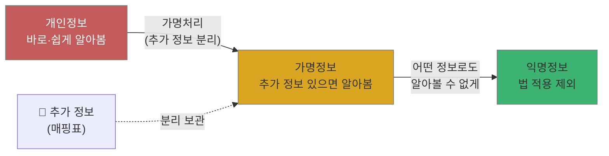
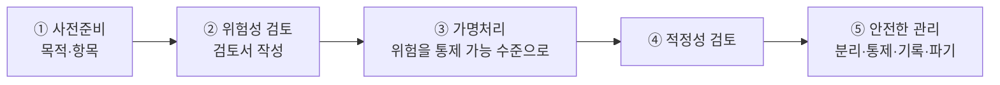
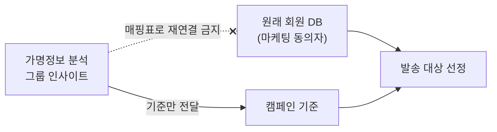
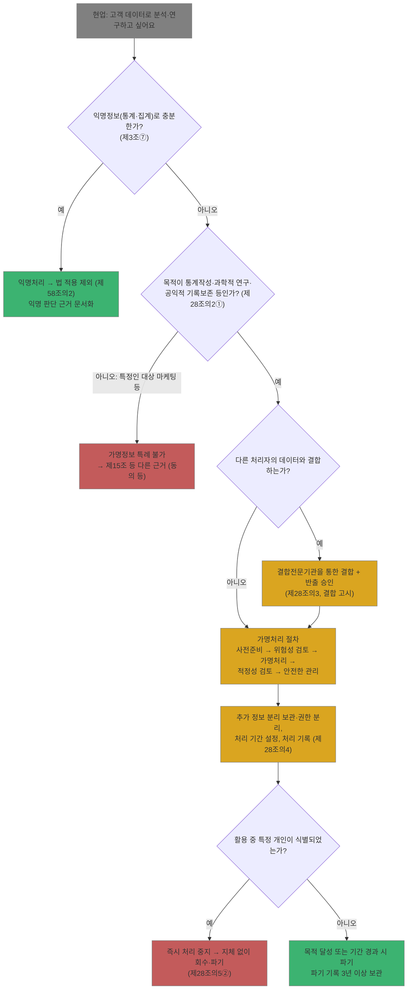
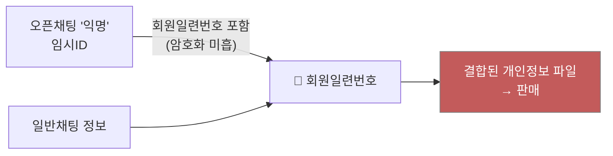

# Week 4 · Ch05. 가명정보의 기본 개념과 사내 활용 시 주의점

> [← 이전 챕터](./ch04_AI와_생성형_AI_도입.md) · [📚 전체 목차](../../README.md) · [다음 챕터 →](./ch06_A사_유출사고_종합_모의훈련.md)

| 항목 | 내용 |
|---|---|
| 예상 학습 시간 | 60분 (개념 수준) |
| 법령 기준일 | 2026-11-17 |
| 핵심 근거 | 개인정보 보호법 제2조제1호다목·제1호의2·제8호, 제28조의2~제28조의5, 제28조의7, 제58조의2, 제64조의2제1항제6호 / 시행령 제29조의2~제29조의5 / 가명정보의 결합 및 반출 등에 관한 고시 / **가명정보 처리 가이드라인(2026. 3.)** |
| 관련 용어 | [가명정보](../../용어집.md#가명정보), [가명처리](../../용어집.md#가명처리), [추가 정보](../../용어집.md#추가-정보), [익명정보](../../용어집.md#익명정보), [가명정보 결합](../../용어집.md#가명정보-결합), [과학적 연구](../../용어집.md#과학적-연구) |
| 선수 챕터 | [W1-ch01 개인정보의 정의](../1주차_개인정보_기초/ch01_개인정보의_정의와_판단_기준.md) (3-3 세 가지 정보 비교) |

> [!IMPORTANT]
> **🎯 이 챕터 핵심 3줄**
> 1. 가명정보는 **여전히 개인정보**이고, **통계·과학적 연구·공익적 기록보존** 등 목적에서만 동의 없이 씁니다.
> 2. 가명정보로 **특정 개인을 다시 찾는 것은 금지**(과징금)이고, 추가 정보는 **분리 보관·권한 분리**합니다.
> 3. 다른 회사와 합칠 때는 반드시 **결합전문기관**을 거칩니다.

> [!NOTE]
> 💡 이 챕터는 커리큘럼에 따라 **개념 수준**까지만 다룹니다. 실제 가명처리 방법(항목별 기법, 위험성 검토서·적정성 검토 작성)은 가명정보 처리 가이드라인 본문과 전문가 검토가 필요합니다.

---

## 1. 학습 목표

이 챕터를 마치면 담당자님은 다음을 할 수 있습니다.

1. **가명정보와 익명정보**를 "추가 정보로 되돌릴 수 있는가"로 구분할 수 있다.
2. 가명정보를 동의 없이 쓸 수 있는 **3가지 목적**과 그때도 지켜야 할 **안전조치·기록·금지 의무**를 설명할 수 있다.
3. 현업의 가명정보 활용 요청에서 **위험 신호**(재식별 목적, 개인 단위 마케팅, 추가 정보 혼재)를 찾아낼 수 있다.

---

## 2. 한 줄 비유

> [!TIP]
> 💡 가명정보는 **"이름표를 번호표로 바꾼 사물함"**, 추가 정보는 **"번호표와 이름을 대조하는 명부"**입니다. 명부를 다른 금고에 넣어 두면 사물함만 봐서는 누구 것인지 모르지만, 명부만 있으면 바로 알 수 있습니다. 익명정보는 사물함 자체를 녹여 **"사물함 100개 중 30개가 사용 중"이라는 통계만 남긴 것**입니다.

단, 비유의 한계가 있습니다.

- 명부(추가 정보)가 없어도 **사물함 안의 내용물**(희귀한 직업, 작은 동네 주소 등)로 누구 것인지 알 수 있다면 가명처리가 충분하지 않은 것입니다.
- 그래서 가명처리는 단순한 이름 바꾸기가 아니라 **위험성 검토와 적정성 검토**를 포함한 절차입니다.

---

## 3. 개념 설명 및 법령 조문

### 3-1. 세 가지 정보 다시 보기

| 구분 | 개인정보 | 가명정보 | 익명정보 |
|---|---|---|---|
| 개인정보인가? | ✅ | ✅ **(여전히 개인정보)** | ❌ |
| 법 적용 | 전부 | 적용 + 가명정보 **특례** | **적용 제외** |
| 동의 없이 쓰는 목적 | 제15조 등 근거 | **통계작성, 과학적 연구, 공익적 기록보존 등** | 제한 없음 |
| 근거 | 법 제2조제1호가목·나목 | 법 제2조제1호다목·제1호의2, 제28조의2 | 법 제58조의2 |

📖 정의 전문 보기

- **개인정보**: 살아 있는 개인을 알아볼 수 있는 정보
- **가명정보**: 가명처리해 추가 정보 없이는 특정 개인을 알아볼 수 없는 정보
- **익명정보**: 시간·비용·기술을 합리적으로 고려할 때 다른 정보를 사용해도 더 이상 개인을 알아볼 수 없는 정보

근거 원문은 각주를 참고하세요.[^law-def] 가명정보 처리 가이드라인도 가명정보는 "여전히 개인정보의 범주에 포함되며, 보호법의 적용을 받"고, 익명정보는 "보호법의 적용을 받지 않"는다고 설명합니다.[^pseudo-p18]

### 3-2. 관련 조문

> [!NOTE]
> 📌 **조문 주소 읽는 법**: 조 → 항(①②) → 호(1. 2.) → 목(가. 나.). 자세한 설명은 [W1-ch01 3-2](../1주차_개인정보_기초/ch01_개인정보의_정의와_판단_기준.md#3-2-관련-조문)를 보세요.

#### 📜 제28조의2 (가명정보의 처리 등)

- **①**: **통계작성, 과학적 연구, 공익적 기록보존 등**을 위해 **동의 없이** 처리 가능
- **②**: 제3자 제공 시 특정 개인을 알아보는 데 쓰일 수 있는 정보를 **포함하면 안 됨**
- **한마디로**: 목적이 맞으면 동의 없이 쓰거나 다른 회사에 줄 수 있지만, **추가 정보(매핑표)는 절대 함께 주면 안 됩니다.**

**세 가지 목적 (가이드라인)**

| 목적 | 뜻 | 기업에도? |
|---|---|---|
| **통계작성** | 특정 집단이나 대상에 관한 **수량적 정보** | 시장조사·마케팅 전략 수립용 **상업적 통계도 포함** (PDF p.39) |
| **과학적 연구** | 체계적·객관적으로 검증 가능한 질문에 대한 연구 | 기술·제품·서비스 개발과 실증, **산업적 연구·민간 자체 예산 연구도 포함** (PDF p.40, 법 제2조제8호) |
| **공익적 기록보존** | 공공의 이익을 위해 지속적으로 열람할 가치가 있는 정보 기록·보존 | 기업도 일반적 공익을 위해 보존하면 인정 (PDF p.43) |

근거 원문은 각주를 참고하세요.[^law-28-2] [^pseudo-purpose]

> [!WARNING]
> ⚠️ 확인 필요: 가이드라인에는 "가명정보로 통계작성 후 1:1 맞춤형 타겟 마케팅도 가능한가요?"(PDF p.39), "AI 기술·서비스 개발 및 고도화 목적도 과학적 연구에 해당하나요?"(PDF p.40)라는 FAQ가 있지만, 답변 본문이 PDF 글꼴 문제로 텍스트로 추출되지 않아 원문을 확인하지 못했습니다. PDF를 직접 열어 확인하세요. 이 교재는 **1:1 타겟 마케팅**에 대해 법 제28조의5제1항(특정 개인을 알아보기 위한 처리 금지)을 근거로 **가명정보 특례로는 할 수 없다**고 봅니다.

#### 📜 제28조의4 (가명정보에 대한 안전조치의무 등)

| 항 | 의무 | 실무 포인트 |
|---|---|---|
| ① | **추가 정보 분리** 보관·관리 등 안전조치 | 가명정보·추가 정보 담당자 **반드시 구분**, 원칙적으로 **물리적 분리**[^safety-guide-p69] |
| ② | **처리 기간** 별도 설정 가능 | 기간이 끝나면 파기 (법 제21조제1항) |
| ③ | 처리 **기록** 작성·보관, 파기 후 **3년 이상** 보관 | 가명정보 처리 대장 |

📖 원문 요지 보기

- ① 원래 상태로 복원하기 위한 추가 정보를 별도로 분리하여 보관·관리하는 등 유출등이 되지 않도록 시행령에 따른 기술적·관리적·물리적 조치. (안전조치 안내서: 가명정보 접근 담당자와 추가 정보 접근 담당자를 반드시 구분, 원칙적으로 물리적 분리, 불가피하면 논리적 분리 + 더 엄격한 접근통제)
- ② 처리목적 등을 고려해 가명정보의 처리 기간을 별도로 정할 수 있다. (법 제21조제1항 "가명정보의 처리 기간 경과")
- ③ 처리 목적, 제3자 제공 시 제공받는 자, 처리 기간 등 시행령 사항의 관련 기록을 작성·보관하고, 가명정보를 파기한 경우 파기한 날부터 3년 이상 보관

근거 원문은 각주를 참고하세요.[^law-28-4]

#### 📜 제28조의5 (가명정보 처리 시 금지의무 등)

| 항 | 의무 |
|---|---|
| ① | **특정 개인을 알아보기 위한 목적**으로 처리 금지 |
| ② | 처리 중 식별 가능 정보가 **생성되면 즉시 중지**, **지체 없이 회수·파기** |

- **금지 범위**: 추가 정보로 복원하는 것뿐 아니라 **보유한 다른 정보나 공개된 정보와 결합·대조**해 알아보려는 시도도 모두 금지됩니다.[^pseudo-p31]

> [!WARNING]
> **제재**: 특정 개인을 알아보기 위한 목적으로 처리하면 **과징금** 대상입니다(법 제64조의2제1항제6호).

근거 원문은 각주를 참고하세요.[^law-28-5]

#### 📜 제28조의3 (가명정보의 결합 제한) + 결합 고시

- **①**: 서로 다른 처리자 간 결합은 **전문기관**이 수행
- **②**: 결합 정보를 외부로 **반출**하려면 가명·익명처리 후 **전문기관 장의 승인**
- **한마디로**: 우리 회사 가명정보와 제휴사 가명정보를 **직접 합치면 안 됩니다.**
- **세부 기준**: 「가명정보의 결합 및 반출 등에 관한 고시」(제2025-8호): 결합전문기관 지정, 결합 절차, 반출 심사 등

근거 원문은 각주를 참고하세요.[^law-28-3]

#### 📜 제28조의7 (적용범위)

가명정보는 회사도 누구 것인지 모르게 만든 정보이므로, 개인별 대응 의무 일부가 빠집니다.

| 🟢 적용 제외 (개인별 대응) | 🔴 그대로 적용 |
|---|---|
| 제20조 (수집 출처 통지) | **제29조** (안전조치) |
| 제20조의2 (이용·제공 내역 통지) | **제34조제4항** (유출 신고) |
| 제27조 (영업양도 통지) | **제21조** (파기) |
| 제34조제1항·제2항 (유출등 통지·가능성 통지) | |
| 제35조 (열람), 제35조의2 (전송) | |
| 제36조 (정정·삭제), 제37조 (처리정지) | |

> [!WARNING]
> **주의**: 안전조치·유출 신고·파기는 적용 제외 목록에 **없습니다.** 가명정보가 유출되면 신고 검토가 필요합니다.

근거 원문은 각주를 참고하세요.[^law-28-7]

### 3-3. 가명처리 절차 (가이드라인, 개념 수준)

| 단계 | 하는 일 |
|---|---|
| ① **사전준비** | 왜 가명정보를 활용하려는지 정리. **처리 목적** 설정·검토, 필요한 항목 선정 |
| ② **위험성 검토** | 어떤 방식·수준으로 가명처리할지 판단, **「위험성 검토서」** 작성·보관 |
| ③ **가명처리** | 재식별 위험을 **통제 가능한 수준**으로 (목표는 0이 아님) |
| ④ **적정성 검토** | 목적의 적절성, 항목 선정, 위험도 판단과 가명처리의 적정성, 목적 달성 가능성 종합 검토 |
| ⑤ **안전한 관리** | 재식별 위험 **지속 관리** (추가 정보 분리, 접근통제, 기록, 기간 경과 시 파기) |

근거 원문은 각주를 참고하세요.[^pseudo-p37]

> [!TIP]
> 💡 가이드라인은 목적을 설정할 때 향후 유사 목적으로 **"확장 가능한 목적"**을 함께 고려하면, 목적이 바뀔 때마다 가명처리·적정성 검토를 반복하는 부담을 줄일 수 있다고 안내합니다. 단, 적정성 검토 때 확장 목적까지 고려해야 합니다(PDF p.44).[^pseudo-purpose]

> [!IMPORTANT]
> 🕒 **시행 예정 (2027. 3. 9.)**: 익명·가명처리로는 AI 개발이 어려운 경우, 위원회 심의·의결을 받아 원래 개인정보를 이용하는 **AI 개발 특례**(제28조의12)가 생깁니다. 가명정보 특례와는 별개의 경로입니다. → [W4-ch04](../4주차_사고대응과_새로운_이슈/ch04_AI와_생성형_AI_도입.md) [출처: 개인정보 보호법(법률)(제21445호)(20260911).pdf, 제28조의12 `[시행일: 2027. 3. 9.]`]

> ✅ **3절 한 줄 정리**: 목적이 맞을 때만, 추가 정보는 떼어 놓고, 다시 사람을 찾지 않으며, 합칠 땐 전문기관으로.

---

## 4. 사내 실무 적용

> 결론 표시: 🟢 가능 · 🟡 조건부 가능 · 🔴 불가

### 🎭 상황극 1. 마케팅팀의 "가명처리했으니 동의 없이 맞춤 쿠폰 보내도 되죠?"

> **📨 마케팅팀 탁 대리**: "회원 구매 데이터를 **가명처리**해서 '30대·서울·아웃도어 관심' 같은 그룹을 만들었어요. 이 분석 결과로 해당 그룹에 속한 **회원들에게 맞춤 쿠폰 문자**를 보내려고요. 가명정보는 동의 없이 쓸 수 있다면서요?"

**🙋 담당자 판단**

| 단계 | 결론 |
|---|---|
| 그룹별 통계·전략 수립 | 🟢 **가능** (통계작성 목적) |
| 그 그룹 회원에게 쿠폰 발송 | 🔴 **가명정보 특례로는 불가** (특정 개인을 알아보기 위한 처리 금지) |

- **대안**: 쿠폰 발송은 **광고 수신 동의를 받은 회원의 원래 개인정보**로, 마케팅 동의 범위 안에서 해야 합니다.
- **근거**: 법 제28조의2제1항(통계작성 등), 제28조의5제1항(특정 개인을 알아보기 위한 처리 금지), 제64조의2제1항제6호(과징금), 제22조제1항제7호(홍보·판매 권유 별도 동의), 가이드라인 PDF p.39(상업적 통계도 통계작성 목적)

**✅ 다음 행동**

- [ ] **① 그룹 단위까지만**: 가명정보 분석은 그룹 단위 인사이트(예: "30대 서울 아웃도어 관심 그룹의 재구매율")까지만 씁니다.
- [ ] **② 원래 DB에서 재선정**: 그 인사이트로 캠페인 기준(예: "최근 6개월 아웃도어 구매 이력이 있는 마케팅 동의 회원")을 만들고, 발송 대상은 원래 회원 DB에서 마케팅 동의 여부로 다시 고릅니다.
- [ ] **③ 재연결 차단**: 가명정보와 매핑표(추가 정보)를 절대 다시 연결하지 않도록 접근 권한을 분리합니다.

**💬 왜 그런가요?**

- 가명정보 특례는 **"누구인지 모른 채 쓰는 것"**을 전제로 한 제도입니다.
- 가명정보를 다시 개인에게 연결하는 순간 특례의 전제가 무너집니다.

> [!WARNING]
> ⚠️ 가이드라인 FAQ(PDF p.39) 답변 원문은 확인하지 못했습니다.

### 🎭 상황극 2. 데이터팀의 "제휴사랑 가명정보 합쳐서 분석하면 대박 날 것 같아요"

> **📨 데이터팀 원 매니저**: "제휴 카드사도 가명처리한 고객 데이터를 갖고 있대요. **같은 방식으로 휴대폰 번호를 해시**해서 키로 쓰면 우리 데이터랑 바로 합칠 수 있어요. 둘 다 가명정보니까 서로 파일만 주고받으면 되죠?"

**🙋 담당자 판단**

| 결론 | 근거 |
|---|---|
| 🔴 **직접 결합은 불가**: 서로 다른 처리자 간 가명정보 결합은 **결합전문기관**이 수행해야 합니다. 결합된 정보를 외부로 가져오려면 **전문기관장의 승인**이 필요합니다. | 법 제28조의3제1항·제2항, 시행령 제29조의2~제29조의4, 「가명정보의 결합 및 반출 등에 관한 고시」 |

**✅ 다음 행동**

- [ ] **① 목적 정하기**: 결합 목적(통계작성·과학적 연구 등)을 정합니다.
- [ ] **② 전문기관 절차**: 신청 → 결합키 생성·전달 → 전문기관 결합 → 반출 심사
- [ ] **③ 승인분만**: 반출이 승인된 결합정보만 받아 안전하게 관리합니다.
- [ ] **④ 제공 주의**: 우리 쪽 가명정보를 제휴사에 그냥 주는 것도 제3자 제공이므로, 특정 개인을 알아보는 데 쓰일 수 있는 정보(같은 해시 키 등)를 포함하면 안 됩니다(제28조의2제2항).

**💬 왜 그런가요?**

- 같은 방식으로 만든 해시값은 사실상 **두 회사가 공유하는 개인 식별키**입니다.
- 이를 각자 주고받으면 결합 제도를 우회하는 것이 됩니다.

> [!WARNING]
> ⚠️ 결합 절차의 세부 단계는 결합 고시와 가이드라인으로 확인하세요. `[출처: 일반 지식, 원문 확인 권장]` (절차 단계 요약)

> ✅ **4절 한 줄 정리**: 가명정보는 "그룹으로 보고 끝", 개인에게 돌아가거나 남과 직접 합치는 순간 특례 밖입니다.

---

## 5. 가명정보 활용 판단 플로우

**그림 읽는 법**

1. 첫 질문은 언제나 **"익명으로 충분한가"**입니다(원칙 ⑦).
2. 가명정보 특례는 **목적이 맞을 때만** 쓰는 길이고, 결합은 **전문기관**을 거칩니다.
3. 활용 중 누구인지 드러나면 🟥 적색처럼 **즉시 멈추고 회수·파기**합니다.

---

## 6. 처분 사례 (관련 사례)

> [!WARNING]
> ⚠️ **확인 필요**: 참고자료에는 **가명정보 제도 위반**(재식별 금지, 결합 제한 등)에 대한 처분 보도자료가 없습니다. 아래는 "**익명**이라고 홍보했지만 내부 식별자 때문에 실제로는 식별이 가능했던" 사례로, 익명·가명의 경계를 이해하는 데 참고할 수 있는 처분입니다.

### ⚖️ 사례: ㈜카카오 오픈채팅 "익명성" 훼손 (2024. 5. 의결) — "익명·식별자" 관점

> 이 사례는 [W4-ch01](./ch01_유출_사고_대응.md)에서 "유출 신고·통지" 관점으로 봤습니다. 여기서는 **"익명이라는 표시와 실제 식별 가능성"**의 관점으로 봅니다.

| 단계 | 내용 |
|---|---|
| **한 줄 요약** | "익명채팅"이라 홍보했지만 **같은 회원일련번호**로 일반채팅과 연결되어 식별 가능 |
| **위원회 판단** | 회원일련번호·임시ID 연계로 **익명성 훼손** 가능성을 검토·개선하지 않음 |
| **위반 조항** | 舊 보호법 §29(안전조치의무), §39의4①(유출 신고·통지) |
| **처분 결과** | 과징금 151억 4,196만 원, 과태료 780만 원, 시정명령, 결과 공표 |
| **출처** | 개인정보보호위원회 보도자료, 「개인정보위, ㈜카카오에 과징금 151억 원, 과태료 780만 원 부과」(2024. 5. 22. 의결, 5. 23. 보도)[^case-kakao] |

**📌 가명·익명 관점의 교훈**

1. **"익명"이라는 이름이 익명정보를 만들지 않습니다.** 내부 식별자(회원일련번호)로 다시 연결된다면 그것은 개인정보입니다(W1-ch01 결합 식별).
2. 가명처리에서 **같은 키(식별자)를 여러 데이터셋에 그대로 쓰면** 결합으로 재식별될 수 있습니다. 상황극 2의 "같은 해시 키" 문제와 같은 구조입니다.
3. 가명·익명 처리 설계 단계에서 **"다른 정보와 결합하면?"**을 반드시 검토해야 합니다(위험성 검토).

📖 사건 상세 보기 (식별 구조·위원회가 제시한 대안)

**사건 개요**

- 카카오는 오픈채팅을 "익명채팅"이라고 홍보했습니다. 그런데 일반채팅과 오픈채팅 이용자를 같은 회원일련번호로 식별하는 체계였습니다.
- 오픈채팅 참여자는 오픈채팅방 ID와 회원일련번호로 구성한 임시ID를 썼는데, 2020. 8. 이전 방은 임시ID를 암호화하지 않아 회원일련번호를 쉽게 알 수 있었습니다.
- 이후 방은 암호화했지만 게시판에 입력하면 평문으로 노출되는 취약점이 있었습니다.
- 해커는 이를 이용해 참여자 정보를 얻고, 다른 기능으로 확보한 정보와 회원일련번호를 기준으로 결합해 개인정보 파일을 만들어 판매했습니다.

**위원회 판단 원문**: 카카오가 "회원일련번호와 임시ID가 연계되어 오픈채팅의 익명성이 훼손 또는 개인정보 노출될 가능성이 있음에도 그에 대한 검토와 개선 조치를 소홀히" 했다고 보았습니다.

**위원회가 든 대안**: "오픈채팅 이용자는 일반채팅과 다른 식별체계로 구성하거나, 임시ID를 암호화해 회원일련번호가 노출되지 않도록 하는 방법"

> [!TIP]
> 💬 **사수의 한마디**: 현업이 "이건 익명 데이터예요"라고 하면 **"이 데이터에 사번·회원번호·기기ID 같은 키가 남아 있나요? 그 키로 다른 데이터와 맞출 수 있나요?"**라고 물어보세요. 대부분의 "익명 데이터"는 사실 **가명정보이거나 그냥 개인정보**입니다.

---

## 7. 오답노트

| # | ❌ 잘못된 생각 | ✅ 올바른 이해 | 근거 |
|---|---|---|---|
| 1 | "가명처리하면 개인정보가 아니니 마음대로 써요." | **여전히 개인정보**, 목적 제한 + 의무 | 법 제2조제1호다목, 제28조의2, 제28조의4, 제28조의5 |
| 2 | "분석한 그룹 회원들에게 맞춤 문자 보내도 돼요." | **특정 개인 재연결 금지**, 과징금 | 법 제28조의5제1항, 제64조의2제1항제6호 |
| 3 | "매핑표는 편하니까 같은 폴더에 두죠." | 추가 정보 **분리 보관 + 권한 구분** | 법 제28조의4제1항, 안전조치 안내서 PDF p.69 |
| 4 | "제휴사도 가명정보니 파일 주고받아 합쳐요." | **결합전문기관** + 반출 **승인** | 법 제28조의3, 결합 고시 |
| 5 | "가명정보는 유출돼도 신고할 필요 없어요." | 통지만 제외, **신고·안전조치는 적용** | 법 제28조의7, 제34조제4항 |
| 6 | "이름만 지우고 '익명 데이터'라 부르면 돼요." | **다른 정보로도** 알아볼 수 없어야 익명 | 법 제58조의2 |

**🔎 번호별 보충 설명**

1. 가명정보는 여전히 개인정보입니다. 통계작성·과학적 연구·공익적 기록보존 등 목적에서만 동의 없이 처리할 수 있고, 안전조치·기록·금지 의무가 따릅니다.
2. 가명정보를 특정 개인과 다시 연결하는 것은 특정 개인을 알아보기 위한 처리로 금지되고 과징금 대상입니다. 발송은 마케팅 동의를 받은 원래 개인정보로 해야 합니다.
3. 추가 정보는 별도로 분리해 보관하고, 가명정보 담당자와 추가 정보 담당자의 접근 권한을 구분해야 합니다.
4. 서로 다른 처리자 간 결합은 결합전문기관만 할 수 있고, 반출에는 승인이 필요합니다.
5. 제28조의7이 적용 제외하는 것은 정보주체 통지(제34조제1항·제2항)입니다. 안전조치(제29조)와 신고(제34조제4항) 의무는 제외되지 않습니다. 유출 시 신고 요건을 검토해야 합니다.
6. 익명정보는 다른 정보를 사용해도 더 이상 개인을 알아볼 수 없어야 합니다. 회원번호·사번 같은 키가 남아 있으면 익명이 아닙니다(카카오 사례).

---

## 8. 업무 체크리스트

**📋 가명정보 활용 요청 사전 점검표**

| 점검 주기 | 점검자 | 점검일 |
|---|---|---|
| 가명정보 활용 요청마다 + 연 1회 처리 현황 점검 | 개인정보보호 담당자 | `____-__-__` |

**① 목적·필요성**

- [ ] **익명정보(통계·집계)**로 목적을 달성할 수 없는지 먼저 검토했다 (법 제3조제7항)
- [ ] 처리 목적이 **통계작성·과학적 연구·공익적 기록보존 등**에 해당하고, 그 판단을 기록했다 (제28조의2제1항)
- [ ] 목적에 **특정 개인에게 연락·제재·맞춤 제공**이 포함되어 있지 않다 (제28조의5제1항)

**② 처리 절차·안전조치**

- [ ] 가이드라인의 5단계(사전준비, 위험성 검토, 가명처리, 적정성 검토, 안전한 관리)를 거쳤고 **위험성 검토서·적정성 검토 결과**가 있다
- [ ] **추가 정보**(매핑표, 해시 키·솔트 등)가 가명정보와 분리 보관되고, **담당자 권한이 분리**되어 있다 (제28조의4제1항)
- [ ] 가명정보의 **처리 기간**을 정했고, 기간이 끝나면 파기한다 (제28조의4제2항, 제21조제1항)
- [ ] 처리 목적, 제공받는 자, 처리 기간 등 **처리 기록**을 작성했고, 파기 후 **3년 이상** 보관한다 (제28조의4제3항)

**③ 제공·결합·사후**

- [ ] 제3자에게 제공할 때 **특정 개인을 알아보는 데 쓰일 수 있는 정보**(추가 정보, 공통 식별키)를 포함하지 않았다 (제28조의2제2항)
- [ ] 다른 처리자의 데이터와 합칠 때는 **결합전문기관**을 거쳤다 (제28조의3)
- [ ] 활용 중 개인이 식별되면 **즉시 중지·회수·파기**하는 절차가 있다 (제28조의5제2항)
- [ ] 처리방침에 **가명정보 처리 사항**을 공개했다 (법 제30조제1항제4호의2)

---

## 9. 실습 과제 / 퀴즈

### 📝 객관식

**Q1.** 개인정보 보호법상 가명정보에 관한 설명으로 **옳은 것**은?

1. 가명정보는 개인정보가 아니므로 개인정보 보호법이 적용되지 않는다.
2. 가명정보는 통계작성, 과학적 연구, 공익적 기록보존 등을 위해 정보주체의 동의 없이 처리할 수 있다.
3. 가명정보는 어떤 목적이든 동의 없이 처리할 수 있다.
4. 가명정보를 제3자에게 제공할 때는 추가 정보를 함께 제공해야 한다.

**Q2.** 법 제28조의7에 따라 가명정보에 **적용되지 않는 조항이 아닌 것**(= 가명정보에도 적용되는 것)은?

1. 제35조 (개인정보의 열람)
2. 제36조 (개인정보의 정정·삭제)
3. 제37조 (개인정보의 처리정지 등)
4. 제29조 (안전조치의무)

**Q3.** 서로 다른 두 회사가 각자 보유한 가명정보를 **결합**하려 할 때 옳은 방법은?

1. 두 회사가 같은 해시 함수로 만든 키를 이용해 직접 결합한다.
2. 결합전문기관이 결합을 수행하고, 결합 정보를 반출하려면 전문기관장의 승인을 받는다.
3. 정보주체 전원에게 결합 동의를 받으면 직접 결합할 수 있다.
4. 가명정보끼리는 결합 제한이 없다.

### 🛠️ 실습: 가명정보·익명정보 구분하기

**Q4.** 아래 데이터를 **개인정보 / 가명정보 / 익명정보** 중 하나로 분류하고 근거를 쓰세요. 그리고 각 데이터를 **현업이 요청한 용도**로 쓸 수 있는지 판단하세요.

| # | 데이터 | 현업 요청 용도 | 분류 | 근거 | 용도 사용 가능 여부 |
|---|---|---|---|---|---|
| 1 | 회원번호를 무작위 일련번호로 바꾸고 이름·연락처를 삭제한 구매이력 (매핑표는 보안팀 보관) | 지역별 구매 트렌드 통계 작성 | | | |
| 2 | 1번 데이터 | 분석 결과 "고가 구매 성향" 일련번호 목록을 보안팀에 보내 실제 회원을 찾아 VIP 초대장 발송 | | | |
| 3 | 시·도별·연령대별 월간 매출 합계표 (모든 칸 수백 명 이상) | 외부 IR 자료에 게재 | | | |
| 4 | 이름만 지운 상담 기록 (회원번호·주문번호·상담 내용 그대로) | "익명 데이터"라며 외부 AI 업체에 학습용으로 제공 | | | |
| 5 | 회원 휴대폰 번호를 SHA-256 해시한 값 + 구매이력 (제휴 카드사도 같은 방식으로 해시) | 제휴 카드사와 파일 교환 후 직접 결합 분석 | | | |

> [!NOTE]
> ✅ 다 풀었다면 [정답 및 해설](../../정답과_해설.md#w4-ch05)에서 확인하세요. 틀린 문제는 **7. 오답노트**에 한 줄씩 추가하세요.

---

## 10. 더 읽을거리

| 자료 | 이 챕터와의 관계 |
|---|---|
| **가명정보 처리 가이드라인 [본권]** 개인정보보호위원회, 2026. 3. | 핵심 자료. 개념(PDF p.17~20), 재식별 금지(p.31), 처리 절차(p.37~), 목적별 해설(p.39~44), 위험성 검토서(p.56), FAQ(p.96~97) |
| **가명정보의 결합 및 반출 등에 관한 고시** 고시 제2025-8호, 2025. 9. 9. | 결합전문기관, 결합·반출 절차 |
| **개인정보 보호법** 법률 제21445호 | 제2조, 제28조의2~제28조의7, 제58조의2, 제64조의2제1항제6호 |
| **개인정보 보호법 시행령** 대통령령 제36804호 | 제29조의2~제29조의5 (결합전문기관, 결합·반출, 안전성 확보 조치) |
| **개인정보의 안전성 확보조치 기준 안내서** 개인정보보호위원회, 2026. 11. | PDF p.69 가명정보·추가 정보 권한 분리, 물리적 분리 |
| **비정형 데이터 가명처리 기준, 합성데이터 생성·활용 안내서** 개인정보보호위원회 (참고자료 미보유) | 영상·음성·텍스트 가명처리 |

📁 참고자료 파일명 보기

- `가명정보 처리 가이드라인(2026.03.).pdf`
- `가명정보의 결합 및 반출 등에 관한 고시(개인정보보호위원회고시)(제2025-8호)(20250909).pdf`
- `개인정보 보호법(법률)(제21445호)(20260911).pdf`
- `개인정보 보호법 시행령(대통령령)(제36804호)(20261110).pdf`
- `개인정보의 안전성 확보조치 기준 안내서(2026.11).pdf`

---

> [← 이전 챕터](./ch04_AI와_생성형_AI_도입.md) · [📚 전체 목차](../../README.md) · [📖 용어집](../../용어집.md) · [다음 챕터 →](./ch06_A사_유출사고_종합_모의훈련.md)

[^law-def]: [출처: [개인정보 보호법(법률)(제21445호)(20260911).pdf](<../../2_참고자료/개인정보 보호법(법률)(제21445호)(20260911).pdf>), 제2조제1호·제1호의2, 제28조의2, 제58조의2]
[^pseudo-p18]: [출처: [가명정보 처리 가이드라인(2026.03.).pdf](<../../2_참고자료/가명정보 처리 가이드라인(2026.03.).pdf>), PDF p.18~19]
[^law-28-2]: [출처: [개인정보 보호법(법률)(제21445호)(20260911).pdf](<../../2_참고자료/개인정보 보호법(법률)(제21445호)(20260911).pdf>), 제2조제8호, 제28조의2제1항·제2항]
[^pseudo-purpose]: [출처: [가명정보 처리 가이드라인(2026.03.).pdf](<../../2_참고자료/가명정보 처리 가이드라인(2026.03.).pdf>), PDF p.39 (통계작성, 상업적 통계 포함), p.40 (과학적 연구), p.43 (공익적 기록보존), p.44 (확장 가능한 목적)]
[^safety-guide-p69]: [출처: [개인정보의 안전성 확보조치 기준 안내서(2026.11).pdf](<../../2_참고자료/개인정보의 안전성 확보조치 기준 안내서(2026.11).pdf>), PDF p.69 (인쇄 p.61)]
[^law-28-4]: [출처: [개인정보 보호법(법률)(제21445호)(20260911).pdf](<../../2_참고자료/개인정보 보호법(법률)(제21445호)(20260911).pdf>), 제28조의4제1항~제3항, 제21조제1항]
[^pseudo-p31]: [출처: [가명정보 처리 가이드라인(2026.03.).pdf](<../../2_참고자료/가명정보 처리 가이드라인(2026.03.).pdf>), PDF p.31 「가명정보 고의적인 재식별 시도 금지」, 「처리중지 및 회수·파기 의무」]
[^law-28-5]: [출처: [개인정보 보호법(법률)(제21445호)(20260911).pdf](<../../2_참고자료/개인정보 보호법(법률)(제21445호)(20260911).pdf>), 제28조의5제1항·제2항, 제64조의2제1항제6호]
[^law-28-3]: [출처: [개인정보 보호법(법률)(제21445호)(20260911).pdf](<../../2_참고자료/개인정보 보호법(법률)(제21445호)(20260911).pdf>), 제28조의3제1항~제3항] / [출처: [가명정보의 결합 및 반출 등에 관한 고시(개인정보보호위원회고시)(제2025-8호)(20250909).pdf](<../../2_참고자료/가명정보의 결합 및 반출 등에 관한 고시(개인정보보호위원회고시)(제2025-8호)(20250909).pdf>), 제1조]
[^law-28-7]: [출처: [개인정보 보호법(법률)(제21445호)(20260911).pdf](<../../2_참고자료/개인정보 보호법(법률)(제21445호)(20260911).pdf>), 제28조의7 (<개정 2023. 3. 14., 2026. 3. 10.>)]
[^pseudo-p37]: [출처: [가명정보 처리 가이드라인(2026.03.).pdf](<../../2_참고자료/가명정보 처리 가이드라인(2026.03.).pdf>), PDF p.37 「제2장 가명처리 절차」 5단계, p.56 위험성 검토서, p.58 가명처리 목표]
[^case-kakao]: [출처: [240523 (석간) 개인정보위, ㈜카카오에 과징금 151억 원, 과태료 780만 원 부과(조사2과) FN.pdf](<../../2_참고자료/240523 (석간) 개인정보위, ㈜카카오에 과징금 151억 원, 과태료 780만 원 부과(조사2과) FN.pdf>), p.1 (유출 과정), p.2 (익명채팅 홍보, 회원일련번호·임시ID, 개선 방법), p.4 (위반 조항 표)]
