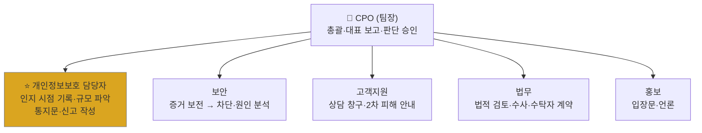
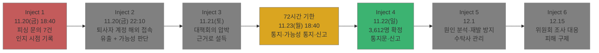
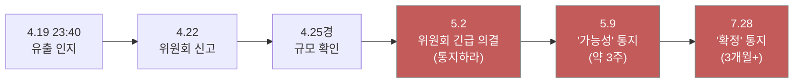

# Week 4 · Ch06. 종합 모의훈련: A사 유출 사고를 처음부터 끝까지 대응하기

> [← 이전 챕터](./ch05_가명정보_기본과_활용.md) · [📚 전체 목차](../../README.md) · (마지막 챕터)

| 항목 | 내용 |
|---|---|
| 예상 학습 시간 | 180분 (팀 롤플레이 권장, 3~6명) |
| 법령 기준일 | 2026-11-17 |
| 핵심 근거 | 개인정보 보호법 제23조제2항, 제26조, 제29조, 제34조, 제39조의2, 제63조, 제64조의2 / 시행령 제39조~제40조 / 안전성 확보조치 기준 제4조제1항제14호, 제5조, 제7조, 제8조 / 개인정보 유출등 대응 안내서(2026. 9.) / 개인정보 보호위원회의 조사 및 처분에 관한 규정 |
| 관련 용어 | [개인정보 유출등](../../용어집.md#개인정보-유출등), [개인정보 유출등의 가능성 통지](../../용어집.md#개인정보-유출등의-가능성-통지), [72시간](../../용어집.md#72시간), [수탁자](../../용어집.md#수탁자), [접속기록](../../용어집.md#접속기록), [과징금](../../용어집.md#과징금) |
| 선수 챕터 | **4주 과정 전체**. 특히 [W4-ch01 유출 대응](./ch01_유출_사고_대응.md), [W3-ch04 접속기록](../3주차_보호조치_실습/ch04_접속기록_보관과_점검.md), [W2-ch03 위탁](../2주차_처리_생애주기/ch03_제3자_제공과_처리위탁_구분.md), [W1-ch05 제재 체계](../1주차_개인정보_기초/ch05_보호위원회의_역할과_제재_체계.md) |

> [!IMPORTANT]
> **🎯 이 챕터 핵심 3줄**
> 1. 첫 신호에서 **인지 시점을 기록**하고 72시간 카운트다운을 시작합니다. 주말도 포함입니다.
> 2. 확정을 기다리지 말고 **가능성 통지 + 우선 신고**를 준비하고, 통지와 신고는 **나란히** 진행합니다.
> 3. 훈련의 진짜 결과물은 **"우리 매뉴얼에서 막힌 곳" 목록**입니다.

> [!TIP]
> 💡 **진행 방법**: 이 챕터는 시나리오를 **단계(Inject)별로 공개**하며 진행합니다. 각 단계의 질문에 답을 적은 뒤 다음 단계로 넘어가세요. 팀으로 한다면 역할(CPO, 개인정보보호 담당자, 보안팀, 고객지원, 법무·홍보)을 나눠 롤플레이합니다. 정답과 해설은 [정답 파일](../../정답과_해설.md#w4-ch06)에 있습니다.

> [!NOTE]
> ⚠️ 이 시나리오의 회사·인물·수치는 모두 **가상**입니다. 실제 회사와 관계없습니다.

---

## 1. 학습 목표

이 챕터를 마치면 담당자님은 다음을 할 수 있습니다.

1. 유출 인지부터 재발 방지까지 **전 과정의 판단(유출등·가능성·신고 요건·기한)**을 시간 순서대로 내릴 수 있다.
2. **신속대응팀** 안에서 개인정보보호 담당자의 역할(보고, 판단 근거 기록, 통지문·신고 내용 작성)을 수행할 수 있다.
3. 사고 원인을 Week 1~3의 **법적 의무와 안전조치 위반**에 연결해 재발 방지 대책과 위원회 조사 대응 자료를 준비할 수 있다.

---

## 2. 한 줄 비유

> [!TIP]
> 💡 모의훈련은 **"소방 훈련"**입니다. 불이 났을 때 처음 해 보는 사람은 비상구를 못 찾습니다. 미리 한 번 걸어 본 사람만 72시간 안에 제대로 움직일 수 있습니다.

단, 비유의 한계가 있습니다.

- 소방 훈련은 대피가 끝나면 끝나지만, 유출 대응은 **통지·신고 뒤에도** 피해 구제, 위원회 조사, 재발 방지가 몇 달씩 이어집니다.
- 훈련도 그 단계까지 다룹니다.

---

## 3. 개념 설명 및 법령 조문: 훈련에서 쓸 기준 한 장 요약

이 챕터는 새 조문을 배우지 않습니다. 아래 기준표만 옆에 펴 놓고 훈련합니다.

> [!NOTE]
> 📌 **조문 주소 읽는 법**: 조 → 항(①②) → 호(1. 2.) → 목(가. 나.). 자세한 설명은 [W1-ch01 3-2](../1주차_개인정보_기초/ch01_개인정보의_정의와_판단_기준.md#3-2-관련-조문)를 보세요.

| 판단 | 기준 (요약) | 근거 | 배운 곳 |
|---|---|---|---|
| 유출등인가 | 분실·도난·유출·위조·변조·훼손 | 법 제23조제2항 | W4-ch01 |
| 기한의 시작 | **알게 된 때**, 객관적 자료로 기록 | 영 제39조, 제39조의3, 제40조, 안내서 p.34 | W4-ch01 |
| 유출등 통지 | 1명 이상, **72시간**, **7개 항목** | 법 제34조제1항, 영 제39조제1항 | W4-ch01 |
| 가능성 통지 | 정황 + 특정 곤란 등, **72시간**, 지연은 천재지변만 | 법 제34조제2항, 영 제39조의2, 제39조의3제1항~제3항 | W4-ch01 |
| 신고 | **1천 명** / **민감·고유식별** / **외부 불법 접근**, **72시간**, 우선 신고 | 법 제34조제4항, 영 제40조 | W4-ch01 |
| 피해 최소화 | 회수·삭제 등 확산 방지 | 법 제34조제3항 | W4-ch01 |
| 수탁자 사고 | 수탁자도 준용, 위탁자 감독 책임 | 법 제26조제4항·제7항·제8항 | W2-ch03 |
| 원인 분석 | 접근권한·접근통제·암호화·접속기록·악성프로그램 등 | 고시 제5조~제9조 | Week 3 |
| 제재 가능성 | 유출 + 안전조치 미흡 → 과징금(3%, 가중 10%), 통지·신고 위반 → 과태료 | 법 제64조의2, 제75조 | W1-ch05 |
| 정보주체 구제 | 손해배상, 법정손해배상(300만 원 이하), 분쟁조정 | 법 제39조, 제39조의2, 제40조 이하 | W4-ch01 |
| 조사 대응 | 연장은 **기한 전**, 사전통지 후 **14일 이상** 의견제출 | 조사·처분 규정 제12조의2, 제16조 | W1-ch05 |

<details>
<summary>📖 기준 상세 보기 (통지 예외·가능성 통지 후속·수탁자 책임)</summary>

- **유출등 통지**: 긴급한 조치(차단·회수 등)나 천재지변 등이 있으면 해소 후 즉시
- **가능성 통지**: 불법 접근 정황 + 정보주체 특정 곤란 / 일부 유출로 다른 정보주체 가능성. 기한 안에 유출이 확인되면 유출등 통지로 대신하고, 유출되지 않은 것으로 확인되면 그 사실을 즉시 통지
- **수탁자 사고**: 수탁자도 제34조 준용, 위탁자는 교육·감독 책임, 손해배상에서 수탁자는 위탁자 소속 직원으로 봄

</details>

### 3-1. 신속대응팀 역할 (안내서 예시 기반)



| 역할 | 주요 업무 | 근거 |
|---|---|---|
| **CPO (팀장)** | 대응 총괄, 대표자 보고, 통지·신고 판단 승인 | 안내서 p.24~25 |
| **개인정보보호 담당자** | 인지·보고, **인지 시점 기록**, 유출 규모 파악, **통지문·신고 내용 작성**, 신고, 대응 전 과정 기록 | 안내서 p.25~26 |
| **보안(정보보호) 담당** | **증거 보전**(스냅샷·로그 백업) → 접근 차단·계정 정지·취약점 조치, 원인·경로 분석 | 안내서 p.25~27 |
| **고객지원** | 전용 상담 창구, Q&A, 2차 피해(스미싱 등) 안내 | 안내서 p.25~26 |
| **법무** | 법적 의무 검토, 수사기관 협조, 수탁자 계약 검토, 분쟁 대응 | 안내서 p.25 |
| **홍보** | 공식 입장문, 언론 대응 | 안내서 p.25 |

근거 원문은 각주를 참고하세요.[^guide-team]

> ✅ **3절 한 줄 정리**: 기준표 한 장과 역할 분담만 있으면 72시간을 움직일 수 있습니다.

---

## 4. 훈련 시나리오

### 📁 배경: 가상 회사 'A사'

| 항목 | 내용 |
|---|---|
| 회사 | ㈜A사 — 온라인 생활용품 쇼핑몰, **중견기업**, 직원 250명 |
| 회원 | **42만 명** (이름, 아이디, 비밀번호(SHA-256+솔트), 휴대전화번호, 이메일, 주소, 생년월일) |
| 결제 | 카드번호는 결제대행사가 보관, A사 DB에는 카드번호 없음 |
| 위탁 | 고객센터 운영: ㈜C콜 (A사 CRM에 **VPN 접속**, 상담원 40명) / 배송: ㈜D택배 |
| 보호 체계 | CPO: 경영지원본부장. 개인정보보호 담당: **담당자님**(입사 4주 차). 내부 관리계획 있음(작년 개정) |
| 과거 이력 | 2년 전 위원회로부터 **접근권한 관리 미흡**으로 시정명령을 받았고, 이행 결과를 보고함 |

---

### 🎬 Inject 1 — 첫 신호 (2026. 11. 20.(금) 18:40)

> 고객센터 수탁사 ㈜C콜의 팀장이 담당자님에게 전화합니다.
> "오늘 오후부터 **'A사를 사칭한 택배 주소 확인 문자를 받았다'**는 고객 문의가 7건 들어왔어요. 다들 문자에 **자기 이름과 최근 주문 상품명**이 정확히 적혀 있었대요."

> [!IMPORTANT]
> **🙋 질문 1-1.** 지금 이것은 유출등인가, 가능성인가, 아직 판단할 수 없는 단계인가? 이 시점에 **무엇을 기록**해야 하는가?
>
> **🙋 질문 1-2.** 담당자님이 **30분 안에** 해야 할 일 3가지를 순서대로 쓰세요. (보고 대상 포함)

---

### 🎬 Inject 2 — 증거 (2026. 11. 20.(금) 22:10)

> 보안팀이 긴급 점검 결과를 보고합니다.
> - CRM 접속기록에서 **㈜C콜 상담원 계정 `cc_kim07`**이 11. 18.(수) 02:13~02:51 **해외 IP**로 VPN 접속해 **고객 상세 조회 화면을 3,840회** 호출한 기록 발견
> - 같은 계정은 **11. 15. 퇴사한 상담원**의 계정이었음 (㈜C콜이 A사에 퇴사 통보를 하지 않아 **계정이 살아 있었음**)
> - VPN은 **ID·비밀번호만으로** 접속 가능
> - 조회된 화면에는 이름, 휴대전화번호, 주소, 최근 주문 내역이 표시됨
> - 같은 시간대 다른 계정의 이상 접속 여부는 **분석 중**

> [!IMPORTANT]
> **🙋 질문 2-1.** 이제 유출등과 가능성을 어떻게 구분하는가? (대상 범위 포함)
>
> **🙋 질문 2-2.** **인지 시점**은 언제로 기록하고, 통지·신고의 **72시간 기한**은 언제인가?
>
> **🙋 질문 2-3.** 신고 대상인가? 근거가 되는 요건을 **모두** 쓰세요.
>
> **🙋 질문 2-4.** 보안팀에 지시할 **초동 조치**를 순서대로 쓰세요. (증거 보전과 차단의 순서에 주의)

---

### 🎬 Inject 3 — 압박 (2026. 11. 21.(토) 10:00, 대책회의)

> 대책회의에서 여러 의견이 나옵니다.
> - **마케팅 본부장**: "주말이니까 월요일에 정확히 분석하고 나서 통지합시다. 괜히 먼저 알렸다가 숫자가 틀리면 더 혼나요."
> - **㈜C콜 대표 (전화)**: "저희 직원 계정 문제니까 저희가 알아서 처리할게요. A사는 신고 안 해도 되지 않나요?"
> - **홍보팀장**: "통지문에 '일부 고객의 일부 정보'라고만 쓰면 어때요? 항목을 다 쓰면 기사가 커져요."

> [!IMPORTANT]
> **🙋 질문 3-1.** 세 의견에 각각 **근거 조문**을 들어 답하세요.
>
> **🙋 질문 3-2.** 가능성 통지가 필요한 대상(분석 중인 다른 고객)에 대해 **통지 기한의 예외**를 쓸 수 있는가?

---

### 🎬 Inject 4 — 통지와 신고 (2026. 11. 22.(일) 15:00)

> 분석 결과, 3,840회 조회는 **고객 3,612명**(중복 제거)에 대한 것이었습니다. 다른 계정의 이상 접속은 **발견되지 않았습니다**.

> [!IMPORTANT]
> **🙋 질문 4-1.** 3,612명에게 보낼 **유출등 통지문**을 작성하세요. (7개 항목, "등" 생략 금지)
>
> **🙋 질문 4-2.** 앞서 가능성 통지를 했다면, 가능성 통지 대상 중 **유출되지 않은 것으로 확인된 고객**에게 무엇을 해야 하는가?
>
> **🙋 질문 4-3.** 유출신고 시스템에 입력할 **신고 요지**(유출 시점, 인지 시점, 경위, 항목, 규모, 조치)를 정리하세요.

---

### 🎬 Inject 5 — 원인과 재발 방지 (2026. 12. 1.)

> 사고 경위 분석을 마쳤습니다. 이제 CPO에게 **원인·재발 방지 보고서**를 올려야 합니다.

> [!IMPORTANT]
> **🙋 질문 5-1.** 이 사고의 원인을 **법령·고시 의무 위반 가능성**과 연결해 **5가지 이상** 쓰세요. (Week 1~3 내용 활용)
>
> **🙋 질문 5-2.** A사는 2년 전 **접근권한 관리 미흡**으로 시정명령을 받은 이력이 있습니다. 이번 사고가 제재 수준에 어떤 영향을 줄 수 있는지 설명하세요.
>
> **🙋 질문 5-3.** 재발 방지 대책을 **A사 조치**와 **수탁사(㈜C콜) 관리** 두 갈래로 나눠 쓰세요.

---

### 🎬 Inject 6 — 위원회 조사 (2026. 12. 15.)

> 위원회에서 **자료제출 요구 공문**이 왔습니다. 제출 기한은 2주 후입니다. 요구 자료: 내부 관리계획, 접근권한 관리 내역(3년), 접속기록 점검 결과, 수탁자 교육·점검 기록, 통지·신고 내역.

> [!IMPORTANT]
> **🙋 질문 6-1.** 제출 자료 중 A사가 **가장 불리할 것**으로 예상되는 자료는 무엇이며, 지금 할 수 있는 일은?
>
> **🙋 질문 6-2.** 기한 안에 다 준비하기 어렵다면 어떻게 해야 하는가?
>
> **🙋 질문 6-3.** 정보주체로부터 **손해배상** 문의가 들어오면 고객지원팀은 무엇을 안내해야 하는가?

> ✅ **4절 한 줄 정리**: 신호 → 증거 → 압박 → 통지·신고 → 원인 → 조사, 여섯 단계 모두 "근거 조문"으로 답합니다.

---

## 5. 훈련 전체 타임라인



**그림 읽는 법**

| 칸 | 의미 |
|---|---|
| 🟥 적색 (Inject 1) | **인지 시점**. 보수적으로 잡으면 모든 기한이 여기서 시작 |
| 🟨 황색 | **72시간 마감** |
| 🟩 녹색 (Inject 4) | 확정은 마감 **전에** 오지만, 기다리지 말고 Inject 2~3에서 이미 **가능성 통지와 우선 신고**를 준비 |

> [!TIP]
> 인지 시점을 Inject 1(18:40)과 Inject 2(22:10) 중 어디로 볼지는 [정답 해설](../../정답과_해설.md#w4-ch06)에서 다룹니다. 힌트: 안내서는 인지 시점의 객관적 자료 예로 "민원 접수 일시"를 듭니다(PDF p.34).

---

## 6. 개인정보보호위원회 처분 사례

### ⚖️ 사례: SK텔레콤 사고 대응 타임라인 (2025. 8. 의결) — "모의훈련의 반면교사"

> 이 사례는 W1-ch05, W3-ch01, W3-ch03, W4-ch01에서 다른 관점으로 다뤘습니다. 여기서는 **시간 순서대로 무엇이 지연되었는지**만 봅니다.



| 시점 (2025년) | 사실 (보도자료 기준) | 훈련 관점의 평가 |
|---|---|---|
| **4. 19. 23:40** | HSS DB 데이터가 외부로 전송된 사실을 확인, **유출 인지** | 인지 시점. 여기서 72시간 시작 |
| **4. 22.** | 비정상적 데이터 외부 전송 사실을 위원회에 **유출 신고** → 위원회는 신고 당일 집중조사 TF 구성 | 신고는 72시간 무렵에 이뤄짐 |
| **4. 25.경** | 유출된 정보의 규모 등을 확인 | 규모 확인 후에도 통지 없음 |
| **5. 2.** | 위원회가 **즉시 유출통지를 진행할 것을 긴급 의결** | 감독기관이 통지를 명령해야 하는 상황 |
| **5. 9.** | 유출 **"가능성"** 통지 | 인지 후 약 3주 |
| **7. 4.** | 민관합동조사단 조사 결과 발표 | |
| **7. 28.** | 유출 **"확정"** 통지 | 인지 후 3개월 넘게 지남 |
| **처분** | 통지 지연에 **과태료 960만 원** (안전조치 위반 과징금 1,347억 9,100만 원과 별도) | 위원회: "정당한 사유 없이 유출 통지를 지연하여 정보주체의 2차 피해 예방을 어렵게 한 것으로 보아, 통지 의무를 위반" |

출처: 개인정보보호위원회 보도자료, 「개인정보위, 'SK텔레콤 개인정보 유출사고' 제재처분 의결」(2025. 8. 27. 의결, 8. 28. 보도)[^case-skt]

**📌 교훈**

1. **"다른 기관의 조사가 진행 중"**이라는 이유는 통지 지연의 정당한 사유가 되지 않았습니다.
2. 신고만 하고 **통지를 미루면** 별도 위반입니다. 통지와 신고는 **나란히** 진행해야 합니다.
3. 2026. 9. 11.부터는 이런 상황에서 **가능성 통지**를 72시간 안에 해야 한다는 의무가 법에 명시되었습니다. Inject 2~3에서 담당자님이 내려야 할 판단이 바로 이것입니다.

> [!TIP]
> 💬 **사수의 한마디**: 훈련을 마치면 **"우리 회사 매뉴얼에서 막힌 곳"**을 목록으로 만드세요. 퇴사자 계정 통보 경로, 주말 비상연락망, 통지문 양식, 신고 계정(누가 로그인하나) 같은 것들입니다. 그 목록이 이 훈련의 진짜 결과물입니다.

---

## 7. 오답노트

| # | ❌ 잘못된 생각 | ✅ 올바른 이해 | 근거 |
|---|---|---|---|
| 1 | "주말이니 월요일에 분석하고 통지하면 돼요." | 72시간에 **주말 포함**, 가능성 통지·우선 신고 | 영 제39조, 제39조의3, 제40조제2항 |
| 2 | "수탁사 계정 문제니 수탁사가 알아서 해요." | 위탁자 **감독 책임**, A사가 통지·신고 주도 | 법 제26조제4항·제7항, 제34조 |
| 3 | "'일부 고객의 일부 정보'라고만 써도 돼요." | 항목을 **누락 없이** 구체적으로 | 법 제34조제1항제1호, 안내서 p.36 |
| 4 | "포렌식 중이라 가능성 통지를 미뤄요." | 지연 사유는 **천재지변 등뿐** | 영 제39조의3제1항 |
| 5 | "일단 계정 지우고 서버 재부팅해요." | **증거 보전 먼저**, 그다음 차단 | 안내서 p.25~27 |
| 6 | "시정명령 이력이 있으니 무조건 가중(10%)이에요." | 가중 요건은 **세 가지뿐**, 이행했다면 ③ 해당 안 됨 | 법 제64조의2제2항, 제5항제2호 |

**🔎 번호별 보충 설명**

1. 72시간에는 주말이 포함됩니다. 확정 전이면 가능성 통지와 우선 신고를 해야 합니다.
2. 위탁자는 수탁자 감독 책임이 있고, 손해배상에서 수탁자는 위탁자의 소속 직원으로 봅니다. 고객 정보의 처리자인 A사가 통지·신고를 주도해야 합니다.
3. 유출된 항목을 누락 없이 구체적으로 써야 합니다. 안내서는 "일부 고객, 회원정보 일부"를 잘못된 사례로 듭니다.
4. 가능성 통지의 지연 사유는 천재지변 등 부득이한 사유뿐입니다.
5. 차단 전에 스냅샷·로그 백업으로 증거를 보전하고, 로그 자동 삭제를 멈춰야 합니다.
6. 가중 요건은 ① 과징금 처분 후 3년 내 같은 위반 반복(고의·중과실) ② 고의·중과실 + 피해 1천만 명 이상 ③ 시정명령을 따르지 않아 생긴 유출, 세 가지뿐입니다. 시정명령을 실제로 이행했다면 ③에 해당하지 않습니다. 다만 위반 횟수는 과징금 산정 때 고려되므로 이행 증빙이 중요합니다.

---

## 8. 업무 체크리스트

**📋 모의훈련 실행·사후 점검표**

| 점검 주기 | 점검자 | 점검일 |
|---|---|---|
| 연 1회 이상 모의훈련 + 훈련 후 2주 내 개선 | CPO (개인정보보호 담당자 진행) | `____-__-__` |

**① 훈련 전**

- [ ] 참가자와 역할(CPO, 담당자, 보안, 고객지원, 법무, 홍보, **수탁사**)을 정했다
- [ ] 최신 유출사고 대응 매뉴얼과 통지문·신고 양식을 준비했다 (고시 제4조제1항제14호)

**② 훈련 중 확인**

- [ ] 첫 신호에서 **인지 시점**을 기록하고 72시간 카운트다운을 시작했다
- [ ] 보고 체계(담당자 → CPO → 대표)가 **30분 안에** 작동했다
- [ ] **증거 보전 → 차단** 순서를 지켰다
- [ ] 유출등과 **가능성**을 구분해 대상 범위를 정했다
- [ ] 신고 요건(1천 명 / 민감·고유식별 / 외부 불법 접근)을 판단하고 근거를 기록했다
- [ ] 통지문에 **7개 항목**이 있다
- [ ] 주말·야간 비상연락이 실제로 됐다
- [ ] 수탁사가 **사고 보고 경로**를 알고 있었다

**③ 훈련 후**

- [ ] "막힌 곳" 목록을 만들고 담당자·기한을 정해 개선했다
- [ ] 매뉴얼·양식·연락망을 개정하고 **내부 관리계획**에 반영했다 (고시 제4조제3항)
- [ ] 수탁사 계약에 **퇴사자 통보·사고 보고 기한**이 있는지 확인했다
- [ ] 훈련 결과를 CPO와 대표자에게 보고했다

---

## 9. 실습 과제 / 퀴즈

### 📝 객관식

**Q1.** A사 시나리오(외부 해외 IP에서 퇴사자 계정으로 3,612명 정보 조회)에서 시행령 제40조제1항의 **신고 요건에 해당하는 것을 모두** 고른 것은?

> ㄱ. 1천 명 이상의 정보주체에 관한 개인정보가 유출등이 된 경우
> ㄴ. 민감정보 또는 고유식별정보가 유출등이 된 경우
> ㄷ. 외부로부터의 불법적인 접근에 의해 개인정보가 유출등이 된 경우

1. ㄱ
2. ㄱ, ㄷ
3. ㄴ, ㄷ
4. ㄱ, ㄴ, ㄷ

**Q2.** 유출 사고 초동 조치 순서로 **가장 적절한 것**은?

1. 서버 재부팅 → 계정 삭제 → 로그 확인
2. 증거 보전(스냅샷·로그 백업) → 접속 차단·계정 정지 → 원인 분석
3. 언론 보도 대응 → 통지 → 차단
4. 포렌식 완료 → 통지 → 차단

**Q3.** 수탁자의 관리 소홀로 발생한 유출에 관한 설명으로 **옳은 것**은?

1. 위탁자는 수탁자에게 책임을 넘겼으므로 아무 의무가 없다.
2. 수탁자가 위탁 업무와 관련해 법을 위반해 발생한 손해배상책임에 대해서는 수탁자를 위탁자의 소속 직원으로 본다.
3. 수탁자 사고는 위원회 신고 대상이 아니다.
4. 위탁 계약서에 면책 조항이 있으면 위탁자는 감독 의무를 지지 않는다.

### 🛠️ 실습: 종합 대응 보고서 작성

**Q4.** 4절의 Inject 1~6 질문에 모두 답하고, 아래 양식으로 **A사 유출사고 대응 보고서**(CPO 제출용, A4 3쪽 내외)를 작성하세요.

```
1. 사고 개요 (일시·경위·규모·항목)
2. 인지 시점과 판단 근거 (유출등 / 가능성 / 신고 요건)
3. 대응 경과 타임라인 (보고·차단·통지·신고·회수 시각)
4. 통지·신고 내역 (대상·방법·일시, 통지문 사본)
5. 원인 분석 (법령·고시 의무와 연결)
6. 재발 방지 대책 (A사 / 수탁사, 담당·기한)
7. 위원회 조사 대응 계획 및 정보주체 피해 구제
8. 이번 훈련에서 드러난 매뉴얼 개선 사항
```

> [!NOTE]
> ✅ 다 풀었다면 [정답 및 해설](../../정답과_해설.md#w4-ch06)에서 확인하세요. **4주 과정을 모두 마쳤습니다. 수고하셨습니다!** 📚 [전체 목차](../../README.md)의 "주차별 완료 기준"을 다시 보며 스스로 점검해 보세요.

---

## 10. 더 읽을거리

| 자료 | 이 챕터와의 관계 |
|---|---|
| **개인정보 유출등 대응 안내서**<br>개인정보보호위원회, 2026. 9. | 핵심 자료. 신속대응팀(PDF p.24~26), 초동 조치·증거 보존(p.26~27), 회수(p.29~30), 통지 지연 사례(p.34), 통지문(p.36), 신고(p.46~48) |
| **개인정보의 안전성 확보조치 기준**<br>고시 제2026-9호 | 제4조(유출사고 대응 계획), 제5조(퇴사자 권한 말소), 제6조(외부 접속 안전한 인증수단), 제8조(접속기록) |
| **개인정보 보호위원회의 조사 및 처분에 관한 규정**<br>고시 제2026-13호 | 자료제출·기한 연장·사전통지·의견제출 |
| **개인정보위 보도자료 (SK텔레콤)**<br>개인정보보호위원회, 2025. 8. | 6절 타임라인 (p.2, p.6~7, p.11) |
| **개인정보위 보도자료 (카카오, 골프존, 엘지유플러스)**<br>개인정보보호위원회 | 신고·통지 위반, 계정 탈취, 접속기록 사례 비교 |

<details>
<summary>📁 참고자료 파일명 보기</summary>

- `개인정보 유출등 대응 안내서(2026.9.).pdf`
- `개인정보의 안전성 확보조치 기준(개인정보보호위원회고시)(제2026-9호)(20260701).pdf`
- `개인정보 보호위원회의 조사 및 처분에 관한 규정(개인정보보호위원회고시)(제2026-13호)(20260911).pdf`
- `250828 (석간) 개인정보위  ‘SK텔레콤 개인정보 유출사고’ 제재처분 의결(조사2과)_최종(붙임 포함).pdf`
- 카카오·골프존·엘지유플러스: 참고자료 각 파일

</details>

---

> [← 이전 챕터](./ch05_가명정보_기본과_활용.md) · [📚 전체 목차](../../README.md) · [📖 용어집](../../용어집.md)

[^guide-team]: [출처: [개인정보 유출등 대응 안내서(2026.9.).pdf](<../../2_참고자료/개인정보 유출등 대응 안내서(2026.9.).pdf>), PDF p.24 (보고 체계, 신속대응팀), p.25~26 (중견기업·중소기업 신속대응팀 역할 예시), p.26~27 (긴급 차단, 증거 보존)]
[^case-skt]: [출처: [250828 (석간) 개인정보위  ‘SK텔레콤 개인정보 유출사고’ 제재처분 의결(조사2과)_최종(붙임 포함).pdf](<../../2_참고자료/250828 (석간) 개인정보위  ‘SK텔레콤 개인정보 유출사고’ 제재처분 의결(조사2과)_최종(붙임 포함).pdf>), p.2 (4. 22. 신고, TF 구성), p.6~7 (4. 19. 인지, 5. 2. 긴급 의결, 5. 9. 가능성 통지, 7. 28. 확정 통지, 과태료 960만 원), p.11 「붙임 4」 (4. 19. 23:40 인지, 4. 25.경 규모 확인, 7. 4. 조사 결과 발표, 통지 의무 위반 판단)]
