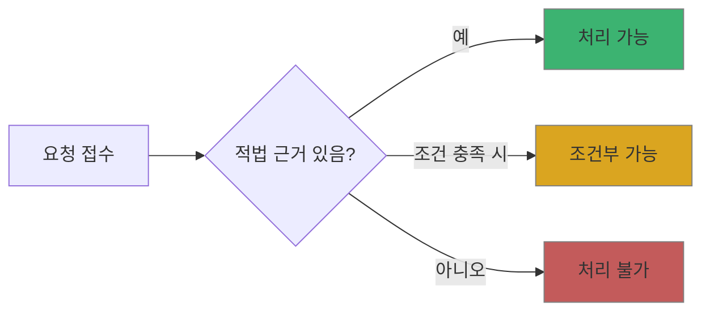

# 템플릿 안내 — 챕터 작성 규격

이 폴더에는 레포지토리의 모든 챕터(`./1_학습_챕터/N주차_주제/chNN_*.md`)가 따르는 **공통 규격**이 들어 있습니다.
챕터의 모양이 같아야 학습자가 "어디에 무엇이 있는지" 고민하지 않고 내용에 집중할 수 있습니다.

| 파일 | 용도 |
|---|---|
| [`chapter_template.md`](./chapter_template.md) | 새 챕터를 만들 때 복사해서 쓰는 원본 |
| `README.md` (이 문서) | 각 섹션의 작성 기준, 출처 표기, Mermaid·색상 규칙, 가독성 규칙, 검수 체크리스트 |
| [`check_mermaid.ps1`](./check_mermaid.ps1) | Mermaid 노드·엣지 라벨의 쌍따옴표 누락을 찾는 PowerShell 검사 스크립트 |

---

## 1. 새 챕터 만드는 순서

1. `chapter_template.md`를 복사해 `./1_학습_챕터/{N}주차_{주제}/ch{NN}_{영문_스네이크케이스}.md`로 저장합니다.
   - 예: `./1_학습_챕터/2주차_처리_생애주기/ch03_제3자_제공과_처리위탁_구분.md`
   - 챕터 번호는 **주차마다 01부터** 시작합니다. 주차당 최대 8개입니다.
2. 템플릿의 `{{ }}` 자리표시자를 모두 채우고, "작성 가이드" HTML 주석은 지웁니다.
3. 퀴즈 정답은 챕터에 쓰지 않고 [`../정답과_해설.md`](../정답과_해설.md)의 해당 앵커(`#w{N}-ch{NN}`) 아래에 씁니다.
4. 루트 [`README.md`](../README.md) 목차의 상태 표시를 `🚧` → `✅`로 바꿉니다.
5. 아래 [7. 검수 체크리스트](#7-검수-체크리스트)를 통과시킵니다.

---

## 2. 필수 구성 10개 — 섹션별 작성 기준

| # | 섹션 | 작성 기준 | 흔한 실수 |
|---|---|---|---|
| 1 | **학습 목표** | **3개 이내**, 모두 "~할 수 있다"로 끝냅니다. 관찰할 수 있는 행동 동사를 씁니다(구분한다, 판단한다, 작성한다, 확인한다). | "~을 이해한다", "~을 안다"처럼 확인할 수 없는 목표 |
| 2 | **한 줄 비유** | 일상 경험 **딱 1줄(2문장 이내)**. 비유가 법적 의미를 왜곡하면 바로 다음 줄에 "단, ~는 다르다"를 붙입니다. | 비유가 길어져 설명이 되어 버림 |
| 3 | **개념 설명 및 법령 조문** | 조문마다 **조문 번호 → 원문 요지 → 쉬운 풀이 → 출처 각주** 순서. **현행 법령만** 설명하고, 개정 전후 비교는 넣지 않습니다. 아직 시행 전인 조문은 "🕒 시행 예정"으로 시행일만 밝힙니다. 조문 표는 [6-2](#6-2-조문-표-형식-두-가지만)의 형식 A·B만 씁니다. | 원문을 통째로 붙여넣기, 시행일 누락, 옛 조문·옛 기준 설명 |
| 4 | **사내 실무 적용** | 현업 부서 요청 **상황극 Q&A 1개 이상**. 담당자의 답에는 반드시 **결론(가능/조건부 가능/불가) + 근거 조문 + 다음 행동**이 들어갑니다. 결론·근거는 표에, 다음 행동은 표 아래 번호 목록에 씁니다. | 외부 컨설턴트 말투("귀사는~"), 결론 없는 답 |
| 5 | **Mermaid 다이어그램** | 업무 흐름이나 판단 플로우 **1개 이상**. [4. Mermaid 규칙](#4-mermaid-규칙-엄격-준수)을 지킵니다. | 노드 텍스트에 따옴표 누락으로 렌더링 실패 |
| 6 | **처분 사례** | **사건 개요 → 위반 조항 → 처분 결과 → 교훈** 순서. 출처(의결 연월, 보도자료 제목 또는 참고자료 파일명)를 밝힙니다. 확인되지 않으면 `⚠️ 확인 필요`를 표시합니다. | 금액·연도를 기억에 의존해 기재 |
| 7 | **오답노트** | 표 형식 `❌ 잘못된 생각 / ✅ 올바른 이해 / 근거 조문`, **3행 이상**. 신입이 실제로 할 법한 말투로 씁니다. | 근거 조문 칸이 비어 있음 |
| 8 | **업무 체크리스트** | `- [ ]` 체크박스. 담당자가 **사내에서 바로 대입**할 수 있게 "누가/무엇을/언제"가 보이게 씁니다. | "개인정보를 잘 관리한다" 같은 추상 항목 |
| 9 | **실습 과제 / 퀴즈** | **객관식 3문항 + 서술형 또는 실습 1문항**. 정답·해설은 본문에 쓰지 않습니다. 주차별 실습 주제는 아래 표를 따릅니다. | 본문에 정답 노출, 정답 링크 누락 |
| 10 | **더 읽을거리** | 관련 가이드라인·해설서 이름. 참고자료에 있으면 **파일명**을 함께 씁니다. | 존재하지 않는 자료명 기재 |

### 주차별 실습 주제 (9번 섹션)

| 주차 | 실습·과제 주제 |
|---|---|
| Week 1 | 데이터 항목이 개인정보인지 분류하기, 사내 역할 구분하기 |
| Week 2 | 동의서 작성, 제공/위탁 구분, 처리방침 초안 작성 |
| Week 3 | BitLocker, 파일 암호, 화면 잠금, 이벤트 뷰어 로그온 기록(4624/4625) 확인, 권한 관리대장 작성 |
| Week 4 | 유출 시나리오의 통지·신고 판단, 통지문·신고서 초안, 권리 행사 민원 답변서, 생성형 AI 도입 체크리스트 |

### 설명의 순서 (모든 개념 공통)

```
일상 비유 1줄 → 법령 조문 → 사내 실무 적용 → 오답노트
```

### 관점과 말투

- **회사 내부 담당자**의 관점으로 씁니다. "귀사", "고객사" 대신 "우리 회사", "현업 마케팅팀"이라고 씁니다.
- 학습자를 "담당자님"으로 부르고, 친절한 사수가 옆자리에서 설명하듯 씁니다.
- **분류 이름에 조문 번호(가목·나목, 제1호·제2호 등)를 쓰지 않습니다.** 분류 이름은 뜻이 드러나는 말로 쓰고, 조문 번호는 괄호 안의 근거로만 씁니다. 예: "결합 식별 정보 (제2조제1호나목)" ✅ / "개인정보(나목)" ❌
- 상황극은 **챕터당 2개**, 분량은 견본 [W1-ch01](../1_학습_챕터/1주차_개인정보_기초/ch01_개인정보의_정의와_판단_기준.md) 수준(60~90분)을 기준으로 합니다.
- 실습 도구·경로·명령어는 **Windows 11** 기준입니다. 명령어는 PowerShell 코드 블록(` ```powershell `)으로 씁니다.

---

## 3. 출처 표기 규칙

### 3-1. 근거의 우선순위

> **원칙: 안내서와 법령이 다르면 최신 법령이 최우선입니다.**
> 여기서 "법령"은 현행 법률 → 시행령 → 고시 순서를 뜻합니다. 상위 규범이 하위 규범보다 우선하고, 같은 단계에서는 시행일이 늦은 것이 우선합니다.

| 순위 | 근거 | 예시 (참고자료 파일) | 표기 |
|---|---|---|---|
| 1 | **현행 법률** | 개인정보 보호법 법률 제21445호 (2026. 9. 11. 시행) | `[출처: 파일명, 제N조제N항]` |
| 2 | **현행 시행령** | 시행령 대통령령 제36804호 (2026. 11. 10. 시행) 및 별표 | `[출처: 파일명, 제N조제N항]` |
| 3 | **현행 고시** | 안전성 확보조치 기준 제2026-9호, 표준 개인정보 보호지침 제2025-4호 등 | `[출처: 파일명, 제N조제N항]` |
| 4 | **안내서·가이드라인·해설서** | 유출등 대응 안내서(2026. 9.), 처리방침 작성지침(2026. 4.) 등 | `[출처: 파일명, p.N]` |
| 5 | 처분 보도자료 | 처분 사례 섹션 전용. 당시 법령 기준이므로 조문 번호가 현행과 다를 수 있음 | `[출처: 파일명, p.N]` |
| 6 | 참고자료에 없는 내용 (일반 지식으로 보충) | — | `[출처: 일반 지식, 원문 확인 권장]` |

**충돌이 생겼을 때**

| 상황 | 처리 |
|---|---|
| 안내서·고시 내용이 최신 법률·시행령과 다를 때 | **법령을 따릅니다.** 차이를 `> ⚠️ 확인 필요` 박스로 밝히고 두 출처를 모두 각주로 답니다. |
| 법령 개정 전에 나온 자료가 옛 조문 번호를 인용할 때 | 현행 조문 번호로 바꿔 쓰고, 필요하면 "(구 제N조)"를 덧붙입니다. |
| 참고자료와 일반 지식이 다를 때 | 참고자료를 따르고 차이를 `> ⚠️ 확인 필요`로 설명합니다. |
| 어느 쪽으로도 확인되지 않을 때 | 단정하지 않고 `> ⚠️ 확인 필요`를 표시합니다. |
| 처분 사례의 위반 조항 | 의결 당시 조항을 그대로 쓰고, 현행 조항이 다르면 "현행 제N조"를 병기합니다. |

**이미 확인된 충돌 (2026-11-17 기준)**

| 자료 | 법령과 다른 점 | 따를 기준 |
|---|---|---|
| 표준 개인정보 보호지침 (2025. 4.) 제26조 | 유출 통지 항목 5개 / 사유 해소 후 "지체 없이" 통지 / '유출 가능성 통지' 없음 | 법 제34조제1항(통지 항목 7개)·제2항, 시행령 제39조("즉시"), 제39조의2·제39조의3 |
| 표준 개인정보 보호지침 (2025. 4.) 제25조 | '유출등'을 "분실·도난·유출"로만 정의함 | 법 제23조제2항: '유출등' = **분실·도난·유출·위조·변조·훼손** (2026. 3. 10. 개정) |
| 표준 개인정보 보호지침 (2025. 4.) 제6조제2항제3호·제5호 | 수집 근거를 "수집·이용하지 않고는 … 불가능하거나 현저히 곤란한 경우", "계약을 이행하기 곤란한 경우"로 표현함 | 법 제15조제1항제2호("법령상 의무를 준수하기 위하여 불가피한 경우")·제4호("계약을 이행하거나 … 위하여 **필요한** 경우") |
| 표준 개인정보 보호지침 (2025. 4.) 제12조제8항 | 동의서 작성 시 "개인정보 처리 동의 안내서"를 준수하라고 함 | 구판 동의 안내서(2022. 3.)는 2023년 개정 전 자료라 참고자료에서 제외함. 법 제22조와 영 제17조를 직접 따름 |
| 표준 개인정보 보호지침 (2025. 4.) 제2조제5호 | CPO 정의에서 "영 제32조제1항 또는 제3항"을 인용함. 2026. 9. 10. 시행령 개정으로 항 구성이 바뀜 | 시행령 제32조제2항(지정 기준)·제3항(이사회 의결·신고 대상) |
| 처리방침 작성지침 (2026. 4.) | 법 제31조를 개정 전 항 번호로 인용함 (CPO 업무 제3항) | 법 제31조제4항 (2026. 9. 11. 시행) |
| 안전성 확보조치 기준 안내서 (2026. 11.) | 고시 제2026-9호와 일치 (충돌 없음) | — |

### 3-2. 각주 쓰는 법

GitHub 각주 문법(`[^키]`)을 쓰고, 각주 내용은 대괄호 출처 형식을 그대로 씁니다. 각주는 문서 맨 끝에 모읍니다.

```markdown
접근 권한 부여·변경·말소 내역은 최소 3년간 보관해야 합니다.[^safety-5]

[^safety-5]: [출처: [개인정보의 안전성 확보조치 기준(개인정보보호위원회고시)(제2026-9호)(20260701).pdf](<../../2_참고자료/개인정보의 안전성 확보조치 기준(개인정보보호위원회고시)(제2026-9호)(20260701).pdf>), 제5조제3항]
```

- **파일명은 참고자료 폴더의 실제 파일명을 그대로** 씁니다. 줄임말을 쓰지 않습니다.
- **파일명은 바로 열리도록 링크로 겁니다.** 형식은 `[파일명](<경로/파일명>)`입니다. 파일명에 공백·괄호가 있으므로 경로를 꺾쇠 `< >`로 감쌉니다.
  - 챕터 파일(`./1_학습_챕터/N주차_주제/`)에서는 `../../2_참고자료/파일명`, 루트 문서(README·용어집·정답)에서는 `2_참고자료/파일명`을 씁니다.
  - 파일명에 대괄호가 있으면(예: `[별표 1] …`) 링크 글자 쪽에서만 `\[별표 1\]`처럼 백슬래시로 감쌉니다. 꺾쇠 안 경로는 그대로 둡니다.
- 법령·고시는 **조문 번호**로, 안내서·가이드라인은 **페이지(p.N)** 로 위치를 적습니다. 페이지는 PDF 뷰어에 표시되는 쪽 번호를 씁니다. 인쇄된 쪽 번호와 다르면 `(PDF p.N)`으로 적습니다.
- 각주 키는 `{문서약칭}-{조문 또는 쪽}` 형식을 권장합니다. 예: `[^law-34]`, `[^decree-40]`, `[^breach-guide-p12]`

### 3-3. 확인 필요 박스

```markdown
> ⚠️ 확인 필요: 「표준 개인정보 보호지침」(2025. 4.) 제26조제1항은 유출 통지 항목을 5개로 정하지만,
> 현행 법 제34조제1항은 손해배상 청구 등 법적 권리 안내(제6호)를 포함해 7개 항목을 요구합니다.
> 최신 법령을 따라 7개 항목을 모두 통지하세요.
```

### 3-4. 법령 버전 기준 (2026-11-17)

| 구분 | 기준 파일 | 주의 |
|---|---|---|
| 법률 | `개인정보 보호법(법률)(제21445호)(20260911).pdf` | 2027. 3. 9.·2027. 7. 1. 시행 예정 조문은 **"시행 예정"** 이라고 반드시 밝힘 |
| 시행령 | `개인정보 보호법 시행령(대통령령)(제36804호)(20261110).pdf` | — |
| 안전조치 고시 | `개인정보의 안전성 확보조치 기준(개인정보보호위원회고시)(제2026-9호)(20260701).pdf` | 제15조제5호·제18조는 2027. 1. 1. 시행 |
| 법 제31조 | 2026년 개정으로 **CPO 업무가 제3항 → 제4항**으로 이동 | 2026. 9. 11. 이전 자료의 인용 번호를 그대로 옮기지 말 것 |

---

## 4. Mermaid 규칙 (엄격 준수)

Markdown 렌더링 오류를 막기 위해 다음을 **예외 없이** 지킵니다.

1. **모든 노드 텍스트는 쌍따옴표(`" "`)로 감쌉니다.** 사각형 `["..."]`, 마름모 `{"..."}`, 둥근 사각형 `("...")` 모두 해당합니다.
2. **엣지 라벨도 쌍따옴표로 감쌉니다.** `-->|"동의 거부"|`
3. 스네이크 케이스(`_`), 괄호(`()`, `[]`), 슬래시(`/`), 특수문자가 들어가도 예외 없이 쌍따옴표를 씁니다.
4. 노드 ID는 **영문·숫자만** 씁니다(`A`, `Q1`, `STEP2`). 한글은 라벨에만 넣습니다.
5. 라벨 안에서 줄을 바꿀 때는 `<br/>`을 씁니다. 라벨 안에 쌍따옴표를 넣어야 하면 `#quot;`를 씁니다.
6. 방향은 판단 플로우는 `flowchart TD`, 타임라인·업무 흐름은 `flowchart LR`을 권장합니다.

```text
✅ Good
A["수집_동의 확인"] -->|"동의 거부"| B["서비스 제공 범위 조정(필수/선택)"]
Q1{"제3자의 이익을 위한 이전인가?"} -->|"예"| P["제3자 제공(제17조)"]

❌ Bad
A[수집_동의 확인] -->|동의 거부| B[서비스 제공 범위 조정(필수/선택)]
Q1{제3자의 이익을 위한 이전인가?} -->|예| P[제3자 제공(제17조)]
```

---

## 5. 색상 규칙

- **폰트 색상은 지정하지 않습니다.** 다크/라이트 모드에서 자동으로 맞춰지게 둡니다.
- 강조 배경색이 필요하면 **아래 4가지 HEX만** 씁니다.

| 색 | HEX | 쓰는 곳 |
|---|---|---|
| 회색 | `#808080` | 보조 정보, 참고 단계, 테두리(stroke) |
| 적색 | `#c35b5b` | 위험, 위반, 불가, 기한 초과 |
| 녹색 | `#3cb371` | 적법, 가능, 완료, 목표 |
| 황색 | `#daa520` | 주의, 조건부 가능, 확인 필요 |

- **GitHub은 Markdown 본문의 `style` 속성(인라인 배경색)을 제거**하므로, 배경색은 **Mermaid의 `classDef`에서만** 씁니다.



- 본문에서 강조할 때는 색 대신 굵게, 이모지, GitHub 알림 블록을 씁니다. 쓰는 기준은 [6. 가독성 규칙](#6-가독성-규칙)을 따릅니다.

---

## 6. 가독성 규칙

> 📌 **원칙**: 좁은 화면(휴대폰 세로 화면)에서도 가로 스크롤 없이 읽히게 씁니다. 적용 견본은 [W1-ch01](../1_학습_챕터/1주차_개인정보_기초/ch01_개인정보의_정의와_판단_기준.md)입니다.

### 6-1. 길이 상한

| 대상 | 상한 | 넘으면 |
|---|---|---|
| 표 셀 하나 | 3문장, 150자 (각주 표시 제외) | 표 아래 문단이나 목록으로 옮깁니다 |
| 셀 안 나열 | 2~3개 | `<br>`로 줄을 나눕니다 (`① …<br>② …`). 4개 이상이면 표 밖 번호 목록으로 뺍니다 |
| 문단 하나 | 3문장, 개념 1개 | 근거 → 해석 → 실무 판단 문단으로 나눕니다 |
| 문장 하나 | 100자 안팎 | 두 문장으로 나눕니다 |
| 사례의 사건 개요 | 3문장 | 세부 경과는 셀 안 `<br>` 나열로 씁니다 |

### 6-2. 조문 표 형식 (두 가지만)

| 형식 | 쓰는 경우 | 모양 |
|---|---|---|
| **A. 세로형** | 항·호·목 나열이 없거나 2개 이하 | 템플릿의 `구분 / 내용` 4행 (원문 요지, 쉬운 풀이, 시행일, 실무 포인트) |
| **B. 항별 3열형** | 항·호·목이 3개 이상 | `항(호·목) / 원문 요지 / 쉬운 풀이` 3열 표 + 표 바로 아래 `시행일`·`실무 포인트` 목록 |

```markdown
#### 📜 개인정보 보호법 제2조제1호 (개인정보의 정의)

| 목 | 원문 요지 | 쉬운 풀이 |
|---|---|---|
| 본문 | "개인정보"란 살아 있는 개인에 관한 정보로서 다음 중 하나에 해당하는 정보 | 아래 세 가지 모두 개인정보입니다 |
| 가목 | 성명, 주민등록번호 및 영상 등을 통하여 개인을 알아볼 수 있는 정보 | 직접 식별 정보: … |

- **시행일**: 2026. 9. 11. 시행 법률 제21445호 기준
- **실무 포인트**: …
```

- 첫 행은 각 호·목 앞의 본문 문장(`본문`)입니다.
- 법과 시행령은 한 표에 섞지 않고 📜 블록을 나눕니다.
- 원문 요지 칸에는 굵게를 쓰지 않습니다. 강조는 쉬운 풀이·실무 포인트에서 합니다.

### 6-3. 상황극 답변과 해설 문단

- 답변 표에는 **결론과 근거만** 둡니다. 다음 행동은 표 아래 `**다음 행동**` 제목과 번호 목록으로 씁니다.
- 상황극 뒤 해설 문단("왜 그런가요?")은 6-1의 문단 기준을 지킵니다. 확인 필요 사항은 문단 중간이 아니라 문단 밖 `> ⚠️ 확인 필요` 박스로 뺍니다.

### 6-4. 굵게

- 문단·표 셀·목록 항목 하나에 **1개까지**만 씁니다.
- 굵게 쓰는 것: 결론어(가능/불가), 기한·숫자, 반드시 기억할 핵심 구절. **문장 전체를 굵게 하지 않습니다**(비유 포함).
- 예외(1개 제한에 세지 않음): 표 첫 열 라벨(`원문 요지`, `결론` 등), 문단·목록 첫머리 라벨(`왜 그런가요?`, `그림 읽는 법`, `시행일:` 등), 콜아웃 라벨, 상황극 화자 표시, 퀴즈 문항 번호와 핵심 조건.

### 6-5. 콜아웃

| 표기 | 용도 (이 용도로만) | 형식 |
|---|---|---|
| 💡 | 한 줄 비유 | `> 💡 비유 문장` |
| 📌 | 보충 설명, 위원회 해석, 참고 기준 | `> 📌 **라벨**: 내용` |
| ⚠️ | 확인 필요 ([3-3](#3-3-확인-필요-박스)) | `> ⚠️ 확인 필요: 내용` |
| `> [!WARNING]` | 실습 전 주의, 하면 안 되는 행동 등 경고 | GitHub 알림 블록 |
| 🕒 | 시행 예정 조문 | `> 🕒 **시행 예정 (시행일)**: 내용` |
| 💬 | 처분 사례 뒤 사수의 한마디 | `> 💬 **사수의 한마디**: 내용` |
| ✅ | 퀴즈 끝 정답 링크 | 템플릿 문구 그대로 |

- 콜아웃 블록 하나에 아이콘은 하나만 씁니다. 종류가 다르면 블록을 나눕니다.
- 표 셀이나 문장 중간에 ⚠️를 쓰지 않습니다. 예외는 상황극 결론 칸의 판정 표시(✅ 가능 / ⚠️ 조건부 가능 / ❌ 불가)입니다.
- 본문에 `[출처: …]`를 직접 쓰지 않고 각주([3-2](#3-2-각주-쓰는-법))로 답니다. 일반 지식 보충도 `[^general-…]` 각주로 씁니다.
- "조문 주소 읽는 법"(조 → 항 → 호 → 목) 설명은 W1-ch01에만 둡니다. 다른 챕터는 필요하면 W1-ch01 3-2로 링크합니다.

### 6-6. 표 너비

- 표는 **4열 이하**가 기본입니다. 5열 이상은 모든 셀이 짧을 때(대략 20자 이하)만 씁니다.
- 학습자가 채우는 빈 양식이 6열 이상이면 세로형(`항목 / 기재 예`)으로 바꾸거나 표를 둘로 나눕니다.
- 체크리스트의 점검 정보(점검 주기·점검자·점검일)는 표가 아니라 한 줄로 씁니다.

### 6-7. 섹션 제목

- 10개 H2 제목은 템플릿 문구를 **번호까지 그대로** 씁니다. 챕터에 맞춘 이름은 바로 아래 H3로 씁니다.
  - 예: `## 5. 업무 흐름 / 판단 플로우` 다음 줄에 `### 개인정보 해당성 판단 플로우`
- 예외: 종합 모의훈련 챕터(W4-ch06)는 3~5절 제목을 훈련 구조(시나리오, 타임라인)에 맞게 바꿀 수 있습니다. 10개 구성과 번호는 유지합니다.

---

## 7. 검수 체크리스트

챕터를 완성했다고 표시하기 전에 모두 확인합니다.

**구성**
- [ ] 필수 구성 10개 섹션이 템플릿 순서대로 모두 있다
- [ ] 학습 목표가 3개 이하이고 모두 "~할 수 있다"로 끝난다
- [ ] 상황극 Q&A의 답에 결론, 근거 조문, 다음 행동이 모두 있다
- [ ] 오답노트가 3행 이상이고 근거 조문 칸이 비어 있지 않다
- [ ] 퀴즈가 객관식 3문항 + 서술형/실습 1문항이고, 본문에 정답이 없다
- [ ] `정답과_해설.md`에 이 챕터의 정답과 **오답 선택지별 해설**이 있다

**근거**
- [ ] 모든 조문 번호와 시행일을 참고자료 원문과 대조했다
- [ ] 모든 출처 각주에 실제 파일명과 위치(조문/페이지)가 있다
- [ ] 확인하지 못한 내용에 `⚠️ 확인 필요`를 달았다
- [ ] 개정 전후 비교나 옛 조문·옛 기준 설명을 넣지 않았다 (현행 법령 기준만)
- [ ] 줄 맨 앞(목록 기호나 `>` 바로 뒤 포함)에 "2026. 3. 10." 같은 날짜를 두지 않았다. 마크다운이 번호 목록으로 읽어 깨집니다. 날짜를 문장 중간에 넣거나 "2026년 3월 10일"로 씁니다.
- [ ] 시행 예정 조문(2027. 3. 9. / 2027. 7. 1.)을 현행인 것처럼 쓰지 않았다

**형식**
- [ ] Mermaid의 모든 노드 텍스트와 엣지 라벨이 쌍따옴표로 감싸져 있다
- [ ] 폰트 색을 지정하지 않았고, 배경색은 허용된 4가지 HEX만 썼다
- [ ] 상대 경로 링크(용어집, 정답, 참고자료)가 모두 열린다

**가독성** ([6. 가독성 규칙](#6-가독성-규칙))
- [ ] 10개 H2 제목이 템플릿 문구와 같다 (챕터별 이름은 H3)
- [ ] 표 셀이 3문장·150자 이내이고, 셀 안 나열이 4개 이상이면 표 밖 목록으로 뺐다
- [ ] 조문 표가 형식 A(세로형) 또는 B(항별 3열형)이다
- [ ] 상황극의 다음 행동이 표 아래 번호 목록이다
- [ ] 굵게가 문단·셀·항목당 1개 이하이고, 문장 전체를 굵게 한 곳이 없다
- [ ] 콜아웃 아이콘을 6-5 표의 용도대로만 썼고, 본문에 `[출처: …]`가 없다
- [ ] 5열 이상 표는 셀이 모두 짧다

### Mermaid 따옴표 누락 빠르게 찾기 (PowerShell)

[`check_mermaid.ps1`](./check_mermaid.ps1)은 ` ```mermaid ` 블록 안만 검사합니다. 쌍따옴표 없이 시작하는 노드 텍스트(`A[...`, `B{...`, `C(...`)와 엣지 라벨(`-->|...`)을 찾아 줍니다. 레포 루트에서 실행하세요.

```powershell
# 레포 전체 검사
powershell -ExecutionPolicy Bypass -File .\3_작성_템플릿\check_mermaid.ps1

# 특정 폴더만 검사
powershell -ExecutionPolicy Bypass -File .\3_작성_템플릿\check_mermaid.ps1 -Path .\1_학습_챕터\2주차_처리_생애주기
```

| 결과 | 뜻 |
|---|---|
| `OK: 따옴표 누락이 의심되는 Mermaid 줄이 없습니다.` | 통과 (종료 코드 0) |
| `파일경로:줄번호: 내용` 목록 + `총 N줄을 확인하세요.` | 해당 줄을 고친 뒤 다시 실행 (종료 코드 1) |

> 📌 **참고**: 이 스크립트는 1차 확인용입니다. 통과해도 GitHub 미리보기에서 다이어그램이 실제로 그려지는지 한 번 더 확인하세요.
