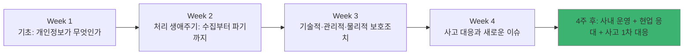

# 개인정보보호 담당자 실무 입문서 (4주 과정)

> **"법조문을 외우는 사람이 아니라, 현업 질문에 근거를 대며 답하는 사람"** 이 되는 4주.

사내 개인정보보호 업무를 처음 맡은 담당자를 위한 실무 교재입니다. 개인정보 취급 부서 담당자, IT·보안 부서에 새로 배치된 분도 대상입니다.
설명은 모두 **회사 안에서 일하는 담당자의 눈높이**로 썼습니다. 각 챕터는 같은 순서로 진행됩니다.

```
일상 비유 1줄 → 법령 조문 → 사내 실무 적용 → 오답노트
```

| 항목 | 내용 |
|---|---|
| 법령 기준일 | **2026-11-17** (이 날짜 기준 시행 중인 법령·고시) |
| 근거 법령 | 「개인정보 보호법」 법률 제21445호(2026. 9. 11. 시행) · 같은 법 시행령 대통령령 제36804호(2026. 11. 10. 시행) · 「개인정보의 안전성 확보조치 기준」 고시 제2026-9호(2026. 7. 1. 시행) |
| 실습 환경 | Windows 11 (PowerShell, BitLocker, 이벤트 뷰어, 로컬 보안 정책) |
| 근거 자료 | [`./references/`](./references/) 폴더의 법령 원문·고시·안내서·처분 보도자료 |
| 근거 우선순위 | **최신 법률 → 시행령 → 고시 → 안내서** 순서. 안내서와 법령이 다르면 **최신 법령**을 따릅니다 |

---

## 목차

- [1. 누구를 위한 교재인가](#1-누구를-위한-교재인가)
- [2. 4주 뒤 할 수 있게 되는 일](#2-4주-뒤-할-수-있게-되는-일)
- [3. 지금 꼭 알아야 할 법령 변경 (2026년 기준)](#3-지금-꼭-알아야-할-법령-변경-2026년-기준)
- [4. 4주 커리큘럼 목차](#4-4주-커리큘럼-목차)
- [5. 학습 방법 가이드](#5-학습-방법-가이드)
- [6. 레포지토리 구조](#6-레포지토리-구조)
- [7. 참고자료 목록](#7-참고자료-목록)
- [8. 표기 규칙과 면책](#8-표기-규칙과-면책)

---

## 1. 누구를 위한 교재인가

| 대상 | 이런 분께 맞습니다 |
|---|---|
| 신입 개인정보보호 담당자 | "개인정보 보호법을 읽어 본 적이 없다", "CPO 밑에서 실무를 맡게 됐다" |
| 개인정보 취급 부서 담당자 | 인사·마케팅·고객센터처럼 개인정보를 매일 다루지만 기준을 모르는 분 |
| IT·보안 부서 신규 배치자 | 기술은 알지만 "법이 무엇을 요구하는지"를 처음 연결해 보는 분 |

**전제 지식 수준**: 2/10. "개인정보", "동의" 같은 단어를 들어 본 정도면 충분합니다. 용어가 막히면 [용어집](./glossary.md)을 먼저 펴 보세요.

---

## 2. 4주 뒤 할 수 있게 되는 일

| # | 목표 역량 | 이런 상황에서 쓴다 | 주로 다루는 주차 |
|---|---|---|---|
| 1 | **회사 안의 개인정보 처리 업무를 법에 맞게 운영한다** | 처리방침 개정, 보유기간 관리, 위탁계약 점검, 내부 관리계획 연 1회 이행 점검 | Week 1~3 |
| 2 | **현업 부서의 질문에 근거를 들어 답한다** | "이벤트 경품 배송하려는데 주소 받아도 되나요?", "이거 제공이에요, 위탁이에요?" | Week 2 |
| 3 | **보호조치를 직접 점검하고 기록한다** | 권한 관리대장, 접속기록 점검, BitLocker·화면 잠금 확인 | Week 3 |
| 4 | **사고가 나면 1차로 대응한다** | 유출 인지 → 72시간 안에 통지·신고 여부 판단 → 통지문·신고서 초안 | Week 4 |



---

## 3. 지금 꼭 알아야 할 법령 변경 (2026년 기준)

개인정보 보호법은 자주 바뀝니다. 인터넷 블로그나 오래된 교재를 보면 **조문 번호와 기준이 지금과 다른 경우가 많으니** 아래 표부터 확인하세요.

### 3-1. 2023년 대개정 (법률 제19234호, 2023. 3. 14. 공포) — 이 교재 전체에 깔린 변화

| 주제 | 개정 전 | 개정 후 | 다루는 챕터 |
|---|---|---|---|
| 동의 중심 규제 | 동의를 받는 것이 사실상 기본값 | 계약 이행 등 **동의 외 적법 근거**가 넓어짐 (제15조) | W2-ch01 |
| 온라인·오프라인 이원화 | 정보통신서비스 제공자 특례(구 제39조의3 등)가 따로 있었음 | 특례를 정리해 **일반 규정으로 통일** | W2-ch01 |
| 영상정보처리기기 | 고정형(CCTV)만 규율 | **고정형(제25조) + 이동형(제25조의2, 신설)** | W3-ch06 |
| 정보주체 권리 | 열람·정정·삭제·처리정지 | **전송요구권(제35조의2)**, **자동화된 결정 대응권(제37조의2)** 신설 | W4-ch02 |
| 제재 | 형벌 중심, 과징금은 위반행위 관련 매출액 기준 | 과징금을 **전체 매출액에서 위반행위와 관련 없는 매출액을 뺀 금액** 기준으로 산정(현행 제64조의2제3항). 형벌 일부를 경제 제재로 전환 `[출처: 일반 지식, 원문 확인 권장]` | W1-ch05 |

> ⚠️ 확인 필요: 2023년 개정 법률 번호(제19234호)는 references 폴더의 법령 원문에 직접 적혀 있지 않습니다. 공포일(2023. 3. 14.)만 조문의 `<개정 2023. 3. 14.>` 표기로 확인됩니다. `[출처: 일반 지식, 원문 확인 권장]`

### 3-2. 2026년 개정 (법률 제21445호, 2026. 3. 10. 공포 → 2026. 9. 11. 시행) — 신입이 놓치기 쉬운 최신 변화

| 변경 내용 | 조문 | 실무 영향 |
|---|---|---|
| **사업주·대표자 책임 신설**: 대표가 개인정보 보호의 최종 책임자로서 인력·예산을 지원해야 함 | 법 제30조의3 | 예산·인력 요청의 법적 근거가 생김 |
| **CPO 지정·변경 시 이사회 의결 + 위원회 신고** (일정 규모 이상: 매출액 1,800억 원 초과이면서 민감·고유식별정보 5만 명 이상 또는 개인정보 100만 명 이상 처리 등) | 법 제31조제3항, 시행령 제32조제3항·제4항 | 사유 발생일부터 **6개월 이내** 신고 |
| **제31조 항 번호 변경**: CPO 업무가 제3항 → **제4항**으로 이동 | 법 제31조제4항 | 오래된 문서의 "제31조제3항" 인용을 주의 |
| **'유출 가능성' 통지 신설**: 유출이 의심되지만 정보주체를 특정하기 어려운 경우에도 가능성 있는 모든 정보주체에게 72시간 안에 통지 | 법 제34조제2항, 시행령 제39조의2·제39조의3 | 사고 대응 매뉴얼에 '가능성 통지' 단계를 추가해야 함 |
| **가중 과징금 신설**: 3년 내 같은 유형 반복 위반(고의·중과실), 고의·중과실로 피해 1천만 명 이상, 시정명령 불이행 후 유출 → **전체 매출액의 10%** 이내 (매출액이 없으면 50억 원 이내). 보호 투자 시 과징금 감경 규정도 신설 | 법 제64조의2제2항·제6항 | 시정명령 이행과 재발 방지 조치를 소홀히 하면 제재가 크게 무거워짐 |

[^law2026]

### 3-3. 시행 예정 (아직 시행 전 — 2026-11-17 기준)

| 시행일 | 내용 | 조문 |
|---|---|---|
| **2027. 3. 9.** | "인공지능기술" 정의 신설, **AI 기술 개발을 위한 개인정보 이용 특례**(위원회 심의·의결을 거치면 목적 외 이용 허용), 자동화된 결정에 "인공지능기술을 적용한 시스템" 명시 | 법 제2조제9호, 제28조의12~제28조의15, 제37조의2 |
| **2027. 7. 1.** | 일정 기준 이상 처리자의 **개인정보 보호 인증 의무화** | 법 제32조의2제1항 단서, 제75조제2항제15호 |

> ⚠️ 확인 필요: 2027. 3. 9. 시행 조문은 `<신설 2026. 9. 8.>`로 표기되어 있지만, references의 법률 파일은 모두 "법률 제21445호"로만 적혀 있고 2026. 9. 8. 개정 법률의 번호와 부칙은 들어 있지 않습니다. 국가법령정보센터에서 해당 개정 법률의 번호와 부칙을 확인하세요.[^law2027]

---

## 4. 4주 커리큘럼 목차

> 링크가 열리지 않는 챕터는 아직 작성 전(🚧)입니다. 모든 챕터는 [챕터 템플릿](./templates/chapter_template.md)의 10개 필수 구성을 따릅니다.

### Week 1. 기초: 개인정보가 무엇인가

| Ch | 제목 | 핵심 질문 | 실습 | 상태 |
|---|---|---|---|---|
| 01 | [개인정보의 정의와 판단 기준](./chapters/week1/ch01_what_is_personal_info.md) | 사번만 있는 엑셀도 개인정보인가? (식별가능성·결합 용이성·가명/익명정보) | 데이터 항목 분류 | 📝 견본 검토 중 |
| 02 | [개인정보 법체계 지도](./chapters/week1/ch02_legal_framework_map.md) | 신용정보법·위치정보법이 먼저인가, 보호법이 먼저인가? | 법령 적용 판단 | 🚧 |
| 03 | [핵심 용어와 역할](./chapters/week1/ch03_key_roles_and_terms.md) | 우리 팀장님은 개인정보취급자인가, 보호책임자인가? | 사내 역할 구분 | 🚧 |
| 04 | [개인정보 보호 원칙과 처리자의 기본 의무](./chapters/week1/ch04_principles_and_duties.md) | "혹시 몰라 더 받아두자"는 왜 안 되나? (최소수집 원칙) | 원칙 위반 찾기 | 🚧 |
| 05 | [개인정보보호위원회의 역할과 제재 체계](./chapters/week1/ch05_pipc_and_sanctions.md) | 과징금·과태료·시정명령은 무엇이 다른가? | 제재 유형 분류 | 🚧 |

### Week 2. 처리 생애주기: 수집부터 파기까지

| Ch | 제목 | 핵심 질문 | 실습 | 상태 |
|---|---|---|---|---|
| 01 | [수집·이용의 적법 근거](./chapters/week2/ch01_collection_and_use.md) | 경품 배송 주소, 동의가 꼭 필요한가? (필수/선택 구분) | 동의서 작성 | 🚧 |
| 02 | [민감정보·고유식별정보·주민등록번호 처리 제한](./chapters/week2/ch02_sensitive_and_unique_id.md) | 채용 지원서에 건강 상태를 물어도 되나? | 항목별 처리 가능 여부 판단 | 🚧 |
| 03 | [제3자 제공과 처리위탁 구분](./chapters/week2/ch03_provision_vs_outsourcing.md) | 배송업체에 넘기는 것은 제공인가, 위탁인가? (판단 플로우차트) | 제공/위탁 구분 | 🚧 |
| 04 | [아동(만 14세 미만) 개인정보 처리](./chapters/week2/ch04_children_under_14.md) | 법정대리인 동의는 어떻게 확인하나? | 법정대리인 동의 절차 설계 | 🚧 |
| 05 | [보유기간 관리와 파기](./chapters/week2/ch05_retention_and_destruction.md) | 탈퇴 회원 정보, 언제 무엇을 지워야 하나? (분리보관 포함) | 보유기간표 작성 | 🚧 |
| 06 | [개인정보 처리방침 작성·공개 실습](./chapters/week2/ch06_privacy_policy_practice.md) | 처리방침에 꼭 들어가야 할 항목은? | 처리방침 초안 작성 | 🚧 |

### Week 3. 기술적·관리적·물리적 보호조치 실습

| Ch | 제목 | 핵심 질문 | 실습 | 상태 |
|---|---|---|---|---|
| 01 | [내부 관리계획 수립과 개인정보취급자 교육](./chapters/week3/ch01_internal_management_plan.md) | 내부 관리계획에 무엇을 넣고, 누가 연 1회 점검하나? | 내부 관리계획 목차 작성 | 🚧 |
| 02 | [접근권한 관리와 접근통제](./chapters/week3/ch02_access_control.md) | 퇴사자 계정은 언제 지우고, 기록은 몇 년 보관하나? | 권한 관리대장 작성 | 🚧 |
| 03 | [암호화 (저장 시·전송 시)](./chapters/week3/ch03_encryption.md) | 계좌번호는 꼭 암호화해야 하나? 비밀번호는 왜 일방향인가? | 암호화 대상 판별 | 🚧 |
| 04 | [접속기록 보관과 점검](./chapters/week3/ch04_access_logs.md) | 접속기록은 1년인가 2년인가? 점검은 얼마나 자주? | 접속기록 점검 시뮬레이션 | 🚧 |
| 05 | [악성프로그램 방지·물리적 안전조치·출력·복사 보호](./chapters/week3/ch05_malware_physical_output.md) | 고객 명단 출력물은 어떻게 관리하나? | 사무실 점검표 작성 | 🚧 |
| 06 | [고정형·이동형 영상정보처리기기(CCTV 등) 운영](./chapters/week3/ch06_cctv_video_devices.md) | 사무실 CCTV 안내판, 무엇을 적어야 하나? | 안내판 문구 작성 | 🚧 |
| 07 | [Windows 11 핸즈온](./chapters/week3/ch07_windows11_handson.md) | 내 PC는 기준을 지키고 있나? | BitLocker·파일 암호·화면 잠금·이벤트 ID 4624/4625 확인 | 🚧 |

### Week 4. 사고 대응과 새로운 이슈

| Ch | 제목 | 핵심 질문 | 실습 | 상태 |
|---|---|---|---|---|
| 01 | [개인정보 유출 등 사고 대응](./chapters/week4/ch01_breach_response.md) | 72시간은 언제부터 세나? 통지와 신고는 무엇이 다른가? | 통지·신고 판단, 통지문·신고서 초안 | 🚧 |
| 02 | [정보주체 권리 행사 대응](./chapters/week4/ch02_data_subject_rights.md) | 열람 요구에 며칠 안에 답해야 하나? 전송요구권·자동화된 결정 대응권은? | 민원 답변서 작성 | 🚧 |
| 03 | [국외 이전과 클라우드·SaaS 이용](./chapters/week4/ch03_cross_border_cloud_saas.md) | 해외 SaaS를 도입하면 국외 이전인가? | 도입 전 확인표 작성 | 🚧 |
| 04 | [AI·생성형 AI 사내 도입 시 개인정보 이슈](./chapters/week4/ch04_ai_and_generative_ai.md) | 직원이 고객 상담 내용을 챗봇에 붙여넣어도 되나? | 생성형 AI 도입 체크리스트 | 🚧 |
| 05 | [가명정보의 기본 개념과 사내 활용 시 주의점](./chapters/week4/ch05_pseudonymized_info_basics.md) | 가명처리하면 동의 없이 마음대로 써도 되나? | 가명/익명 구분 | 🚧 |
| 06 | [종합 모의훈련: A사 유출 사고 대응](./chapters/week4/ch06_mock_drill_company_a.md) | 유출 인지부터 재발 방지까지, 처음부터 끝까지 | 전 과정 롤플레이 | 🚧 |

### 공통 자료

| 문서 | 설명 | 상태 |
|---|---|---|
| [용어집](./glossary.md) | 가나다순 핵심 용어 / 쉬운 정의 / 관련 조문, 헷갈리는 짝 비교표 | ✅ |
| [정답 및 해설](./answers_and_explanations.md) | 전 챕터 퀴즈·실습 정답과 오답 선택지 해설 | 🚧 |
| [템플릿 안내](./templates/README.md) · [챕터 템플릿](./templates/chapter_template.md) | 모든 챕터에 같은 형식을 적용하기 위한 규격 | ✅ |

---

## 5. 학습 방법 가이드

### 5-1. 하루 학습량

| 구분 | 권장 | 비고 |
|---|---|---|
| 하루 | **챕터 1개, 60~90분** | 업무 시간 중 매일 같은 시간대에 블록을 잡으세요 |
| 한 주 | 월~목 신규 학습, **금요일은 복습과 퀴즈** | Week 3(7개)·Week 2(6개)·Week 4(6개)는 금요일 오전에 마지막 챕터를 끝냅니다 |
| 실습 | Week 3 ch07(Windows 11)은 **90~120분** 확보 | 관리자 권한이 필요한 작업은 IT 부서와 미리 일정을 맞추세요 |

**하루 60~90분 배분 예시**

| 시간 | 할 일 | 챕터 섹션 |
|---|---|---|
| 5분 | 학습 목표와 한 줄 비유를 읽고 "오늘 답할 질문"을 메모 | 1~2 |
| 25분 | 조문 읽기: 원문 요지보다 **쉬운 풀이**를 먼저 읽고, 원문으로 돌아가기 | 3 |
| 15분 | 상황극 Q&A를 읽기 전에 **내 답을 먼저 써 보기** | 4~5 |
| 10분 | 처분 사례: "우리 회사라면 어디가 같은 약점일까?" 한 줄 쓰기 | 6 |
| 10분 | 오답노트에서 **내가 실제로 그렇게 생각했던 칸**에 표시 | 7 |
| 15분 | 체크리스트를 우리 회사에 실제로 대입하고, 퀴즈 풀기 | 8~9 |

### 5-2. 복습 방법

1. **오답노트를 내 것으로 만들기**: 챕터의 오답노트 표를 복사해 개인 노트에 붙이고, 퀴즈에서 틀린 항목을 행으로 추가합니다.
2. **간격 반복**: 학습 다음 날, 1주 뒤, 4주 뒤(과정 종료일)에 각 챕터의 **체크리스트만** 다시 훑습니다. 막히는 항목이 있으면 그 챕터의 3번 섹션으로 돌아가세요.
3. **"현업에게 설명하기" 테스트**: 금요일마다 그 주에 배운 개념 하나를 동료나 현업 담당자에게 3분 안에 설명해 봅니다. 비유 → 조문 번호 → 우리 회사 예시 순서로 말하면 됩니다.
4. **정답은 마지막에**: [정답 및 해설](./answers_and_explanations.md)은 퀴즈를 끝까지 푼 뒤에 엽니다. 해설에서는 **오답 선택지가 왜 틀렸는지**를 꼭 읽으세요. 실무에서 헷갈리는 지점이 바로 거기입니다.
5. **조문은 원문으로 확인하는 습관**: 이 교재의 요약을 그대로 인용하지 말고, 사내 문서에 쓸 때는 반드시 [`references/`](./references/)의 원문이나 국가법령정보센터에서 최신 조문을 다시 확인하세요.

### 5-3. 주차별 완료 기준

| 주차 | 이것을 할 수 있으면 다음 주로 |
|---|---|
| Week 1 | 사내 엑셀 파일 하나를 보고 개인정보 여부와 우리 회사의 역할(처리자/수탁자)을 설명할 수 있다 |
| Week 2 | 현업의 수집·제공 요청에 근거 조문을 들어 "가능/조건부 가능/불가"로 답할 수 있다 |
| Week 3 | 권한 관리대장을 작성하고, 내 PC에서 BitLocker 상태와 로그온 기록(4624/4625)을 확인할 수 있다 |
| Week 4 | 유출 시나리오에서 72시간 안에 통지·신고 대상과 기한을 판단하고 초안을 쓸 수 있다 |

---

## 6. 레포지토리 구조

```
Basic_PrivacyStudy/
├── README.md                      ← 지금 보고 있는 문서
├── glossary.md                    ← 용어집 (가나다순)
├── answers_and_explanations.md    ← 전 챕터 정답과 해설
├── templates/
│   ├── README.md                  ← 템플릿 사용법과 작성 규칙
│   ├── chapter_template.md        ← 챕터 공통 템플릿
│   └── check_mermaid.ps1          ← Mermaid 따옴표 누락 검사 스크립트
├── chapters/
│   ├── week1/  ch01 ~ ch05
│   ├── week2/  ch01 ~ ch06
│   ├── week3/  ch01 ~ ch07
│   └── week4/  ch01 ~ ch06
└── references/                    ← 법령 원문·고시·안내서·처분 보도자료 (1순위 근거)
```

---

## 7. 참고자료 목록

[`references/`](./references/) 폴더의 자료(35건)를 근거로 씁니다. 자료끼리 내용이 다르면 **최신 법령(법률 → 시행령 → 고시)이 안내서보다 우선**합니다. 모든 자료의 발행 기관은 **개인정보보호위원회**입니다. ISMS-P 고시만 과학기술정보통신부와 공동 고시입니다.

### 7-1. 법령·고시

| 문서 | 버전 / 시행일 | 주로 쓰는 챕터 |
|---|---|---|
| 개인정보 보호법 (`개인정보 보호법(법률)(제21445호)(20260911).pdf`) | 법률 제21445호, **2026. 9. 11. 시행** (현행) | 전 챕터 |
| 개인정보 보호법 (`개인정보 보호법(법률)(제21445호)(20270701).pdf`) | 같은 법률, **2027. 7. 1. 시행 예정본** | 시행 예정 조문 비교용 |
| 개인정보 보호법 시행령 (`개인정보 보호법 시행령(대통령령)(제36804호)(20261110).pdf`) | 대통령령 제36804호, 2026. 11. 10. 시행 | 전 챕터 |
| 시행령 [별표 1] 개인정보 보호책임자의 자격 | 2026. 9. 10. 개정 | W1-ch03 |
| 시행령 [별표 1의5] 과징금의 산정기준과 산정절차 | 2026. 9. 10. 개정 | W1-ch05 |
| 시행령 [별표 2] 과태료의 부과기준 | 2026. 9. 10. 개정 | W1-ch05 |
| 개인정보의 안전성 확보조치 기준 | 고시 제2026-9호, 2026. 7. 1. 시행 | Week 3 전체 |
| 표준 개인정보 보호지침 | 고시 제2025-4호, 2025. 4. 11. 시행 ⚠️ 2026년 법 개정 전 고시: 유출 통지(제26조)·CPO 정의(제2조제5호)는 현행 법령 우선 | Week 2 전반, W3-ch06, W4-ch01·ch02 |
| 개인정보 보호법 위반에 대한 과징금 부과기준 | 고시 제2026-12호, 2026. 9. 11. 시행 | W1-ch05 |
| 개인정보 보호위원회의 조사 및 처분에 관한 규정 | 고시 제2026-13호, 2026. 9. 11. 시행 | W1-ch05, W4-ch01 |
| 가명정보의 결합 및 반출 등에 관한 고시 | 고시 제2025-8호, 2025. 9. 9. 시행 | W4-ch05 |
| 개인정보 영향평가에 관한 고시 (+[별표 5]) | 고시 제2025-7호, 2025. 9. 5. 시행 | W3-ch01 (참고) |
| 정보보호 및 개인정보보호 관리체계 인증 등에 관한 고시 (+[별표 7] 인증기준) | 고시 제2024-8호, 2024. 7. 24. 시행 | Week 3 (참고) |

### 7-2. 안내서·가이드라인

| 문서 | 발행 | 주로 쓰는 챕터 |
|---|---|---|
| 개인정보의 안전성 확보조치 기준 안내서 | 2026. 11. | Week 3 전체 |
| 개인정보 유출등 대응 안내서 | 2026. 9. | W4-ch01, ch06 |
| 2026 개인정보 처리방침 작성지침 | 2026. 4. | W2-ch06 |
| 가명정보 처리 가이드라인 | 2026. 3. | W1-ch01, W4-ch05 |
| 개인정보 영향평가 수행안내서 (개정판) | 2025. 10. | W3-ch01 (참고) |
| 생성형 인공지능(AI) 개발·활용을 위한 개인정보 처리 안내서 | 2025. 8. | W4-ch04 |
| 고정형 영상정보처리기기 설치·운영 안내서 (공공 및 민간분야 통합본) | 2024. 12. | W3-ch06 |
| 자동화된 결정에 대한 정보주체의 권리 안내서 | 2024. 9. | W4-ch02 |
| 이동형 영상정보처리기기를 위한 개인영상정보 보호·활용 안내서 | 2024. 9. | W3-ch06 |
### 7-3. 처분·점검 보도자료 (처분 사례 섹션의 근거)

| 의결/발표 | 대상 | 요지 | 주로 쓰는 챕터 |
|---|---|---|---|
| 2022. 9. | 구글·메타 | 동의 없는 타사 행태정보 수집·이용, 과징금 약 1,000억 원 | W2-ch01 |
| 2023. 7. | ㈜엘지유플러스 | 유출사고, 과징금 68억 원·과태료 2,700만 원 | W3-ch02 |
| 2024. 3. | LLM 사업자 6개사 | AI 서비스 사전 실태점검, 개선권고 | W4-ch04 |
| 2024. 5. | ㈜골프존 | 랜섬웨어 유출, 과징금 75억 원·과태료 540만 원 | W3-ch02, ch05 |
| 2024. 5. | ㈜카카오 | 오픈채팅 유출, 유출 신고·통지 소홀, 과징금 151억 원 | W4-ch01 |
| 2024. 6. | AI 응용서비스 4개사 | 사전 실태점검 | W4-ch04 |
| 2024. 11. | 메타 | 민감정보 무단 처리, 열람 거절, 과징금·과태료 216억 원 | W2-ch02, W4-ch02 |
| 2025. 1. | 카카오페이·애플 | 무단 국외 이전, 과징금·과태료 83억 원 | W4-ch03 |
| 2025. 5. | 테무 | 국외이전 규정 등 위반, 과징금 13억 6,900만 원 | W4-ch03 |
| 2025. 8. | SK텔레콤 | USIM 정보 등 유출, 과징금 1,347억 원 | W3-ch03, W4-ch01 |
| 2026. 8. | (공공기관 1,458개) | 2026년 공공기관 개인정보 보호수준 평가단 위촉 | 참고 |

### 7-4. references에 없어 추가로 확보하면 좋은 자료

아래 자료는 references 폴더에 없습니다. 해당 챕터에서는 일반 지식으로 보충하고 `[출처: 일반 지식, 원문 확인 권장]`을 표시합니다.

- 2023년 개정법을 반영한 동의 관련 안내서 (구판인 2022. 3. 동의 안내서는 개정 전 자료라 references에서 제외함): W2-ch01
- 「신용정보의 이용 및 보호에 관한 법률」, 「위치정보의 보호 및 이용 등에 관한 법률」 원문: W1-ch02
- 개인정보 처리 통합 안내서, 정보주체 권리 행사(열람·삭제 등) 관련 안내서: W2, W4-ch02
- 아동·청소년 개인정보 보호 가이드라인: W2-ch04
- 국외 이전 관련 안내서, 클라우드 이용 관련 안내서: W4-ch03

---

## 8. 표기 규칙과 면책

| 표기 | 뜻 |
|---|---|
| `[출처: 파일명, p.N]` / `[출처: 파일명, 제N조]` | references 폴더의 원문에서 확인한 내용 |
| `[출처: 일반 지식, 원문 확인 권장]` | references에 없어 일반 지식으로 보충한 내용 |
| `> ⚠️ 확인 필요` | 원문으로 확인하지 못했거나 자료끼리 내용이 다른 부분. 자료끼리 다르면 **최신 법령 기준**으로 쓰고 차이를 밝힙니다 |

근거 우선순위와 이미 확인된 충돌 목록은 [템플릿 안내 3-1](./templates/README.md#3-1-근거의-우선순위)에 정리되어 있습니다.

- 이 교재는 **사내 교육용 학습 자료**이며 법률 자문이 아닙니다. 실제 사안 판단은 최신 법령 원문, 개인정보보호위원회 법령해석 지원센터(☎ 02-2100-3043), 사내 법무 검토를 거치세요.
- 법령 기준일(2026-11-17) 이후의 개정은 반영되어 있지 않습니다. 특히 **2027. 3. 9.과 2027. 7. 1. 시행 예정 조문**은 시행 전에 다시 확인하세요.

[^law2026]: [출처: 개인정보 보호법(법률)(제21445호)(20260911).pdf, 제30조의3·제31조·제34조·제64조의2 및 부칙 제1조~제3조] / [출처: 개인정보 보호법 시행령(대통령령)(제36804호)(20261110).pdf, 제32조제3항·제4항, 제39조의2, 제39조의3]
[^law2027]: [출처: 개인정보 보호법(법률)(제21445호)(20260911).pdf, 제2조·제28조의12~제28조의15·제37조의2의 `[시행일: 2027. 3. 9.]` 표기, 제32조의2제1항 단서·제75조제2항제15호의 `[시행일: 2027. 7. 1.]` 표기, 부칙 제1조]
