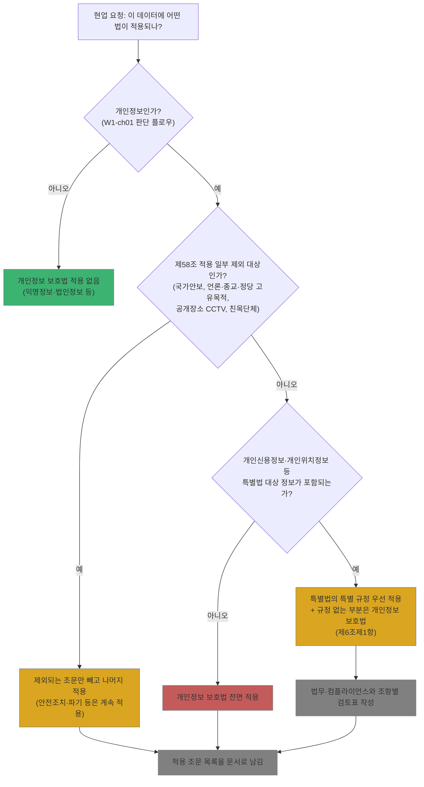

# Week 1 · Ch02. 개인정보 법체계 지도

> [← 이전 챕터](./ch01_what_is_personal_info.md) · [📚 전체 목차](../../README.md) · [다음 챕터 →](./ch03_key_roles_and_terms.md)

| 항목 | 내용 |
|---|---|
| 예상 학습 시간 | 70분 |
| 법령 기준일 | 2026-11-17 |
| 핵심 근거 | 개인정보 보호법 제6조, 제12조, 제58조 / 표준 개인정보 보호지침 제1조·제5조 / 안전성 확보조치 기준 제1조 |
| 관련 용어 | [개인정보 보호위원회](../../glossary.md#개인정보-보호위원회), [표준 개인정보 보호지침](../../glossary.md#표준-개인정보-보호지침), [안전성 확보조치](../../glossary.md#안전성-확보조치), [개인정보 보호 인증](../../glossary.md#개인정보-보호-인증) |
| 선수 챕터 | [W1-ch01 개인정보의 정의와 판단 기준](./ch01_what_is_personal_info.md) |

---

## 1. 학습 목표

이 챕터를 마치면 담당자님은 다음을 할 수 있습니다.

1. 법률 → 시행령 → 고시 → 안내서의 **위계와 구속력 차이**를 구분할 수 있다.
2. 개인정보 보호법과 신용정보법·위치정보법 등 **특별법이 함께 걸릴 때** 어느 법을 먼저 볼지 판단할 수 있다.
3. 법 제58조의 **적용 일부 제외**에 해당하는 경우와 그래도 지켜야 할 의무를 확인할 수 있다.

---

## 2. 한 줄 비유

> 💡 **개인정보 보호법은 "건물 전체 관리규약", 신용정보법·위치정보법은 "특정 층 전용 규칙"입니다. 전용 규칙이 있는 층에서는 그 규칙을 먼저 보고, 규칙에 없는 부분은 전체 관리규약을 따릅니다.**

단, 비유의 한계가 있습니다. 실제로는 한 데이터가 **여러 층에 동시에 걸치는** 경우가 많습니다. 예를 들어 결제 정보는 신용정보법과 개인정보 보호법에 함께 걸릴 수 있으므로, "한 법만 고르는" 문제가 아니라 **"조항별로 어느 법이 우선하는지"** 따지는 문제입니다.

---

## 3. 개념 설명 및 법령 조문

### 3-1. 규범의 위계: 무엇이 "법"이고 무엇이 "참고"인가

신입 담당자가 가장 먼저 익혀야 할 것은 **자료마다 힘이 다르다**는 점입니다.

| 단계 | 이름 | 누가 만드나 | 구속력 | 이 교재의 예 |
|---|---|---|---|---|
| 1 | **법률** | 국회 | 반드시 지켜야 함. 위반하면 과징금·과태료·형벌 | 개인정보 보호법 |
| 2 | **시행령** (대통령령) | 정부 | 법률이 위임한 범위에서 반드시 지켜야 함 | 개인정보 보호법 시행령 (72시간, 1천 명 등 구체 기준) |
| 3 | **고시** (위원회 고시) | 개인정보보호위원회 | 법령의 위임을 받은 고시는 사실상 법령처럼 지켜야 함. 단, **고시마다 성격이 다름** (아래 표) | 안전성 확보조치 기준, 표준 개인정보 보호지침 |
| 4 | **안내서·가이드라인·해설서** | 개인정보보호위원회 | 직접 구속력은 없음. 위원회의 **해석 방향**이라 실무 판단의 중요한 참고 | 유출등 대응 안내서, 가명정보 처리 가이드라인 |
| 5 | **처분 사례** (의결·보도자료) | 개인정보보호위원회 | 해당 사건에만 효력. 위원회가 실제로 **어떻게 판단하는지** 보여 주는 선례 | 구글·메타, SK텔레콤 처분 |

> ⚠️ 확인 필요: "법령의 위임을 받은 고시는 상위 법령과 결합해 대외적 구속력을 가진다"는 설명은 행정법의 일반 이론입니다. references에서 직접 확인한 내용은 아닙니다. `[출처: 일반 지식, 원문 확인 권장]`

**같은 "고시"라도 성격이 다릅니다.** references 원문에서 각 고시가 스스로 밝힌 성격은 다음과 같습니다.

| 고시 | 근거 조문 | 원문이 밝힌 성격 | 실무 의미 |
|---|---|---|---|
| 개인정보의 안전성 확보조치 기준 (제2026-9호) | 법 제29조, 영 제16조제2항·제30조·제30조의2 | "안전조치에 관한 **최소한의 기준**을 정하는 것을 목적"으로 함. 안내서는 이를 "**반드시 준수**해야 하는 최소한의 기준"이라고 설명함[^safety-nature] | 하나라도 빠지면 법 제29조(안전조치의무) 위반이 될 수 있음 |
| 표준 개인정보 보호지침 (제2025-4호) | 법 제12조제1항 | 위원회가 표준지침을 정해 "그 **준수를 권장**할 수 있다"(법 제12조제1항)[^law-12] | 지침 자체는 권장 형식이지만, 내용 대부분이 법·시행령을 구체화한 것이라 **실무 기준으로 따르는 것**이 안전함 |

> 💡 **우선순위 원칙 다시 보기**: 이 교재는 자료끼리 내용이 다르면 **최신 법령(법률 → 시행령 → 고시)이 안내서보다 우선**합니다. 표준지침(2025. 4.)과 2026년 개정 법률이 다른 부분이 실제로 있으니 [템플릿 안내 3-1](../../templates/README.md#3-1-근거의-우선순위)의 충돌 목록을 함께 보세요.

### 3-2. 관련 조문

> 📌 **조문 주소 읽는 법**: 조 → 항(①②) → 호(1. 2.) → 목(가. 나.). 자세한 설명은 [W1-ch01 3-2](./ch01_what_is_personal_info.md#3-2-관련-조문)를 보세요.

#### 📜 개인정보 보호법 제6조 (다른 법률과의 관계)

| 구분 | 내용 |
|---|---|
| **원문 요지** | ① 개인정보의 처리 및 보호에 관하여 **다른 법률에 특별한 규정이 있는 경우를 제외하고는** 이 법에서 정하는 바에 따른다. ② 개인정보의 처리 및 보호에 관한 다른 법률을 제정하거나 개정하는 경우에는 이 법의 목적과 원칙에 맞도록 하여야 한다. |
| **쉬운 풀이** | 개인정보 보호법은 **기본법(일반법)**입니다. 신용정보법처럼 특정 분야 법률에 **같은 사항을 다르게 정한 조항**이 있으면 그 조항이 먼저 적용됩니다. 특별법에 **규정이 없는 부분**은 다시 개인정보 보호법을 따릅니다. |
| **시행일** | 2026. 9. 11. 시행 법률 제21445호 기준 (제2항은 2023. 3. 14. 신설) |
| **실무 포인트** | "우리는 금융회사라 신용정보법만 보면 된다"는 틀린 말입니다. 판단은 **법 단위가 아니라 조항 단위**로 합니다. 예를 들어 신용정보법에 따로 정하지 않은 사항이면 보호법이 적용됩니다. |

근거 원문은 각주를 참고하세요.[^law-6]

#### 📜 개인정보 보호법 제12조 (개인정보 보호지침)

| 구분 | 내용 |
|---|---|
| **원문 요지** | ① 보호위원회는 개인정보의 처리에 관한 기준, 침해 유형 및 예방조치 등에 관한 **표준 개인정보 보호지침**을 정하여 개인정보처리자에게 그 준수를 권장할 수 있다. ② 중앙행정기관의 장은 표준지침에 따라 소관 분야의 개인정보 보호지침을 정할 수 있다. ③ 국회·법원·헌법재판소·중앙선거관리위원회는 자체 지침을 정하여 시행할 수 있다. |
| **쉬운 풀이** | 표준지침은 위원회가 만든 **"실무 표준 매뉴얼"**입니다. 각 부처는 이 표준에 맞춰 자기 분야 지침을 만들 수 있습니다. 표준지침 제5조도 다른 부처 지침이 표준지침에 **부합해야** 한다고 정합니다. |
| **시행일** | 2026. 9. 11. 시행 법률 제21445호 기준 / 표준지침은 2025. 4. 11. 시행 고시 제2025-4호 |
| **실무 포인트** | 우리 회사가 속한 업종(의료, 교육, 금융 등)에 **부처별 지침**이 따로 있는지 확인하세요. 있다면 그 지침도 사내 기준에 반영해야 합니다. |

근거 원문은 각주를 참고하세요.[^law-12] [^std-1-5]

#### 📜 개인정보 보호법 제58조 (적용의 일부 제외)

| 구분 | 내용 |
|---|---|
| **원문 요지** | ① 다음 개인정보에는 제3장부터 제8장까지를 적용하지 않는다: **국가안전보장** 관련 정보 분석 목적의 개인정보(제2호), **언론·종교단체·정당**이 취재·보도, 선교, 선거 입후보자 추천 등 고유 목적을 위해 수집·이용하는 개인정보(제4호). ② 공개된 장소에 법 제25조제1항에 따라 설치한 **고정형 영상정보처리기기**로 처리되는 개인정보에는 제15조, 제22조, 제22조의2, 제27조제1항·제2항, 제34조, 제37조를 적용하지 않는다. ③ **동창회·동호회 등 친목 단체** 운영을 위한 개인정보 처리에는 제15조, 제30조, 제30조의3, 제31조를 적용하지 않는다. ④ 제1항의 경우에도 최소한의 기간에 최소한의 개인정보만 처리하고, 안전조치·고충처리 등 필요한 조치를 마련해야 한다. |
| **쉬운 풀이** | 법 전체가 면제되는 게 아니라 **"이 조문들만 빼 준다"**는 규정입니다. 예를 들어 친목 단체는 수집 근거(제15조), 처리방침(제30조), 대표자 책임(제30조의3), CPO 지정(제31조)만 면제됩니다. **안전조치(제29조)와 파기(제21조)는 그대로** 지켜야 합니다. |
| **시행일** | 2026. 9. 11. 시행 법률 제21445호 기준 |
| **실무 포인트** | 현업이 "이건 법 적용 제외래요"라고 하면 **"몇 조 몇 항의 어느 조문이 제외되는지"**를 반드시 확인하세요. 제외되지 않은 의무가 대부분입니다. |

근거 원문은 각주를 참고하세요.[^law-58] "친목단체"의 뜻은 표준지침 제2조제4호에 있습니다(학교·지역·기업·인터넷 커뮤니티 등을 단위로 한 동창회, 동호회, 향우회, 반상회, 동아리 등).[^std-2-4]

### 3-3. 개인정보 법체계 지도

개인정보와 관련된 주요 법률을 사내 담당자 관점에서 정리하면 다음과 같습니다.

| 법률 | 무엇을 다루나 | 주로 관련된 사내 업무 | 근거 표시 |
|---|---|---|---|
| **개인정보 보호법** | 모든 개인정보 처리의 기본 원칙과 절차 (일반법) | 전 부서 | references 원문 |
| **신용정보의 이용 및 보호에 관한 법률** (신용정보법) | **개인신용정보**(기업·법인 정보를 뺀 살아 있는 개인에 관한 신용정보)의 수집·제공·활용 등. 소관: **금융위원회**. 금융위 감독을 받지 않는 **상거래기업**의 일부 조항 위반은 **개인정보보호위원회**가 조사 | 결제, 할부, 금융 제휴, 신용조회 | 신용정보법 제2조제2호, 제45조의3[^credit] |
| **위치정보의 보호 및 이용 등에 관한 법률** (위치정보법) | **개인위치정보**(특정 개인의 위치정보. 다른 정보와 쉽게 결합해 위치를 알 수 있는 것 포함)의 수집·이용·제공, 위치기반서비스 사업. 소관: **방송미디어통신위원회** | 배송 추적, 차량 관제, 매장 찾기, 근무자 위치 확인 | 위치정보법 제2조제2호, 제4조[^loc] |
| **정보통신망 이용촉진 및 정보보호 등에 관한 법률** (정보통신망법) | 정보보호 관리체계(ISMS), 침해사고 대응, 광고성 정보 전송 등 | 보안팀, 마케팅(광고 문자·메일) | ISMS 인증 근거(정보통신망법 제47조)[^isms-1] / 광고성 정보: 사전 동의, 야간(21시~8시) 별도 동의, 2년마다 수신 동의 확인 (정보통신망법 제50조, 시행령 제62조의3)[^net-50] |
| 업종별 법률 (의료법, 전자상거래법, 근로기준법 등) | 개인정보의 **보존 의무 기간**, 업종별 비밀유지 등 | 보유기간 설정, 파기 예외 | `[출처: 일반 지식, 원문 확인 권장]` → [W2-ch05](../week2/ch05_retention_and_destruction.md) |

이 법률들이 서로 맞물려 있다는 증거는 references에서도 확인됩니다.
- 2026. 3. 10. 개인정보 보호법 개정 법률의 부칙 제4조는 개인정보 보호법 제31조의 항 번호가 바뀌자 **신용정보법 제20조와 정보통신망법 제45조의3의 인용 조문을 함께 고쳤습니다.**[^law-addenda]
- 가명정보 처리 가이드라인은 개인정보 보호법·정보통신망법·신용정보법 개정을 묶어 **"데이터 3법"**(2020. 8. 5. 시행)이라고 부릅니다.[^pseudo-p17]
- ISMS-P 인증 고시는 정보통신망법의 정보보호 관리체계 인증과 개인정보 보호법의 개인정보보호 인증을 **하나로 통합 운영**하기 위한 고시입니다.[^isms-1]

> 📌 **특별법도 같은 구조를 스스로 밝힙니다.** 신용정보법 제3조의2제2항은 "개인정보의 보호에 관하여 이 법에 특별한 규정이 있는 경우를 제외하고는 「개인정보 보호법」에서 정하는 바에 따른다"고 정합니다. 위치정보법 제4조도 위치정보에 관해 다른 법률에 특별한 규정이 없으면 위치정보법을 따른다고 정합니다. 그래서 판단은 **법 단위가 아니라 조항 단위**입니다.[^credit][^loc]
>
> ⚠️ 이 교재는 두 법의 **세부 의무**(동의 방식, 보유기간, 사업 등록 등)는 다루지 않습니다. 해당 업무가 있는 회사는 원문을 법무·컴플라이언스 부서와 함께 검토하세요.

---

## 4. 사내 실무 적용

### 🎭 상황극 1. 신사업팀의 "금융 데이터니까 신용정보법만 보면 되죠?"

> **📨 신사업팀 이 팀장**: "제휴 카드사랑 같이 **고객 결제 패턴으로 맞춤 할인 쿠폰** 주는 서비스를 준비하고 있어요. 결제 정보는 금융 데이터니까 신용정보법만 챙기면 되죠? 개인정보 보호법은 안 봐도 되는 거 맞죠?"

**🙋 담당자 답변**

| 구분 | 내용 |
|---|---|
| **결론** | ⚠️ **조건부 가능** — 두 법을 **모두** 검토해야 합니다. 신용정보법에 특별한 규정이 있는 사항은 신용정보법을 따르고, 규정이 없는 사항은 개인정보 보호법을 따릅니다. |
| **근거** | 개인정보 보호법 제6조제1항 / 카카오페이·애플 처분 사례(아래 6절): 같은 사건에서 국외이전 부분은 개인정보보호위원회가 보호법으로, 제3자 제공 부분은 금융위원회가 신용정보법으로 따로 처분 |
| **다음 행동** | ① 주고받는 데이터 항목 목록을 받아 **개인신용정보에 해당하는 항목**과 일반 개인정보를 나눕니다. ② 개인신용정보 부분은 법무·컴플라이언스 부서에 신용정보법 검토를 요청합니다. ③ 나머지(마케팅 이용 동의, 처리방침 공개, 안전조치 등)는 개인정보 보호법 기준으로 검토합니다([W2-ch01](../week2/ch01_collection_and_use.md), [W2-ch03](../week2/ch03_provision_vs_outsourcing.md)). ④ 검토 결과를 **법별·조항별 표**로 남깁니다. |

**왜 그런가요?** 제6조는 "다른 법률에 **특별한 규정이 있는 경우를 제외하고는**" 보호법을 따른다고 합니다. 신용정보법이 모든 사항을 정하고 있지는 않으므로, 빈칸은 보호법이 채웁니다. 실제로 위원회와 금융위원회가 **한 사건을 나눠서** 처분한 사례가 있습니다.

### 🎭 상황극 2. 사내 등산 동호회의 "동호회는 법 적용 안 받는다던데요?"

> **📨 경영지원팀 정 주임 (사내 등산 동호회 총무)**: "동호회 회원 명단이랑 회비 납부 내역, 비상연락처를 엑셀로 관리하고 있어요. 동호회는 개인정보 보호법 적용을 안 받는다고 들었는데, 그냥 공용 드라이브에 올려 둬도 되죠? 그리고 회비를 **급여에서 공제**하려고 인사팀에 명단을 넘기려고요."

**🙋 담당자 답변**

| 구분 | 내용 |
|---|---|
| **결론** | ❌ **공용 드라이브 공개는 불가** / ⚠️ **급여 공제는 조건부 가능**. 동호회 운영 목적의 처리는 **일부 조문만** 적용이 제외되고, 안전조치 의무는 그대로입니다. 또 급여 공제는 동호회가 아니라 **회사의 처리**가 되므로 일반 규정이 적용됩니다. |
| **근거** | 개인정보 보호법 제58조제3항 (제15조·제30조·제30조의3·제31조만 적용 제외), 제29조(안전조치의무), 표준지침 제2조제4호(친목단체 정의) |
| **다음 행동** | ① 명단 파일을 **동호회 운영진만 접근할 수 있는 폴더**로 옮기고, 비상연락처처럼 꼭 필요하지 않은 항목은 줄입니다. ② 탈퇴 회원 정보는 파기합니다(제21조). ③ 급여 공제는 회사(인사팀)가 처리하는 것이므로, 회원 본인의 **신청이나 동의**를 받는 등 적법 근거를 갖춘 뒤 진행합니다. ④ 인사팀에는 공제에 필요한 **사번과 공제 금액만** 넘깁니다. |

**왜 그런가요?** 제58조제3항이 빼 주는 조문은 네 개뿐입니다. 공용 드라이브에 올려 아무나 볼 수 있게 하는 것은 제29조의 안전조치 문제입니다. 이는 [안전성 확보조치 기준 제6조제3항](../week3/ch02_access_control.md)이 말하는 "권한 없는 자에게 공개" 상황과도 같습니다. 급여 공제는 동호회 운영이 아니라 **회사의 급여 업무**이므로 제58조제3항의 범위를 벗어납니다. `[출처: 일반 지식, 원문 확인 권장]` (급여 공제에 회사의 일반 처리 규정이 적용된다는 해석)

---

## 5. 법령 적용 판단 플로우

**그림 읽는 법**: 적색(보호법 전면 적용)이 가장 흔한 결론입니다. 황색은 "특별법이 먼저" 또는 "일부 조문만 제외"이므로 **조항별로** 따져야 하는 경우입니다. 녹색은 보호법이 적용되지 않는 경우입니다. 어느 경로든 마지막에는 **적용 조문 목록을 문서로 남깁니다.**

---

## 6. 개인정보보호위원회 처분 사례

### ⚖️ 사례: 카카오페이·애플의 개인정보 무단 국외 이전 (2025. 1. 의결)

| 단계 | 내용 |
|---|---|
| **사건 개요** | 카카오페이는 애플의 결제 업무 수탁자인 알리페이(싱가포르)가 'NSF 점수'(일괄 청구 시 자금부족 가능성을 판단하는 고객별 점수) 산출 모델을 만들 수 있도록 이용자 개인정보를 보냈습니다. 2018년에 최소 1,590만 명분을 3회 보냈고, 2019. 6. ~ 2024. 5.에는 **전체 이용자 약 4천만 명**의 정보를 매일 동의 없이 전송했습니다. 애플에 카카오페이를 결제수단으로 등록한 이용자는 20% 미만이었습니다. 애플은 알리페이에 처리를 위탁하면서 이 국외 위탁 사실을 처리방침 등에 공개하지 않았습니다. |
| **위반 조항** | 보도자료는 "개인정보 보호법상 **국외이전 규정**" 위반이라고만 밝히고 조항 번호는 적지 않았습니다. 현행 법의 국외 이전 조항은 **제28조의8**입니다. ⚠️ 확인 필요: 행위 기간(2018~2024)이 2023년 개정 전후에 걸쳐 있어, 실제 의결에서 어느 시점의 어느 조항을 적용했는지는 의결서 원문으로 확인해야 합니다. |
| **처분 결과** | **카카오페이**: 과징금 59억 6,800만 원, 시정명령, 공표명령 / **애플**: 과징금 24억 500만 원, 과태료 220만 원, 시정명령, 공표명령 / **알리페이**: NSF 점수 산출 모델 **파기** 시정명령 / 총 83억 7,520만 원 |
| **법체계 포인트** | 보도자료 각주: "**동의 없는 제3자 제공 부분은 금융위원회가 신용정보법에 따라 별도 처분 예정**". 같은 데이터 이전 행위 중 **국외 이전**은 개인정보보호위원회가 개인정보 보호법으로, **제3자 제공**은 금융위원회가 신용정보법으로 나눠 다뤘습니다. |
| **교훈** | ① 한 건의 데이터 이전에 **법률 두 개, 감독기관 두 곳**이 동시에 걸릴 수 있습니다. ② 금융 데이터라도 개인정보 보호법 검토를 생략하면 안 됩니다. ③ 위법하게 받은 데이터로 만든 **모델까지 파기 명령**을 받을 수 있습니다. |
| **출처** | 개인정보보호위원회 보도자료, 「개인정보위, 개인정보 무단 국외 이전한 카카오페이·애플에 총 83억 7,520만 원 과징금·과태료 부과」(2025. 1. 22. 의결, 1. 23. 보도)[^case-kakaopay] |

> 💬 **사수의 한마디**: 제휴·결제·금융 관련 요청이 오면 "이건 우리 팀 혼자 판단할 일이 아니다"라는 감각이 중요합니다. 법무·컴플라이언스·정보보호 부서를 **처음부터** 같은 검토표에 묶으세요. 국외 이전 자체는 [W4-ch03](../week4/ch03_cross_border_cloud_saas.md)에서 자세히 다룹니다.

---

## 7. 오답노트

| # | ❌ 잘못된 생각 | ✅ 올바른 이해 | 근거 조문 |
|---|---|---|---|
| 1 | "안내서에 안 나와 있으니까 법적 의무가 아니에요." | 의무의 출처는 **법률·시행령·고시**입니다. 안내서는 그 의무를 어떻게 해석·이행하는지 설명할 뿐입니다. 안내서에 없어도 법령에 있으면 의무입니다. | 법 제29조, 안전조치 고시 제1조 등 |
| 2 | "신용정보법이 적용되는 데이터니까 개인정보 보호법은 볼 필요가 없어요." | 특별법에 **특별한 규정이 있는 사항만** 특별법이 우선합니다. 나머지는 개인정보 보호법이 적용됩니다. 법 단위가 아니라 **조항 단위**로 판단합니다. | 법 제6조제1항 |
| 3 | "표준지침은 고시니까 시행령보다 위예요." 또는 "표준지침이 법이랑 다르면 표준지침을 따라야죠." | 위계는 **법률 → 시행령 → 고시 → 안내서** 순입니다. 표준지침(2025. 4.)과 2026년 개정 법률이 다르면(예: 유출 통지 항목) **법률을 따릅니다.** | 법 제12조제1항, 제34조제1항 |
| 4 | "동호회는 개인정보 보호법 적용 대상이 아니에요." | 친목 단체는 제15조·제30조·제30조의3·제31조 **네 조문만** 적용이 제외됩니다. 안전조치(제29조), 파기(제21조) 등은 그대로 적용됩니다. | 법 제58조제3항 |
| 5 | "언론사·종교단체는 개인정보 보호법이랑 상관없어요." | 취재·보도, 선교 등 **고유 목적**으로 수집·이용할 때만 일부 장(제3장~제8장)이 제외됩니다. 그때도 최소 처리, 안전조치, 고충처리 의무가 있습니다. 고유 목적 밖의 업무(예: 언론사의 유료 회원 관리)는 일반 규정이 적용됩니다. | 법 제58조제1항제4호·제4항 |

---

## 8. 업무 체크리스트

**📋 우리 회사 개인정보 법령 지도 점검표**

| 점검 주기 | 입사 첫 달 1회, 이후 연 1회 및 법령 개정 시 | 점검자 | 개인정보보호 담당자 | 점검일 | ____-__-__ |
|---|---|---|---|---|---|

- [ ] 개인정보 보호법·시행령·안전조치 고시의 **현행 시행일과 다음 시행 예정일**을 확인해 기록했다 (현재: 2026. 9. 11. / 2026. 11. 10. / 2026. 7. 1., 예정: 2027. 3. 9. / 2027. 7. 1.)
- [ ] 우리 회사 업무 중 **개인신용정보**(결제·할부·금융 제휴)를 다루는 업무를 찾아 목록에 표시했다
- [ ] 우리 회사 업무 중 **개인위치정보**(배송 추적, 차량 관제, 직원 위치 확인)를 다루는 업무를 찾아 목록에 표시했다
- [ ] 광고성 정보(문자·메일·푸시) 발송 업무를 찾아 정보통신망법 검토 대상으로 표시했다
- [ ] 업종 법령(전자상거래법, 의료법, 근로기준법 등)에 따른 **보존 의무 기간**을 법무팀과 확인했다
- [ ] 우리 업종에 **부처별 개인정보 보호지침**이 있는지 확인했다 (법 제12조제2항)
- [ ] 사내 동호회·친목회 등 **제58조 적용 일부 제외** 대상과, 그래도 적용되는 의무(안전조치·파기)를 정리해 운영진에게 안내했다
- [ ] 특별법이 걸리는 업무마다 **법무·컴플라이언스 담당자**를 지정해 연락처를 정리했다
- [ ] 위원회·관계 부처의 보도자료와 개정 소식을 받아 볼 방법(누리집 알림, 뉴스레터 등)을 정했다

---

## 9. 실습 과제 / 퀴즈

### 객관식

**Q1.** 다음 중 **구속력이 강한 것부터** 바르게 나열한 것은?

1. 안내서 → 고시 → 시행령 → 법률
2. 법률 → 시행령 → 고시 → 안내서
3. 법률 → 고시 → 시행령 → 안내서
4. 시행령 → 법률 → 안내서 → 고시

**Q2.** 개인정보 보호법 제6조제1항("다른 법률에 특별한 규정이 있는 경우를 제외하고는 이 법에서 정하는 바에 따른다")의 의미로 **가장 옳은 것**은?

1. 개인신용정보를 처리하는 회사에는 개인정보 보호법이 전혀 적용되지 않는다.
2. 다른 법률이 개인정보에 관해 무엇이든 정하고 있으면, 그 법률이 모든 사항에 우선한다.
3. 다른 법률에 특별한 규정이 있는 사항은 그 규정을 따르고, 규정이 없는 사항은 개인정보 보호법을 따른다.
4. 개인정보 보호법과 다른 법률이 충돌하면 항상 개인정보 보호법이 우선한다.

**Q3.** 사내 등산 동호회가 회원 명단을 관리할 때, 개인정보 보호법 제58조제3항에 따라 **적용이 제외되지 않는(계속 지켜야 하는) 조문**은?

1. 제15조 (개인정보의 수집·이용)
2. 제29조 (안전조치의무)
3. 제30조 (개인정보 처리방침의 수립 및 공개)
4. 제31조 (개인정보 보호책임자의 지정 등)

### 🛠️ 실습: 우리 회사 법령 적용 판단표 만들기

**Q4.** 우리 회사(온라인 쇼핑몰 운영, 직원 300명, 자체 배송 차량 운영)의 아래 업무마다 **① 적용되는 법률(여러 개 가능)** 과 **② 개인정보 보호법 제58조 적용 일부 제외 해당 여부**를 쓰고, **③ 판단 근거를 한 줄로** 쓰세요. references에 원문이 없는 법률은 "원문 확인 필요"라고 표시해도 됩니다.

| # | 업무 | ① 적용 법률 | ② 제58조 해당 여부 | ③ 판단 근거 |
|---|---|---|---|---|
| 1 | 회원 가입·주문·배송 처리 | | | |
| 2 | 카드사와 제휴해 고객 결제 내역으로 할인 쿠폰 제공 | | | |
| 3 | 배송 차량과 배송기사 스마트폰의 실시간 위치 관제 | | | |
| 4 | 물류센터 출입구(외부인 출입 가능)에 설치한 CCTV | | | |
| 5 | 사내 등산 동호회의 회원 명단 관리 | | | |
| 6 | 주문 기록을 법정 기간 동안 보관 | | | |

> ✅ 다 풀었다면 [정답 및 해설](../../answers_and_explanations.md#w1-ch02)에서 확인하세요. 틀린 문제는 **7. 오답노트**에 한 줄씩 추가하세요.

---

## 10. 더 읽을거리

| 자료 | 발행 | references 파일명 | 이 챕터와의 관계 |
|---|---|---|---|
| 개인정보 보호법 | 법률 제21445호, 2026. 9. 11. 시행 | `개인정보 보호법(법률)(제21445호)(20260911).pdf` | 제6조, 제12조, 제58조, 부칙 제4조 |
| 표준 개인정보 보호지침 | 개인정보보호위원회 고시 제2025-4호 | `표준 개인정보 보호지침(개인정보보호위원회고시)(제2025-4호)(20250411).pdf` | 제1조(목적), 제2조제4호(친목단체), 제5조(다른 지침과의 관계) |
| 개인정보의 안전성 확보조치 기준 안내서 | 개인정보보호위원회, 2026. 11. | `개인정보의 안전성 확보조치 기준 안내서(2026.11).pdf` | PDF p.10: 고시의 법적 근거·성격 개요 |
| 정보보호 및 개인정보보호 관리체계 인증 등에 관한 고시 | 개인정보보호위원회·과학기술정보통신부 고시 제2024-8호 | `정보보호 및 개인정보보호 관리체계 인증 등에 관한 고시(개인정보보호위원회고시)(제2024-8호)(20240724).pdf` | 제1조: 정보통신망법과 개인정보 보호법 인증의 통합 운영 |
| 개인정보위 보도자료 (카카오페이·애플) | 개인정보보호위원회, 2025. 1. | `250123 (석간) 개인정보위, 개인정보 무단 국외 이전한 카카오페이·애플에 총 83억 7,520만 원 과징금·과태료 부과(조사3팀).pdf` | 6절 처분 사례 원문 |
| 신용정보의 이용 및 보호에 관한 법률 | 법률 제21445호, 2026. 9. 11. 시행 | `신용정보의 이용 및 보호에 관한 법률(법률)(제21445호)(20260911).pdf` | 제2조제2호(개인신용정보), 제3조의2(다른 법률과의 관계), 제45조의3(보호위원회의 조사) |
| 위치정보의 보호 및 이용 등에 관한 법률 | 법률 제21066호, 2025. 10. 1. 시행 | `위치정보의 보호 및 이용 등에 관한 법률(법률)(제21066호)(20251001).pdf` | 제2조제2호(개인위치정보), 제4조(다른 법률과의 관계) |
| 정보통신망 이용촉진 및 정보보호 등에 관한 법률 (+시행령) | 법률 제21988호·대통령령 제36728호, 2026. 10. 2. 시행 | `정보통신망 이용촉진 및 정보보호 등에 관한 법률(법률)(제21988호)(20261002).pdf` 외 | 제50조(광고성 정보 전송 제한), 시행령 제61조~제62조의3 |

---

> [← 이전 챕터](./ch01_what_is_personal_info.md) · [📚 전체 목차](../../README.md) · [📖 용어집](../../glossary.md) · [다음 챕터 →](./ch03_key_roles_and_terms.md)

[^law-6]: [출처: 개인정보 보호법(법률)(제21445호)(20260911).pdf, 제6조제1항·제2항 (<개정 2014. 3. 24., 2023. 3. 14.>, 제2항 <신설 2023. 3. 14.>)]
[^law-12]: [출처: 개인정보 보호법(법률)(제21445호)(20260911).pdf, 제12조제1항~제3항]
[^std-1-5]: [출처: 표준 개인정보 보호지침(개인정보보호위원회고시)(제2025-4호)(20250411).pdf, 제1조, 제5조]
[^std-2-4]: [출처: 표준 개인정보 보호지침(개인정보보호위원회고시)(제2025-4호)(20250411).pdf, 제2조제4호]
[^law-58]: [출처: 개인정보 보호법(법률)(제21445호)(20260911).pdf, 제58조제1항~제4항 (제1항제1호·제3호 삭제 <2023. 3. 14.>, 제3항 <개정 2026. 3. 10.>)]
[^safety-nature]: [출처: 개인정보의 안전성 확보조치 기준(개인정보보호위원회고시)(제2026-9호)(20260701).pdf, 제1조] / [출처: 개인정보의 안전성 확보조치 기준 안내서(2026.11).pdf, PDF p.10 「개요」 표 "반드시 준수해야 하는 최소한의 기준"]
[^isms-1]: [출처: 정보보호 및 개인정보보호 관리체계 인증 등에 관한 고시(개인정보보호위원회고시)(제2024-8호)(20240724).pdf, 제1조]
[^law-addenda]: [출처: 개인정보 보호법(법률)(제21445호)(20260911).pdf, 부칙 <제21445호, 2026. 3. 10.> 제4조제1항·제2항]
[^pseudo-p17]: [출처: 가명정보 처리 가이드라인(2026.03.).pdf, PDF p.17]
[^case-kakaopay]: [출처: 250123 (석간) 개인정보위, 개인정보 무단 국외 이전한 카카오페이·애플에 총 83억 7,520만 원 과징금·과태료 부과(조사3팀).pdf, p.1 (처분 개요), p.2~3 (조사 결과: 전송 기간·인원·항목), p.3~4 (제재 처분 및 금융위원회 별도 처분 예정 각주)]
[^credit]: [출처: 신용정보의 이용 및 보호에 관한 법률(법률)(제21445호)(20260911).pdf, 제2조제2호, 제3조의2, 제45조의3제1항, 표지의 소관 부처 표시(금융위원회)]
[^loc]: [출처: 위치정보의 보호 및 이용 등에 관한 법률(법률)(제21066호)(20251001).pdf, 제2조제2호, 제4조, 표지의 소관 부처 표시(방송미디어통신위원회)]
[^net-50]: [출처: 정보통신망 이용촉진 및 정보보호 등에 관한 법률(법률)(제21988호)(20261002).pdf, 제50조 / 정보통신망 이용촉진 및 정보보호 등에 관한 법률 시행령(대통령령)(제36728호)(20261002).pdf, 제61조, 제62조의3]
