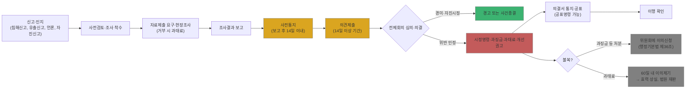

# Week 1 · Ch05. 개인정보보호위원회의 역할과 제재 체계

> [← 이전 챕터](./ch04_principles_and_duties.md) · [📚 전체 목차](../../README.md) · [다음 챕터 →](../week2/ch01_collection_and_use.md)

| 항목 | 내용 |
|---|---|
| 예상 학습 시간 | 80분 |
| 법령 기준일 | 2026-11-17 |
| 핵심 근거 | 개인정보 보호법 제7조, 제61조~제66조, 제70조~제76조 / 시행령 [별표 1의5], [별표 2] / 개인정보 보호위원회의 조사 및 처분에 관한 규정(고시 제2026-13호) |
| 관련 용어 | [개인정보 보호위원회](../../glossary.md#개인정보-보호위원회), [과징금](../../glossary.md#과징금), [과태료](../../glossary.md#과태료), [시정조치](../../glossary.md#시정조치), [결과의 공표](../../glossary.md#결과의-공표), [사전 실태점검](../../glossary.md#사전-실태점검), [개인정보 분쟁조정위원회](../../glossary.md#개인정보-분쟁조정위원회) |
| 선수 챕터 | [W1-ch02](./ch02_legal_framework_map.md), [W1-ch04](./ch04_principles_and_duties.md) |

---

## 1. 학습 목표

이 챕터를 마치면 담당자님은 다음을 할 수 있습니다.

1. **과징금·과태료·시정명령·형사처벌**의 성격, 상한, 불복 방법의 차이를 구분할 수 있다.
2. 위원회 조사가 시작되었을 때 **신고·조사·사전통지·의결·공표**로 이어지는 절차와 회사가 할 일을 설명할 수 있다.
3. 사내 위반 사례가 **어떤 제재 유형**에 해당할 수 있는지 조문을 찾아 판단할 수 있다.

---

## 2. 한 줄 비유

> 💡 **과태료는 "주차 위반 딱지", 과징금은 "매출에 비례하는 벌금형 영업 제재", 시정명령은 "공사 중지 명령", 형사처벌은 "운전자 본인이 받는 형사재판"입니다.**

단, 비유의 한계가 있습니다. 딱지(과태료)라도 개인정보 분야는 최대 **5천만 원**까지 나오고, 위반이 반복되면 차수에 따라 가중됩니다. 또 한 사건에서 **여러 제재가 동시에** 나옵니다. 예를 들어 SK텔레콤 사건에서는 과징금, 과태료, 시정명령, 개선권고가 한꺼번에 의결되었습니다(6절).

---

## 3. 개념 설명 및 법령 조문

### 3-1. 개인정보보호위원회는 어떤 기관인가

#### 📜 개인정보 보호법 제7조 (개인정보 보호위원회)

| 구분 | 내용 |
|---|---|
| **원문 요지** | ① 개인정보 보호에 관한 사무를 **독립적으로** 수행하기 위하여 **국무총리 소속**으로 개인정보 보호위원회를 둔다. ② 보호위원회는 「정부조직법」상 **중앙행정기관**으로 본다. |
| **쉬운 풀이** | 위원회는 법령 해석, 정책, 조사, 처분을 모두 하는 **개인정보 분야의 주무 기관**입니다. 위원 합의제로 운영되어 과징금·시정조치 같은 중요 처분은 **전체회의 심의·의결**로 결정합니다(제7조의9제1항제8호·제10호·제13호). |
| **시행일** | 2026. 9. 11. 시행 법률 제21445호 기준 |
| **실무 포인트** | 보도자료의 "○월 ○일 제○회 **전체회의**를 열고 … **의결**하였다"가 바로 이 심의·의결입니다. 법령 질의는 위원회 법령해석 지원센터(☎ 02-2100-3043)로 할 수 있습니다.[^safety-guide-contact] |

근거 원문은 각주를 참고하세요.[^law-7]

### 3-2. 제재 수단 한눈에 보기

| 수단 | 성격 | 누가·어디서 | 상한 / 내용 | 근거 |
|---|---|---|---|---|
| **개선권고** | 행정지도 (강제력 약함) | 위원회 | 처리 실태 개선 권고 | 법 제61조제2항 |
| **시정권고** | 사전 실태점검에서 발견한 위반의 시정 권고 | 위원회 | 위반 사항 시정 권고 | 법 제63조의2제2항 |
| **경고** | 시정조치의 실익이 없을 때 | 위원회 | 경미, 자진 시정, 과징금·과태료 미부과 사유 등 | 조사·처분 규정 제21조 |
| **시정조치 명령** | 행정처분 | 위원회 | 침해행위 중지, 처리 일시 정지, 그 밖에 필요한 조치 | 법 제64조제1항 |
| **과징금** | 행정처분 (금전) | 위원회 | 기본: 위반과 관련 없는 매출을 뺀 **전체 매출액의 3%**(매출 없으면 20억 원) / 가중: **10%**(매출 없으면 50억 원) | 법 제64조의2 |
| **과태료** | 행정질서벌 (금전) | 위원회가 부과, 이의제기 시 **법원**이 결정 | 위반 유형별 **5천만·3천만·2천만·1천만 원 이하** | 법 제75조, 영 [별표 2] |
| **형사처벌** | 형벌 | 수사기관 → **법원** | 예: 동의 없는 제3자 제공 **5년 이하 징역 또는 5천만 원 이하 벌금** | 법 제70조~제73조 |
| **양벌규정** | 법인 처벌 | 법원 | 직원의 위반에 대해 **법인도 벌금** (상당한 주의·감독을 다했으면 면책) | 법 제74조 |
| **고발·징계권고** | 수사기관 고발, 책임자 징계 권고 | 위원회 | 대표자·책임 있는 임원 포함 징계 권고 | 법 제65조 |
| **공표·공표명령** | 처분 사실 공개 | 위원회 / 처분받은 회사 | 위원회가 공표하거나, 회사에 **스스로 공표하라고 명령** | 법 제66조 |

근거 원문은 각주를 참고하세요.[^law-sanctions]

> 💡 **같은 행위에 과징금과 과태료를 겹쳐 부과하지 않습니다.** 법 제76조는 "제64조의2에 따라 과징금을 부과한 행위에 대하여는 과태료를 부과할 수 없다"고 정합니다. 그래서 한 사건에서 과징금과 과태료가 함께 나오면 **서로 다른 위반행위**에 각각 부과된 것입니다. 예를 들어 SK텔레콤은 안전조치 위반에 과징금, 유출 통지 지연에 과태료를 받았습니다.[^law-76]

### 3-3. 과징금 vs 과태료 vs 시정명령: 핵심 비교

| 비교 항목 | 과징금 | 과태료 | 시정명령 |
|---|---|---|---|
| 무엇에 대한 제재인가 | 위법한 처리로 얻은 이익 환수 + 제재. **중대한 위반**(무단 수집·제공, 민감·고유식별정보, 아동, 국외 이전, 유출+안전조치 미흡 등)에 부과 | **절차·의무 불이행**(처리방침 미공개, 파기 미이행, 통지 지연, 자료제출 거부 등) | 위반 상태를 **멈추고 바로잡게** 함 |
| 금액 결정 방식 | **매출액 × 부과기준율**에서 출발해 여러 단계로 조정 | 위반 유형별로 정해진 금액(1회·2회·3회 이상 위반)에서 가감 | 금액 없음 |
| 대상 조문 | 법 제64조의2제1항 각 호 (9개 유형) | 법 제75조제1항~제4항 각 호 | 법 제64조제1항 |
| 불복 방법 | 위원회에 **이의신청**(「행정기본법」 제36조) 등 | 통지받은 날부터 **60일 이내** 위원회에 서면 이의제기 → 부과처분 **효력 상실**, **법원**이 과태료 재판으로 결정 | 이의신청 등 |
| 근거 | 법 제64조의2, 영 [별표 1의5], 과징금 고시, 조사·처분 규정 제28조의2 | 법 제75조, 영 [별표 2], 조사·처분 규정 제29조 | 법 제64조 |

근거 원문은 각주를 참고하세요.[^rule-appeal] 과징금 처분에 대한 행정심판·행정소송 가능성은 references에서 직접 확인하지 못했습니다. `[출처: 일반 지식, 원문 확인 권장]`

### 3-4. 과징금은 어떻게 계산되나 ([별표 1의5])

과징금은 다섯 단계를 차례로 거쳐 정해집니다.

```
① 기준금액  →  ② 투자감경  →  ③ 1차 조정  →  ④ 2차 조정  →  ⑤ 부과과징금 결정
(매출×기준율)   (최대 -40%)     (±90% 범위)     (±50% 범위)     (상한 초과 불가)
```

| 단계 | 내용 | 근거 |
|---|---|---|
| ① 기준금액 | (전체 매출액 − 위반행위와 관련 없는 매출액) × **부과기준율**. 위반행위의 중대성(위반 내용·정도, 암호화 등 안전조치 노력, 유출 관련성·규모, 정보 유형, 피해 규모)으로 등급을 정함 | [별표 1의5] 제2호가목 |
| ② 투자감경 | 개인정보 보호 투자 등을 고려해 기준금액의 **100분의 40 범위**에서 감경 (고의·중과실이면 제외, 법 제64조의2제6항 단서) | [별표 1의5] 제2호나목, 법 제64조의2제6항 |
| ③ 1차 조정 | 위반 **기간·횟수**, 취득 이익 규모, 업무 형태·규모를 고려해 **100분의 90 범위**에서 가중·감경 | [별표 1의5] 제2호다목 |
| ④ 2차 조정 | 위원회 협조 등 **시정 노력**, 피해 회복 등을 고려해 **100분의 50 범위**에서 가중·감경 | [별표 1의5] 제2호라목 |
| ⑤ 결정 | 가중해도 **법정 상한(3% / 가중 10%)을 넘을 수 없음** | [별표 1의5] 제1호 단서 |

**부과기준율** (법 제64조의2제1항에 따라 부과하는 경우)

| 위반행위의 중대성 | 부과기준율 | 매출액이 없거나 산정 곤란한 경우의 기준금액 |
|---|---|---|
| 매우 중대한 위반행위 | 2.1% 이상 2.7% 이하 | 7억 원 이상 18억 원 이하 |
| 중대한 위반행위 | 1.5% 이상 2.1% 미만 | 2억 원 이상 7억 원 미만 |
| 보통 위반행위 | 0.9% 이상 1.5% 미만 | 5천만 원 이상 2억 원 미만 |
| 약한 위반행위 | 0.03% 이상 0.9% 미만 | 5백만 원 이상 5천만 원 미만 |

> 📌 위 표의 등급·비율·기준금액 짝은 [별표 1의5] 제2호가목1)가)·나)의 원문 표와 대조해 확인했습니다.[^annex-1-5] 법 제64조의2제2항의 가중 과징금은 부과기준율에 가중비율을 곱하며, 그 비율은 **8.91%를 넘을 수 없습니다**(매출액이 없으면 기준금액 45억 원 한도).

### 3-5. 과태료는 어떻게 정해지나 ([별표 2])

| 항목 | 내용 |
|---|---|
| 기본 금액 | 위반 유형별로 **1회·2회·3회 이상 위반** 금액이 정해져 있음 (개별기준) |
| 반복 가중 | **최근 3년간** 같은 위반행위로 과태료 처분을 받은 경우 다음 차수 적용 |
| 감경·면제 사유 | ① 사소한 부주의·오류 ② 경미한 위반 ③ 중소기업자 등 규모에 비해 과중 ④ 위반 상태 시정 노력 ⑤ 피해 회복·확산 방지 조치 ⑥ **개인정보 보호 인증**이나 자율 보호 활동 ⑦ **자진신고** ⑧ 그 밖의 사정 (과태료 체납자는 제외) |
| 가중 | 피해가 크거나 위반 정도·기간·동기 등을 고려해 **2분의 1 범위**에서 가중 (법정 상한은 초과 불가) |

근거 원문은 각주를 참고하세요.[^annex-2]

> 💡 감경 사유 ④·⑤·⑥·⑦은 **담당자가 평소에 준비할 수 있는 것**입니다. 사고가 나면 바로 시정하고, 피해 확산을 막고, 그 노력을 **기록**으로 남기세요. ISMS-P 같은 인증이나 자율 보호 활동도 감경 요소가 됩니다.

### 3-6. 위원회 조사는 어떻게 진행되나

| 단계 | 내용 | 회사(담당자)가 할 일 | 근거 (조사·처분 규정) |
|---|---|---|---|
| 1. 신고·인지 | 침해 신고, 유출 신고, 언론 보도, 자진신고 | 유출 신고(72시간), 필요하면 자진신고 | 법 제62조, 규정 제4조·제4조의2 |
| 2. 사전검토·착수 | 사실관계 확인 후 조사 착수 | — | 규정 제5조·제6조 |
| 3. 자료제출·현장조사 | 조사공문으로 자료 요구, 현장조사, 출석·진술 요구 | 기한 내 제출. 부득이하면 **기한 전에 연장 요청**. 변호인 참여 신청 가능 | 법 제63조, 규정 제9조~제13조 |
| 4. 사전통지 | 조사결과 보고 후 **14일 이내** 예정 처분을 통지하고 **14일 이상** 의견제출 기회 부여 | 서면·구술로 **의견제출**, 증거자료 제출, 증거 열람·복사 신청 | 규정 제16조~제17조 |
| 5. 심의·의결 | 시정조치안 작성 → 전체회의 심의·의결 (사업자 출석·의견 진술 가능) | 출석해 의견 진술 | 규정 제18조·제19조 |
| 6. 의결서 통지·공표 | 의결서 작성·통지, 처분 결과 공표 | 공표명령이 있으면 홈페이지 등에 공표 | 법 제66조, 규정 제25조~제26조 |
| 7. 이행 확인·불복 | 명령 이행 여부 확인, 이의신청·이의제기 | 이행 결과 보고, 필요하면 불복 절차 | 규정 제27조~제29조 |

> ⚠️ 자료제출 요구를 따르지 않거나 출입·검사를 거부·방해하면 그 자체로 **과태료** 대상입니다(법 제75조제2항제25호·제26호).[^law-75-63]

---

## 4. 사내 실무 적용

### 🎭 상황극 1. 경영진의 "과태료 몇백만 원이면 그냥 내죠"

> **📨 경영지원본부 송 상무**: "보안 솔루션 도입에 2억이 든다고요? 지난번 뉴스 보니까 과태료 몇백만 원 나오던데, 차라리 사고 나면 그때 과태료 내는 게 싸지 않아요?"

**🙋 담당자 답변**

| 구분 | 내용 |
|---|---|
| **결론** | ❌ **그 판단은 위험합니다** — 유출 사고에 안전조치 미흡이 겹치면 과태료가 아니라 **매출액 기준 과징금**이 부과됩니다. 반복·중과실이면 상한이 **10%**까지 올라갑니다. |
| **근거** | 개인정보 보호법 제64조의2제1항제9호(유출 + 안전조치 미흡 → 전체 매출액 3% 이내), 제64조의2제2항(가중 시 10%), 제64조의2제6항(보호 투자는 오히려 **감경 사유**), 제30조의3(대표자의 인력·예산 지원 의무) |
| **다음 행동** | ① 최근 처분 사례의 **금액과 위반 내용**을 한 장으로 정리해 보고합니다(골프존 75억 원, SK텔레콤 1,347억 원 등). ② 이 솔루션이 막는 위험이 안전조치 고시의 **어느 조항**인지 연결해 설명합니다. ③ 투자 내역은 과징금 산정 시 **투자감경(최대 40%)** 자료가 되므로 기록해 둔다고 덧붙입니다. ④ 대표자 책임 조항(제30조의3)을 함께 보고합니다. |

**왜 그런가요?** 몇백만 원 단위로 보도된 것은 대개 처리방침이나 파기 같은 **절차 위반의 과태료**입니다. 유출 사고의 본체는 과징금입니다. 골프존(과징금 75억 원 vs 과태료 540만 원)과 SK텔레콤(과징금 1,347억 원 vs 과태료 960만 원)을 보면 **과징금과 과태료의 규모 차이**가 분명합니다. 덧붙여 공표명령, 분쟁조정·손해배상, 신뢰 하락이라는 비용도 따라옵니다.

### 🎭 상황극 2. 법무팀의 "위원회에서 자료 내라는 공문이 왔어요"

> **📨 법무팀 오 변호사**: "개인정보위에서 **조사공문**이 왔어요. 고객 민원이 접수됐다면서 회원 탈퇴 처리 내역이랑 처리방침 개정 이력을 2주 안에 내라는데, 담당 부서가 바빠서 기한을 맞추기 어렵대요. 그냥 좀 늦게 내도 되겠죠?"

**🙋 담당자 답변**

| 구분 | 내용 |
|---|---|
| **결론** | ⚠️ **조건부 가능** — 늦게 낼 수밖에 없다면 기한이 지나기 **전에** 사유를 알리고 연장을 요청해야 합니다. 그냥 늦게 내거나 내지 않으면 **과태료** 대상이 될 수 있습니다. |
| **근거** | 개인정보 보호법 제63조제1항(자료제출 요구), 제75조제2항제25호(자료 미제출 과태료), 조사·처분 규정 제9조(조사공문), 제12조의2(제출기한 연장은 기한 경과 **전에** 요청), 제13조(변호인 참여) |
| **다음 행동** | ① 공문의 **제출 요청 사유, 자료 목록, 기한**을 정리해 CPO에게 즉시 보고합니다. ② 자료를 가진 부서와 담당자를 지정하고 일정표를 만듭니다. ③ 기한을 맞추기 어려우면 **기한 전에** 사유와 제출 가능 일자를 적어 연장을 요청합니다. ④ 제출 자료는 **사본 목록과 제출 이력**을 남깁니다. ⑤ 이후 사전통지서가 오면 **14일 이상**의 의견제출 기간에 반박·소명 자료를 준비합니다. |

**왜 그런가요?** 조사 단계의 협조 여부는 나중에 과징금 **2차 조정**(위원회와의 협조 등 시정 노력)과 과태료 **감경**(시정 노력)에도 영향을 줍니다. 처음 대응이 끝까지 영향을 줍니다.

---

## 5. 조사·처분 흐름도



**그림 읽는 법**: 황색 칸(사전통지·의견제출)이 회사가 **공식적으로 소명할 수 있는 기회**입니다. 이 단계에 대비하려면 평소에 내부 관리계획, 교육 기록, 점검 기록, 투자 내역을 쌓아 두어야 합니다. "했다"는 말보다 **"했다는 기록"**이 힘을 가집니다.

---

## 6. 개인정보보호위원회 처분 사례

### ⚖️ 사례: SK텔레콤 USIM 정보 유출사고 (2025. 8. 의결)

| 단계 | 내용 |
|---|---|
| **사건 개요** | 해커가 2021. 8. SK텔레콤 내부망에 처음 침투해 여러 서버에 악성프로그램을 설치했습니다. 이후 2025. 4. 18. 가입자 인증 서버(HSS)의 DB에서 개인정보 9.82GB를 외부로 빼냈습니다. LTE·5G 이용자 **23,244,649명**의 휴대전화번호, 가입자식별번호(IMSI), 유심 인증키(Ki) 등 **25종**의 정보가 유출되었습니다. 조사 결과 인터넷망·관리망·코어망이 사실상 연결되어 접근이 허용되어 있었습니다. 서버 약 2,365개의 계정정보 약 4,899개가 암호 설정 없이 저장되어 있었고, 2016년 경보된 OS 취약점의 보안 업데이트를 하지 않았으며, **유심 인증키 26,144,363건을 평문으로 저장**했습니다. CPO의 역할은 IT 서비스 영역에 한정되어, 사고가 난 통신 인프라 영역을 CPO가 파악하지 못했습니다. 회사는 2025. 4. 19. 유출을 인지하고도 72시간 안에 통지하지 않았습니다. 5. 9.에 유출 "가능성" 통지를, 7. 28.에야 유출 "확정" 통지를 했습니다. |
| **위반 조항** | 보도자료 기준: **안전조치의무 위반**(접근통제, 접근권한 관리, 보안 업데이트, 인증정보 암호화, 내부 관리계획, 접속기록 보관 등), **개인정보 보호책임자 지정 및 업무 수행 소홀**, **유출 통지 지연**. ⚠️ 확인 필요: 보도자료 본문에 조항 번호는 적혀 있지 않습니다. 각각 현행 법 제29조, 제31조, 제34조에 해당하는 것으로 보이나 의결서로 확인하세요. |
| **처분 결과** | **과징금 1,347억 9,100만 원**(안전조치의무 위반으로 인한 유출), **과태료 960만 원**(유출 통지 지연), **시정명령**(이동통신 서비스 전반의 안전조치 강화, CPO가 회사 전반을 총괄하는 거버넌스 정비, 3개월 내 재발방지 대책 수립·보고), **개선권고**(ISMS-P 인증 범위를 이동통신 네트워크 시스템으로 확대) |
| **제재 체계 관점의 교훈** | ① **과징금 산정 과정이 공개**되었습니다: 매출액은 전체 이동통신서비스 매출액 기준(위반 무관 매출 제외), 핵심 인증정보 유출·대규모 피해를 고려해 **"매우 중대한 위반행위"**로 판단, 위반 기간이 2년 이상이라 **일부 가중**, 시정·피해 회복 노력으로 **일부 감경**. 3-4절의 산정 단계가 실제로 적용된 모습입니다. ② **한 사건에 여러 제재**가 서로 다른 위반행위에 각각 부과되었습니다(과징금 ↔ 안전조치, 과태료 ↔ 통지 지연). ③ 처분과 별개로 집단 분쟁조정 3건(약 2,025명), 개인 분쟁조정 약 610건이 접수되었습니다. **피해 구제 절차가 동시에 진행**됩니다. |
| **출처** | 개인정보보호위원회 보도자료, 「개인정보위, 'SK텔레콤 개인정보 유출사고' 제재처분 의결」(2025. 8. 27. 의결, 8. 28. 보도)[^case-skt] |

> 💬 **사수의 한마디**: 이 사건의 시정명령에 **"CPO의 실질적 역할 보장(전사 관할, 이사회 정기 보고 등)"**이 들어간 점을 꼭 기억하세요. 골프존, 엘지유플러스 처분에도 CPO 역할·위상 강화가 시정명령에 있었습니다. 위원회는 사고의 원인을 **기술**뿐 아니라 **거버넌스**에서도 찾습니다.

---

## 7. 오답노트

| # | ❌ 잘못된 생각 | ✅ 올바른 이해 | 근거 조문 |
|---|---|---|---|
| 1 | "개인정보 사고 나면 과태료 몇백만 원 내면 끝이에요." | 유출 + 안전조치 미흡, 무단 수집·제공 등 중대한 위반은 **전체 매출액 기준 과징금**(3%, 가중 시 10%) 대상입니다. 과태료는 주로 절차 의무 위반에 부과됩니다. | 법 제64조의2, 제75조 |
| 2 | "과징금이랑 과태료가 같이 나오면 이중 처벌이에요." | 같은 행위에는 과징금과 과태료를 겹쳐 부과하지 않습니다. 함께 나왔다면 **서로 다른 위반행위**에 대한 것입니다. | 법 제76조 |
| 3 | "과태료 고지서에 이의제기하면 위원회가 다시 검토해 주는 거죠?" | 60일 안에 이의제기하면 위원회의 부과처분은 **효력을 잃고**, 관할 **법원**이 과태료 재판으로 결정합니다. | 조사·처분 규정 제29조 (「질서위반행위규제법」 제20조) |
| 4 | "회사가 과징금을 내니까 직원 개인은 처벌받지 않아요." | 직원이 업무상 알게 된 개인정보를 **누설**하거나 권한 없이 이용하게 하면 그 직원 개인이 **5년 이하 징역 또는 5천만 원 이하 벌금** 대상입니다. 양벌규정에 따라 법인도 벌금을 받을 수 있습니다. | 법 제59조제2호, 제71조제9호, 제74조 |
| 5 | "위원회 자료 요청은 협조 사항이니까 바쁘면 나중에 내도 돼요." | 자료 미제출, 출입·검사 거부·방해는 그 자체로 **과태료** 대상입니다. 기한 연장은 **기한이 지나기 전에** 요청해야 합니다. | 법 제63조, 제75조제2항제25호·제26호, 조사·처분 규정 제12조의2 |

---

## 8. 업무 체크리스트

**📋 제재 대비 사내 준비 상태 점검표**

| 점검 주기 | 반기 1회 + 위원회 공문 접수 시 즉시 | 점검자 | 개인정보보호 담당자 (법무팀 협업) | 점검일 | ____-__-__ |
|---|---|---|---|---|---|

- [ ] 위원회·한국인터넷진흥원 공문을 받았을 때의 **사내 접수·보고 경로**(누가 받고, 누구에게, 몇 시간 안에 보고)가 정해져 있다
- [ ] 조사 대응 시 **자료 제출 목록과 제출 이력**을 기록할 양식이 있다
- [ ] 내부 관리계획, 취급자 교육, 접근권한 관리, 접속기록 점검 등 **이행 기록**을 최근 3년분 바로 꺼낼 수 있다 (사전통지 의견제출 대비)
- [ ] 개인정보 보호 관련 **투자 내역**(솔루션, 인력, 인증, 교육)을 연도별로 정리하고 있다 (법 제64조의2제6항 투자감경)
- [ ] 최근 3년간 우리 회사가 받은 **과태료·과징금·시정명령 이력**과 이행 결과를 관리하고 있다 (반복 가중 대비)
- [ ] 받은 **시정명령의 이행 기한과 이행 결과 보고**를 추적하고 있다 (불이행 후 유출 시 10% 가중)
- [ ] ISMS-P 등 **개인정보 보호 인증** 취득 여부와 범위를 확인했다 ([별표 2] 감경 사유, 2027. 7. 1. 의무화 대상 여부)
- [ ] 사고 시 **자진신고** 판단 기준과 결정권자가 내부 관리계획에 있다
- [ ] 임직원 교육에 **개인 형사처벌**(누설·부정 이용) 내용이 들어 있다 (법 제71조)

---

## 9. 실습 과제 / 퀴즈

### 객관식

**Q1.** 과징금과 과태료에 관한 설명으로 **옳은 것**은?

1. 과징금과 과태료는 같은 위반행위에 대해 함께 부과하는 것이 원칙이다.
2. 과징금의 기본 상한은 전체 매출액(위반행위와 관련 없는 매출액 제외)의 100분의 3이다.
3. 과태료의 상한은 위반 유형과 관계없이 일률적으로 1천만 원이다.
4. 과징금은 법원이 형사재판으로 부과한다.

**Q2.** 위원회로부터 과태료 부과 통지를 받은 회사가 불복하려고 합니다. 「개인정보 보호위원회의 조사 및 처분에 관한 규정」에 따른 설명으로 **옳은 것**은?

1. 통지를 받은 날부터 14일 이내에 구두로 이의를 제기해야 한다.
2. 이의제기를 하면 위원회의 과태료 부과처분은 효력을 상실하고, 관할 법원이 과태료 재판으로 결정한다.
3. 과태료 처분에는 불복할 수 없다.
4. 이의제기를 하면 위원회 전체회의가 다시 심의해 최종 확정한다.

**Q3.** 위원회 조사 결과에 따라 처분이 예정된 경우의 **사전통지와 의견제출**에 관한 설명으로 옳은 것은?

1. 사전통지 없이 바로 전체회의에서 의결한다.
2. 조사관은 조사결과 보고를 마친 날부터 14일 이내에 사전통지서를 보내고, 14일 이상의 의견제출 기간을 주어야 한다.
3. 의견제출은 반드시 변호사를 통해서만 할 수 있다.
4. 의견제출 기한까지 의견을 내지 않으면 처분이 자동으로 취소된다.

### 🛠️ 실습: 제재 유형 분류하기

**Q4.** 아래 사내 위반 사례마다 **가능한 제재 유형**(과징금 / 과태료 / 형사처벌 / 시정명령 등, 여러 개 가능)과 **근거 조문**을 쓰세요. 법 원문(references의 법률 PDF 제64조의2, 제70조~제75조)을 직접 찾아 확인하세요.

| # | 위반 사례 | 가능한 제재 유형 | 근거 조문 |
|---|---|---|---|
| 1 | 마케팅팀이 회원 동의 없이 제휴사에 회원 명단을 제공함 | | |
| 2 | 홈페이지에 개인정보 처리방침을 공개하지 않음 | | |
| 3 | 해킹으로 회원 정보가 유출되었고, 접근통제·암호화 등 안전조치가 미흡했음 | | |
| 4 | 탈퇴 회원 정보를 보유기간이 지난 뒤에도 파기하지 않음 | | |
| 5 | 위원회의 자료제출 요구에 응하지 않음 | | |
| 6 | 상담원이 업무 중 알게 된 고객 연락처를 지인에게 몰래 넘김 | | |

> ✅ 다 풀었다면 [정답 및 해설](../../answers_and_explanations.md#w1-ch05)에서 확인하세요. 틀린 문제는 **7. 오답노트**에 한 줄씩 추가하세요.

---

## 10. 더 읽을거리

| 자료 | 발행 | references 파일명 | 이 챕터와의 관계 |
|---|---|---|---|
| 개인정보 보호법 시행령 [별표 1의5] | 2026. 9. 10. 개정 | `[별표 1의5] 과징금의 산정기준과 산정절차(제60조의2제7항 관련)(개인정보 보호법 시행령).pdf` | 과징금 산정 5단계, 부과기준율 표 원문 |
| 개인정보 보호법 시행령 [별표 2] | 2026. 9. 10. 개정 | `[별표 2] 과태료의 부과기준(제63조 관련)(개인정보 보호법 시행령).pdf` | 과태료 일반기준(감경·가중), 위반 유형별 금액 |
| 개인정보 보호법 위반에 대한 과징금 부과기준 | 고시 제2026-12호 | `개인정보 보호법 위반에 대한 과징금 부과기준(개인정보보호위원회고시)(제2026-12호)(20260911).pdf` | 가중비율·투자감경·조정 단계의 세부 기준 |
| 개인정보 보호위원회의 조사 및 처분에 관한 규정 | 고시 제2026-13호 | `개인정보 보호위원회의 조사 및 처분에 관한 규정(개인정보보호위원회고시)(제2026-13호)(20260911).pdf` | 조사 절차, 사전통지·의견제출, 경고, 이의신청·이의제기 |
| 개인정보위 보도자료 (SK텔레콤) | 개인정보보호위원회, 2025. 8. | `250828 (석간) 개인정보위  ‘SK텔레콤 개인정보 유출사고’ 제재처분 의결(조사2과)_최종(붙임 포함).pdf` | 6절 처분 사례, 붙임 쟁점별 정리(과징금 산정 p.12) |
| 개인정보위 보도자료 (골프존) | 개인정보보호위원회, 2024. 5. | `240509 (석간) 개인정보위, ㈜골프존 개인정보 유출사고에 대해 과징금 75억 원, 과태료 540만 원 및 시정명령 부과(조사1과).pdf` | 2023년 개정 과징금 규정 첫 적용, 공표명령 |

---

> [← 이전 챕터](./ch04_principles_and_duties.md) · [📚 전체 목차](../../README.md) · [📖 용어집](../../glossary.md) · [다음 챕터 →](../week2/ch01_collection_and_use.md)

[^law-7]: [출처: 개인정보 보호법(법률)(제21445호)(20260911).pdf, 제7조제1항·제2항, 제7조의9제1항]
[^safety-guide-contact]: [출처: 개인정보의 안전성 확보조치 기준 안내서(2026.11).pdf, 안내사항 「문의처」 "개인정보보호 법령 질의 등에 관한 사항은 개인정보보호위원회 법령해석 지원센터(☎02-2100-3043)"]
[^law-sanctions]: [출처: 개인정보 보호법(법률)(제21445호)(20260911).pdf, 제61조제2항, 제63조의2제2항, 제64조제1항, 제64조의2제1항·제2항, 제65조, 제66조, 제70조~제75조] / [출처: 개인정보 보호위원회의 조사 및 처분에 관한 규정(개인정보보호위원회고시)(제2026-13호)(20260911).pdf, 제21조]
[^law-76]: [출처: 개인정보 보호법(법률)(제21445호)(20260911).pdf, 제76조]
[^rule-appeal]: [출처: 개인정보 보호위원회의 조사 및 처분에 관한 규정(개인정보보호위원회고시)(제2026-13호)(20260911).pdf, 제28조의2(처분에 대한 이의신청), 제29조(과태료 부과처분에 대한 이의제기)]
[^annex-1-5]: [출처: [별표 1의5] 과징금의 산정기준과 산정절차(제60조의2제7항 관련)(개인정보 보호법 시행령).pdf, 제1호, 제2호가목~라목]
[^annex-2]: [출처: [별표 2] 과태료의 부과기준(제63조 관련)(개인정보 보호법 시행령).pdf, 제1호 일반기준 가목~라목]
[^law-75-63]: [출처: 개인정보 보호법(법률)(제21445호)(20260911).pdf, 제75조제2항제25호·제26호] / [출처: 개인정보 보호위원회의 조사 및 처분에 관한 규정(개인정보보호위원회고시)(제2026-13호)(20260911).pdf, 제4조~제19조, 제25조~제29조]
[^case-skt]: [출처: 250828 (석간) 개인정보위  ‘SK텔레콤 개인정보 유출사고’ 제재처분 의결(조사2과)_최종(붙임 포함).pdf, p.1~2 (처분 개요·유출 규모), p.3·p.9 (유출 경위), p.4~6 (위반 사항), p.6~7 (통지 지연·처분 내용), p.12 (과징금 산정·시정명령), p.13 (분쟁조정 현황)]
