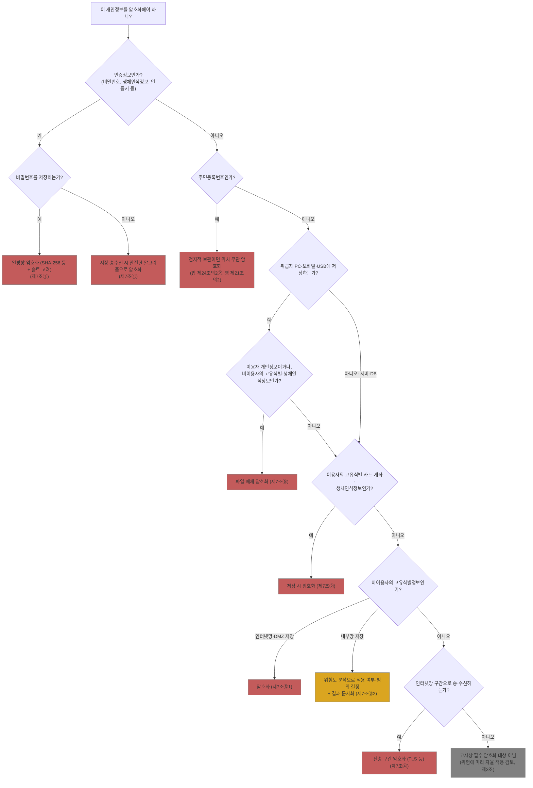

# Week 3 · Ch03. 암호화 (저장 시·전송 시)

> [← 이전 챕터](./ch02_access_control.md) · [📚 전체 목차](../../README.md) · [다음 챕터 →](./ch04_access_logs.md)

| 항목 | 내용 |
|---|---|
| 예상 학습 시간 | 75분 |
| 법령 기준일 | 2026-11-17 |
| 핵심 근거 | 개인정보 보호법 제24조제3항, 제24조의2제2항, 제29조 / 시행령 제21조의2, 제30조제1항제4호 / 안전성 확보조치 기준 제2조, 제7조 / 안전성 확보조치 기준 안내서 |
| 관련 용어 | [암호화](../../glossary.md#암호화), [비밀번호](../../glossary.md#비밀번호), [인증정보](../../glossary.md#인증정보), [생체인식정보](../../glossary.md#생체인식정보), [고유식별정보](../../glossary.md#고유식별정보), [이용자](../../glossary.md#이용자), [내부망](../../glossary.md#내부망) |
| 선수 챕터 | [W2-ch02 민감정보·고유식별정보](../week2/ch02_sensitive_and_unique_id.md), [W3-ch02](./ch02_access_control.md) |

---

## 1. 학습 목표

이 챕터를 마치면 담당자님은 다음을 할 수 있습니다.

1. **저장 위치**(인터넷·DMZ·내부망·업무용 PC)와 **정보주체 유형**(이용자/이용자가 아닌 정보주체)에 따라 암호화 대상을 판별할 수 있다.
2. 비밀번호의 **일방향 암호화**, 전송 구간 암호화, **안전한 암호 알고리즘**의 기준을 설명할 수 있다.
3. 업무용 PC·USB에 저장된 개인정보 파일의 **암호화 여부를 점검**할 수 있다.

---

## 2. 한 줄 비유

> 💡 **암호화는 "금고에 넣어 두는 것"이고, 비밀번호의 일방향 암호화는 "금고 열쇠의 지문만 보관하는 것"입니다. 열쇠 자체를 갖고 있지 않아도, 손님이 가져온 열쇠의 지문과 맞는지만 확인하면 됩니다.**

단, 비유의 한계가 있습니다. 금고(암호화)는 **열쇠(암호 키)**가 함께 털리면 소용이 없습니다. 그래서 일정 규모 이상의 처리자에게는 **암호 키 관리 절차**까지 요구합니다(고시 제7조제6항).

---

## 3. 개념 설명 및 법령 조문

### 3-1. 관련 조문

> 📌 **조문 주소 읽는 법**: 조 → 항(①②) → 호(1. 2.) → 목(가. 나.). 자세한 설명은 [W1-ch01 3-2](../week1/ch01_what_is_personal_info.md#3-2-관련-조문)를 보세요.

#### 📜 안전성 확보조치 기준 제7조 (개인정보의 암호화)

| 항 | 원문 요지 | 쉬운 풀이 |
|---|---|---|
| ① | **비밀번호, 생체인식정보 등 인증정보**를 저장하거나 정보통신망으로 송·수신할 때는 **안전한 암호 알고리즘**으로 암호화. 단, **비밀번호를 저장**할 때는 복호화되지 않도록 **일방향 암호화** | 인증정보는 누구의 것이든, 어디에 있든 암호화. 비밀번호는 되돌릴 수 없는 해시로 |
| ② | **이용자**의 다음 정보는 안전한 암호 알고리즘으로 암호화해 **저장**: 1. 주민등록번호 2. 여권번호 3. 운전면허번호 4. 외국인등록번호 5. **신용카드번호** 6. **계좌번호** 7. **생체인식정보** | 고객(이용자)의 고유식별정보·카드·계좌·생체인식정보는 **저장 위치와 관계없이** 암호화 |
| ③ | **이용자가 아닌 정보주체**(예: 임직원)의 개인정보는 1. **인터넷망 구간·DMZ**에 고유식별정보를 저장하면 암호화 2. **내부망**에 고유식별정보를 저장하면 암호화. 단, **주민등록번호 외**의 고유식별정보는 영향평가 결과(공공기관) 또는 **위험도 분석** 결과에 따라 적용 여부·범위를 정할 수 있음 | 직원 정보는 위치에 따라 다르지만, **주민등록번호는 내부망이어도 암호화** |
| ④ | 개인정보를 정보통신망으로 **인터넷망 구간**에 송·수신할 때는 안전한 암호 알고리즘으로 암호화 | 홈페이지·앱·외부 연동은 **HTTPS(TLS)** 등 전송 암호화 |
| ⑤ | **이용자의 개인정보** 또는 이용자가 아닌 정보주체의 **고유식별정보·생체인식정보**를 취급자의 **컴퓨터, 모바일 기기, 보조저장매체** 등에 저장할 때는 안전한 암호 알고리즘으로 암호화 | **고객 명단 엑셀을 PC에 저장하면 암호화** 대상 (종류 불문) |
| ⑥ | **10만 명 이상** 처리하는 대기업·중견기업·공공기관 또는 **100만 명 이상** 처리하는 중소기업·단체는 암호 키의 생성·이용·보관·배포·파기 등에 관한 **절차를 수립·시행** | 암호 키 관리 절차서 필요 여부를 규모로 판단 |

근거 원문은 각주를 참고하세요.[^safety-7]

> 💡 **"이용자"란?** 고시 제2조제2호는 "이용자"를 정보통신망법상 **정보통신서비스 제공자가 제공하는 정보통신서비스를 이용하는 자**로 정의합니다. 쇼핑몰·앱 회원 같은 온라인 서비스 고객이 대표적입니다. 임직원, 오프라인 매장 고객 등은 "이용자가 아닌 정보주체"로 볼 수 있습니다. ⚠️ 구체적 구분은 서비스 형태에 따라 판단이 필요합니다. `[출처: 일반 지식, 원문 확인 권장]`

#### 📜 개인정보 보호법 제24조의2제2항 + 시행령 제21조의2 (주민등록번호 암호화)

| 구분 | 내용 |
|---|---|
| **원문 요지** | 주민등록번호가 유출등이 되지 않도록 **암호화 조치를 통하여** 안전하게 보관해야 한다. 암호화 대상은 주민등록번호를 **전자적인 방법으로 보관**하는 처리자다. |
| **쉬운 풀이** | 주민등록번호는 **이용자든 직원이든, 내부망이든 어디든** 전자 파일이면 암호화합니다. |
| **실무 포인트** | 안내서 FAQ는 "내부망에 주민등록번호를 저장하는 경우, 법 제24조의2, 시행령 제21조의2에 따라 '개인정보 영향평가'나 '위험도 분석'의 결과와 **관계없이** 암호화하여야 합니다"라고 답합니다.[^guide-p158] |

근거 원문은 각주를 참고하세요.[^law-24-2]

### 3-2. 암호화 적용 기준 한눈에 보기

안내서의 요약표를 정리하면 다음과 같습니다.[^guide-p96]

| 구분 | 이용자가 아닌 정보주체 (예: 임직원) | 이용자 (예: 온라인 회원) |
|---|---|---|
| **정보통신망 송·수신** | 인증정보(비밀번호, 생체인식정보 등) | 인터넷망 구간: **개인정보 전체** / 그 밖의 정보통신망: 인증정보 |
| **저장 (위치 무관)** | 인증정보 (비밀번호는 **일방향**) / **주민등록번호** | 인증정보 (비밀번호는 **일방향**) / 주민등록번호, 여권번호, 운전면허번호, 외국인등록번호, **신용카드번호, 계좌번호, 생체인식정보** |
| **저장: 인터넷망 구간·DMZ** | 고유식별정보 | (위와 같음) |
| **저장: 내부망** | 고유식별정보. 단, **주민등록번호 외**는 영향평가·위험도 분석으로 적용 여부·범위 결정 가능 | (위와 같음) |
| **저장: 취급자 PC·모바일·보조저장매체** | 고유식별정보, 생체인식정보 | **개인정보 전체** |

### 3-3. 어떻게 암호화하나: 안전한 암호 알고리즘

| 용도 | 안내서가 예시한 안전한 알고리즘 (국내외 권고 기관 기준) | 쓰면 안 되는 것 |
|---|---|---|
| **일방향 (비밀번호 저장)** | SHA-224/256/384/512 등 | **MD5, SHA-1** |
| **대칭키 (DB·파일 저장)** | AES-128/192/256, **ARIA**, **SEED**, LEA, Camellia 등 | **TDEA(TDES)** |
| **공개키 (키 교환·전자서명)** | RSA(RSAES-OAEP 등, 국내 권고: 키 길이 2048비트 이상) | 짧은 키 길이 |
| **전송 구간** | SSL/TLS 등 통신구간 암호화 프로토콜, 응용 프로그램 암호화 등 | 평문 HTTP, 취약한 프로토콜 버전 |

근거 원문은 각주를 참고하세요.[^guide-p90-91]

| 추가 포인트 | 안내서 내용 |
|---|---|
| **솔트(salt)** | 비밀번호 일방향 암호화 시 무작위 대입 공격, 레인보우 테이블 공격 등에 대응하기 위해 **솔트값 추가를 고려**할 필요 (PDF p.90) |
| **알고리즘은 바뀐다** | 기술 발전에 따라 권고 알고리즘이 달라질 수 있으므로 국내외 암호 연구기관의 **최신 정보를 확인**. 양자컴퓨팅·HNDL(선 수집 후 해독) 위협에 대비해 **PQC(양자내성암호)** 도입·전환도 고려 가능 (PDF p.91) |
| **오피스 파일** | 엑셀 등 오피스 파일은 프로그램의 **암호 설정 기능**, **압축파일 암호 설정** 등을 활용할 수 있음 (PDF p.96). 상용 프로그램의 비밀번호 설정 기능이 쓰는 알고리즘이 **안전한 암호 알고리즘이면** 활용 가능 (FAQ PDF p.158) |
| **암호 키 관리** | 라이프사이클 단계별(생성·이용·보관·배포·파기) 암호 키 관리 절차를 수립·시행 (PDF p.97) |

> 📌 **위원회 해석**: 한글·엑셀 등 상용프로그램의 비밀번호 설정 기능으로 암호화하는 것도 보호법상 **암호화 조치에 해당할 수 있습니다.** 단, 파일명에 비밀번호를 적어 두면 암호화로 볼 수 없습니다. [출처: 1. 개인정보 질의응답 모음집(2025.12.).pdf, Q51 (인쇄 p.62, PDF p.72)]
>
> ⚠️ 확인 필요: 특정 오피스 프로그램 버전이 어떤 알고리즘을 쓰는지는 references에 없습니다. 최신 버전의 문서 암호 기능은 AES 계열을 쓰는 것으로 알려져 있지만, 사내 표준 프로그램과 버전을 IT 보안 담당과 확인하세요. `[출처: 일반 지식, 원문 확인 권장]` 실습은 [W3-ch07](./ch07_windows11_handson.md)에서 합니다.

---

## 4. 사내 실무 적용

### 🎭 상황극 1. 영업팀의 "고객 명단 엑셀은 제 PC에만 있으니 괜찮아요"

> **📨 영업팀 위 대리**: "CRM에서 **VIP 고객 명단**(이름, 연락처, 주소, 구매액)을 엑셀로 내려받아 제 노트북 바탕화면에 두고 써요. 주민번호나 카드번호는 없으니까 암호화 안 해도 되죠? 제 노트북은 로그인 비밀번호도 있어요."

**🙋 담당자 답변**

| 구분 | 내용 |
|---|---|
| **결론** | ❌ **암호화가 필요합니다** — 온라인 회원(이용자)의 개인정보를 취급자 PC에 저장할 때는 **종류와 관계없이** 안전한 암호 알고리즘으로 암호화해야 합니다. 노트북 로그인 비밀번호는 파일 암호화가 아닙니다. |
| **근거** | 안전성 확보조치 기준 제7조제5항("이용자의 개인정보 … 를 개인정보취급자의 컴퓨터, 모바일 기기 및 보조저장매체 등에 저장할 때에는 안전한 암호 알고리즘을 사용하여 암호화한 후 저장"), 안내서 PDF p.96(오피스 파일 암호 설정 활용) |
| **다음 행동** | ① 파일에 **문서 암호**를 설정하거나 암호화된 압축 파일로 보관합니다. ② 노트북 전체를 **BitLocker**로 암호화하는 것도 함께 권합니다(분실 대비) → [W3-ch07](./ch07_windows11_handson.md) ③ 꼭 필요한 열(이름·연락처)만 남기고 주소·구매액이 필요 없으면 지웁니다. ④ 업무가 끝나면 파일을 **파기**합니다. ⑤ CRM 다운로드 사유를 남기도록 설정되어 있는지 IT팀과 확인합니다 → [W3-ch04](./ch04_access_logs.md) |

**왜 그런가요?** 고시 제7조제5항은 이용자에 대해서는 정보의 **종류를 가리지 않습니다.** 노트북 분실·도난, 악성코드 감염, 메일 오발송 때 파일 암호화가 마지막 방어선입니다.

### 🎭 상황극 2. 인사팀의 "직원 주민번호는 내부망 DB라서 암호화 안 했어요"

> **📨 인사팀 공 차장**: "인사 DB는 인터넷이랑 차단된 **내부망**에 있고, 직원 정보라서 위험도 분석만 하면 **주민등록번호도 암호화 안 해도** 된다고 들었어요. 맞죠?"

**🙋 담당자 답변**

| 구분 | 내용 |
|---|---|
| **결론** | ❌ **틀렸습니다** — 위험도 분석으로 암호화 여부를 정할 수 있는 것은 **주민등록번호 외**의 고유식별정보(여권번호 등)입니다. 주민등록번호는 내부망이어도 **반드시 암호화**해야 합니다. |
| **근거** | 개인정보 보호법 제24조의2제2항, 시행령 제21조의2제1항(전자적으로 보관하는 처리자), 안전성 확보조치 기준 제7조제3항제2호 단서("주민등록번호 외의 고유식별정보를 저장하는 경우에는"), 안내서 FAQ PDF p.158 |
| **다음 행동** | ① 인사 DB의 주민등록번호 열을 **안전한 알고리즘(AES·ARIA 등)으로 암호화**하는 개선 계획을 세웁니다. ② 암호화 전까지 접근 권한을 최소화하고 접속기록을 집중 점검합니다. ③ 인사 담당자 PC의 엑셀·PDF(원천징수, 4대보험 신고 서류)에도 주민등록번호가 있는지 확인하고 암호화합니다(제7조제5항). ④ 여권번호 등 다른 고유식별정보에 대해서는 **위험도 분석 결과를 문서로** 남깁니다. |

**왜 그런가요?** 고시 제7조제3항제2호의 예외 문구는 **"주민등록번호 외의 고유식별정보를 저장하는 경우에는"**으로 시작합니다. 또 주민등록번호 암호화는 고시보다 상위인 **법률(제24조의2제2항)**의 의무입니다. 골프존은 파일서버에 주민등록번호를 암호화하지 않고 저장해 §24의2② 위반 판단을 받았습니다 → [W1-ch04](../week1/ch04_principles_and_duties.md).

---

## 5. 암호화 대상 판별 플로우

**그림 읽는 법**: 적색 칸은 **반드시 암호화**, 황색은 **위험도 분석으로 판단**하는 칸입니다. 가장 먼저 **인증정보**와 **주민등록번호**를 거르는 이유는 이 둘이 위치·대상과 관계없이 암호화 대상이기 때문입니다. 회색이라도 고시 제3조(스스로의 환경에 맞는 조치)에 따라 추가 암호화를 검토할 수 있습니다.

---

## 6. 개인정보보호위원회 처분 사례

### ⚖️ 사례: SK텔레콤의 유심 인증키 평문 저장 (2025. 8. 의결) — "암호화" 관점

> 이 사례는 [W1-ch05](../week1/ch05_pipc_and_sanctions.md)(제재 체계)와 [W3-ch01](./ch01_internal_management_plan.md)(거버넌스)에서도 다뤘습니다. 여기서는 **"무엇이 암호화 대상인 인증정보인가"**에 집중합니다.

| 단계 | 내용 |
|---|---|
| **사건 개요** | SK텔레콤은 가입자 인증과 이동통신 서비스 제공에 필수적인 **유심 인증키(Ki) 26,144,363건을 암호화하지 않고 평문으로** HSS DB 등에 저장했습니다. 그래서 해커는 유심 복제에 쓰일 수 있는 인증키를 **원본 그대로** 확보할 수 있었습니다. 특히 2022년경 유심 복제 이슈가 제기되어 암호화를 검토하면서 **다른 통신사들은 인증키를 암호화해 저장하고 있음을 확인했는데도**(LGU+ 2011년~, KT 2014년~) 조치하지 않았습니다. 또 서버 약 2,365개의 계정정보(ID/비밀번호 약 4,899개)가 저장된 파일을 관리망 서버에 **암호 설정 등 제한 없이** 저장했습니다. |
| **쟁점: 유심 인증키는 인증정보인가?** | 보도자료 붙임은 이렇게 판단했습니다. 유심 인증키는 통신 네트워크 연결 시 단말기 소유자의 정당성을 인증하는 데 쓰입니다. 이용자가 이동통신망 접속을 요청하면 HSS 등과 단말에 각각 저장된 IMSI로 가입자를 식별하고 인증키로 인증값을 비교합니다. 따라서 **"개인정보처리시스템에 접속을 요청하는 자의 신원을 검증하는데 사용되는 정보"**로서 **기타 암호화 대상 인증정보**에 해당합니다. |
| **위반 내용** | 안전조치의무 위반(유심 인증키 평문 저장, 계정정보 파일 관리 부실, 접근통제 소홀, 보안 업데이트 미조치 등). ⚠️ 보도자료에 조항 번호는 없음. 쟁점 설명은 현행 고시 제2조제11호(인증정보)·제7조제1항 문언과 일치합니다. |
| **처분 결과** | 과징금 1,347억 9,100만 원(안전조치의무 위반), 과태료 960만 원(유출 통지 지연), 시정명령·개선권고 |
| **암호화 관점의 교훈** | ① **"인증정보 = 비밀번호"가 아닙니다.** 시스템이 사용자를 인증하는 데 쓰는 키·토큰도 인증정보일 수 있습니다. ② 암호화를 **검토만 하고 미루면** 그 자체가 불리한 사정이 됩니다. 업계 수준(다른 회사의 암호화 적용)도 비교 대상이 되었습니다. ③ 관리자 **계정정보 파일의 평문 저장**은 공격자에게 열쇠 꾸러미를 주는 것과 같습니다. |
| **출처** | 개인정보보호위원회 보도자료, 「개인정보위, 'SK텔레콤 개인정보 유출사고' 제재처분 의결」(2025. 8. 27. 의결, 8. 28. 보도)[^case-skt] |

> 💬 **사수의 한마디**: IT팀에 **"우리 시스템에서 사용자를 인증하는 데 쓰는 값이 무엇이고, 어떻게 저장되어 있나요?"**라고 물어보세요. 비밀번호 해시 방식(MD5인지 SHA-256인지), API 토큰, 세션 키, 서버 계정 비밀번호를 적어 둔 파일까지 목록에 올려야 합니다.

---

## 7. 오답노트

| # | ❌ 잘못된 생각 | ✅ 올바른 이해 | 근거 조문 |
|---|---|---|---|
| 1 | "주민번호·카드번호만 없으면 PC 엑셀은 암호화 안 해도 돼요." | **이용자**의 개인정보를 취급자 PC·모바일·USB에 저장할 때는 **종류와 관계없이** 암호화해야 합니다. | 고시 제7조제5항, 안내서 PDF p.96 |
| 2 | "내부망이니까 위험도 분석만 하면 직원 주민번호도 암호화 안 해도 돼요." | 위험도 분석 예외는 **주민등록번호 외**의 고유식별정보에만 적용됩니다. 주민등록번호는 위치와 관계없이 암호화해야 합니다. | 법 제24조의2제2항, 고시 제7조제3항제2호, 안내서 FAQ PDF p.158 |
| 3 | "비밀번호도 암호화(AES)해서 저장하면 되죠. 필요하면 복호화해서 알려 주게요." | 비밀번호는 **복호화되지 않도록 일방향 암호화**해야 합니다. 비밀번호를 "알려 주는" 기능은 만들면 안 되고, **재설정**만 가능해야 합니다. | 고시 제7조제1항 단서 |
| 4 | "MD5로 해시했으니 일방향 암호화 요건은 충족해요." | **MD5, SHA-1, TDEA** 등 보안강도가 낮은 것으로 판명된 알고리즘은 쓰면 안 됩니다. SHA-256 이상 등 안전한 알고리즘을 쓰고 솔트를 고려하세요. | 고시 제7조제1항, 안내서 PDF p.90~91 |
| 5 | "인증정보는 비밀번호뿐이에요." | 인증정보는 접속을 요청하는 자의 **신원을 검증하는 데 쓰는 정보**입니다. 생체인식정보, 유심 인증키 같은 키도 포함될 수 있습니다. | 고시 제2조제11호, 제7조제1항, SK텔레콤 사례 |
| 6 | "노트북 로그인 비밀번호가 있으니 파일은 암호화된 거예요." | 로그인 비밀번호는 **접근통제**이지 **암호화**가 아닙니다. 디스크를 분리하면 읽힐 수 있습니다. 파일 암호 또는 디스크 암호화(BitLocker 등)가 필요합니다. `[출처: 일반 지식, 원문 확인 권장]` (디스크 분리 시 판독 가능성) | 고시 제7조제5항 |

---

## 8. 업무 체크리스트

**📋 암호화 적용 현황 점검표**

| 점검 주기 | 연 1회 전수 + 신규 시스템·알고리즘 변경 시 | 점검자 | 개인정보보호 담당자 + IT 보안 담당 | 점검일 | ____-__-__ |
|---|---|---|---|---|---|

**[인증정보]**
- [ ] 회원·직원 비밀번호가 **일방향 암호화**(SHA-256 이상 등)로 저장되고, **MD5·SHA-1을 쓰지 않는다** (제7조①)
- [ ] 비밀번호 해시에 **솔트**를 적용했는지 확인했다 (안내서 PDF p.90)
- [ ] 생체인식정보, API 키·토큰, 기타 인증키가 **암호화**되어 저장·전송된다 (제7조①)
- [ ] 서버·DB **관리자 계정 정보**를 평문 파일로 보관하지 않는다

**[저장 암호화]**
- [ ] 이용자의 주민·여권·운전면허·외국인등록번호, **카드번호, 계좌번호, 생체인식정보**가 DB에서 암호화되어 있다 (제7조②)
- [ ] **주민등록번호**는 이용자·직원 구분 없이, 내부망이어도 암호화되어 있다 (법 제24조의2②)
- [ ] 직원 등의 주민등록번호 외 고유식별정보를 내부망에 평문 저장한다면 **위험도 분석 결과 문서**가 있다 (제7조③2)
- [ ] 취급자 PC·USB에 저장된 **이용자 개인정보 파일**이 암호화되어 있다 (제7조⑤)
- [ ] 업무용 노트북에 **디스크 암호화**(BitLocker 등)가 적용되어 있다 (권장)

**[전송 암호화]**
- [ ] 홈페이지·앱·외부 연동 API가 **HTTPS(TLS)** 등으로 암호화되어 있다 (제7조④)
- [ ] 메일로 개인정보 파일을 보낼 때 **파일 암호화**하고 암호는 **다른 경로**로 전달한다

**[키 관리]**
- [ ] 우리 회사가 키 관리 절차 의무 대상(대기업·중견 10만 명 / 중소 100만 명 이상)인지 확인했고, 대상이면 **암호 키 관리 절차**가 있다 (제7조⑥)
- [ ] 사용 중인 암호 알고리즘이 **최신 권고**에 맞는지 연 1회 확인한다 (안내서 PDF p.91)

---

## 9. 실습 과제 / 퀴즈

### 객관식

**Q1.** 안전성 확보조치 기준 제7조제1항에 따라 **비밀번호를 저장**하는 방법으로 옳은 것은?

1. AES-256으로 암호화해 저장하고, 필요하면 복호화해 이용자에게 알려 준다.
2. 복호화되지 않도록 일방향 암호화해 저장한다.
3. 평문으로 저장하되 DB 접근 권한을 최소화한다.
4. MD5로 해시해 저장한다.

**Q2.** 다음 중 **내부망에 저장**할 때 위험도 분석 결과에 따라 암호화 적용 여부를 정할 수 **없는** 것(반드시 암호화해야 하는 것)은? (모두 이용자가 아닌 정보주체인 임직원의 정보)

1. 여권번호
2. 운전면허번호
3. 외국인등록번호
4. 주민등록번호

**Q3.** 안전성 확보조치 기준 제7조제5항에 따라 취급자의 컴퓨터에 저장할 때 **암호화해야 하는 것**은?

1. 온라인 쇼핑몰 회원(이용자)의 이름·연락처·주소가 담긴 엑셀 파일
2. 회사 매출 실적 엑셀 파일
3. 개인정보가 없는 제품 사양서
4. 공개된 회사 조직도

### 🛠️ 실습: 암호화 대상 판별

**Q4.** 우리 회사(온라인 쇼핑몰, 대기업, 회원 30만 명) 각 항목이 **고시상 암호화 대상인지** 판별하고, **근거 조항**과 **방법**을 쓰세요.

| # | 정보 | 저장 위치 / 상황 | 암호화 대상? (필수 / 위험도 분석 / 대상 아님) | 근거 | 방법 |
|---|---|---|---|---|---|
| 1 | 회원 비밀번호 | 회원 DB | | | |
| 2 | 회원 이름·주소·전화번호 | 회원 DB (내부망) | | | |
| 3 | 회원 결제용 카드번호 | 결제 DB | | | |
| 4 | 직원 주민등록번호 | 인사 DB (내부망) | | | |
| 5 | 직원 여권번호 (출장용) | 총무 DB (내부망) | | | |
| 6 | 회원 VIP 명단 (이름·연락처) | 영업 담당자 노트북 엑셀 | | | |
| 7 | 회원 로그인 시 전송되는 ID·비밀번호 | 앱 ↔ 서버 (인터넷) | | | |
| 8 | 회원 개인정보 전체 | 회원 DB 암호화에 쓰는 암호 키 | | | |

> ✅ 다 풀었다면 [정답 및 해설](../../answers_and_explanations.md#w3-ch03)에서 확인하세요. 틀린 문제는 **7. 오답노트**에 한 줄씩 추가하세요.

---

## 10. 더 읽을거리

| 자료 | 발행 | references 파일명 | 이 챕터와의 관계 |
|---|---|---|---|
| 개인정보의 안전성 확보조치 기준 | 고시 제2026-9호 | `개인정보의 안전성 확보조치 기준(개인정보보호위원회고시)(제2026-9호)(20260701).pdf` | 제2조제2호(이용자)·제10호(생체인식정보)·제11호(인증정보)·제12호(내부망), 제7조 |
| 개인정보의 안전성 확보조치 기준 안내서 | 개인정보보호위원회, 2026. 11. | `개인정보의 안전성 확보조치 기준 안내서(2026.11).pdf` | 제7조 해설 PDF p.89~98 (안전한 알고리즘 표 p.91, 적용 기준 요약표 p.96, 키 관리 p.97), FAQ PDF p.158, 부록 제3장 암호화 참고 웹사이트 |
| 개인정보 보호법 시행령 | 대통령령 제36804호 | `개인정보 보호법 시행령(대통령령)(제36804호)(20261110).pdf` | 제21조의2(주민등록번호 암호화), 제30조제1항제4호 |
| 개인정보위 보도자료 (SK텔레콤) | 개인정보보호위원회, 2025. 8. | `250828 (석간) 개인정보위  ‘SK텔레콤 개인정보 유출사고’ 제재처분 의결(조사2과)_최종(붙임 포함).pdf` | p.6 유심 인증키 평문 저장, p.11 「붙임 3」 인증정보 해당 여부 판단 |

---

> [← 이전 챕터](./ch02_access_control.md) · [📚 전체 목차](../../README.md) · [📖 용어집](../../glossary.md) · [다음 챕터 →](./ch04_access_logs.md)

[^safety-7]: [출처: 개인정보의 안전성 확보조치 기준(개인정보보호위원회고시)(제2026-9호)(20260701).pdf, 제2조제2호·제11호, 제7조제1항~제6항]
[^law-24-2]: [출처: 개인정보 보호법(법률)(제21445호)(20260911).pdf, 제24조의2제2항] / [출처: 개인정보 보호법 시행령(대통령령)(제36804호)(20261110).pdf, 제21조의2제1항]
[^guide-p158]: [출처: 개인정보의 안전성 확보조치 기준 안내서(2026.11).pdf, PDF p.158 (인쇄 p.150) 부록 FAQ 「6. 암호화」 1번·2번]
[^guide-p96]: [출처: 개인정보의 안전성 확보조치 기준 안내서(2026.11).pdf, PDF p.96 (인쇄 p.88) 「암호화 적용 기준 요약」 표, 오피스 파일 암호 설정]
[^guide-p90-91]: [출처: 개인정보의 안전성 확보조치 기준 안내서(2026.11).pdf, PDF p.90 (솔트, 송·수신 암호화 방법), PDF p.91 (인쇄 p.83) 「안전한 암호 알고리즘(예시)」 표, 사용 금지 알고리즘, PQC]
[^case-skt]: [출처: 250828 (석간) 개인정보위  ‘SK텔레콤 개인정보 유출사고’ 제재처분 의결(조사2과)_최종(붙임 포함).pdf, p.4 (계정정보 파일 관리), p.6 (유심 인증키 평문 저장, 타사 암호화 현황), p.11 「붙임 3」 유심 인증키의 인증정보 해당 여부]
