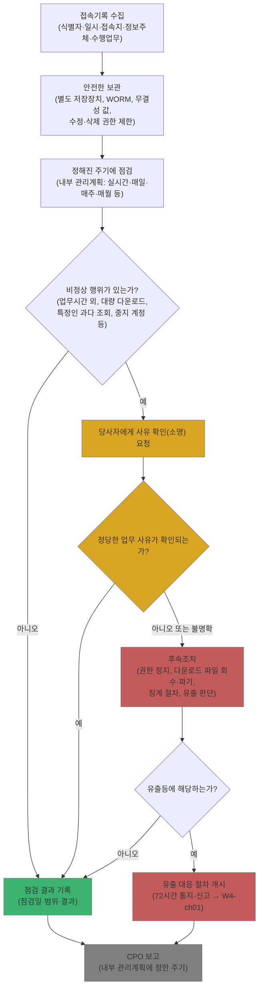

# Week 3 · Ch04. 접속기록 보관과 점검

> [← 이전 챕터](./ch03_encryption.md) · [📚 전체 목차](../../README.md) · [다음 챕터 →](./ch05_malware_physical_output.md)

| 항목 | 내용 |
|---|---|
| 예상 학습 시간 | 75분 (실습 포함) |
| 법령 기준일 | 2026-11-17 |
| 핵심 근거 | 개인정보 보호법 제29조 / 시행령 제30조 / 안전성 확보조치 기준 제2조제3호, 제8조, 제17조 / 안전성 확보조치 기준 안내서 |
| 관련 용어 | [접속기록](../../glossary.md#접속기록), [개인정보처리시스템](../../glossary.md#개인정보처리시스템), [내부 관리계획](../../glossary.md#내부-관리계획), [개인정보 보호책임자](../../glossary.md#개인정보-보호책임자) |
| 선수 챕터 | [W3-ch01 내부 관리계획](./ch01_internal_management_plan.md), [W3-ch02 접근권한](./ch02_access_control.md) |

---

## 1. 학습 목표

이 챕터를 마치면 담당자님은 다음을 할 수 있습니다.

1. 접속기록의 **필수 기록 항목 5가지**와 **보관 기간(1년/2년)** 기준을 적용할 수 있다.
2. 접속기록·다운로드 점검의 **주기·방법·사후조치 절차**를 내부 관리계획으로 정할 수 있다.
3. 접속기록에서 **비정상 행위**를 찾아내고 소명 요청 등 후속 조치를 할 수 있다.

---

## 2. 한 줄 비유

> 💡 **접속기록은 "건물 출입 CCTV 녹화본 + 방문 일지"입니다. 누가(식별자), 언제(일시), 어디서(접속지), 누구의 서류를(정보주체), 무엇을 했는지(수행업무) 남겨 두고, 정기적으로 돌려 보면서 이상한 장면을 찾는 것입니다.**

단, 비유의 한계가 있습니다. CCTV는 녹화만 해도 범죄 억제 효과가 있지만, 접속기록은 **점검하지 않으면 사고가 난 뒤에야** 의미가 생깁니다. 그래서 고시는 보관(제8조제1항)과 **점검**(제2항)을 따로 의무로 정합니다.

---

## 3. 개념 설명 및 법령 조문

### 3-1. 관련 조문

> 📌 **조문 주소 읽는 법**: 조 → 항(①②) → 호(1. 2.) → 목(가. 나.). 자세한 설명은 [W1-ch01 3-2](../week1/ch01_what_is_personal_info.md#3-2-관련-조문)를 보세요.

#### 📜 안전성 확보조치 기준 제2조제3호 (접속기록의 정의)

| 구분 | 내용 |
|---|---|
| **원문 요지** | "접속기록"이란 개인정보처리시스템에 접속하는 자가 접속하여 수행한 업무내역에 대하여 **식별자, 접속일시, 접속지 정보, 처리한 정보주체 정보, 수행업무** 등을 전자적으로 기록한 것. "접속"이란 처리시스템과 연결되어 데이터 송신 또는 수신이 가능한 상태. |
| **쉬운 풀이** | 로그인 기록만으로는 부족합니다. **"누구의 정보를 무엇을 했는지"**까지 남아야 접속기록입니다. |

근거 원문은 각주를 참고하세요.[^safety-2-8]

**필수 기록 항목 5가지 (안내서)**

| 항목 | 설명 | 예시 |
|---|---|---|
| ① 식별자 | 처리시스템에 접속한 자를 식별할 수 있는 ID 등 | A0001 |
| ② 접속일시 | 접속하거나 업무를 수행한 시점 (년-월-일, 시:분:초) | 2026-10-30, 14:00:00 |
| ③ 접속지 정보 | 접속한 자의 단말기 정보 또는 IP 주소 등 | 192.168.10.9 |
| ④ 처리한 정보주체 정보 | 누구의 개인정보를 처리했는지 알 수 있는 식별정보(ID, 고객번호, 학번, 사번 등). 대량 처리 시 **검색조건문(쿼리)**을 기록할 수 있으나, 책임 추적성을 위해 그 시점 DB 백업 등 필요 | CLI060719 / `SELECT * FROM member WHERE ...` |
| ⑤ 수행업무 | 검색, 열람, 조회, 입력, 수정, 삭제, 출력, **다운로드**, 로그인, 로그아웃, 로그인 실패 등 | 연락처 조회 |

안내서는 위 정보는 **반드시 기록**하고, 처리한 정보주체 정보에 **민감하거나 과도한 개인정보가 저장되지 않게** 하며 필요하면 암호화하라고 설명합니다.[^guide-p100]

#### 📜 안전성 확보조치 기준 제8조 (접속기록의 보관 및 점검)

| 항 | 원문 요지 | 실무 포인트 |
|---|---|---|
| ① | 처리시스템에 접속한 자(**정보주체 제외**)의 접속기록을 **1년 이상** 보관·관리. 다음은 **2년 이상**: 1. **5만 명 이상** 정보주체의 개인정보를 처리하는 시스템 2. **고유식별정보 또는 민감정보**를 처리하는 시스템 3. 「전기통신사업법」상 **기간통신사업자** | 시스템별로 1년/2년 대상인지 판정해 목록화. 오픈마켓 판매자 등 **취급자 외 제3자에게 계정을 발급**한 경우도 접속기록 대상[^guide-p99] |
| ② | 오·남용, 분실·도난·유출·위조·변조·훼손 등에 대응하기 위해 취급자의 **접속기록 및 개인정보 다운로드 상황**을 확인·점검하는 **주기·방법·사후조치절차** 등을 **내부 관리계획으로 정하고 이행** | 점검 주기는 법정 숫자가 없고 **회사가 정함**. 단, 과도하게 길게 정하지 말 것[^guide-p162] |
| ③ | 접속기록이 **위·변조 및 도난, 분실되지 않도록** 안전하게 보관하는 조치 | 별도 저장장치 백업, 덮어쓰기 방지 매체(WORM), 무결성 확인값 별도 보관, 수정·삭제 권한 제한[^guide-p103] |

근거 원문은 각주를 참고하세요.[^safety-2-8]

> 💡 **최소 보관기간 이후**: 안내서는 최소 보관기간이 지나도 접속기록을 즉시 삭제하지 말고, 처리하는 개인정보의 중요도·민감도 등을 고려해 **책임 추적성을 확보하기에 충분한 기간**을 내부 관리계획에 정해 보관하라고 설명합니다.[^guide-p102] 또 처리 목적을 달성해 개인정보를 파기했더라도 **취급자의 접속기록은 정해진 기간 동안 보관**해야 합니다.[^guide-p162]

### 3-2. 점검 주기·방법·사후조치 정하기

안내서가 제시한 관리 항목은 다음과 같습니다.[^guide-p102]

| 관리 항목 | 선택지 (예시) |
|---|---|
| **주기** | 실시간, 매일, 매주, 매월, 격월, 분기별 (연휴 기간, 처리 환경 변화 등도 고려) |
| **방법** | 자동화된 방법, 스크립트 활용, 수동 점검 등 |
| **점검 기준** | 비인가 접속, 단시간 내 대량 다운로드, 과다 조회·다운로드, 업무시간 외 조회·다운로드, 이상 또는 부정행위 등 |
| **사후조치 절차** | 검토 결과 보고, 통지, **사유 확인(소명)**, 후속조치(신고, 회수, 파기 등) |
| **점검 주체** | 책임 추적성과 객관성을 위해 취급·운영 부서가 아닌 **개인정보 총괄 부서 또는 감사 부서** 등 **별도 부서** |

**비정상 행위의 예 (안내서)**[^guide-p103]

| 항목 | 비정상 행위 |
|---|---|
| 식별자 | 권한이 없거나 **사용이 중지된 계정**으로 접속 |
| 접속일시 | 출근 전, 퇴근 후, **새벽**, 휴무일 등 업무시간 외 접속 |
| 접속지 정보 | 인가되지 않은 단말기·지역(IP)에서 접속 |
| 처리한 정보주체 정보 | **특정 정보주체**를 과도하게 조회·다운로드 (예: 유명인, 지인) |
| 수행업무 | **대량** 조회·정정·다운로드·삭제 |
| 기타 | 짧은 시간에 한 계정으로 **여러 지역(IP)**에서 접속 |

> 💡 **CPO에게 언제 보고하나요?** 안내서 FAQ는 고시가 CPO 보고 주기를 따로 정하지 않았지만, 접속기록 점검의 **최종 책임은 CPO에게 있다**고 설명합니다. 따라서 점검 주기·방법·사후조치 절차와 함께 **CPO 보고 주기**도 내부 관리계획으로 정해야 합니다.[^guide-p161]

---

## 4. 사내 실무 적용

### 🎭 상황극 1. IT팀의 "로그 용량이 커서 6개월만 보관할게요"

> **📨 IT팀 봉 과장**: "CRM 접속 로그가 너무 커서 스토리지 비용이 많이 나와요. **6개월**만 보관하고 지우려고요. 어차피 사고 나면 그때 보면 되잖아요."

**🙋 담당자 답변**

| 구분 | 내용 |
|---|---|
| **결론** | ❌ **불가** — 접속기록은 **최소 1년**, 우리 CRM처럼 **5만 명 이상**을 처리하는 시스템은 **최소 2년** 보관해야 합니다. |
| **근거** | 안전성 확보조치 기준 제8조제1항제1호, 제3항(안전한 보관) |
| **다음 행동** | ① 시스템별 **보관 기간 판정표**(처리 인원, 고유식별·민감정보 여부 → 1년/2년)를 만듭니다. ② 비용이 문제라면 **보관 위치를 계층화**합니다. 최근 기간은 고속 스토리지, 오래된 로그는 압축해 저가 스토리지나 WORM 매체로 옮깁니다. ③ 로그에 **불필요한 개인정보**(전체 조회 결과 등)가 쌓이지 않게 기록 항목을 정리합니다(안내서: 민감하거나 과도한 개인정보 저장 금지). ④ 로그 삭제 권한을 제한하고, 삭제 자체도 기록되게 합니다. |

**왜 그런가요?** SK텔레콤 사건에서 감염된 서버의 방화벽 로그를 **4개월만** 보관한 탓에, 그 이전 기간(2022. 6. ~ 2024. 12.)에는 **유출 여부를 확인할 수 없었습니다.**[^case-skt-p9] 기록이 없으면 "유출되지 않았다"는 것도 증명할 수 없습니다.

### 🎭 상황극 2. 고객지원팀장의 "제 팀원 접속기록은 제가 점검할게요"

> **📨 고객지원팀 감 팀장**: "접속기록 점검을 개인정보보호팀이 매번 하기 번거로우니까, **우리 팀원 접속기록은 제가 직접** 보고 이상 없으면 '이상 없음'으로 보고할게요. 제가 제일 잘 알잖아요."

**🙋 담당자 답변**

| 구분 | 내용 |
|---|---|
| **결론** | ⚠️ **조건부 가능 (보조적으로만)** — 팀장이 1차로 보는 것은 도움이 되지만, 공식 점검은 **취급·운영 부서가 아닌 별도 부서**(개인정보 총괄 부서·감사 부서 등)가 해야 객관성이 확보됩니다. |
| **근거** | 안전성 확보조치 기준 제8조제2항, 안내서 PDF p.102("책임 추적성 및 점검의 객관성을 보장하기 위해 개인정보 취급 및 운영 부서가 아닌 개인정보 총괄 부서 또는 감사 부서 등 별도의 부서에서 점검"), 안내서 FAQ PDF p.161(최종 책임은 CPO) |
| **다음 행동** | ① 공식 점검은 개인정보보호팀이 **정한 주기**에 수행합니다. ② 팀장에게는 **소명 요청 대응**(왜 새벽에 조회했는지 등)과 업무 맥락 설명 역할을 맡깁니다. ③ 팀장 본인 계정의 접속기록도 점검 대상에 포함합니다. ④ 점검 결과와 소명 내용을 기록하고 CPO에게 정해진 주기로 보고합니다. |

**왜 그런가요?** 같은 부서가 자기 부서를 점검하면, 팀장 본인이나 팀 전체의 관행적 오남용을 걸러 내기 어렵습니다. 점검은 **"감시"가 아니라 "회사와 직원을 함께 보호하는 기록"**이라고 현업에 설명하세요. 정당한 업무였다는 소명 기록은 나중에 직원을 보호하는 증거가 됩니다.

---

## 5. 접속기록 점검 업무 흐름

**그림 읽는 법**: 점검의 목적은 비정상 행위를 **찾아서 설명을 듣고, 설명이 안 되면 조치하는 것**입니다. 황색의 소명 단계가 핵심입니다. 적색으로 넘어가면 단순 내부 문제가 아니라 **유출 사고**일 수 있으므로 W4-ch01의 72시간 절차를 함께 검토합니다.

---

## 6. 개인정보보호위원회 처분 사례

### ⚖️ 사례: ㈜엘지유플러스의 접속기록 관리 부실 (2023. 7. 의결) + SK텔레콤의 짧은 로그 보관 (2025. 8.) — "접속기록" 관점

| 단계 | 내용 |
|---|---|
| **사건 개요 (엘지유플러스)** | 2023년 1월 고객 개인정보 약 30만 건(중복 제거 297,117건) 유출이 확인되었습니다. 조사에서 엘지유플러스는 다량의 개인정보를 관리하면서도 **개인정보취급자의 접근권한과 접속기록을 제대로 관리하지 않아, 대규모 개인정보를 추출·전송한 기록을 남기지 않았습니다.** 그래서 **비정상 행위 여부에 대한 점검·확인이 안 되는** 상황이었습니다. 유출 시점은 2018년 6월경으로 추정되었는데, 2023년 조사 때까지 회사가 이를 스스로 발견하지 못했습니다. |
| **위반 조항 (엘지유플러스)** | 보도자료 참고1 표: 안전조치의무 **법 §29, 영 §48조의2, 고시 §5** — "접속기록 보존·관리를 소홀히 함", "개인정보처리시스템 접근권한 부여·변경·말소 내역 보관을 소홀히 함" 등 (당시 정보통신서비스 제공자용 조항·고시 기준) |
| **처분 결과 (엘지유플러스)** | 과징금 68억 45만 2천 원, 과태료 2,700만 원, 시정조치 명령, 결과 공표 |
| **참고 (SK텔레콤)** | 감염된 ICAS 서버에는 이용자의 이름·생년월일·주소·이메일·단말기 식별번호(IMEI) 등이 임시 저장되어 있었습니다. 그런데 해당 서버의 **방화벽 로그를 4개월만 보관**해, 2024. 12.~2025. 4.에는 유출 정황이 없음을 확인했지만 **그 이전 기간(2022. 6.~2024. 12.)은 유출 여부를 확인할 수 없었습니다.** 보도자료는 "접속기록 미보관"도 안전조치 위반 사항으로 언급했습니다. |
| **교훈** | ① 접속기록이 없으면 **유출을 발견할 수도, 유출이 없었음을 증명할 수도 없습니다.** ② **대량 추출·다운로드**는 반드시 기록되고 점검되어야 하는 항목입니다. ③ 로그 보관 기간을 비용 문제로 줄이면 사고 때 **피해 범위를 특정하지 못해** 대응(통지 대상 확정)과 제재 모두에서 불리해집니다. |
| **출처** | 개인정보보호위원회 보도자료, 「개인정보위, ㈜엘지유플러스 개인정보 유출사고에 대해 과징금 68억 원, 과태료 2,700만 원 및 시정명령 부과」(2023. 7. 12.)[^case-lgu] / 「개인정보위, 'SK텔레콤 개인정보 유출사고' 제재처분 의결」(2025. 8. 28.)[^case-skt-p9] |

> 💬 **사수의 한마디**: IT팀에 **"지난달 고객 DB에서 1,000건 이상을 한 번에 다운로드한 사람 목록을 뽑아 주세요"**라고 요청해 보세요. 바로 뽑힌다면 기록과 점검 체계가 있는 것이고, "그런 기록은 없는데요"라는 답이 오면 이 챕터의 체크리스트부터 시작해야 합니다.

---

## 7. 오답노트

| # | ❌ 잘못된 생각 | ✅ 올바른 이해 | 근거 조문 |
|---|---|---|---|
| 1 | "로그인·로그아웃 기록만 있으면 접속기록 의무는 충족돼요." | 접속기록에는 **식별자, 접속일시, 접속지 정보, 처리한 정보주체 정보, 수행업무**가 모두 있어야 합니다. "누구의 정보를 무엇을 했는지"가 빠지면 안 됩니다. | 고시 제2조제3호, 안내서 PDF p.100~101 |
| 2 | "접속기록은 무조건 1년만 보관하면 돼요." | **5만 명 이상**, **고유식별·민감정보** 처리 시스템, **기간통신사업자**는 **2년 이상** 보관해야 합니다. | 고시 제8조제1항 |
| 3 | "고시에 점검 주기 숫자가 없으니 접속기록 점검은 안 해도 돼요." | 고시는 숫자 대신 **주기·방법·사후조치절차를 내부 관리계획으로 정하고 이행**할 의무가 있습니다. 주기를 과도하게 길게 잡으면 안 됩니다. | 고시 제8조제2항, 안내서 FAQ PDF p.162 |
| 4 | "각 팀장이 자기 팀 기록을 점검하면 충분해요." | 객관성을 위해 취급·운영 부서가 아닌 **총괄 부서·감사 부서 등 별도 부서**가 점검하는 것이 바람직하고, 최종 책임은 **CPO**에게 있습니다. | 안내서 PDF p.102, FAQ PDF p.161 |
| 5 | "개인정보를 파기했으니 그 시스템 접속기록도 같이 지워요." | 처리 목적을 달성해 개인정보를 파기하더라도 **취급자의 접속기록은 정해진 기간 동안 보관**해야 합니다. | 고시 제8조제1항, 안내서 FAQ PDF p.162 |
| 6 | "로그 서버 관리자는 필요하면 로그를 지울 수 있어야죠." | 접속기록은 **위·변조, 도난, 분실되지 않도록** 보관해야 하고, 임의 수정·삭제가 불가능하도록 **권한을 제한**해야 합니다. | 고시 제8조제3항, 안내서 PDF p.103 |

---

## 8. 업무 체크리스트

**📋 접속기록 보관·점검 셀프 점검표**

| 점검 주기 | 점검 수행: 내부 관리계획에 정한 주기 / 체계 점검: 반기 1회 | 점검자 | 개인정보보호 담당자 (총괄 부서) | 점검일 | ____-__-__ |
|---|---|---|---|---|---|

**[기록]**
- [ ] 개인정보처리시스템마다 접속기록이 **5가지 필수 항목**(식별자·일시·접속지·정보주체·수행업무)을 남긴다 (고시 제2조제3호)
- [ ] **다운로드**가 수행업무로 기록되고, 다운로드 건수·대상을 확인할 수 있다 (제8조제2항)
- [ ] 협력사·판매자 등 **취급자 외 제3자 계정**의 접속도 기록된다 (안내서 PDF p.99)
- [ ] 로그에 조회 결과 전체 등 **과도한 개인정보**가 쌓이지 않는다 (안내서 PDF p.100)

**[보관]**
- [ ] 시스템별 **보관 기간 판정표**가 있다 (1년 / 2년: 5만 명 이상, 고유식별·민감정보, 기간통신사업자) (제8조제1항)
- [ ] 접속기록을 처리시스템 외 **별도 저장장치**에 백업한다 (안내서 PDF p.103)
- [ ] 위·변조 방지 조치(WORM, 무결성 확인값 별도 보관 등)가 있다 (제8조제3항)
- [ ] 로그 **수정·삭제 권한**이 제한되어 있다

**[점검]**
- [ ] 내부 관리계획에 점검 **주기·방법·점검 기준·사후조치 절차·CPO 보고 주기**가 정해져 있다 (제8조제2항, FAQ PDF p.161)
- [ ] 점검은 **취급·운영 부서가 아닌 별도 부서**가 수행한다 (안내서 PDF p.102)
- [ ] 정해진 주기대로 점검했고, **점검 결과 기록**이 있다
- [ ] 비정상 행위에 대한 **소명 요청과 소명 결과**가 기록되어 있다
- [ ] 소명되지 않은 건에 대한 **후속조치**(권한 정지, 회수·파기, 유출 판단)가 기록되어 있다

---

## 9. 실습 과제 / 퀴즈

### 객관식

**Q1.** 안전성 확보조치 기준 제8조제1항에 따라 접속기록을 **2년 이상** 보관해야 하는 경우가 **아닌 것**은?

1. 5만 명 이상의 정보주체에 관한 개인정보를 처리하는 개인정보처리시스템
2. 민감정보를 처리하는 개인정보처리시스템
3. 「전기통신사업법」에 따른 기간통신사업자
4. 직원 3만 명의 인사정보(고유식별정보 없음, 민감정보 없음)를 처리하는 인사시스템

**Q2.** 현행 안전성 확보조치 기준(고시 제2026-9호)의 접속기록 **점검 주기**에 관한 설명으로 옳은 것은?

1. 고시가 월 1회 이상으로 정하고 있다.
2. 고시가 분기 1회 이상으로 정하고 있다.
3. 점검 주기·방법·사후조치절차 등을 내부 관리계획으로 정하고 이행해야 한다.
4. 사고가 발생했을 때만 점검하면 된다.

**Q3.** 안내서가 설명하는 **접속기록 필수 기록 항목이 아닌 것**은?

1. 식별자
2. 접속일시
3. 처리한 정보주체 정보
4. 접속한 취급자의 주민등록번호

### 🛠️ 실습: 접속기록 점검 시뮬레이션

**Q4.** 아래는 우리 회사 CRM(회원 30만 명)의 2026년 11월 셋째 주 접속기록 발췌입니다. 회사 업무시간은 평일 09:00~18:00이고, 11/14(토)·11/15(일)은 휴무일입니다. **비정상 행위로 의심되는 기록**을 모두 찾아 ① 의심 사유 ② 소명 요청 내용 ③ 소명되지 않을 경우의 후속조치를 쓰세요.

| No | 식별자 | 접속일시 | 접속지 | 처리한 정보주체 | 수행업무 | 건수 |
|---|---|---|---|---|---|---|
| 1 | cs_park | 2026-11-12 10:15:22 | 10.1.20.31 | M0012345 | 연락처 조회 | 1 |
| 2 | cs_kim | 2026-11-12 02:47:10 | 10.1.20.45 | M0098812 | 주소 조회 | 1 |
| 3 | mk_lee | 2026-11-12 16:02:55 | 10.1.30.12 | `SELECT name,phone FROM member` | 다운로드 | 298,410 |
| 4 | sales_kim | 2026-11-13 11:20:03 | 10.1.40.08 | M0000777 | 상세 조회 | 1 |
| 5 | sales_kim | 2026-11-13 11:20:41 | 203.0.113.50 (해외 IP) | M0000777 | 상세 조회 | 1 |
| 6 | cs_choi | 2026-11-13 14:30:00 | 10.1.20.33 | M0055555 (같은 회원) | 연락처 조회 | 37 |
| 7 | admin01 | 2026-11-14 23:10:12 | 10.1.10.2 | — | 로그 삭제 | — |
| 8 | ex_kim (11/10 퇴사자) | 2026-11-15 09:05:44 | 10.1.40.19 | M0034567 | 연락처 조회 | 1 |

> ✅ 다 풀었다면 [정답 및 해설](../../answers_and_explanations.md#w3-ch04)에서 확인하세요. 틀린 문제는 **7. 오답노트**에 한 줄씩 추가하세요. Windows PC의 로그온 기록(이벤트 ID 4624/4625) 확인 실습은 [W3-ch07](./ch07_windows11_handson.md)에서 합니다.

---

## 10. 더 읽을거리

| 자료 | 발행 | references 파일명 | 이 챕터와의 관계 |
|---|---|---|---|
| 개인정보의 안전성 확보조치 기준 | 고시 제2026-9호 | `개인정보의 안전성 확보조치 기준(개인정보보호위원회고시)(제2026-9호)(20260701).pdf` | 제2조제3호, 제8조, 제17조(공공시스템) |
| 개인정보의 안전성 확보조치 기준 안내서 | 개인정보보호위원회, 2026. 11. | `개인정보의 안전성 확보조치 기준 안내서(2026.11).pdf` | 제8조 해설 PDF p.99~103 (인쇄 p.91~95), FAQ PDF p.161~162 (CPO 보고, 파기 후 보관, 점검 주기) |
| 개인정보위 보도자료 (엘지유플러스) | 개인정보보호위원회, 2023. 7. | `230713 (조간) 개인정보위, ㈜엘지유플러스 개인정보 유출사고에 대해 과징금 68억 원, 과태료 2,700만 원 및 시정명령 부과(조사2과)FN.pdf` | p.2 접속기록 관리 부실, p.4 위반 조항 표 |
| 개인정보위 보도자료 (SK텔레콤) | 개인정보보호위원회, 2025. 8. | `250828 (석간) 개인정보위  ‘SK텔레콤 개인정보 유출사고’ 제재처분 의결(조사2과)_최종(붙임 포함).pdf` | p.6 접속기록 미보관 언급, p.9 방화벽 로그 4개월 보관 |

---

> [← 이전 챕터](./ch03_encryption.md) · [📚 전체 목차](../../README.md) · [📖 용어집](../../glossary.md) · [다음 챕터 →](./ch05_malware_physical_output.md)

[^safety-2-8]: [출처: 개인정보의 안전성 확보조치 기준(개인정보보호위원회고시)(제2026-9호)(20260701).pdf, 제2조제3호, 제8조제1항~제3항]
[^guide-p99]: [출처: 개인정보의 안전성 확보조치 기준 안내서(2026.11).pdf, PDF p.99 (인쇄 p.91) 취급자 외 제3자 계정의 접속기록]
[^guide-p100]: [출처: 개인정보의 안전성 확보조치 기준 안내서(2026.11).pdf, PDF p.100~101 (인쇄 p.92~93) 필수 기록 항목, 검색조건문 예시, 접속기록 항목 예시]
[^guide-p102]: [출처: 개인정보의 안전성 확보조치 기준 안내서(2026.11).pdf, PDF p.102 (인쇄 p.94) 최소 보관기간 이후 보관, 점검 관리 항목, 별도 부서 점검]
[^guide-p103]: [출처: 개인정보의 안전성 확보조치 기준 안내서(2026.11).pdf, PDF p.103 (인쇄 p.95) 비정상 행위 예시, 다운로드 정의, 위·변조 방지 방법]
[^guide-p161]: [출처: 개인정보의 안전성 확보조치 기준 안내서(2026.11).pdf, PDF p.161 (인쇄 p.153) 부록 FAQ 「CPO에게 접속기록을 주기적으로 보고해야 하나요?」]
[^guide-p162]: [출처: 개인정보의 안전성 확보조치 기준 안내서(2026.11).pdf, PDF p.162 (인쇄 p.154) 부록 FAQ 「파기 후에도 접속기록 보관」, 「접속기록 점검 주기」]
[^case-lgu]: [출처: 230713 (조간) 개인정보위, ㈜엘지유플러스 개인정보 유출사고에 대해 과징금 68억 원, 과태료 2,700만 원 및 시정명령 부과(조사2과)FN.pdf, p.1 (유출 규모·시점), p.2 (접근권한·접속기록 관리 부실), p.4 「참고1」 위반 조항 표]
[^case-skt-p9]: [출처: 250828 (석간) 개인정보위  ‘SK텔레콤 개인정보 유출사고’ 제재처분 의결(조사2과)_최종(붙임 포함).pdf, p.6 (접속기록 미보관 등), p.9 「참고」 ICAS 서버 방화벽 로그 4개월 보관]
