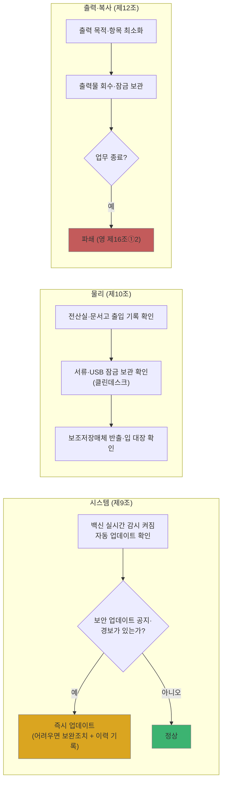

# Week 3 · Ch05. 악성프로그램 방지, 물리적 안전조치, 출력·복사 보호

> [← 이전 챕터](./ch04_access_logs.md) · [📚 전체 목차](../../README.md) · [다음 챕터 →](./ch06_cctv_video_devices.md)

| 항목 | 내용 |
|---|---|
| 예상 학습 시간 | 70분 |
| 법령 기준일 | 2026-11-17 |
| 핵심 근거 | 안전성 확보조치 기준 제4조제1항제9호~제12호, 제9조, 제10조, 제11조, 제12조 / 안전성 확보조치 기준 안내서 |
| 관련 용어 | [안전성 확보조치](../../glossary.md#안전성-확보조치), [보조저장매체](../../glossary.md#보조저장매체), [출력·복사 보호](../../glossary.md#출력복사-보호), [내부 관리계획](../../glossary.md#내부-관리계획) |
| 선수 챕터 | [W3-ch01](./ch01_internal_management_plan.md) ~ [W3-ch04](./ch04_access_logs.md) |

---

## 1. 학습 목표

이 챕터를 마치면 담당자님은 다음을 할 수 있습니다.

1. 보안 프로그램 운영과 **보안 업데이트**의 기준(자동 또는 일 1회, 공지 시 즉시)을 점검할 수 있다.
2. 전산실·문서 보관 장소의 **출입통제**, 서류·**보조저장매체**의 잠금 보관과 반출·입 통제를 운영할 수 있다.
3. 개인정보 **출력(인쇄·화면·파일)** 시 용도 특정과 항목 최소화, 출력·복사물 관리 기준을 적용할 수 있다.

---

## 2. 한 줄 비유

> 💡 **이 챕터의 세 가지는 "사무실 문단속 3종 세트"입니다. 백신과 업데이트는 "자물쇠 교체", 물리적 안전조치는 "서류함과 전산실 열쇠 관리", 출력·복사 보호는 "복사기 옆에 고객 명단을 두고 가지 않기"입니다.**

단, 비유의 한계가 있습니다. 해커는 문으로만 들어오지 않습니다. 업데이트를 미룬 **오래된 소프트웨어 한 개**가 문이 열린 것과 같은 결과를 낳습니다(6절 사례).

---

## 3. 개념 설명 및 법령 조문

### 3-1. 관련 조문

> 📌 **조문 주소 읽는 법**: 조 → 항(①②) → 호(1. 2.) → 목(가. 나.). 자세한 설명은 [W1-ch01 3-2](../week1/ch01_what_is_personal_info.md#3-2-관련-조문)를 보세요.

#### 📜 안전성 확보조치 기준 제9조 (악성프로그램 등 방지)

| 항 | 원문 요지 | 실무 포인트 |
|---|---|---|
| ① | 악성프로그램 등을 방지·치료할 수 있는 **보안 프로그램을 설치·운영**하고 다음을 준수: 1. **자동 업데이트** 기능을 사용하거나, 정당한 사유가 없는 한 **일 1회 이상** 업데이트하는 등 최신 상태 유지 2. 발견된 악성프로그램 등에 대해 **삭제 등 대응 조치** | 대상은 업무용 PC뿐 아니라 **처리시스템(웹서버·WAS·DBMS), 네트워크·보안 장비**의 운영체제까지. 리눅스 서버를 노리는 악성프로그램도 증가하고 있음[^guide-p163] |
| ② | 악성프로그램 관련 **경보가 발령**되거나, 사용 중인 응용 프로그램·운영체제 제작업체의 **보안 업데이트 공지**가 있으면 정당한 사유가 없는 한 **즉시** 업데이트 등 실시 | 업무 연속성 등 정당한 사유로 즉시 적용이 어렵다면 **접근통제 강화 등 보완조치**. 적용 사항·일자 등 이력 관리, **기술지원 종료(EOS)** 여부 확인[^guide-p107] |

근거 원문은 각주를 참고하세요.[^safety-9-12] 안내서는 **정품 소프트웨어만** 써야 한다고 강조합니다. 불법·비인가 보안 프로그램은 악성프로그램 침투 경로가 되거나 보안 업데이트를 받지 못하기 때문입니다.[^guide-p104]

#### 📜 안전성 확보조치 기준 제10조 (물리적 안전조치)

| 항 | 원문 요지 | 실무 포인트 |
|---|---|---|
| ① | **전산실, 자료보관실** 등 개인정보를 보관하는 물리적 장소를 **별도로 두고 있으면** 출입통제 절차를 수립·운영 | 출입통제 장치(비밀번호·스마트카드·생체인식 등) + **출입 기록**(출입자, 일시, 목적, 소속)[^guide-p109] |
| ② | 개인정보가 포함된 **서류, 보조저장매체** 등을 **잠금장치가 있는 안전한 장소**에 보관 | 신청서 박스를 복도에 두지 않기, 퇴근 시 책상 위 서류 정리(클린데스크) |
| ③ | 개인정보가 포함된 **보조저장매체의 반출·입 통제**를 위한 보안대책 마련. 단, 별도 처리시스템 없이 업무용 PC·모바일만으로 처리하면 적용하지 않을 수 있음 | 회사 승인 USB만 사용, 반출 대장, 매체 제어 프로그램 등 |

근거 원문은 각주를 참고하세요.[^safety-9-12]

#### 📜 안전성 확보조치 기준 제11조 (재해·재난 대비 안전조치)

| 구분 | 내용 |
|---|---|
| **원문 요지** | **10만 명 이상** 처리 대기업·중견기업·공공기관 또는 **100만 명 이상** 처리 중소기업·단체는 화재, 홍수, 단전 등 재해·재난 시 처리시스템 보호를 위해 1. **위기대응 매뉴얼** 등 대응절차를 마련하고 **정기적으로 점검** 2. 처리시스템 **백업 및 복구 계획** 마련 |
| **실무 포인트** | 클라우드로 처리시스템을 구축한 경우에도 적용됩니다. 대응절차는 시스템별 **시험 계획**으로 실효성을 확인하라고 안내합니다.[^guide-p112] |

근거 원문은 각주를 참고하세요.[^safety-9-12]

#### 📜 안전성 확보조치 기준 제12조 (출력·복사시 안전조치)

| 항 | 원문 요지 | 실무 포인트 |
|---|---|---|
| ① | 처리시스템에서 개인정보를 **출력**(인쇄, **화면표시**, **파일생성** 등)할 때 **용도를 특정**하고, 용도에 따라 **출력 항목을 최소화** | 화면도 출력입니다. 상담 화면에 주민등록번호 전체·카드번호 전체가 보일 필요가 있는지 점검 |
| ② | 개인정보가 포함된 **종이 인쇄물**, 개인정보가 복사된 **외부 저장매체** 등 출력·복사물을 안전하게 관리하기 위한 조치 | 출력물 관리대장, 보안 출력(본인 인증 후 출력), 워터마크, 문서보안(DRM), 데이터 유출 방지(DLP)·매체 제어 등[^guide-p115] |

근거 원문은 각주를 참고하세요.[^safety-9-12]

**출력 시 주의사항 (안내서 예시)**[^guide-p115]

| 주의사항 | 왜 필요한가 |
|---|---|
| 엑셀 등 오피스 파일에 개인정보가 **숨겨진 필드** 형태로 저장되지 않도록 | 숨긴 열·시트도 파일을 받은 사람은 볼 수 있음 |
| **웹페이지 소스 보기** 등으로 불필요한 개인정보가 출력되지 않도록 | 화면에는 안 보여도 HTML 소스에 남는 경우 |
| 업무상 반드시 필요한 경우가 아니면 **like 검색**이 되지 않도록 | "김%" 검색으로 수천 명이 한꺼번에 조회됨 |
| 불필요하거나 과도한 정보가 조회되지 않도록 **일치검색(equal 검색)** 등 적용 | 조회 범위 최소화 |

### 3-2. 취약점 점검 (내부 관리계획 18개 사항 중 10번)

| 구분 | 내용 |
|---|---|
| **근거** | 고시 제4조제1항제10호: "개인정보의 유출, 도난 방지 등을 위한 **취약점 점검**에 관한 사항"을 내부 관리계획에 포함 |
| **민간 기업** | 고시가 점검 주기를 따로 정하지 않으므로, 내부 관리계획에 **대상·주기·방법·조치 절차**를 정해 이행 |
| **공공시스템운영기관** | 공공시스템별로 **연 1회 이상** 취약점 점검 + **외부 전문기관 침투 테스트 연 1회 이상**, 결과에 따른 보완조치 (제18조, **2027. 1. 1. 시행**) |

근거 원문은 각주를 참고하세요.[^safety-4-18]

---

## 4. 사내 실무 적용

### 🎭 상황극 1. 운영팀의 "업데이트하면 시스템이 멈출 수 있어서 3년째 안 했어요"

> **📨 운영팀 반 차장**: "주문관리 서버가 **Windows Server 2012**인데, 업데이트하면 연동 프로그램이 멈출까 봐 **3년째 업데이트를 안 하고 있어요.** 내부망이라 괜찮지 않을까요? 백신은 깔려 있어요."

**🙋 담당자 답변**

| 구분 | 내용 |
|---|---|
| **결론** | ❌ **현 상태 유지는 불가** — 보안 업데이트 공지가 있으면 **정당한 사유가 없는 한 즉시** 업데이트해야 합니다. 업무 연속성 문제로 바로 못 한다면 **보완조치**와 **전환 계획**이 있어야 합니다. 또 기술지원이 종료된(EOS) 운영체제라면 더 이상 보안 업데이트를 받을 수 없으므로 **교체 계획**이 필요합니다. |
| **근거** | 안전성 확보조치 기준 제9조제2항, 안내서 PDF p.107(보완조치, 업데이트 이력 관리, EOS 확인) |
| **다음 행동** | ① 해당 운영체제의 **기술지원 종료 여부**를 확인합니다 `[출처: 일반 지식, 원문 확인 권장]` (제조사 공지로 확인). ② 즉시 업데이트가 어렵다면 **보완조치**를 문서화합니다: 해당 서버의 네트워크 접근을 필요한 IP로만 제한, 인터넷 통신 차단, 관리자 계정 다중 인증, 접속기록 집중 점검. ③ **테스트 환경**에서 업데이트·전환을 검증하는 일정을 정합니다. ④ 단종·미지원 소프트웨어 **목록**을 만들어 내부 관리계획 취약점 점검(제4조제1항제10호)에 넣습니다. |

**왜 그런가요?** 엘지유플러스 사건에서 고객인증시스템의 운영체제·DBMS·웹서버 등 상용 소프트웨어 대부분이 **단종되거나 기술지원이 종료된 상태**였습니다. SK텔레콤 사건에서는 2016년에 경보된 취약점을 2025년까지 업데이트하지 않았습니다(6절). "내부망이라 괜찮다"는 생각이 두 사건의 공통점입니다.

### 🎭 상황극 2. 고객지원팀의 "상담 화면에 다 보여야 일하기 편해요"

> **📨 고객지원팀 경 대리**: "상담원 화면에 고객 **주민등록번호 전체, 카드번호 전체, 주소, 최근 주문 전체**가 다 보여요. 혹시 물어볼 때 바로 답하려면 다 보이는 게 편해요. 그리고 하루 상담 목록을 **매일 아침 인쇄**해서 책상에 두고 봐요."

**🙋 담당자 답변**

| 구분 | 내용 |
|---|---|
| **결론** | ⚠️ **조건부 가능 (화면과 출력물 모두 고쳐야 함)** — 화면 표시도 **출력**이므로 용도를 특정하고 **항목을 최소화**해야 합니다. 인쇄물은 **안전하게 관리**해야 합니다. |
| **근거** | 안전성 확보조치 기준 제12조제1항(출력 시 용도 특정·항목 최소화, 화면표시 포함), 제12조제2항(출력·복사물 관리), 제10조제2항(서류 잠금 보관), 법 제24조의2(주민등록번호는 법령 근거가 있어야 처리) |
| **다음 행동** | ① 상담 화면에서 주민등록번호가 **왜 처리되는지**부터 확인합니다. 근거가 없으면 처리 자체를 중단합니다 → [W2-ch02](../week2/ch02_sensitive_and_unique_id.md) ② 카드번호는 **마스킹**(예: 앞 6·뒤 4자리만)하고, 전체 조회는 별도 권한·사유 입력 후에만 허용합니다. ③ 상담 목록 인쇄를 없애고 화면으로 대체합니다. 인쇄가 꼭 필요하면 **필요 항목만**, **보안 출력**, 퇴근 시 **잠금 보관 또는 파쇄**합니다. ④ 출력 기록을 남기고 접속기록 점검 대상에 포함합니다. |

**왜 그런가요?** "혹시 물어볼 때"는 용도가 아닙니다. 고시 제12조제1항은 **용도를 특정하고 그 용도에 맞게** 출력 항목을 줄이라고 요구합니다. 화면에 보이는 정보가 많을수록 어깨너머 노출, 화면 촬영, 대량 조회 위험이 커집니다.

---

## 5. 사무실·시스템 일일 보안 점검 흐름

**그림 읽는 법**: 세 묶음(시스템·물리·출력)은 **매일** 확인할 수 있는 항목입니다. 황색(보완조치)은 업데이트를 바로 못 할 때 **그 이유와 대신 한 조치**를 기록하는 단계입니다. 적색(파쇄)은 출력물의 마지막 단계로, 휴지통에 그냥 버리지 않는다는 뜻입니다.

---

## 6. 개인정보보호위원회 처분 사례

### ⚖️ 사례: ㈜엘지유플러스의 단종 소프트웨어와 웹셸 방치 (2023. 7. 의결) + SK텔레콤의 보안 업데이트 미조치 (2025. 8.) — "악성프로그램·업데이트" 관점

| 단계 | 내용 |
|---|---|
| **사건 개요 (엘지유플러스)** | 고객인증시스템(CAS)의 운영체제, DBMS, 웹서버, WAS 등 상용 소프트웨어 대부분이 유출 추정 시점(2018. 6.) 기준으로 **단종되거나 기술지원이 종료된 상태**였습니다. 방화벽·침입방지시스템(IPS)·웹방화벽 등 기본 보안장비가 설치되지 않았거나 보안정책이 제대로 적용되지 않았습니다. 특히 개발 서버에 **2009년과 2018년에 업로드된 악성코드(웹셸)가 2023년 1월까지 삭제되지 않고** 남아 있었고, 웹셸 점검이나 탐지·차단 정책도 적용되지 않았습니다. |
| **사건 개요 (SK텔레콤)** | 해커가 악성프로그램(BPFDoor) 설치에 활용한 운영체제 취약점(DirtyCow)은 **2016년 10월에 이미 보안 경보가 발령되고 패치가 공개**된 것이었습니다. SK텔레콤은 이를 알고도 2016년 11월 해당 취약점이 있는 운영체제를 설치했고, **2025년 4월 유출 당시까지 보안 업데이트를 하지 않았습니다.** 또 최소 2020년부터 상용 백신들이 해당 취약점 실행을 탐지했는데도 **백신을 설치하지 않았고** 이를 대체하는 보안조치도 소홀히 했습니다. |
| **위반 조항** | 엘지유플러스: 안전조치의무 법 §29, 영 §48조의2, 고시 §4·§5 (침입차단·탐지시스템 운영 소홀 등, 당시 기준) / SK텔레콤: 안전조치의무 위반(보안 업데이트 미조치, 악성프로그램 방지 소홀 등). ⚠️ SK텔레콤 보도자료에 조항 번호는 없음(현행 고시 제9조에 해당하는 쟁점으로 보임) |
| **처분 결과** | 엘지유플러스: 과징금 68억 45만 2천 원, 과태료 2,700만 원, 시정명령(전반적 시스템 점검 및 취약요소 개선 등) / SK텔레콤: 과징금 1,347억 9,100만 원, 과태료 960만 원, 시정명령·개선권고 |
| **교훈** | ① **보안 경보·패치가 나온 취약점을 방치**하는 것은 고시 제9조제2항의 "즉시 업데이트" 의무와 정면으로 충돌합니다. ② **악성코드가 몇 년씩 남아 있었다**는 것은 보안 프로그램이 없거나 탐지 결과를 처리하지 않았다는 뜻입니다(제9조제1항제2호 "발견된 악성프로그램 등에 대해 삭제 등 대응 조치"). ③ **단종 소프트웨어 목록**과 **전환 계획**이 없으면 같은 일이 반복됩니다. |
| **출처** | 개인정보보호위원회 보도자료, 「개인정보위, ㈜엘지유플러스 개인정보 유출사고에 대해 과징금 68억 원, 과태료 2,700만 원 및 시정명령 부과」(2023. 7. 12.)[^case-lgu] / 「개인정보위, 'SK텔레콤 개인정보 유출사고' 제재처분 의결」(2025. 8. 28.)[^case-skt] |

> 💬 **사수의 한마디**: IT팀에 **"운영 중인 서버 중 운영체제·DB·웹서버 버전과 기술지원 종료일 목록"**을 요청해 보세요. 이 목록이 없다는 것 자체가 위험 신호입니다. 목록이 있으면 종료일이 지난 항목에 **보완조치 기록**이 있는지 확인하세요.

---

## 7. 오답노트

| # | ❌ 잘못된 생각 | ✅ 올바른 이해 | 근거 조문 |
|---|---|---|---|
| 1 | "백신만 깔려 있으면 악성프로그램 방지 의무는 끝이에요." | **자동 업데이트 또는 일 1회 이상 업데이트**로 최신 상태를 유지하고, 발견된 악성프로그램은 **삭제 등 대응**해야 합니다. 서버·네트워크 장비도 대상입니다. | 고시 제9조제1항, 안내서 FAQ PDF p.163 |
| 2 | "내부망 서버는 업데이트 안 해도 괜찮아요." | 보안 업데이트 공지가 있으면 **정당한 사유가 없는 한 즉시** 업데이트해야 합니다. 즉시 못 하면 **보완조치**를 하고 기록해야 합니다. | 고시 제9조제2항, 안내서 PDF p.107 |
| 3 | "화면에 보이는 건 출력이 아니니까 다 보여 줘도 돼요." | 고시는 **화면표시**도 출력으로 봅니다. 용도를 특정하고 출력 항목을 **최소화**해야 합니다. | 고시 제12조제1항 |
| 4 | "엑셀에서 주민번호 열을 숨기기 했으니 보내도 돼요." | **숨겨진 필드**는 파일을 받은 사람이 다시 볼 수 있습니다. 불필요한 열은 **삭제**해야 합니다. | 고시 제12조제1항, 안내서 PDF p.115 |
| 5 | "고객 신청서 박스는 사무실 안이니까 복도 선반에 둬도 돼요." | 개인정보가 포함된 **서류·보조저장매체**는 **잠금장치가 있는 안전한 장소**에 보관해야 합니다. | 고시 제10조제2항 |
| 6 | "USB는 개인 것 써도 되죠. 회사 PC에 꽂기만 하는 거예요." | 처리시스템을 운영하는 처리자는 개인정보가 포함된 **보조저장매체의 반출·입 통제** 대책을 마련해야 합니다. 개인 USB는 통제 밖에 있습니다. | 고시 제10조제3항 |

---

## 8. 업무 체크리스트

**📋 악성프로그램·물리·출력 보안 점검표**

| 점검 주기 | 일일(개인 PC·출력물) / 월 1회(서버·대장) / 연 1회(재해·재난 훈련) | 점검자 | 개인정보보호 담당자 + IT·총무 | 점검일 | ____-__-__ |
|---|---|---|---|---|---|

**[악성프로그램 방지 — 제9조]**
- [ ] 업무용 PC·서버(Windows·리눅스)·네트워크 장비에 **정품 보안 프로그램**이 설치되어 있다
- [ ] 보안 프로그램이 **자동 업데이트** 또는 일 1회 이상 업데이트된다 (①1)
- [ ] 탐지된 악성프로그램의 **삭제·치료 결과**가 확인·기록된다 (①2)
- [ ] OS·응용 프로그램 **보안 업데이트 적용 이력**이 관리된다 (②)
- [ ] **기술지원 종료(EOS)** 소프트웨어 목록과 전환 계획·보완조치가 있다 (안내서 PDF p.107)

**[물리적 안전조치 — 제10조]**
- [ ] 전산실·자료보관실에 **출입통제 장치**와 **출입 기록**이 있다 (①)
- [ ] 개인정보 서류·USB가 **잠금장치가 있는 장소**에 보관된다 (클린데스크 점검) (②)
- [ ] **회사 승인 USB**만 쓰고, 반출·입 대장 또는 매체 제어가 있다 (③)

**[재해·재난 — 제11조]**
- [ ] 우리 회사가 대상(대기업·중견 10만 명 / 중소 100만 명 이상)인지 확인했고, 대상이면 **위기대응 매뉴얼과 백업·복구 계획**이 있고 **정기 점검·시험**했다

**[출력·복사 — 제12조]**
- [ ] 처리시스템 화면·출력물·다운로드 파일의 **항목이 용도별로 최소화**되어 있다 (마스킹 포함) (①)
- [ ] **like 검색**·전체 조회가 업무상 필요한 경우로 제한되어 있다 (안내서 PDF p.115)
- [ ] 출력물 **보안 출력**·회수·파쇄 절차가 있다 (②)
- [ ] 파일 반출 시 **DRM·DLP·매체 제어** 등 보호 수단이 있다 (②, 안내서 PDF p.115)

**[취약점 점검 — 제4조제1항제10호]**
- [ ] 내부 관리계획에 취약점 점검의 **대상·주기·방법·조치 절차**가 있고 올해 점검을 실시했다

---

## 9. 실습 과제 / 퀴즈

### 객관식

**Q1.** 안전성 확보조치 기준 제9조제1항에 따른 **보안 프로그램 업데이트** 기준으로 옳은 것은?

1. 월 1회 이상 수동 업데이트
2. 자동 업데이트 기능을 사용하거나, 정당한 사유가 없는 한 일 1회 이상 업데이트
3. 연 1회 정기 점검 시 업데이트
4. 악성프로그램이 발견된 경우에만 업데이트

**Q2.** 고시 제12조제1항에서 말하는 개인정보의 "출력"에 **포함되는 것을 모두** 고른 것은?

> ㄱ. 인쇄 ㄴ. 화면표시 ㄷ. 파일생성

1. ㄱ
2. ㄱ, ㄷ
3. ㄴ, ㄷ
4. ㄱ, ㄴ, ㄷ

**Q3.** 고시 제10조에 따른 물리적 안전조치로 **옳지 않은 것**은?

1. 전산실을 별도로 두고 있다면 출입통제 절차를 수립·운영한다.
2. 개인정보가 포함된 서류는 잠금장치가 있는 안전한 장소에 보관한다.
3. 개인정보가 포함된 보조저장매체의 반출·입 통제를 위한 보안대책을 마련한다.
4. 사무실 출입문에 잠금장치가 있으면 개인정보 서류는 책상 위에 두어도 된다.

### 🛠️ 실습: 사무실 보안 점검표 작성과 현장 점검

**Q4.** 우리 회사 고객지원팀 사무실(상담원 20명, 고객 신청서 접수, 프린터 1대, 문서 보관함 2개)을 대상으로 **점검표를 작성**하고, 아래 **가상 점검 결과**에서 문제를 찾아 개선 방안을 쓰세요.

**(1) 점검표**: 제9조·제10조·제12조에서 각각 3개 이상, 총 10개 이상의 점검 항목을 만드세요. 항목마다 근거 조항을 붙이세요.

**(2) 가상 점검 결과**

> - 오후 7시 점검 시 상담원 책상 6곳 위에 **고객 신청서**가 그대로 있음
> - 프린터 출력함에 **고객 명단 출력물** 3장이 방치되어 있음
> - 문서 보관함 1개는 **열쇠가 꽂힌 채** 열려 있음
> - 상담원 PC 2대의 백신 **최종 업데이트가 40일 전**
> - 상담원 1명이 **개인 USB**에 "고객문의_11월.xlsx" 파일을 저장해 두었음 (암호 없음)
> - 상담 화면에 고객 **카드번호 전체**가 표시됨

> ✅ 다 풀었다면 [정답 및 해설](../../answers_and_explanations.md#w3-ch05)에서 확인하세요. 틀린 문제는 **7. 오답노트**에 한 줄씩 추가하세요.

---

## 10. 더 읽을거리

| 자료 | 발행 | references 파일명 | 이 챕터와의 관계 |
|---|---|---|---|
| 개인정보의 안전성 확보조치 기준 | 고시 제2026-9호 | `개인정보의 안전성 확보조치 기준(개인정보보호위원회고시)(제2026-9호)(20260701).pdf` | 제4조제1항제9호~제12호, 제9조~제12조, 제18조, 부칙 |
| 개인정보의 안전성 확보조치 기준 안내서 | 개인정보보호위원회, 2026. 11. | `개인정보의 안전성 확보조치 기준 안내서(2026.11).pdf` | 제9조 해설 PDF p.104~107, 제10조 PDF p.108~110, 제11조 PDF p.111~113, 제12조 PDF p.114~115, FAQ PDF p.163(악성프로그램) |
| 정보보호 및 개인정보보호 관리체계 인증 등에 관한 고시 [별표 7] | 고시 제2024-8호 | `[별표 7] 인증기준(제23조 관련)(정보보호 및 개인정보보호 관리체계 인증 등에 관한 고시).pdf` | 물리보안, 운영보안 등 보호대책 요구사항 참고 |
| 개인정보위 보도자료 (엘지유플러스) | 개인정보보호위원회, 2023. 7. | `230713 (조간) 개인정보위, ㈜엘지유플러스 개인정보 유출사고에 대해 과징금 68억 원, 과태료 2,700만 원 및 시정명령 부과(조사2과)FN.pdf` | p.2 단종 소프트웨어, 웹셸 방치 |
| 개인정보위 보도자료 (SK텔레콤) | 개인정보보호위원회, 2025. 8. | `250828 (석간) 개인정보위  ‘SK텔레콤 개인정보 유출사고’ 제재처분 의결(조사2과)_최종(붙임 포함).pdf` | p.5 보안 업데이트 미조치, 백신 미설치 |

---

> [← 이전 챕터](./ch04_access_logs.md) · [📚 전체 목차](../../README.md) · [📖 용어집](../../glossary.md) · [다음 챕터 →](./ch06_cctv_video_devices.md)

[^safety-9-12]: [출처: 개인정보의 안전성 확보조치 기준(개인정보보호위원회고시)(제2026-9호)(20260701).pdf, 제9조제1항·제2항, 제10조제1항~제3항, 제11조, 제12조제1항·제2항]
[^safety-4-18]: [출처: 개인정보의 안전성 확보조치 기준(개인정보보호위원회고시)(제2026-9호)(20260701).pdf, 제4조제1항제10호, 제18조, 부칙 <제2026-9호, 2026. 7. 1.>]
[^guide-p104]: [출처: 개인정보의 안전성 확보조치 기준 안내서(2026.11).pdf, PDF p.104 (인쇄 p.96) 정품 소프트웨어 사용]
[^guide-p107]: [출처: 개인정보의 안전성 확보조치 기준 안내서(2026.11).pdf, PDF p.107 (인쇄 p.99) 즉시 업데이트의 의미, 보완조치, 업데이트 이력·EOS 관리]
[^guide-p109]: [출처: 개인정보의 안전성 확보조치 기준 안내서(2026.11).pdf, PDF p.109 (인쇄 p.101) 출입통제 장치·출입 기록 예시]
[^guide-p112]: [출처: 개인정보의 안전성 확보조치 기준 안내서(2026.11).pdf, PDF p.112~113 (인쇄 p.104~105) 대응절차 점검·시험, 클라우드 적용, 백업·복구 계획]
[^guide-p115]: [출처: 개인정보의 안전성 확보조치 기준 안내서(2026.11).pdf, PDF p.114~115 (인쇄 p.106~107) 출력 항목 최소화, 출력 시 주의사항, 출력·복사물 안전조치(DRM·DLP 등)]
[^guide-p163]: [출처: 개인정보의 안전성 확보조치 기준 안내서(2026.11).pdf, PDF p.163 (인쇄 p.155) 부록 FAQ 「8. 악성프로그램 등 방지」]
[^case-lgu]: [출처: 230713 (조간) 개인정보위, ㈜엘지유플러스 개인정보 유출사고에 대해 과징금 68억 원, 과태료 2,700만 원 및 시정명령 부과(조사2과)FN.pdf, p.2 (단종 소프트웨어, 보안장비 미설치, 웹셸 방치), p.3 (시정명령), p.4 (위반 조항 표)]
[^case-skt]: [출처: 250828 (석간) 개인정보위  ‘SK텔레콤 개인정보 유출사고’ 제재처분 의결(조사2과)_최종(붙임 포함).pdf, p.5 (DirtyCow 취약점 보안 업데이트 미실시, 백신 미설치)]
