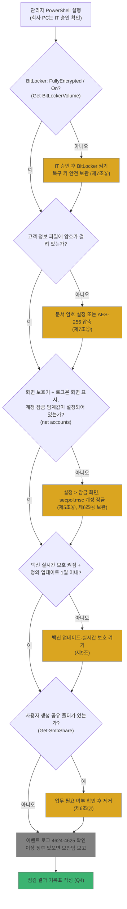

# Week 3 · Ch07. Windows 11 핸즈온: 내 PC는 기준을 지키고 있나?

> [← 이전 챕터](./ch06_cctv_video_devices.md) · [📚 전체 목차](../../README.md) · [다음 챕터 →](../week4/ch01_breach_response.md)

| 항목 | 내용 |
|---|---|
| 예상 학습 시간 | 120분 (실습 중심) |
| 법령 기준일 | 2026-11-17 |
| 핵심 근거 | 안전성 확보조치 기준 제5조제6항, 제6조제3항·제4항, 제7조제5항, 제9조 / 안전성 확보조치 기준 안내서 |
| 실습 환경 | **Windows 11 Pro** (BitLocker·로컬 보안 정책은 Pro 이상), Windows PowerShell 5.1, **관리자 권한** |
| 관련 용어 | [BitLocker](../../glossary.md#bitlocker), [4624 / 4625](../../glossary.md#4624-4625), [암호화](../../glossary.md#암호화), [자동 접속 차단](../../glossary.md#자동-접속-차단), [P2P / 공유설정](../../glossary.md#p2p-공유설정) |
| 선수 챕터 | [W3-ch02 접근통제](./ch02_access_control.md), [W3-ch03 암호화](./ch03_encryption.md), [W3-ch04 접속기록](./ch04_access_logs.md), [W3-ch05 악성프로그램](./ch05_malware_physical_output.md) |

> ⚠️ **실습 전 반드시 읽으세요**
> 1. **회사 PC라면 IT 부서의 승인을 먼저 받으세요.** 회사가 중앙에서 BitLocker·보안 정책을 관리하는 경우가 많습니다. 임의로 바꾸면 정책 충돌이나 접속 장애가 생길 수 있습니다.
> 2. 이 챕터의 명령어 중 **"조회"** 표시가 있는 것은 설정을 바꾸지 않습니다. **"변경"** 표시가 있는 작업은 승인을 받은 뒤에만 하세요.
> 3. BitLocker를 켜면 **복구 키**를 반드시 안전한 곳에 보관해야 합니다. 복구 키를 잃으면 데이터를 영구히 잃을 수 있습니다.
> 4. 아래 명령어는 Windows 11 Pro(빌드 26300)·PowerShell 5.1·관리자 권한 환경에서 **조회 동작을 확인**했습니다. 메뉴 이름은 Windows 버전·업데이트에 따라 조금씩 다를 수 있습니다. `[출처: 일반 지식, 원문 확인 권장]` (Windows 메뉴·명령어 설명 전체)

---

## 1. 학습 목표

이 챕터를 마치면 담당자님은 다음을 할 수 있습니다.

1. 내 PC의 **BitLocker 상태, 화면 잠금, 계정 잠금, 백신, 공유 폴더**를 직접 확인하고 고시 조항과 연결할 수 있다.
2. 개인정보가 담긴 **파일에 안전한 암호**를 설정할 수 있다.
3. **이벤트 뷰어와 PowerShell**로 로그온 성공(4624)·실패(4625) 기록을 찾아 해석할 수 있다.

---

## 2. 한 줄 비유

> 💡 **이 실습은 "내 자동차 정기 점검"입니다. 문 잠금(화면 잠금), 블랙박스(로그온 기록), 도난 방지 장치(BitLocker), 엔진 오일(백신 업데이트)을 직접 열어 보고 점검표에 체크하는 것입니다.**

단, 비유의 한계가 있습니다. 내 PC 점검이 회사 개인정보처리시스템(서버·DB) 점검을 대신하지는 않습니다. 이 챕터는 **취급자 PC** 단의 기준을 확인하는 실습입니다. Windows 로그온 기록은 고시 제8조의 "개인정보처리시스템 접속기록"과는 다른 것입니다(3-1 참고).

---

## 3. 개념 설명 및 법령 조문

### 3-1. 실습과 고시 조항의 연결

| 실습 | 연결되는 고시 조항 | 조항 요지 | 연결 방식 |
|---|---|---|---|
| ① BitLocker | 제7조제5항 | 이용자의 개인정보, 이용자가 아닌 정보주체의 고유식별·생체인식정보를 취급자 **컴퓨터·모바일 기기·보조저장매체**에 저장할 때 **안전한 암호 알고리즘으로 암호화** | 디스크 전체 암호화는 **분실·도난 대비**에 효과적인 수단입니다. ⚠️ 디스크 암호화만으로 제7조제5항의 "파일 암호화"가 충족되는지는 해석이 필요할 수 있어, ②와 함께 쓰는 것을 권장합니다 |
| ② 파일 암호 | 제7조제5항 | 위와 같음. 안내서: 오피스 파일은 프로그램의 **암호 설정 기능**, **압축 파일 암호 설정** 등 활용 가능, 상용 프로그램 기능이 쓰는 알고리즘이 **안전한 암호 알고리즘이면** 활용 가능 | 직접 근거[^guide-p96] |
| ③ 화면 잠금 | 제6조제4항 | 취급자가 **일정시간 이상 업무처리를 하지 않으면** 처리시스템 **접속이 자동으로 차단**되도록 | 고시 조항은 **처리시스템 세션**에 관한 것입니다. PC 화면 잠금은 자리를 비운 사이 열린 세션을 남이 쓰지 못하게 하는 **보완 수단**입니다 |
| ④ 계정 잠금 | 제5조제6항 | **일정 횟수 이상 인증에 실패**하면 접근 제한 | PC 로그인에 같은 원리를 적용 |
| ⑤ 로그온 기록 (4624/4625) | 제5조제6항, 제8조(참고) | 인증 실패 대응, 접속기록 점검 | Windows 로그온 기록은 **PC 단의 기록**입니다. 처리시스템 접속기록(제8조)을 대신하지 않지만, **계정 탈취·대입 공격 징후**를 찾는 데 쓸 수 있습니다 |
| ⑥ 백신·업데이트 | 제9조 | 보안 프로그램 설치·운영, **자동 업데이트 또는 일 1회 이상**, 보안 업데이트 **즉시** 적용 | 직접 근거 |
| ⑦ 공유 폴더 | 제6조제3항 | **공유설정** 등으로 권한 없는 자에게 공개·유출되지 않도록 취급자 컴퓨터 등에 조치 | 직접 근거. 안내서: 공유설정은 기본적으로 쓰지 않는 것이 원칙[^guide-p81] |

근거 원문은 각주를 참고하세요.[^safety]

> ⚠️ 확인 필요: 위 표의 "연결 방식" 중 ①·③·⑤의 해석(디스크 암호화와 파일 암호화의 관계, PC 화면 잠금과 처리시스템 세션 차단의 관계, Windows 로그와 처리시스템 접속기록의 관계)은 이 교재의 실무적 설명입니다. 위원회 안내서에 같은 표현이 있는지는 확인하지 못했습니다. `[출처: 일반 지식, 원문 확인 권장]`

### 3-2. 실습 ① BitLocker 상태 확인과 켜기

**[조회] PowerShell (관리자)**

```powershell
# BitLocker 상태 조회 (설정을 바꾸지 않음)
Get-BitLockerVolume | Select-Object MountPoint, VolumeStatus, ProtectionStatus, EncryptionPercentage

# 또는 명령 프롬프트 도구
manage-bde -status C:
```

| 결과 값 | 뜻 | 판정 |
|---|---|---|
| `VolumeStatus = FullyEncrypted`, `ProtectionStatus = On` | 암호화 완료, 보호 중 | ✅ |
| `VolumeStatus = FullyDecrypted`, `ProtectionStatus = Off` | 암호화 안 됨 | ❌ 조치 필요 |
| `EncryptionInProgress` | 암호화 진행 중 | ⏳ 완료까지 대기 |
| `FullyEncrypted` 이지만 `ProtectionStatus = Off` | 암호화됐지만 보호가 일시 중지된 상태 | ⚠️ IT 확인 |

**[변경] GUI로 켜기 (IT 승인 후)**

1. **시작** → "BitLocker 관리" 검색 → **제어판 > 시스템 및 보안 > BitLocker 드라이브 암호화**
2. 운영체제 드라이브(C:)의 **"BitLocker 켜기"** 클릭
3. **복구 키 백업** 방법 선택: 회사 정책에 따라 회사 계정·관리 서버에 저장하거나, 파일로 저장해 **PC가 아닌 안전한 장소**에 보관
4. 암호화 범위 선택(새 PC는 "사용 중인 공간만", 오래 쓴 PC는 "전체 드라이브" 권장) → 암호화 모드 선택 → 시작
5. 완료 후 위 **조회 명령**으로 `FullyEncrypted / On`인지 확인

> 💡 USB 메모리는 **"BitLocker To Go"**로 같은 화면에서 암호화할 수 있습니다(보조저장매체 암호화, 고시 제7조제5항).

### 3-3. 실습 ② 개인정보 파일에 암호 걸기

| 방법 | 절차 | 확인 포인트 |
|---|---|---|
| **Excel·Word 문서 암호** | **파일 > 정보 > 통합 문서 보호(문서 보호) > 암호 설정** → 암호 입력·확인 → 저장 | "읽기 전용 권장"이나 "시트 보호"는 **암호화가 아닙니다.** 반드시 "**암호 설정**(암호화)"을 쓰세요 |
| **압축 파일 암호 (예: 7-Zip)** | 파일 우클릭 → 7-Zip → 압축하기 → 암호화 방식 **AES-256** 선택 → 암호 입력 → **"파일 이름 암호화"** 체크(7z 형식) | ZIP의 구형 암호 방식(ZipCrypto)은 약합니다. AES-256을 고르세요 |
| **암호 전달** | 파일은 메일로, 암호는 **다른 경로**(전화·메신저)로 | 같은 메일에 암호를 쓰면 의미가 없습니다 |

> ⚠️ 확인 필요: 사용하는 오피스·압축 프로그램 버전이 어떤 알고리즘을 쓰는지는 IT 보안 담당과 확인하세요. 안내서는 "상용프로그램에서 제공하는 비밀번호 설정기능이 사용하는 알고리즘이 안전한 암호 알고리즘에 해당한다면 이를 활용할 수 있"다고 설명합니다.[^guide-p158] 위원회 질의응답 모음집도 상용프로그램 비밀번호 설정을 암호화 조치로 볼 수 있다고 하면서, **파일명에 비밀번호를 적어 두면 암호화가 아니라고** 밝힙니다 [출처: 1. 개인정보 질의응답 모음집(2025.12.).pdf, Q51 (인쇄 p.62)]. 위 메뉴 경로와 7-Zip 옵션은 `[출처: 일반 지식, 원문 확인 권장]`

### 3-4. 실습 ③ 화면 잠금 + ④ 계정 잠금 정책

**[조회] 현재 설정 확인**

```powershell
# 계정 잠금·비밀번호 정책 조회 (설정을 바꾸지 않음)
net accounts

# 화면 보호기 설정 조회 (현재 사용자)
Get-ItemProperty 'HKCU:\Control Panel\Desktop' -Name ScreenSaveActive, ScreenSaverIsSecure, ScreenSaveTimeOut -ErrorAction SilentlyContinue

# "컴퓨터 비활성 한도" 정책 조회 (값이 없으면 미설정)
(Get-ItemProperty 'HKLM:\SOFTWARE\Microsoft\Windows\CurrentVersion\Policies\System' -Name InactivityTimeoutSecs -ErrorAction SilentlyContinue).InactivityTimeoutSecs
```

| `net accounts` 항목 | 뜻 | 점검 기준 (예시) |
|---|---|---|
| `Lockout threshold` | 몇 번 실패하면 잠길지 (0 = 잠기지 않음) | **0이면 ❌**. 회사 기준 횟수(예: 5회)로 설정 (고시 제5조제6항) |
| `Lockout duration (minutes)` | 잠금 유지 시간 | 회사 기준 |
| `Minimum password length` | 최소 비밀번호 길이 | 회사 관리기준 (고시는 숫자를 정하지 않음, 안내서 FAQ) |

**[변경] GUI로 설정 (IT 승인 후)**

| 설정 | 경로 |
|---|---|
| **화면 보호기 + 다시 시작할 때 로그온 화면 표시** | **설정 > 개인 설정 > 잠금 화면 > 화면 보호기** → 대기 시간(예: 10분) → **"다시 시작할 때 로그온 화면 표시"** 체크 |
| **컴퓨터 비활성 한도** (정책으로 강제) | `secpol.msc` → **로컬 정책 > 보안 옵션 > "대화형 로그온: 컴퓨터 비활성 한도"** → 초 단위 입력(예: 600) |
| **계정 잠금 임계값** | `secpol.msc` → **계정 정책 > 계정 잠금 정책 > "계정 잠금 임계값"** |
| **즉시 잠금 습관** | 자리를 뜰 때 **`Windows 키 + L`** |

> 💡 대기 시간은 고시가 숫자로 정하지 않습니다. 안내서 FAQ는 처리시스템 최대 접속시간을 "최소한으로 정하여야" 한다고 설명합니다.[^guide-p155] PC 화면 잠금 시간도 회사 내부 관리계획에서 정하세요.

### 3-5. 실습 ⑤ 이벤트 뷰어로 로그온 기록(4624/4625) 확인

**GUI 경로**

1. **시작** 우클릭 → **이벤트 뷰어** (또는 `eventvwr.msc`)
2. **Windows 로그 > 보안**
3. 오른쪽 **"현재 로그 필터링"** → 이벤트 ID에 `4624,4625` 입력 → 확인
4. 이벤트를 열어 **"로그온 유형"**, **"계정 이름"**, **"원본 네트워크 주소"**, (4625의 경우) **"실패 이유"·"상태"·"하위 상태"**를 확인

**[조회] PowerShell (관리자)**

```powershell
# 최근 7일 사람 로그온(유형 2,7,10,11)만 보기 — 시스템 계정 제외
Get-WinEvent -FilterHashtable @{LogName='Security'; Id=4624; StartTime=(Get-Date).AddDays(-7)} |
  ForEach-Object {
    $d = @{}; ([xml]$_.ToXml()).Event.EventData.Data | ForEach-Object { $d[$_.Name] = $_.'#text' }
    [pscustomobject]@{ 시간=$_.TimeCreated; 유형=$d['LogonType']; 계정=$d['TargetUserName']; IP=$d['IpAddress'] }
  } |
  Where-Object { $_.유형 -in '2','7','10','11' -and $_.계정 -notmatch '^(DWM-|UMFD-)' } |
  Select-Object -First 20

# 최근 7일 로그온 실패(4625) 상세
Get-WinEvent -FilterHashtable @{LogName='Security'; Id=4625; StartTime=(Get-Date).AddDays(-7)} -ErrorAction SilentlyContinue |
  ForEach-Object {
    $d = @{}; ([xml]$_.ToXml()).Event.EventData.Data | ForEach-Object { $d[$_.Name] = $_.'#text' }
    [pscustomobject]@{ 시간=$_.TimeCreated; 유형=$d['LogonType']; 계정=$d['TargetUserName']; 상태=$d['Status']; 하위상태=$d['SubStatus']; IP=$d['IpAddress'] }
  }
```

> 💡 4625가 하나도 없으면 두 번째 명령은 아무것도 출력하지 않습니다. 실습용으로 보려면 잠금 화면에서 **일부러 비밀번호를 한 번 틀린 뒤** 다시 실행해 보세요(계정 잠금 임계값보다 적게).

**해석표**

| 로그온 유형 | 뜻 |
|---|---|
| 2 | 대화형 (PC 앞에서 직접 로그인) |
| 3 | 네트워크 (공유 폴더 접근 등) |
| 5 | 서비스 (시스템 서비스, 보통 무시) |
| 7 | 잠금 해제 |
| 10 | 원격 대화형 (원격 데스크톱) |
| 11 | 캐시된 자격 증명 (오프라인 로그인) |

| 4625 하위 상태 (예) | 뜻 |
|---|---|
| `0xC000006A` | 비밀번호 틀림 |
| `0xC0000064` | 존재하지 않는 계정 |
| `0xC0000234` | 계정이 잠긴 상태 |
| `0xC0000072` | 비활성화된 계정 |

> ⚠️ 위 로그온 유형과 상태 코드의 의미는 Microsoft 문서에 근거한 일반 지식입니다. references에는 없습니다. `[출처: 일반 지식, 원문 확인 권장]`

**이상 징후 판단 (W3-ch04의 비정상 행위 기준을 PC에 적용)**

| 징후 | 의심 |
|---|---|
| 짧은 시간에 **4625가 여러 번** (특히 같은 계정, 하위 상태 0xC000006A) | 비밀번호 대입 시도 |
| **존재하지 않는 계정**(0xC0000064) 실패가 반복 | 계정 이름 추측 공격 |
| 업무시간 외(새벽·휴일)의 **유형 10(원격)** 성공 | 원격 접속 계정 탈취 |
| 모르는 **IP**에서 유형 3·10 로그온 | 내부 확산·원격 접근 |

### 3-6. 실습 ⑥ 백신·업데이트 + ⑦ 공유 폴더

```powershell
# [조회] Microsoft Defender 상태
Get-MpComputerStatus | Select-Object AMServiceEnabled, RealTimeProtectionEnabled, AntivirusSignatureLastUpdated

# [조회] 최근 설치된 업데이트 5건
Get-HotFix | Sort-Object InstalledOn -Descending | Select-Object -First 5 HotFixID, Description, InstalledOn

# [조회] 이 PC의 공유 폴더 목록 ($로 끝나는 것은 Windows 기본 관리 공유)
Get-SmbShare | Select-Object Name, Path, Description
```

| 확인 항목 | 기준 | 근거 |
|---|---|---|
| `RealTimeProtectionEnabled` | `True` | 고시 제9조제1항 |
| `AntivirusSignatureLastUpdated` | 오늘 또는 어제 (일 1회 이상) | 고시 제9조제1항제1호 |
| 최근 업데이트 설치일 | 최근 공지된 보안 업데이트가 적용됨 | 고시 제9조제2항 |
| 공유 폴더 | `$`로 끝나지 않는 **사용자 생성 공유**가 있으면 업무상 필요한지 확인, 불필요하면 제거 | 고시 제6조제3항 |

> ⚠️ 회사가 Defender가 아닌 다른 백신을 쓰면 `Get-MpComputerStatus` 결과가 다를 수 있습니다. 회사 백신의 관리 화면에서 확인하세요. `[출처: 일반 지식, 원문 확인 권장]`

---

## 4. 사내 실무 적용

### 🎭 상황극 1. 영업팀장의 "노트북 잃어버렸어요, 어떡하죠?"

> **📨 영업팀 엄 팀장**: "어제 저녁 택시에 **업무용 노트북**을 두고 내렸어요. 고객 엑셀 파일이 몇 개 있었는데… 로그인 비밀번호는 걸려 있어요. 이거 신고해야 하나요?"

**🙋 담당자 답변**

| 구분 | 내용 |
|---|---|
| **결론** | ⚠️ **즉시 확인이 필요합니다** — 노트북의 **BitLocker 상태**와 **파일 암호 여부**에 따라 위험도가 크게 달라집니다. 분실도 '유출등'(분실·도난·유출·위조·변조·훼손)에 해당할 수 있으므로 **72시간 기준**의 통지·신고 판단을 바로 시작해야 합니다. |
| **근거** | 개인정보 보호법 제23조제2항('유출등'의 정의에 분실 포함), 제34조, 시행령 제39조·제40조 → [W4-ch01](../week4/ch01_breach_response.md) / 안전성 확보조치 기준 제7조제5항(PC 저장 시 암호화) |
| **다음 행동** | ① IT팀에 노트북의 **BitLocker 적용 여부**를 확인합니다(관리 서버 기록, 복구 키 등록 여부). ② 노트북에 있던 **파일 목록**(항목·인원·암호 여부)을 본인 기억과 백업으로 파악합니다. ③ 계정 비밀번호를 즉시 바꾸고, 원격 잠금·초기화가 가능하면 실행합니다. ④ 택시 회사·경찰에 분실 신고를 합니다. ⑤ 이 정보를 바탕으로 **유출등 해당 여부와 통지·신고 대상**을 판단합니다(1천 명 이상, 민감·고유식별정보 등). |

**왜 그런가요?** 로그인 비밀번호만 있으면 디스크를 떼어 다른 PC에 연결해 파일을 읽을 수 있습니다. 반대로 BitLocker와 파일 암호가 모두 되어 있었다면 실제로 정보가 노출될 가능성이 크게 낮아집니다. ⚠️ 분실 시 암호화 여부가 통지·신고 판단에 어떻게 반영되는지는 W4-ch01에서 유출등 대응 안내서로 확인합니다. `[출처: 일반 지식, 원문 확인 권장]` (디스크 분리 시 판독 가능성에 관한 설명)

### 🎭 상황극 2. 보안팀의 "어젯밤 한 PC에서 로그인 실패가 200번 났어요"

> **📨 보안팀 하 책임**: "재무팀 PC 한 대에서 **새벽 2시부터 4시 사이에 로그온 실패(4625)가 200건** 넘게 찍혔어요. 계정 잠금은 설정이 안 되어 있었고요. 성공한 기록은 아직 확인 못 했어요."

**🙋 담당자 답변**

| 구분 | 내용 |
|---|---|
| **결론** | 🚨 **침해 시도로 보고 즉시 대응** — 짧은 시간의 대량 인증 실패는 비밀번호 대입 공격의 징후입니다. 계정 잠금이 없었다면 **성공 여부(4624)**를 바로 확인해야 합니다. |
| **근거** | 안전성 확보조치 기준 제5조제6항(일정 횟수 이상 인증 실패 시 접근 제한), 제6조제1항(유출 시도 탐지·대응), 안내서 PDF p.77(로그인 실패 로그가 과도하게 발생하면 탐지·분석·대응) |
| **다음 행동** | ① 같은 시간대 이후의 **4624(성공)**, 특히 유형 3·10과 출처 IP를 확인합니다. ② 4625의 **하위 상태**로 공격 유형을 봅니다(0xC000006A 반복 = 비밀번호 대입, 0xC0000064 반복 = 계정 추측). ③ 해당 PC를 **네트워크에서 분리**할지 보안팀과 결정하고, 계정 비밀번호를 바꿉니다. ④ 전사 PC의 **계정 잠금 임계값** 설정 여부를 점검합니다. ⑤ 성공 로그온이 확인되고 개인정보 처리 PC라면 **유출 대응 절차** 검토 → W4-ch01 |

**왜 그런가요?** 안내서는 "크리덴셜 스터핑 공격 등에 따라 로그인 실패 로그가 과도하게 발생할 경우 이에 대한 탐지·분석 및 대응"을 예로 듭니다.[^guide-p77] 계정 잠금 정책은 이런 공격을 **자동으로 늦추는** 가장 기본적인 장치입니다.

---

## 5. 내 PC 보안 셀프 점검 흐름



**그림 읽는 법**: 위에서 아래로 **한 번에 30분 안에** 돌 수 있는 순서입니다. 황색 칸은 **변경 작업**이므로 회사 PC라면 IT 승인 후에 합니다. 마지막에는 반드시 **점검 결과를 기록**합니다. 내부 관리계획 이행 점검(W3-ch01)의 증빙이 됩니다.

---

## 6. 개인정보보호위원회 처분 사례

### ⚖️ 사례: ㈜골프존의 Windows 공유폴더와 탈취된 VPN 계정 (2024. 5. 의결) — "취급자 PC" 관점

> 이 사례는 [W1-ch04](../week1/ch04_principles_and_duties.md)(원칙)와 [W3-ch02](./ch02_access_control.md)(접근통제)에서도 다뤘습니다. 여기서는 **취급자 PC 설정**의 관점으로 봅니다.

| 단계 | 내용 |
|---|---|
| **사건 개요** | 골프존의 업무망 파일서버는 **Windows의 공유폴더 기능**을 이용해 임직원들의 PC에 파일서버 폴더가 생성·공유되는 구조였습니다. 회사는 전 직원이 쓰는 파일서버에 주민등록번호를 포함한 다량의 개인정보가 저장·공유되고 있다는 사실을 인지하지 못했습니다. 해커는 직원들의 **VPN 계정정보(서버 관리자 계정 포함)**를 탈취해 파일서버에 원격 접속하고 파일을 빼냈습니다. 약 221만 명 이상의 개인정보가 유출되었습니다. |
| **위반 조항** | 안전조치의무 **§29**, 주민등록번호 처리제한 **§24의2②**, 파기 **§21①** (보도자료 붙임) |
| **처분 결과** | 과징금 75억 400만 원, 과태료 540만 원, 시정명령("**공유설정 등을 통해 개인정보가 유출되지 않도록 조치**하는 등 안전조치의무 준수", 전 직원 정기 교육 등), 공표명령 |
| **PC 관점의 교훈** | ① 내 PC에 보이는 **공유 폴더**가 어디와 연결되어 있고 무엇이 들어 있는지 알아야 합니다(실습 ⑦). ② **인증 실패·이상 로그온**을 볼 수 있어야 계정 탈취를 빨리 알아챌 수 있습니다(실습 ⑤). ③ 파일서버의 주민등록번호가 **암호화**되어 있었다면 피해가 줄었을 것입니다(실습 ②, 고시 제7조). |
| **출처** | 개인정보보호위원회 보도자료, 「개인정보위, ㈜골프존 개인정보 유출사고에 대해 과징금 75억 원, 과태료 540만 원 및 시정명령 부과」(2024. 5. 8. 의결, 5. 9. 보도)[^case-golfzon] |

> 💬 **사수의 한마디**: 이 실습을 **우리 팀 전체**와 함께 해 보세요. 한 명씩 자기 PC에서 `Get-BitLockerVolume`과 `Get-SmbShare`를 실행하고 결과를 표에 적게 하면, 10분 만에 팀 전체의 현황이 나옵니다. 교육과 점검을 동시에 하는 방법입니다.

---

## 7. 오답노트

| # | ❌ 잘못된 생각 | ✅ 올바른 이해 | 근거 |
|---|---|---|---|
| 1 | "Windows 로그인 비밀번호가 있으니 노트북 파일은 암호화된 거예요." | 로그인 비밀번호는 접근통제일 뿐입니다. 디스크를 떼어 내면 읽힐 수 있습니다. **BitLocker**와 **파일 암호**가 필요합니다. `[출처: 일반 지식, 원문 확인 권장]` | 고시 제7조제5항 |
| 2 | "엑셀 '시트 보호'를 걸었으니 암호화했어요." | 시트 보호는 **편집 제한**이지 암호화가 아닙니다. **"파일 > 정보 > 통합 문서 보호 > 암호 설정"**을 써야 합니다. `[출처: 일반 지식, 원문 확인 권장]` | 고시 제7조제5항, 안내서 PDF p.96 |
| 3 | "4624가 수천 건이니 누가 계속 로그인하는 거예요." | 4624에는 **서비스(유형 5)·시스템 계정** 로그온이 많이 섞입니다. 사람 로그온은 **유형 2·7·10·11**로 걸러서 보세요. `[출처: 일반 지식, 원문 확인 권장]` | — |
| 4 | "계정 잠금을 걸면 직원들이 불편하니까 0(잠금 없음)으로 둬요." | 일정 횟수 이상 인증에 실패하면 **접근을 제한**해야 합니다. 잠금 없음은 대입 공격에 무방비입니다. | 고시 제5조제6항 |
| 5 | "BitLocker 켤 때 복구 키는 그냥 바탕화면에 저장해 두면 돼요." | 복구 키를 **암호화하는 PC 안**에 두면 PC를 잃었을 때 쓸 수 없고, 남이 찾을 수도 있습니다. **회사 관리 서버나 PC 밖의 안전한 곳**에 보관하세요. `[출처: 일반 지식, 원문 확인 권장]` | 고시 제7조제6항(키 관리) 취지 |
| 6 | "Windows 로그온 기록을 보관하니까 접속기록 의무는 다 했어요." | 고시 제8조의 접속기록은 **개인정보처리시스템**(DB·CRM 등)에 접속해 **누구의 정보를 무엇을 했는지**의 기록입니다. PC 로그온 기록으로 대신할 수 없습니다. | 고시 제2조제3호, 제8조 |

---

## 8. 업무 체크리스트

**📋 취급자 PC 보안 셀프 점검표** (분기 1회, 결과를 Q4 기록표에 기록)

| 점검 주기 | 분기 1회 + 신규 PC 지급·반납 시 | 점검자 | 각 취급자 (개인정보보호 담당자 취합) | 점검일 | ____-__-__ |
|---|---|---|---|---|---|

- [ ] `Get-BitLockerVolume` 결과 운영체제 드라이브가 **FullyEncrypted / On**이다
- [ ] BitLocker **복구 키**가 회사 정책에 따라 PC 밖에 보관되어 있다
- [ ] 업무용 **USB**가 BitLocker To Go 등으로 암호화되어 있다
- [ ] PC에 저장된 **고객(이용자) 정보 파일**에 안전한 암호가 걸려 있다 (제7조⑤)
- [ ] 화면 보호기가 켜져 있고 **"다시 시작할 때 로그온 화면 표시"**가 체크되어 있다
- [ ] `net accounts`의 **Lockout threshold**가 0이 아니다 (제5조⑥)
- [ ] 백신 **실시간 보호**가 켜져 있고 정의 업데이트가 **1일 이내**다 (제9조①)
- [ ] 최근 공지된 **Windows 보안 업데이트**가 설치되어 있다 (제9조②)
- [ ] `Get-SmbShare`에 **업무상 필요 없는 사용자 공유**가 없다 (제6조③)
- [ ] 최근 7일 **4625**가 비정상적으로 많지 않고, 업무시간 외 **원격(유형 10) 로그온**이 없다
- [ ] 자리를 비울 때 **`Windows 키 + L`**로 잠근다

---

## 9. 실습 과제 / 퀴즈

### 객관식

**Q1.** PowerShell에서 `Get-BitLockerVolume` 결과가 `VolumeStatus = FullyDecrypted`, `ProtectionStatus = Off`로 나왔습니다. 올바른 해석은?

1. 드라이브가 암호화되어 보호되고 있다.
2. 드라이브가 암호화되어 있지 않다.
3. 암호화가 진행 중이다.
4. BitLocker가 설치되어 있지 않은 Windows Home이다.

**Q2.** Windows 보안 로그에서 **로그온 실패**를 나타내는 이벤트 ID는?

1. 4624
2. 4625
3. 4634
4. 4720

**Q3.** 안전성 확보조치 기준과 Windows 설정의 연결로 **옳지 않은 것**은?

1. 계정 잠금 임계값 설정 — 일정 횟수 이상 인증 실패 시 접근 제한(제5조제6항)
2. 사용자 공유 폴더 제거 — 공유설정을 통한 공개·유출 방지(제6조제3항)
3. 백신 자동 업데이트 — 보안 프로그램 최신 상태 유지(제9조제1항)
4. Windows 로그온 기록 보관 — 개인정보처리시스템 접속기록 보관 의무(제8조)를 완전히 대체

### 🛠️ 실습: 내 PC 점검과 로그온 기록 확인

**Q4.** 실습 PC(가능하면 본인 업무용 PC, 회사 PC는 IT 승인 후)에서 3-2~3-6의 **조회 명령**을 실행하고 아래 기록표를 채우세요. 그리고 아래 **가상 4625 로그**를 해석하세요.

**(1) 점검 결과 기록표**

| # | 점검 항목 | 실행 명령 / 경로 | 결과 값 | 판정 (✅/❌) | 조치 내용 |
|---|---|---|---|---|---|
| 1 | BitLocker (C:) | `Get-BitLockerVolume` | | | |
| 2 | 고객 파일 암호 | 파일 열기 시 암호 요구 여부 | | | |
| 3 | 화면 보호기·로그온 화면 | 설정 > 잠금 화면 > 화면 보호기 | | | |
| 4 | 계정 잠금 임계값 | `net accounts` | | | |
| 5 | 백신 실시간 보호·업데이트 | `Get-MpComputerStatus` | | | |
| 6 | 공유 폴더 | `Get-SmbShare` | | | |
| 7 | 최근 7일 4625 건수 | 이벤트 뷰어 / PowerShell | | | |

**(2) 가상 4625 로그 해석** — 아래는 어느 취급자 PC의 기록입니다. 무슨 일이 일어났는지와 다음 조치를 쓰세요.

| 시간 | 이벤트 ID | 로그온 유형 | 계정 | 하위 상태 | IP |
|---|---|---|---|---|---|
| 02:10:01 | 4625 | 3 | administrator | 0xC000006A | 198.51.100.23 |
| 02:10:02 | 4625 | 3 | administrator | 0xC000006A | 198.51.100.23 |
| 02:10:03 | 4625 | 3 | admin | 0xC0000064 | 198.51.100.23 |
| 02:10:04 | 4625 | 3 | test | 0xC0000064 | 198.51.100.23 |
| … (같은 패턴 180건) | | | | | |
| 02:41:55 | 4624 | 3 | administrator | — | 198.51.100.23 |

> ✅ 다 풀었다면 [정답 및 해설](../../answers_and_explanations.md#w3-ch07)에서 확인하세요. 틀린 문제는 **7. 오답노트**에 한 줄씩 추가하세요.

---

## 10. 더 읽을거리

| 자료 | 발행 | references 파일명 | 이 챕터와의 관계 |
|---|---|---|---|
| 개인정보의 안전성 확보조치 기준 | 고시 제2026-9호 | `개인정보의 안전성 확보조치 기준(개인정보보호위원회고시)(제2026-9호)(20260701).pdf` | 제5조제6항, 제6조제3항·제4항, 제7조제5항, 제9조 |
| 개인정보의 안전성 확보조치 기준 안내서 | 개인정보보호위원회, 2026. 11. | `개인정보의 안전성 확보조치 기준 안내서(2026.11).pdf` | PDF p.77(로그인 실패 대응), p.81(공유설정), p.96(오피스 파일 암호), p.155(최대 접속시간), p.158(상용 프로그램 암호 기능) |
| 개인정보위 보도자료 (골프존) | 개인정보보호위원회, 2024. 5. | `240509 (석간) 개인정보위, ㈜골프존 개인정보 유출사고에 대해 과징금 75억 원, 과태료 540만 원 및 시정명령 부과(조사1과).pdf` | 6절 사례, Windows 공유폴더 구조 |
| Microsoft 공식 문서 (BitLocker, 이벤트 4624·4625, 보안 정책) | Microsoft | (references 미보유) | 메뉴 경로·이벤트 필드의 정확한 의미 확인 |

---

> [← 이전 챕터](./ch06_cctv_video_devices.md) · [📚 전체 목차](../../README.md) · [📖 용어집](../../glossary.md) · [다음 챕터 →](../week4/ch01_breach_response.md)

[^safety]: [출처: 개인정보의 안전성 확보조치 기준(개인정보보호위원회고시)(제2026-9호)(20260701).pdf, 제2조제3호, 제5조제6항, 제6조제3항·제4항, 제7조제5항·제6항, 제8조, 제9조]
[^guide-p96]: [출처: 개인정보의 안전성 확보조치 기준 안내서(2026.11).pdf, PDF p.96 (인쇄 p.88) 오피스 파일 암호 설정·압축파일 암호설정]
[^guide-p81]: [출처: 개인정보의 안전성 확보조치 기준 안내서(2026.11).pdf, PDF p.81 (인쇄 p.73) 공유설정은 기본적으로 사용하지 않는 것이 원칙]
[^guide-p158]: [출처: 개인정보의 안전성 확보조치 기준 안내서(2026.11).pdf, PDF p.158 (인쇄 p.150) 부록 FAQ 「6. 암호화」 2번]
[^guide-p155]: [출처: 개인정보의 안전성 확보조치 기준 안내서(2026.11).pdf, PDF p.155 (인쇄 p.147) 부록 FAQ 최대 접속시간]
[^guide-p77]: [출처: 개인정보의 안전성 확보조치 기준 안내서(2026.11).pdf, PDF p.77 (인쇄 p.69) 「정책설정 운영 및 이상행위 대응(예시)」 크리덴셜 스터핑·로그인 실패 대응]
[^case-golfzon]: [출처: 240509 (석간) 개인정보위, ㈜골프존 개인정보 유출사고에 대해 과징금 75억 원, 과태료 540만 원 및 시정명령 부과(조사1과).pdf, p.1 (Windows 공유폴더, VPN 계정 탈취), p.2 (시정명령), p.4 (위반 조항 표)]
