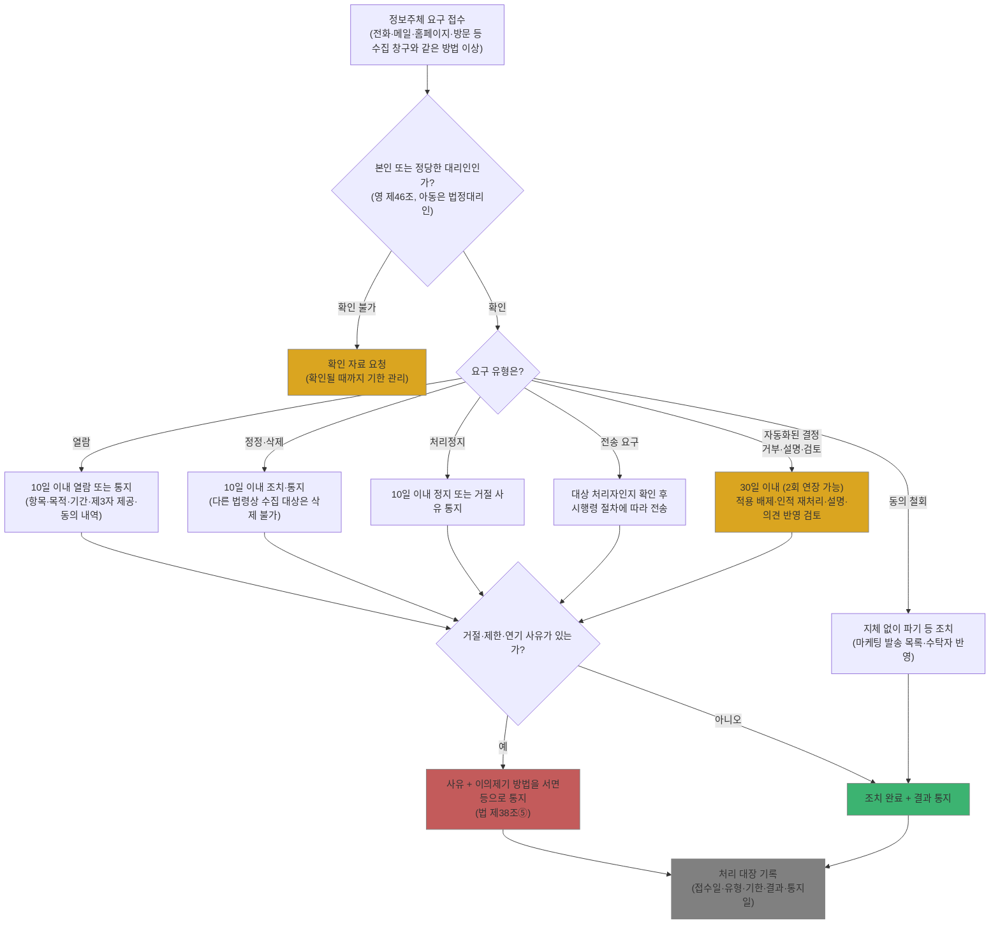

# Week 4 · Ch02. 정보주체 권리 행사 대응

> [← 이전 챕터](./ch01_breach_response.md) · [📚 전체 목차](../../README.md) · [다음 챕터 →](./ch03_cross_border_cloud_saas.md)

| 항목 | 내용 |
|---|---|
| 예상 학습 시간 | 90분 (실습 포함) |
| 법령 기준일 | 2026-11-17 |
| 핵심 근거 | 개인정보 보호법 제4조, 제35조~제38조 / 시행령 제41조~제47조 / 표준지침 제31조~제34조 / 자동화된 결정에 대한 정보주체의 권리 안내서(2024. 9.) |
| 관련 용어 | [열람](../../glossary.md#열람), [정정·삭제](../../glossary.md#정정삭제), [처리정지](../../glossary.md#처리정지), [동의 철회](../../glossary.md#동의-철회), [전송요구권](../../glossary.md#전송요구권), [자동화된 결정](../../glossary.md#자동화된-결정), [법정대리인 동의](../../glossary.md#법정대리인-동의) |
| 선수 챕터 | [W1-ch04 원칙과 의무](../week1/ch04_principles_and_duties.md) (제4조 권리), [W2-ch04 아동](../week2/ch04_children_under_14.md) |

---

## 1. 학습 목표

이 챕터를 마치면 담당자님은 다음을 할 수 있습니다.

1. 열람·정정·삭제·처리정지·동의 철회·**전송요구**·**자동화된 결정 거부·설명 요구**의 요건과 **처리 기한(10일 / 30일)**을 구분할 수 있다.
2. 요구를 **거절·제한·연기할 수 있는 사유**와 그때 알려야 할 내용을 확인할 수 있다.
3. 정보주체 민원에 대한 **답변서**를 법정 기한 안에 작성할 수 있다.

---

## 2. 한 줄 비유

> 💡 **정보주체의 권리는 "은행 계좌 주인의 권리"와 같습니다. 잔액과 거래내역을 볼 수 있고(열람), 틀린 내역을 고치라고 할 수 있고(정정), 계좌를 닫을 수 있고(삭제·처리정지), 다른 은행으로 옮길 수 있습니다(전송). 기계가 대출을 거절했다면 사람이 다시 봐 달라고 요구할 수도 있습니다(자동화된 결정 거부·설명).**

단, 비유의 한계가 있습니다. 은행 계좌와 달리 개인정보는 회사가 **다른 법령 때문에 남겨야 하는 경우**가 있어, 삭제 요구를 그대로 들어줄 수 없을 때가 있습니다. 그때도 **거절 사유와 이의제기 방법**을 알려야 합니다.

---

## 3. 개념 설명 및 법령 조문

### 3-1. 권리별 한눈에 보기

| 권리 | 근거 | 처리 기한 | 거절·제한 사유 (요지) |
|---|---|---|---|
| **열람** (사본 발급 포함) | 법 제35조, 영 제41조·제42조 | 요구를 받은 날부터 **10일 이내** (정당한 사유가 있으면 사유를 알리고 연기, 사유 소멸 시 지체 없이) | 법률상 금지·제한, 타인의 생명·신체·재산 등 이익을 부당하게 침해할 우려, 공공기관의 특정 업무(조세, 성적 평가, 시험·채용, 진행 중 감사·조사 등) |
| **정정·삭제** | 법 제36조, 영 제43조 | 요구를 받은 날부터 **10일 이내** 조치 결과 통지 | **다른 법령에서 수집 대상으로 명시**한 개인정보는 삭제 요구 불가 |
| **처리정지·동의 철회** | 법 제37조, 영 제44조 | 처리정지: 요구를 받은 날부터 **10일 이내** / 동의 철회: **지체 없이** 파기 등 조치 | 법률상 의무 준수에 불가피, 타인의 생명·신체·재산 등 이익 침해 우려, 계약 이행이 곤란해지는 경우 등 (법 제37조제2항 각 호) |
| **전송 요구** | 법 제35조의2, 영 제42조의2~제42조의8 | 시행령이 정한 기한·방법 (요구 대상 처리자는 매출액·처리 규모 등 기준 해당자) | 본인 여부 미확인 등 시행령 사유 |
| **자동화된 결정 거부·설명·검토 요구** | 법 제37조의2, 영 제44조의2~제44조의4 | 요구를 받은 날부터 **30일 이내** (정당한 사유 시 **30일씩 2회** 연장 가능) | 타인의 생명·신체·재산 등 이익을 부당하게 침해할 우려 등 정당한 사유 |

근거 원문은 각주를 참고하세요.[^law-35-37] [^decree-41-44]

> 💡 **공통 절차 (법 제38조)**: ① 권리 행사(열람등요구)는 **대리인**을 통해서도 할 수 있습니다. ② **만 14세 미만 아동의 법정대리인**은 아동의 열람등요구를 할 수 있습니다. ③ 처리자는 시행령에 따라 수수료·우송료를 청구할 수 있습니다. ④ 처리자는 권리 행사 방법과 절차를 마련해 **공개**해야 하고, 그 방법은 **수집 방법과 절차보다 어렵지 않아야** 합니다. ⑤ 거절 등에 불복하면 **이의를 제기할 수 있는 절차**를 마련하고 안내해야 합니다.[^law-38] 처리자는 요구한 사람이 **본인 또는 정당한 대리인인지 확인**해야 합니다(영 제46조).[^decree-46]

### 3-2. 관련 조문

> 📌 **조문 주소 읽는 법**: 조 → 항(①②) → 호(1. 2.) → 목(가. 나.). 자세한 설명은 [W1-ch01 3-2](../week1/ch01_what_is_personal_info.md#3-2-관련-조문)를 보세요.

#### 📜 개인정보 보호법 제35조 + 시행령 제41조 (열람)

| 구분 | 내용 |
|---|---|
| **원문 요지** | (법 제35조) ① 정보주체는 자신의 개인정보 **열람**을 요구할 수 있다. ③ 처리자는 시행령 기간 내에 열람하게 해야 하며, 정당한 사유가 있으면 사유를 알리고 **연기**할 수 있다. ④ 법률상 금지·제한, 타인의 이익 침해 우려 등이 있으면 사유를 알리고 **제한·거절**할 수 있다. (영 제41조) ① 열람할 수 있는 사항: 1. 개인정보의 **항목 및 내용** 2. 수집·이용 **목적** 3. **보유 및 이용 기간** 4. **제3자 제공 현황** 5. 처리에 **동의한 사실 및 내용**. ② 열람 방법은 **수집 방법보다 어렵지 않게**: 서면·전화·전자우편·인터넷 등 쉽게 활용할 수 있는 방법, 최소한 **수집한 창구·방법과 동일**하게 요구할 수 있게, 홈페이지 운영자는 **홈페이지에 방법과 절차를 공개**. ④ 기간은 **10일**. ⑤ 10일 이내 열람하게 하거나 일부만 열람하게 할 때는 열람통지서로 알린다(즉시 열람하면 생략 가능). |
| **쉬운 풀이** | 고객이 "내 정보 보여 주세요"라고 하면, **무엇을, 왜, 언제까지, 누구에게 줬고, 무엇에 동의했는지**까지 10일 안에 보여 줘야 합니다. |
| **실무 포인트** | 메타는 "처리 기간, 제3자 제공 현황, 동의 내역"이 열람 대상이 아니라며 거절했다가 처분을 받았습니다(6절). 위 5가지는 **시행령이 명시한 열람 대상**입니다. |

근거 원문은 각주를 참고하세요.[^law-35-37] [^decree-41-44]

#### 📜 개인정보 보호법 제36조 (정정·삭제)

| 구분 | 내용 |
|---|---|
| **원문 요지** | ① 자신의 개인정보를 열람한 정보주체는 정정 또는 삭제를 요구할 수 있다. 다만 **다른 법령에서 그 개인정보가 수집 대상으로 명시**되어 있으면 삭제를 요구할 수 없다. ② 처리자는 다른 법령에 특별한 절차가 없으면 **지체 없이 조사**해 필요한 조치를 하고 결과를 알려야 한다. |
| **시행령** | 영 제43조: 요구를 받은 날부터 **10일 이내** 조치 결과를 알림 |
| **실무 포인트** | 정정·삭제 요구를 받고 조치하지 않은 채 **계속 이용하거나 제3자에게 제공**하면 형사처벌 대상입니다(법 제73조제1항제1호). 조치하지 않는 것 자체도 과태료 대상입니다(법 제75조제2항제22호). |

근거 원문은 각주를 참고하세요.[^law-35-37]

#### 📜 개인정보 보호법 제37조 (처리정지·동의 철회)

| 구분 | 내용 |
|---|---|
| **원문 요지** | ① 정보주체는 처리의 **정지**를 요구하거나 **동의를 철회**할 수 있다. ② 처리정지 요구를 받으면 지체 없이 전부 또는 일부를 정지해야 한다. 단, 법률 규정·법령상 의무, 타인의 생명·신체·재산 등 이익 침해 우려 등 각 호 사유가 있으면 거절할 수 있다. ③ 동의를 철회하면 **지체 없이 복구·재생할 수 없도록 파기**하는 등 필요한 조치를 해야 한다(제2항 각 호에 해당하면 예외). ④ 거절하거나 조치를 하지 않으면 **지체 없이 사유를 알려야** 한다. |
| **실무 포인트** | 마케팅 수신 동의 철회는 **가장 흔한 요구**입니다. 철회 즉시 발송 목록에서 빠지도록 **시스템 연동**(광고 발송 시스템, 수탁 발송업체)을 확인하세요. |

근거 원문은 각주를 참고하세요.[^law-35-37]

#### 📜 개인정보 보호법 제35조의2 (개인정보의 전송 요구)

| 구분 | 내용 |
|---|---|
| **원문 요지** | ① 정보주체는 시행령 기준에 해당하는 처리자에게 **자신에게로** 전송을 요구할 수 있다. 대상 정보: 동의 또는 계약 이행 근거로 처리되는 본인 정보 등, **분석·가공해 별도로 생성한 정보가 아닐 것**, **컴퓨터 등으로 처리**되는 정보일 것. ② 일정 기준 처리자에게는 **개인정보관리 전문기관** 등 **제3자에게** 전송을 요구할 수 있다. ③ 시간·비용·기술적으로 허용되는 합리적 범위에서 **컴퓨터로 처리 가능한 형태**로 전송해야 한다. ⑤ 정보주체는 전송 요구를 **철회**할 수 있다. ⑥ 본인 여부 미확인 등 시행령 사유가 있으면 거절·중단할 수 있다. |
| **대상 처리자** (영 제42조의2제1항, 2026. 2. 19. 신설) | 본인 대상 전송: 평균매출액등 **1,800억 원 초과**이면서 **민감·고유식별정보 5만 명 이상** 또는 **개인정보 100만 명 이상** 처리자(각급 학교·의료기관 제외, 인원은 전년도 말 기준 직전 3개월 일일평균), 공공시스템운영기관, 제3자 전송 대상 처리자 등 |
| **실무 포인트** | 우리 회사가 대상 처리자인지 **매출액과 처리 인원**으로 먼저 확인하세요. 처리방침 작성지침은 전송 요구 현황을 **개인정보전송지원플랫폼(온마이데이터)**에서 확인할 수 있다고 안내합니다.[^policy-p68] ⚠️ 전송 기한·방법 등 세부는 영 제42조의5~제42조의8 원문을 확인하세요. |

근거 원문은 각주를 참고하세요.[^law-35-2] [^decree-42-2]

#### 📜 개인정보 보호법 제37조의2 + 시행령 제44조의2~제44조의4 (자동화된 결정)

| 구분 | 내용 |
|---|---|
| **원문 요지** | (법) ① **완전히 자동화된 시스템**(인공지능기술을 적용한 시스템 포함)으로 개인정보를 처리해 이루어지는 결정이 자신의 권리·의무에 **중대한 영향**을 미치면 **거부**할 수 있다. 단, 제15조제1항제1호(동의)·제2호(법률)·제4호(계약)에 따라 이루어지는 경우는 거부권이 없다. ② 자동화된 결정에 대해 **설명 등을 요구**할 수 있다. ③ 처리자는 정당한 사유가 없으면 결정을 적용하지 않거나 **인적 개입에 의한 재처리·설명** 등 조치를 해야 한다. ④ 결정의 **기준과 절차, 처리 방식**을 정보주체가 쉽게 확인할 수 있도록 **공개**해야 한다. (영) 설명 요구 시 **결과, 사용된 주요 개인정보 유형, 그 유형이 미친 영향 등 주요 기준, 처리 과정**을 담은 간결하고 의미 있는 설명 제공. 의견을 제출하면 **반영 여부 검토** 후 결과 통지. **30일 이내**(2회 연장 가능). 공개 사항: 자동화된 결정의 사실·목적·대상 범위, 주요 개인정보 유형, 고려사항·처리 절차, 민감정보·아동 정보 처리 시 목적·항목, 거부·설명 요구 방법 |
| **"완전히 자동화"의 판단** | 안내서: 결정을 **변경할 권한을 가진 사람의 실질적이고 의미 있는 인적 개입**이 없어야 합니다. 권한 없는 사람이나 능력이 없는 사람의 **형식적 개입**, 시스템 결정을 **기계적으로 적용**하는 것은 인적 개입이 아닙니다. 예: 서류심사·적성검사 단계를 AI가 자동으로 탈락 처리하면 해당, 권한 있는 인사위원회가 AI 결과를 참고해 실질적으로 최종 결정하면 해당하지 않음.[^auto-p8] |
| **"중대한 영향"의 판단** | 안내서: 생명·신체의 안전 관련 여부, 권리의 박탈 등 여부 등을 고려 (안내서 PDF p.6) |
| **시행일** | 법 제37조의2 [본조신설 2023. 3. 14.], 영 제44조의2~4 [본조신설 2024. 3. 12.]. 🕒 "인공지능기술을 적용한 시스템을 포함한다" 문구는 2026. 9. 8. 개정, **2027. 3. 9. 시행 예정** |

근거 원문은 각주를 참고하세요.[^law-37-2] [^decree-44-2]

---

## 4. 사내 실무 적용

### 🎭 상황극 1. 고객센터의 "탈퇴한 고객이 자기 정보 전부 지우라는데, 주문 기록도 지워야 하나요?"

> **📨 고객센터 류 파트장**: "작년에 탈퇴한 고객이 메일로 **'내 정보 다 지우고, 지금까지 누구한테 내 정보 줬는지도 알려 달라'**고 했어요. 주문 기록은 법 때문에 5년 보관한다고 들었는데, 그것도 지워야 하나요? 그리고 답은 언제까지 해야 하죠?"

**🙋 담당자 답변**

| 구분 | 내용 |
|---|---|
| **결론** | ⚠️ **일부 수용 + 일부 거절** — **제3자 제공 현황 열람**은 응해야 합니다. 삭제는 법정 보존 대상(주문·결제 기록 등)은 거절할 수 있고, 그 외 남아 있는 정보는 삭제합니다. **모두 10일 이내**에 결과와 거절 사유, **이의제기 방법**을 알려야 합니다. |
| **근거** | 개인정보 보호법 제35조(열람), 영 제41조제1항제4호(제3자 제공 현황은 열람 대상), 제41조제4항(10일), 법 제36조제1항 단서(다른 법령에서 수집 대상으로 명시된 정보는 삭제 요구 불가), 영 제43조(10일), 법 제38조제5항(이의제기 절차), 영 제46조(본인 확인) |
| **다음 행동** | ① 요구자가 **본인인지 확인**합니다(가입 시 이메일·휴대전화 인증 등). ② 접수일을 기록하고 **10일 기한**을 계산합니다. ③ 해당 고객의 남은 정보를 전수 조회합니다(분리 보관 DB, 상담 기록, 마케팅 발송 목록, 수탁자 보유분). ④ **제3자 제공 내역**을 정리합니다(제공받은 자, 목적, 항목, 일자). ⑤ 법정 보존 정보(주문·결제 기록 등)는 **근거 법령과 보존 기간**을 알리고 기간 경과 시 파기한다고 안내합니다. ⑥ 그 외 정보는 삭제하고 수탁자에게도 삭제를 요청합니다. ⑦ 답변서에 **이의제기 방법**을 넣습니다(실습 Q4). |

**왜 그런가요?** 열람 대상 5가지(영 제41조제1항)에 "제3자 제공 현황"이 명시되어 있습니다. 삭제는 법 제36조제1항 단서의 예외가 있지만, 그때도 거절 **사유를 알리는 것**까지가 의무입니다. 탈퇴 후 분리 보관 중인 정보도 **열람 대상**입니다 → [W2-ch05](../week2/ch05_retention_and_destruction.md)

### 🎭 상황극 2. 인사팀의 "AI 서류심사 탈락자가 이유를 설명하래요"

> **📨 인사팀 소 대리**: "올해부터 **AI가 서류를 자동 채점해서 하위 70%는 자동 불합격** 처리했는데, 탈락자 한 명이 '왜 떨어졌는지 설명하고, 사람이 다시 봐 달라'고 해요. AI 판단이라 우리도 정확한 이유는 모르는데 어떻게 답하죠?"

**🙋 담당자 답변**

| 구분 | 내용 |
|---|---|
| **결론** | ⚠️ **응해야 합니다** — 사람의 실질적 개입 없이 AI가 자동으로 불합격 처리했다면 **자동화된 결정**입니다. 지원자는 **설명**과 **거부(인적 재처리)**를 요구할 수 있습니다. **30일 이내**에 조치하고 결과를 알려야 합니다. |
| **근거** | 개인정보 보호법 제37조의2제1항~제4항, 시행령 제44조의2(설명·검토 요구), 제44조의3제1항(거부 시 적용 배제 또는 인적 개입 재처리), 제2항(설명 내용), 제5항(30일), 제44조의4(사전 공개), 자동화된 결정 안내서(AI 채용 서류심사 예시) |
| **다음 행동** | ① AI 공급업체에서 **결정에 사용된 주요 개인정보 유형과 영향(주요 기준)**에 대한 설명 자료를 받습니다. ② 지원자에게 **결과, 사용된 주요 정보 유형, 주요 기준, 처리 절차**를 담은 **간결하고 의미 있는 설명**을 제공합니다. ③ 거부(재심사) 요구에는 **권한 있는 사람이 실질적으로** 서류를 다시 검토하고 결과를 알립니다. ④ 채용 공고·처리방침에 **자동화된 결정 사실, 목적, 대상, 주요 기준, 거부·설명 요구 방법**이 공개되어 있는지 확인하고, 없으면 보완합니다(영 제44조의4). ⑤ 다음 채용부터는 AI 결과를 **사람이 실질적으로 검토**하는 단계를 둘지 검토합니다. |

**왜 그런가요?** "AI라서 우리도 모른다"는 답은 설명 의무를 이행한 것이 아닙니다. 안내서는 AI 채용에서 **서류심사·적성검사 단계만 자동화된 결정**이 이루어지고 면접은 사람이 하는 경우에도, 자동 단계는 자동화된 결정에 **해당**한다고 설명합니다.[^auto-p12] ⚠️ 채용 시 동의(제15조제1항제1호)나 계약 체결 과정(제4호)에 근거한 결정이면 **거부권**은 제한될 수 있지만, **설명 요구권**은 남습니다. 구체적 판단은 안내서를 확인하세요.

---

## 5. 권리 행사 요구 처리 플로우

**그림 읽는 법**: 먼저 **본인 확인**, 다음으로 **요구 유형별 기한**(대부분 10일, 자동화된 결정은 30일, 동의 철회는 지체 없이)을 적용합니다. 거절할 때도 적색 칸처럼 **사유와 이의제기 방법**을 알리는 것이 의무입니다. 모든 요구는 **처리 대장**에 남깁니다.

---

## 6. 개인정보보호위원회 처분 사례

### ⚖️ 사례: 메타의 정당한 사유 없는 열람 거절 (2024. 11. 의결) + 테무의 7단계 탈퇴 절차 (2025. 5. 의결) — "권리 행사" 관점

| 단계 | 내용 |
|---|---|
| **사건 개요 (메타)** | 이용자가 개인정보 **열람**을 요구하면서 ① 개인정보를 처리한 **기간**, ② 페이스북 로그인을 통한 **개인정보 제공 현황**, ③ 페이스북 외부활동 정보 **수집 근거 및 동의 내역** 등을 요청했습니다. 메타는 "보호법상 열람 요구 대상이 아니다" 등의 이유로 거절했습니다. 위원회는 시행령 제41조제1항이 **제3호 보유 및 이용 기간, 제4호 제3자 제공 현황, 제5호 처리에 동의한 사실 및 내용**을 열람 대상으로 정하고 있으므로, 거절에 **정당한 사유가 없다**고 판단했습니다. |
| **사건 개요 (테무)** | 테무는 **회원 탈퇴 절차를 7단계로 복잡하게** 구현해 이용자의 권리 행사를 어렵게 했습니다. 조사 과정에서 탈퇴 절차를 일부 개선했습니다. |
| **위반 조항** | 메타: 개인정보의 열람 **舊 §35③** (+ 민감정보 §23①, 안전조치 §29) / 테무: 권리행사의 방법 및 절차 **§38④** (+ 국외이전, 국내대리인, 위탁 등) |
| **처분 결과** | 메타: 과징금 216억 1,300만 원, 과태료 1,020만 원, 시정명령("이용자의 개인정보 **열람 요구에 대해 성실히 응할 것**" 포함) / 테무: 과징금 13억 6,900만 원, 과태료 1,760만 원, 시정명령·개선권고("정보주체의 권리를 충분히 보장할 것") |
| **교훈** | ① 열람 대상은 회사가 정하는 것이 아니라 **시행령 제41조제1항**이 정합니다. "그건 열람 대상이 아니에요"라고 답하기 전에 5가지 목록을 확인하세요. ② 권리 행사 절차가 **가입보다 어려우면** 그 자체로 위반입니다(법 제38조제4항). 탈퇴·철회 단계 수를 세어 보세요. ③ 해외 글로벌 사업자도 같은 기준이 적용됩니다. |
| **출처** | 개인정보보호위원회 보도자료, 「개인정보위, 합법 처리근거 없이 민감정보를 수집·활용한 메타 제재」(2024. 11. 4. 의결)[^case-meta] / 「국외이전 규정 등 개인정보 보호법 위반한 테무에 13억 6,900만 원 과징금 부과」(2025. 5. 14. 의결)[^case-temu] |

> 💬 **사수의 한마디**: 우리 회사 홈페이지에서 **가입에 몇 번 클릭**하는지, **탈퇴와 마케팅 동의 철회에 몇 번 클릭**하는지 직접 세어 보세요. 탈퇴·철회 쪽이 더 많다면 법 제38조제4항을 근거로 개선을 요청할 수 있습니다.

---

## 7. 오답노트

| # | ❌ 잘못된 생각 | ✅ 올바른 이해 | 근거 조문 |
|---|---|---|---|
| 1 | "열람은 지금 저장된 이름·연락처만 보여 주면 돼요." | 열람 대상은 **항목·내용, 목적, 보유기간, 제3자 제공 현황, 동의 사실·내용** 5가지입니다. 메타는 이 중 일부를 거절했다가 처분을 받았습니다. | 영 제41조제1항, 법 제35조 |
| 2 | "열람 요구는 한 달 안에만 답하면 돼요." | 열람·정정·삭제·처리정지는 **10일 이내**입니다. 30일은 **자동화된 결정** 거부·설명 요구의 기한입니다. | 영 제41조제4항, 제43조, 제44조, 제44조의3제5항 |
| 3 | "법 때문에 보관하는 정보라서 삭제 요구는 그냥 무시해도 돼요." | 삭제를 거절할 수는 있지만 **사유와 이의제기 방법을 알려야** 합니다. 법정 보존 대상이 아닌 나머지 정보는 삭제해야 합니다. | 법 제36조제1항 단서, 제38조제5항 |
| 4 | "전화로 요구하면 본인 확인이 어려우니 서면으로만 받을게요." | 열람 방법은 **수집 방법보다 어렵지 않게**, 최소한 **수집한 창구·방법과 동일**하게 마련해야 합니다. 본인 확인 방법을 정해 다양한 창구로 받으세요. | 법 제38조제4항, 영 제41조제2항 |
| 5 | "AI가 결정한 거라 설명할 수 없어요." | 완전히 자동화된 결정이면 **결과, 주요 개인정보 유형, 주요 기준, 처리 절차**를 담은 설명을 제공해야 합니다. 공급업체에서 설명 자료를 확보해 두세요. | 법 제37조의2제2항, 영 제44조의3제2항 |
| 6 | "부모라고 하는 사람이 자녀 정보 열람을 요구하면 바로 보여 줘야죠." | 만 14세 미만 아동의 법정대리인은 열람등요구를 할 수 있지만, **정당한 대리인인지 확인**해야 합니다. 14세 이상 미성년자는 본인이 직접 또는 법정대리인을 통해 행사합니다. | 법 제38조제2항, 영 제46조, 작성지침 p.68 |

---

## 8. 업무 체크리스트

**📋 정보주체 권리 행사 대응 체계 점검표**

| 점검 주기 | 반기 1회 + 민원 발생 시 | 점검자 | 개인정보보호 담당자 + 고객센터 | 점검일 | ____-__-__ |
|---|---|---|---|---|---|

- [ ] 홈페이지·처리방침에 열람·정정·삭제·처리정지·동의 철회·**전송**·**자동화된 결정** 거부·설명 요구 **방법과 절차**가 공개되어 있다 (법 제38조제4항, 영 제41조제2항)
- [ ] 권리 행사 창구가 **수집 창구보다 어렵지 않다** (탈퇴·철회 클릭 수 ≤ 가입 클릭 수)
- [ ] **본인·대리인 확인 방법**(위임장, 법정대리인 확인 서류 등)이 정해져 있다 (영 제46조)
- [ ] 요구 유형별 **처리 기한**(10일 / 30일 / 지체 없이)을 관리하는 **처리 대장**이 있다
- [ ] 열람 응답 양식에 **5가지 열람 대상**이 모두 들어 있다 (영 제41조제1항)
- [ ] **분리 보관 DB, 상담 기록, 마케팅 목록, 수탁자 보유분**까지 조회·조치하는 절차가 있다
- [ ] 거절·제한·연기 시 **사유와 이의제기 방법**을 서면등으로 알리는 양식이 있다 (법 제38조제5항)
- [ ] 동의 철회 시 광고 발송 시스템·수탁 발송업체에 **즉시 반영**된다 (법 제37조제3항)
- [ ] 우리 회사가 **전송요구권 대상 처리자**인지 확인했다 (영 제42조의2)
- [ ] 자동화된 결정(AI 채용, 자동 심사, 자동 계정 정지 등)이 있으면 **기준·절차를 사전 공개**하고 설명 자료를 확보했다 (영 제44조의4)

---

## 9. 실습 과제 / 퀴즈

### 객관식

**Q1.** 시행령 제41조제1항에 따라 정보주체가 **열람을 요구할 수 있는 사항이 아닌 것**은?

1. 개인정보의 제3자 제공 현황
2. 개인정보 처리에 동의한 사실 및 내용
3. 개인정보의 보유 및 이용 기간
4. 회사 내부 개인정보 보호 감사 보고서 전문

**Q2.** 처리 기한이 **나머지와 다른 것**은?

1. 열람 요구
2. 정정·삭제 요구
3. 처리정지 요구
4. 자동화된 결정에 대한 설명 요구

**Q3.** 다음 중 개인정보 보호법 제38조에 비추어 **옳지 않은 것**은?

1. 정보주체는 대리인을 통해 열람등요구를 할 수 있다.
2. 만 14세 미만 아동의 법정대리인은 아동의 열람등요구를 할 수 있다.
3. 열람등요구의 방법과 절차는 수집 방법과 절차보다 어렵게 해도 된다.
4. 거절 등 조치에 불복하는 경우 이의를 제기할 수 있는 절차를 마련하고 안내해야 한다.

### 🛠️ 실습: 권리 행사 민원 답변서 작성

**Q4.** 아래 민원에 대한 **답변서**를 작성하세요. 답변서에는 요구별 조치 결과, 거절 시 사유와 근거, **이의제기 방법**, 담당부서 연락처가 들어가야 합니다.

> **민원 (2026. 11. 16.(월) 접수, 홈페이지 1:1 문의, 본인 인증 완료)**
> "안녕하세요. 3년 전에 가입했다가 작년에 탈퇴한 회원 김○○입니다.
> 1) 지금 회사가 제 정보를 무엇을 가지고 있는지, 누구한테 줬는지 알려 주세요.
> 2) 제 정보를 전부 삭제해 주세요.
> 3) 아직도 광고 문자가 와요. 당장 멈춰 주세요."

> **회사 내부 확인 결과**
> - 분리 보관 DB: 주문·결제 기록 2건(2024년), 소비자 불만 상담 기록 1건(2025년)
> - 마케팅 발송 목록: 탈퇴 시 삭제 누락으로 **휴대전화번호가 남아 있음** (수탁 발송업체 ㈜M문자 보유)
> - 제3자 제공: 2024. 5. 이벤트 제휴사 ㈜P코스메틱에 이름·휴대전화번호 제공 (당시 제공 동의 있음)

> ✅ 다 풀었다면 [정답 및 해설](../../answers_and_explanations.md#w4-ch02)에서 확인하세요. 틀린 문제는 **7. 오답노트**에 한 줄씩 추가하세요.

---

## 10. 더 읽을거리

| 자료 | 발행 | references 파일명 | 이 챕터와의 관계 |
|---|---|---|---|
| 자동화된 결정에 대한 정보주체의 권리 안내서 | 개인정보보호위원회, 2024. 9. | `★자동화된 결정에 대한 정보주체의 권리 안내서(2024.9).pdf` | 요건(PDF p.6~13: 완전 자동화, 인적 개입, 중대한 영향), AI 채용 예시 |
| 개인정보 보호법 | 법률 제21445호 | `개인정보 보호법(법률)(제21445호)(20260911).pdf` | 제4조, 제35조~제38조, 제73조, 제75조 |
| 개인정보 보호법 시행령 | 대통령령 제36804호 | `개인정보 보호법 시행령(대통령령)(제36804호)(20261110).pdf` | 제41조~제47조 (열람·전송·정정·처리정지·자동화된 결정·대리인·본인 확인·수수료) |
| 표준 개인정보 보호지침 | 고시 제2025-4호 | `표준 개인정보 보호지침(개인정보보호위원회고시)(제2025-4호)(20250411).pdf` | 제31조~제34조 |
| 2026 개인정보 처리방침 작성지침 | 개인정보보호위원회, 2026. 4. | `2026 개인정보 처리방침 작성지침.pdf` | PDF p.67~69 권리 행사 항목 작성 예시, 전송요구, 자동화된 결정 |
| 개인정보 처리 방법에 관한 고시 (열람통지서·위임장 서식) | 개인정보보호위원회 | (references 미보유) | 서식 확인 |

---

> [← 이전 챕터](./ch01_breach_response.md) · [📚 전체 목차](../../README.md) · [📖 용어집](../../glossary.md) · [다음 챕터 →](./ch03_cross_border_cloud_saas.md)

[^law-35-37]: [출처: 개인정보 보호법(법률)(제21445호)(20260911).pdf, 제35조제1항~제5항, 제36조제1항·제2항, 제37조제1항~제4항, 제73조제1항제1호, 제75조제2항제22호]
[^decree-41-44]: [출처: 개인정보 보호법 시행령(대통령령)(제36804호)(20261110).pdf, 제41조제1항~제5항, 제42조, 제43조제3항, 제44조제2항]
[^law-38]: [출처: 개인정보 보호법(법률)(제21445호)(20260911).pdf, 제38조제1항~제5항]
[^decree-46]: [출처: 개인정보 보호법 시행령(대통령령)(제36804호)(20261110).pdf, 제46조제1항]
[^law-35-2]: [출처: 개인정보 보호법(법률)(제21445호)(20260911).pdf, 제35조의2제1항~제8항]
[^decree-42-2]: [출처: 개인정보 보호법 시행령(대통령령)(제36804호)(20261110).pdf, 제42조의2제1항 (<신설 2026. 2. 19.>)]
[^policy-p68]: [출처: 2026 개인정보 처리방침 작성지침.pdf, PDF p.68 작성 예시 (온마이데이터 OnMydata.go.kr)]
[^law-37-2]: [출처: 개인정보 보호법(법률)(제21445호)(20260911).pdf, 제37조의2제1항~제5항 (2027. 3. 9. 시행 예정 문언 포함)]
[^decree-44-2]: [출처: 개인정보 보호법 시행령(대통령령)(제36804호)(20261110).pdf, 제44조의2, 제44조의3제1항~제5항, 제44조의4제1항·제2항]
[^auto-p8]: [출처: ★자동화된 결정에 대한 정보주체의 권리 안내서(2024.9).pdf, PDF p.6 (요건 요약, 중대한 영향 고려사항), p.8~10 (완전히 자동화, 인적 개입 판단, 사례)]
[^auto-p12]: [출처: ★자동화된 결정에 대한 정보주체의 권리 안내서(2024.9).pdf, PDF p.12 AI 채용 서류심사·적성검사 단계 예시]
[^case-meta]: [출처: 241105 (석간) 개인정보위  합법 처리근거 없이 민감정보를 수집·활용한 메타 제재(조사1과).pdf, p.2 「정당한 사유 없는 개인정보 열람 거절」, p.3 위반 조항 표(§35③)·시정명령]
[^case-temu]: [출처: 250515 (석간) 국외이전 규정 등 개인정보 보호법 위반한 테무에 13억 6,900만 원 과징금 부과(조사1과).pdf, p.3 (회원 탈퇴 7단계), p.5 「붙임」 (§38④)]
