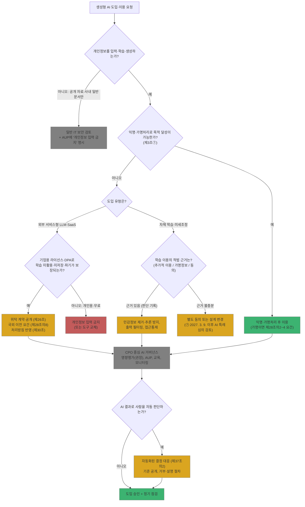

# Week 4 · Ch04. AI·생성형 AI 사내 도입 시 개인정보 이슈

> [← 이전 챕터](./ch03_cross_border_cloud_saas.md) · [📚 전체 목차](../../README.md) · [다음 챕터 →](./ch05_pseudonymized_info_basics.md)

| 항목 | 내용 |
|---|---|
| 예상 학습 시간 | 85분 (실습 포함) |
| 법령 기준일 | 2026-11-17 |
| 핵심 근거 | 개인정보 보호법 제3조, 제15조, 제23조, 제26조, 제28조의2, 제28조의8, 제29조, 제30조, 제33조, 제37조의2, 제63조의2 / 🕒 제2조제9호·제28조의12~제28조의15(2027. 3. 9. 시행 예정) / **생성형 인공지능(AI) 개발·활용을 위한 개인정보 처리 안내서(2025. 8.)** |
| 관련 용어 | [인공지능기술](../../glossary.md#인공지능기술), [자동화된 결정](../../glossary.md#자동화된-결정), [추가적 이용·제공](../../glossary.md#추가적-이용제공), [가명정보](../../glossary.md#가명정보), [국외 이전](../../glossary.md#국외-이전), [처리위탁](../../glossary.md#처리위탁), [민감정보](../../glossary.md#민감정보), [사전 실태점검](../../glossary.md#사전-실태점검), [개인정보 영향평가](../../glossary.md#개인정보-영향평가) |
| 선수 챕터 | [W2-ch01](../week2/ch01_collection_and_use.md), [W2-ch03](../week2/ch03_provision_vs_outsourcing.md), [W4-ch02](./ch02_data_subject_rights.md), [W4-ch03](./ch03_cross_border_cloud_saas.md) |

---

## 1. 학습 목표

이 챕터를 마치면 담당자님은 다음을 할 수 있습니다.

1. 사내 생성형 AI 도입 유형(**직원 업무용, 서비스형 LLM 연동, 자체 학습**)별로 걸리는 개인정보 조문을 구분할 수 있다.
2. 외부 생성형 AI 서비스의 **라이선스·약관(입력 데이터의 학습 이용, 보관, 국외 이전)**을 검토할 수 있다.
3. 사내 **생성형 AI 도입 체크리스트**와 **허용 이용방침(AUP)**의 핵심 항목을 작성할 수 있다.

---

## 2. 한 줄 비유

> 💡 **외부 생성형 AI에 고객 정보를 넣는 것은 "남의 회사 회의실 칠판에 고객 명단을 적는 것"과 같습니다. 회의가 끝나면 지워지는지, 그 회사 직원이 사진을 찍어 가는지(학습·인적 검토), 그 회의실이 어느 나라에 있는지(국외 이전)를 모르면 적으면 안 됩니다.**

단, 비유의 한계가 있습니다. 칠판과 달리 AI는 적힌 내용을 **학습해 다른 사람의 질문에 답할 때 다시 꺼낼 수도** 있습니다. 위원회 실태점검에서도 학습된 개인정보가 특정 명령어로 노출되는 취약점 사례가 소개되었습니다(6절).

---

## 3. 개념 설명 및 법령 조문

### 3-1. 사내 AI 도입 유형별 주요 이슈

| 유형 | 예시 | 핵심 질문 | 주요 조문 |
|---|---|---|---|
| **A. 직원 업무용 생성형 AI** | 직원이 챗봇에 문서 요약·메일 초안·번역을 요청 | 직원이 **고객·직원 개인정보를 입력**하면 어떻게 되나? 학습에 쓰이나? 어디에 저장되나? | 제3조(최소 처리), 제17조·제26조(외부 제공·위탁), 제28조의8(국외 이전), 제29조(안전조치) |
| **B. 서비스형 LLM 연동** | 고객 상담 챗봇, 상품 추천 문구 생성에 외부 LLM API 연결 | 업체가 입력 데이터를 **자기 목적(학습)**으로 쓰나? 위탁 계약·국외 이전 요건은? | 제26조(위탁), 제28조의8, 제30조(처리방침), 제37조의2(자동화된 결정) |
| **C. 자체 학습·미세조정** | 고객 상담 기록으로 자체 모델 미세조정, 구매 데이터로 추천 모델 개발 | 수집 목적과 **다른 목적(학습)**에 써도 되나? 가명처리? 민감정보 **추론**? | 제15조제3항(추가적 이용), 제28조의2(가명정보), 제23조(민감정보), 제33조(영향평가), 🕒 제28조의12(AI 특례, 시행 예정) |

> 💡 생성형 AI 안내서는 개발·활용 방식을 **서비스형 LLM**(상용 서비스를 API 등으로 활용), **기성 LLM 활용**(공개 모델 재학습·가공), **자체 개발**로 나누고, 서비스형 LLM 이용 시 "**전송되는 데이터의 처리 목적·범위, 보관·파기 정책 등**"을 확인하라고 안내합니다.[^genai-p23]

### 3-2. 관련 조문과 안내서 기준

> 📌 **조문 주소 읽는 법**: 조 → 항(①②) → 호(1. 2.) → 목(가. 나.). 자세한 설명은 [W1-ch01 3-2](../week1/ch01_what_is_personal_info.md#3-2-관련-조문)를 보세요.

#### 📜 서비스형 LLM 이용 시: 위탁·국외 이전·라이선스 (법 제26조, 제28조의8 + 안내서)

| 구분 | 내용 |
|---|---|
| **원문 요지** | 외부 LLM 사업자가 우리 회사의 업무(상담 응대, 문서 요약)를 대신 처리하면 **처리위탁**(제26조)이고, 해외 서버면 **국외 이전**(제28조의8)입니다. 수탁자는 위탁받은 업무 범위를 **초과해 이용·제공할 수 없습니다**(제26조제5항). |
| **안내서 기준** | 서비스형 LLM은 ▲이용자 데이터의 **보관 및 재이용(AI 학습 포함)** 여부 ▲**국외이전** 여부를 사전에 검토해야 합니다. 개인정보 저장·재이용(학습 포함) **배제 규정을 둔 기업용 API 라이선스**를 고려할 수 있습니다. 기업용 이용약관과 **데이터 처리 부속서(DPA)**로 ▲입력데이터의 **소유권** ▲**재이용 제한** ▲**안전조치** ▲**데이터 파기** 등을 명확히 하고, 필요하면 **특약**을 추가하는 것이 권장됩니다.[^genai-p27] |

**개인용 vs 기업용 라이선스 (안내서 비교표, OpenAI ChatGPT 기준, 2025. 8. 3.)**[^genai-p27]

| 구분 | 개인용 라이선스 | 기업용 API 라이선스 |
|---|---|---|
| 이용 대상 | 일반 개인 사용자 | 기업, 조직, 개발자 등 |
| 데이터 저장 | 대화기록 저장 가능(옵션 제공) | 기본적으로 입출력값 미저장 |
| AI 학습 활용 | **기본적으로 학습 활용**(opt-out 가능) | **학습 미활용(기본값)** |
| 계약 관계 | 이용약관에 따른 일반 사용자 계약 | 개별 계약(서비스 이용계약 + **DPA**) |

> ⚠️ 확인 필요: 위 비교는 안내서가 특정 서비스의 **2025. 8. 3. 기준** 약관을 정리한 것입니다. 서비스 약관은 수시로 바뀌므로 도입 시점의 최신 약관과 계약서로 다시 확인하세요.

> 💡 **위원회 결정 사례 (안내서 소개)**: 의료기관이 진료 대화로 의료기록 작성을 자동화하면서 **개인용 무료 라이선스**를 쓰면 입력 데이터가 LLM 제공자의 자체 목적(학습)으로 활용될 우려가 있었습니다. 위원회는 **기업용 라이선스(Enterprise API)**로 의료기관의 목적으로만 데이터가 처리되도록 조치하는 방안을 다뤘습니다(개인정보보호위원회 제2024-017-237호, 비공개 결정).[^genai-p27]

#### 📜 자체 학습 시: 목적 외 이용과 가명정보 (법 제15조제3항, 제28조의2)

| 구분 | 내용 |
|---|---|
| **원문 요지** | (제15조제3항) 당초 수집 목적과 **합리적으로 관련된 범위**에서 불이익 여부, 암호화 등 안전조치 등을 고려해 동의 없이 이용할 수 있다(영 제14조의2: 관련성, 예측 가능성, 부당한 침해 여부, 가명처리·암호화). (제28조의2) **통계작성, 과학적 연구, 공익적 기록보존** 등을 위해 정보주체 동의 없이 **가명정보**를 처리할 수 있다. |
| **쉬운 풀이** | 고객 데이터를 AI 학습에 쓰려면 ① 원래 목적의 연장선인지(추가적 이용) ② 가명처리해 연구 목적으로 쓸 수 있는지(가명정보) ③ 별도 동의가 필요한지를 따져야 합니다. "이미 갖고 있으니 학습에 써도 된다"는 근거가 아닙니다. |
| **실무 포인트** | 안내서는 이용자 **프롬프트 입력 내용을 AI 학습데이터로 수집·이용**할 때 이용자가 학습데이터 수집을 **항시 옵트아웃**할 수 있는 기능 등을 언급합니다(PDF p.20). 학습에 쓰면 그 사실을 **처리방침에 공개**해야 합니다(제30조). 학습 결과로 **민감정보를 추론**하면 별도 동의 등이 필요합니다(제23조, 메타 사례 → [W2-ch02](../week2/ch02_sensitive_and_unique_id.md)). |

근거 원문은 각주를 참고하세요.[^law-15-28-2] [^genai-p20]

#### 📜 🕒 인공지능기술 개발을 위한 개인정보 처리 특례 (법 제28조의12~제28조의15) — 2027. 3. 9. 시행 예정

| 구분 | 내용 |
|---|---|
| **원문 요지** | 처리자는 AI 기술 개발(성능 개선 포함)을 위해 1. 익명·가명처리로는 개발이 **어렵고** 2. 시행령 기준의 **안전장치**를 마련했고 3. 목적이 **공공의 이익** 또는 정보주체·제3자 이익 보호·사회적 이익 증진을 포함하며 침해 우려가 현저히 낮을 것을 모두 갖추고, **위원회 심의·의결**을 받으면 적법하게 수집한 개인정보를 **당초 목적 외로 이용**할 수 있다. 위원회는 민감정보·고유식별정보 처리 여부 등에 따라 **위험요인평가**를 요구할 수 있고, 이용 목적·유형은 **처리방침에 포함**해야 하며, 위원회는 심의 내용을 공개한다. 심의·의결을 거쳐 제18조~제20조, 제23조, 제24조, 제24조의2 등 일부 조항의 **적용을 제외**할 수 있다. |
| **쉬운 풀이** | 2027. 3. 9.부터 **위원회의 사전 심의를 거치는** AI 학습 특례가 생깁니다. 회사가 스스로 판단해서 쓰는 제도가 아니라 **신청 → 심의·의결 → 조건 이행 → 관리·감독**의 절차입니다. |
| **실무 포인트** | 2026-11-17 현재는 **시행 전**입니다. 지금은 기존 규정(추가적 이용, 가명정보, 동의 등)으로 판단해야 합니다. 시행령의 세부 기준(안전장치, 심의 절차)은 아직 references에 없습니다. |

근거 원문은 각주를 참고하세요.[^law-28-12]

#### 📜 AI 결과로 사람을 판단하면: 자동화된 결정 (법 제37조의2)

AI가 사람의 실질적 개입 없이 **채용 탈락, 대출 거절, 계정 정지** 등을 결정하면 정보주체는 거부·설명을 요구할 수 있습니다. 2027. 3. 9.부터는 "인공지능기술을 적용한 시스템을 포함한다"는 문구가 명시됩니다. 자세한 내용은 [W4-ch02](./ch02_data_subject_rights.md)를 보세요.

### 3-3. AI 프라이버시 거버넌스와 영향평가 (안내서)

| 항목 | 안내서 내용 |
|---|---|
| **거버넌스** | 전사적 내부 관리체계로 생성형 AI의 목적 설정부터 적용·관리까지 전체 프로세스를 관리·감독. **CPO 중심**으로 구성하고, 개발·보안 등 유관 부서와 협력해 **AI 개발·활용 초기부터 참여**. 역할: AI 프라이버시 리스크 관리 정책 마련·문서화, 취약성 상시 모니터링·평가·보고, 정보주체 권리행사 대응 등 (PDF p.14) |
| **단계별 고려사항** | ① 목적 설정: 목적 구체화, 적법 근거 확보(수집 출처별 검토) ② 전략 수립: **PbD(개인정보 안심설계)**, **영향평가**, 개발·활용 방식별 유의사항 ③ 학습·개발: 데이터 출처 검증, 전처리, 가명·익명처리, 미세조정·정렬 등 안전장치 ④ 적용·관리: 배포 전 테스트·문서화, **허용 이용방침(AUP)** 작성·공개, **접근 권한 통제, 입출력 필터링**, 침해 신고 기능, 권리 보장 (PDF p.14) |
| **영향평가** | 민간은 침해 우려 시 영향평가를 하도록 **적극 노력**해야 하고(법 제33조제11항), 생성형 AI 개발·운영 시 영향평가가 권장됩니다. 침해요인 분석에 AI 고유 리스크(**개인정보 추론 생성, 학습데이터 복원, 프롬프트 인젝션** 등)를 포함합니다. 자율 영향평가 결과는 과태료·과징금 감경 시 증빙이 될 수 있다고 안내합니다 (PDF p.24~26) |

근거 원문은 각주를 참고하세요.[^genai-p14] [^genai-p24]

> ⚠️ 확인 필요: 생성형 AI 안내서 각주는 「개인정보 영향평가 수행안내서」를 "'25. 8., AI 분야 평가항목 등 신설"로 인용하지만, references에 있는 수행안내서는 **2025. 10. 개정판**입니다. 최신판인 references 파일을 기준으로 확인하세요.

---

## 4. 사내 실무 적용

### 🎭 상황극 1. 고객센터의 "상담 내용 요약에 무료 챗봇 쓰면 일이 반으로 줄어요"

> **📨 고객센터 우 상담원**: "고객 통화를 받고 나서 **상담 내용(고객 이름, 주문번호, 주소, 불만 내용)을 무료 AI 챗봇에 붙여 넣고** 요약해 달라고 하면 기록 작성 시간이 엄청 줄어요. 다들 개인 계정으로 쓰고 있는데 괜찮죠?"

**🙋 담당자 답변**

| 구분 | 내용 |
|---|---|
| **결론** | ❌ **개인 계정·무료 버전에 고객 정보를 넣는 것은 즉시 중단** — 개인용 라이선스는 입력 데이터가 **기본적으로 학습에 활용**될 수 있고, 회사와 AI 사업자 사이에 **위탁 계약도 국외 이전 요건도 없는** 상태입니다. 회사가 승인한 **기업용 서비스**로 바꾸고 이용 수칙을 정해야 합니다. |
| **근거** | 개인정보 보호법 제26조(위탁 문서·공개·감독 없음), 제28조의8(국외 이전 요건 미충족 가능성), 제29조(안전조치), 제3조제1항·제7항(최소 처리, 익명·가명 우선), 생성형 AI 안내서 PDF p.27(개인용 vs 기업용 라이선스) |
| **다음 행동** | ① 개인 계정 사용을 **중단**하도록 공지합니다. ② 이미 입력된 데이터는 해당 서비스의 대화 기록 삭제·학습 옵트아웃 기능으로 정리하도록 안내하고, 입력 규모를 파악합니다. ⚠️ 이미 입력한 것이 유출등에 해당하는지는 서비스 약관과 입력 범위를 보고 판단합니다 → [W4-ch01](./ch01_breach_response.md) ③ 회사 차원에서 **기업용 라이선스**(학습 미활용, DPA 체결)를 검토하고, 위탁·국외 이전 절차를 밟습니다 → [W4-ch03](./ch03_cross_border_cloud_saas.md) ④ **허용 이용방침(AUP)**을 만듭니다: 입력 금지 정보(주민등록번호, 카드번호, 건강 정보 등), 입력 전 **이름·연락처 가리기**, 승인된 도구만 사용. ⑤ 취급자 교육에 AI 이용 수칙을 넣습니다. |

**왜 그런가요?** 위원회의 2024. 3. 실태점검에서 한 AI 서비스의 이용자 입력 데이터를 일주일간 분석했더니 **전화번호 672건, 이메일 142건, 여권번호 34건, 주민등록번호 2건** 등이 들어 있었습니다.[^case-ai-2024-3] 직원 한 명의 편의가 회사 전체의 위탁·국외 이전 위반이 될 수 있습니다.

### 🎭 상황극 2. 데이터팀의 "고객 상담 기록으로 우리 AI 챗봇을 학습시킬게요"

> **📨 데이터팀 맹 책임**: "3년치 **고객 상담 기록**(이름, 연락처, 주문, 상담 내용)으로 **자체 상담 챗봇을 미세조정**하려고요. 우리가 수집한 데이터니까 바로 써도 되죠? 처리방침에 '서비스 개선'이라고 써 있잖아요."

**🙋 담당자 답변**

| 구분 | 내용 |
|---|---|
| **결론** | ⚠️ **조건부 가능 (설계 변경 필요)** — "서비스 개선"이라는 포괄 문구만으로 원문 상담 기록 전체를 AI 학습에 쓰기는 어렵습니다. **익명·가명처리**를 먼저 검토하고, 적법 근거(추가적 이용 판단, 가명정보, 동의 등)와 **처리방침 공개**, **영향평가**를 갖춰야 합니다. |
| **근거** | 개인정보 보호법 제3조제7항(익명 > 가명 > 실명), 제15조제3항·영 제14조의2(추가적 이용 4가지 고려사항), 제28조의2(가명정보: 통계·과학적 연구 등), 제23조(민감정보 포함·추론 여부), 제30조(처리방침), 제33조제11항(민간 영향평가 노력), 생성형 AI 안내서 PDF p.14·p.24~26 |
| **다음 행동** | ① 학습 목적에 **이름·연락처가 필요한지** 확인합니다. 대부분 필요 없으므로 **삭제·대체(가명처리)**합니다. 상담 내용 속 개인정보도 마스킹합니다. ② 상담 기록에 **건강·장애 등 민감정보**가 섞였는지 확인하고 제거합니다. ③ 남는 처리에 대해 **적법 근거**를 정하고 판단 기록을 남깁니다(추가적 이용이면 4가지 고려사항, 가명정보면 처리 목적·안전조치 → [W4-ch05](./ch05_pseudonymized_info_basics.md)). ④ 학습 데이터·모델에 대한 **접근 권한, 보관 기간, 출력 필터링**(학습된 개인정보가 답변으로 나오지 않게)을 설계합니다. ⑤ 처리방침에 AI 학습 이용 사실을 구체적으로 공개합니다. ⑥ **개인정보 영향평가**(자율)를 실시하고 결과를 남깁니다. |

**왜 그런가요?** 안내서는 수집 출처별로 적법성을 **별도로 검토**하고, 학습·개발 단계에서 **가명·익명처리 등 전처리**와 안전장치를 적용하라고 안내합니다.[^genai-p14] 2027. 3. 9.부터는 AI 개발 특례(위원회 심의·의결)도 선택지가 되지만, 현재는 시행 전입니다.

---

## 5. 생성형 AI 도입 판단 플로우

**그림 읽는 법**: 첫 질문은 **"개인정보가 들어가는가"**, 두 번째는 **"빼고도 할 수 있는가"**입니다. 대부분의 업무용 AI 활용은 이 두 질문에서 해결됩니다. 적색(입력 금지)은 개인용·무료 서비스에 개인정보를 넣는 경우입니다. 모든 경로는 **CPO 중심 거버넌스**(회색)로 모입니다.

---

## 6. 개인정보보호위원회 사전 실태점검 사례

> ⚠️ 아래는 **처분(과징금·과태료)이 아니라 사전 실태점검(법 제63조의2) 결과**에 따른 **개선권고·시정권고** 사례입니다. AI 분야는 references에 과징금 처분 보도자료가 없어 실태점검 결과로 대신합니다.

### ⚖️ 사례 1: 주요 LLM 서비스 6개 사업자 사전 실태점검 (2024. 3. 의결)

| 단계 | 내용 |
|---|---|
| **개요** | 위원회는 2023. 11.부터 한국인터넷진흥원과 함께 LLM을 개발·배포하거나 이를 기반으로 AI 서비스를 제공하는 6개 사업자(오픈AI, 구글, MS, 메타, 네이버, 뤼튼)를 사전 실태점검했습니다. 처리방침 공개, 데이터 전처리, 정보주체 통제권 보장 등 기본 요건은 대체로 충족했지만 일부 미흡한 사항이 발견되었습니다. |
| **발견 사항** | ① **공개된 데이터** 학습 과정에서 주민등록번호·신용카드번호 등 한국 정보주체의 중요 개인정보가 포함될 수 있음. 학습데이터에서 주요 식별정보를 사전 제거하는 조치 미흡 ② **이용자 입력 데이터**를 검토 인력이 직접 열람·검토(**인적 검토**)해 학습·서비스 개선에 활용하는데, 이용자는 이를 알기 어려움. 특정 AI 서비스 입력 데이터 분석(2023. 12. 30.~2024. 1. 5.)에서 **전화번호 672건, 이메일 142건, 여권번호 34건, 주민등록번호 2건** 등 확인 ③ 학습된 개인정보가 특정 명령어 반복으로 노출되는 취약점 사례 등 침해 예방·투명성 미흡 |
| **결과** | **개선권고**: 사전 학습 단계에서 주요 개인식별정보 제거 강화(위원회가 개인정보 노출 URL 정보 제공), 인적 검토 시 이용자에게 **명확히 고지**, 입력 데이터를 **손쉽게 삭제·사용 중단**할 수 있도록 접근성 제고, 처리방침 구체화, 취약점 신속 대응 |
| **출처** | 개인정보보호위원회 보도자료, 「개인정보위, 주요 인공지능(AI) 서비스 사전 실태점검 결과 발표」(2024. 3. 27. 의결, 3. 28. 보도)[^case-ai-2024-3] |

### ⚖️ 사례 2: 에이닷 등 AI 응용서비스 4개 사업자 사전 실태점검 (2024. 6. 의결)

| 사업자 | 발견 사항 | 결과 |
|---|---|---|
| **SKT(에이닷)** | 통화 녹음 음성을 SKT 서버에서 텍스트로 변환하고 MS 클라우드에서 요약하는 과정에서, 텍스트 파일 보관 시스템 등에 **접속기록이 보관되지 않음** | 접속기록 보관·점검 **시정권고**, 텍스트 파일 보관 기간 최소화·비식별 처리 강화·서비스 내용 명확한 이해 조치 **개선권고** |
| **스노우** | 특정 기능에서 이미지를 서버로 전송해 처리하면서 처리방침에 알기 어렵게 공개, 외부 **SDK의 안전성 검토 미흡** | 서버 전송 사실을 쉽게 인지하게 하고, 외부 SDK의 의도하지 않은 처리·전송 가능성 점검 **개선권고** |
| **DeepL** | 무료 서비스 입력 텍스트를 AI 학습·**인적 검토**에 활용하면서 명확히 공개하지 않음 | 점검 중 입력 화면에 개인정보 입력 자제 안내, 처리방침에 인적 검토 사실 반영 → 별도 개선권고 없음 |
| **뷰노** | 기관 심의를 거친 데이터만 학습에 사용, 의료기관 입력 데이터는 학습에 사용하지 않음 | 위반 사항 없음 |

출처: 개인정보보호위원회 보도자료, 「개인정보위, 에이닷 등 인공지능(AI) 응용서비스 사전 실태점검 결과 발표」(2024. 6. 12. 의결, 6. 13. 보도)[^case-ai-2024-6]

| **교훈 (두 사례 공통)** |
|---|
| ① 사용자는 **자기 입력이 학습·인적 검토에 쓰이는지** 알아야 합니다. 이것이 처리방침과 입력 화면 안내의 핵심입니다. ② AI라도 기본 안전조치(**접속기록**, 보관 기간 최소화)는 그대로 적용됩니다. ③ 외부 **SDK·API**를 쓰면 의도하지 않은 데이터 전송이 없는지 점검해야 합니다. ④ 입력 화면에 **"개인정보를 입력하지 마세요"** 안내를 두는 것은 실태점검에서 인정된 실무적 개선 조치입니다. |

> 💬 **사수의 한마디**: 사내 AI 도입은 "금지"보다 **"안전한 길을 먼저 깔아 주는 것"**이 효과적입니다. 승인된 기업용 도구가 없으면 직원들은 개인 계정을 씁니다. CPO와 IT팀이 함께 **승인 도구 목록과 한 장짜리 AUP**를 먼저 배포하세요.

---

## 7. 오답노트

| # | ❌ 잘못된 생각 | ✅ 올바른 이해 | 근거 |
|---|---|---|---|
| 1 | "무료 AI 챗봇에 고객 정보를 넣어도 대화 끝나면 사라져요." | 개인용 라이선스는 입력 데이터를 **저장하거나 학습에 활용**할 수 있습니다(옵트아웃 가능). 회사와의 위탁 계약·국외 이전 요건도 없습니다. | 생성형 AI 안내서 PDF p.27, 법 제26조, 제28조의8 |
| 2 | "처리방침에 '서비스 개선'이라고 써 있으니 AI 학습에 다 써도 돼요." | AI 학습이 당초 목적과 합리적으로 관련되는지(추가적 이용 4가지 고려사항) 따지고, 익명·가명처리를 우선 검토하고, 학습 이용 사실을 **구체적으로 공개**해야 합니다. | 법 제15조제3항, 영 제14조의2, 제3조제7항, 제30조 |
| 3 | "2027년 AI 특례가 생기니까 이제 AI 학습은 자유예요." | 특례는 **2027. 3. 9. 시행 예정**이고, 시행 후에도 **위원회 심의·의결**, 안전장치, 위험요인평가, 처리방침 공개, 관리·감독을 거쳐야 합니다. | 법 제28조의12~제28조의14 (시행 예정) |
| 4 | "AI가 만든 추론 결과는 수집한 정보가 아니니 개인정보가 아니에요." | 특정인에 대한 추론 결과도 개인정보이고, 종교·건강 등을 추론하면 **민감정보**를 처리하는 것입니다. 안내서는 "개인정보 추론 생성"을 AI 고유 리스크로 듭니다. | 법 제2조제1호, 제23조, 안내서 PDF p.25, 메타 사례 |
| 5 | "AI 서비스는 새로운 기술이라 접속기록 같은 기존 안전조치는 안 맞아요." | AI 서비스도 개인정보처리시스템이면 **접속기록 보관·점검** 등 안전조치가 적용됩니다. 에이닷은 접속기록 미보관으로 시정권고를 받았습니다. | 법 제29조, 고시 제8조, 2024. 6. 실태점검 |
| 6 | "민간 기업은 영향평가 의무가 없으니 AI 도입 때 안 해도 돼요." | 민간도 침해 우려 시 영향평가를 하도록 **적극 노력**해야 하고, 안내서는 생성형 AI에 영향평가를 권장합니다. 결과는 제재 감경 시 증빙이 될 수 있습니다. | 법 제33조제11항, 안내서 PDF p.24~26 |

---

## 8. 업무 체크리스트

**📋 사내 생성형 AI 운영 점검표**

| 점검 주기 | 신규 AI 도구 도입 시 + 반기 1회 | 점검자 | CPO (개인정보보호 담당자·IT·법무) | 점검일 | ____-__-__ |
|---|---|---|---|---|---|

- [ ] 사내에서 쓰는 **AI 도구 목록**(부서 카드 결제·무료 개인 계정 포함)을 파악했다
- [ ] **승인 도구 목록**과 **허용 이용방침(AUP)**(입력 금지 정보, 가리기 방법, 승인 절차)을 배포했다
- [ ] 승인 도구는 **기업용 라이선스**이고 **학습 미활용·미저장(또는 보관 기간)·파기**가 계약(DPA)으로 보장된다 (안내서 PDF p.27~28)
- [ ] 외부 AI 서비스마다 **위탁 계약·공개**, **국외 이전 요건**을 갖췄다 (법 제26조, 제28조의8)
- [ ] 자체 학습 데이터에 대해 **익명·가명처리**를 우선 검토하고, 적법 근거 판단 기록이 있다 (제3조제7항, 제15조제3항, 제28조의2)
- [ ] 학습 데이터에서 **민감정보·고유식별정보를 제거**하고, 출력에서 개인정보가 나오지 않도록 **필터링**한다
- [ ] AI 시스템의 **접근 권한·접속기록·보관 기간**이 정해져 있다 (법 제29조, 고시 제5조·제8조)
- [ ] 외부 **SDK·API**의 데이터 전송 범위를 점검했다 (2024. 6. 실태점검)
- [ ] 처리방침에 **AI 학습·인적 검토·국외 이전** 사실이 구체적으로 공개되어 있다 (법 제30조)
- [ ] AI 결과로 사람을 자동 판단하면 **자동화된 결정** 기준 공개와 거부·설명 절차가 있다 (법 제37조의2)
- [ ] 주요 AI 도입 건에 **개인정보 영향평가**(자율)를 했다 (법 제33조제11항)
- [ ] 취급자 교육에 **AI 이용 수칙**이 들어 있다 (안전조치 안내서 PDF p.64)
- [ ] 🕒 2027. 3. 9. AI 특례 시행과 시행령 제정 동향을 모니터링하고 있다

---

## 9. 실습 과제 / 퀴즈

### 객관식

**Q1.** 생성형 AI 안내서가 **서비스형 LLM** 이용 시 사전에 검토하라고 한 사항으로 가장 적절한 것은?

1. 이용자 데이터의 보관 및 재이용(AI 학습 포함) 여부와 국외이전 여부
2. LLM 사업자의 주가와 시장 점유율
3. LLM의 파라미터 수와 학습 비용
4. LLM 사업자 대표의 국적

**Q2.** 개인정보 보호법 제28조의12(인공지능기술 개발을 위한 개인정보의 이용)에 관한 설명으로 **옳은 것**은? (기준일 2026-11-17)

1. 이미 시행 중이므로 회사가 자체 판단으로 고객 데이터를 AI 학습에 쓸 수 있다.
2. 2027. 3. 9. 시행 예정이며, 요건을 갖추고 보호위원회의 심의·의결을 받아야 한다.
3. 공공기관에만 적용된다.
4. 정보주체의 개별 동의를 반드시 받아야 이용할 수 있다.

**Q3.** 2024. 3. 위원회의 AI 서비스 사전 실태점검에서 권고한 내용이 **아닌 것**은?

1. 사전 학습 단계에서 주민등록번호 등 주요 개인식별정보 제거 강화
2. 이용자 입력 데이터에 대한 인적 검토 시 이용자에게 명확히 고지
3. 이용자가 입력 데이터를 손쉽게 삭제·사용 중단할 수 있도록 접근성 제고
4. 모든 AI 서비스의 국내 서비스 즉시 중단

### 🛠️ 실습: 생성형 AI 도입 체크리스트와 AUP 작성

**Q4.** 우리 회사(온라인 쇼핑몰, 직원 300명)가 **전 직원 업무용 생성형 AI**(외부 서비스형 LLM, 기업용 라이선스 검토 중)를 도입하려 합니다. 다음을 작성하세요.

**(1) 도입 전 체크리스트** (10개 항목 이상, 각 항목에 근거 조문 또는 안내서 쪽수)

**(2) 직원용 허용 이용방침(AUP) 한 장** — 아래 항목을 포함하세요.
- 사용할 수 있는 도구 (승인 도구)
- **입력하면 안 되는 정보** (구체적 목록)
- 개인정보가 필요한 업무일 때 **가리는 방법** (예시 포함)
- 결과물 사용 시 주의사항 (사람에 대한 판단에 쓰지 않기 등)
- 위반·사고 시 신고 창구

> ✅ 다 풀었다면 [정답 및 해설](../../answers_and_explanations.md#w4-ch04)에서 확인하세요. 틀린 문제는 **7. 오답노트**에 한 줄씩 추가하세요.

---

## 10. 더 읽을거리

| 자료 | 발행 | references 파일명 | 이 챕터와의 관계 |
|---|---|---|---|
| 생성형 인공지능(AI) 개발·활용을 위한 개인정보 처리 안내서 | 개인정보보호위원회, 2025. 8. | `생성형 인공지능(AI) 개발･활용을 위한 개인정보 처리 안내서(2025.8.).pdf` | 핵심 자료. 단계별 고려사항(PDF p.14), 개발 방식 분류(p.23), 서비스형 LLM·라이선스·DPA(p.27~28), 영향평가(p.24~26), 학습 옵트아웃(p.20). ⚠️ 2026. 9. AI 특례 신설 전 자료 |
| 개인정보위 보도자료 (AI 서비스 실태점검) | 개인정보보호위원회, 2024. 3. | `240328 (석간) 개인정보위, 주요 인공지능(AI) 서비스 실태점검 결과 발표(조사1과, 조사3팀, 인공지능프라이버시팀).pdf` | 6절 사례 1 |
| 개인정보위 보도자료 (AI 응용서비스 실태점검) | 개인정보보호위원회, 2024. 6. | `240613 (석간) 개인정보위, 에이닷 등 인공지능(AI) 응용서비스 사전 실태점검 결과 발표(조사1과, 조사2과) 수정.pdf` | 6절 사례 2 |
| 자동화된 결정에 대한 정보주체의 권리 안내서 | 개인정보보호위원회, 2024. 9. | `★자동화된 결정에 대한 정보주체의 권리 안내서(2024.9).pdf` | AI 판정 시스템 → W4-ch02 |
| 개인정보 영향평가 수행안내서 (개정판) | 개인정보보호위원회, 2025. 10. | `개인정보 영향평가 수행안내서(25.10.).pdf` | AI 분야 평가 항목 |
| 가명정보 처리 가이드라인 | 개인정보보호위원회, 2026. 3. | `가명정보 처리 가이드라인(2026.03.).pdf` | AI 학습용 가명처리 → W4-ch05 |
| AI 개발·서비스를 위한 공개된 개인정보 처리 안내서, 합성데이터 생성·활용 안내서 등 | 개인정보보호위원회 | (references 미보유) | 생성형 AI 안내서 각주에서 인용 |

---

> [← 이전 챕터](./ch03_cross_border_cloud_saas.md) · [📚 전체 목차](../../README.md) · [📖 용어집](../../glossary.md) · [다음 챕터 →](./ch05_pseudonymized_info_basics.md)

[^genai-p23]: [출처: 생성형 인공지능(AI) 개발･활용을 위한 개인정보 처리 안내서(2025.8.).pdf, PDF p.23 「생성형 AI 개발 방식 분류」]
[^genai-p27]: [출처: 생성형 인공지능(AI) 개발･활용을 위한 개인정보 처리 안내서(2025.8.).pdf, PDF p.27 (서비스형 LLM 유의사항, 개인용 vs 기업용 API 라이선스 비교, 진료 대화 사례·제2024-017-237호 결정), PDF p.28 (기업용 약관·DPA 주요 내용)]
[^law-15-28-2]: [출처: 개인정보 보호법(법률)(제21445호)(20260911).pdf, 제3조제7항, 제15조제3항, 제23조, 제28조의2, 제30조] / [출처: 개인정보 보호법 시행령(대통령령)(제36804호)(20261110).pdf, 제14조의2]
[^genai-p20]: [출처: 생성형 인공지능(AI) 개발･활용을 위한 개인정보 처리 안내서(2025.8.).pdf, PDF p.20 이용자 프롬프트 학습 이용 시 옵트아웃]
[^law-28-12]: [출처: 개인정보 보호법(법률)(제21445호)(20260911).pdf, 제2조제9호, 제28조의12~제28조의15, 제37조의2 (각 `[시행일: 2027. 3. 9.]`)]
[^genai-p14]: [출처: 생성형 인공지능(AI) 개발･활용을 위한 개인정보 처리 안내서(2025.8.).pdf, PDF p.14 「생성형 AI 개발·활용 단계」 및 AI 프라이버시 거버넌스]
[^genai-p24]: [출처: 생성형 인공지능(AI) 개발･활용을 위한 개인정보 처리 안내서(2025.8.).pdf, PDF p.24~26 PbD, 개인정보 영향평가, AI 고유 리스크, 감경 증빙 각주]
[^case-ai-2024-3]: [출처: 240328 (석간) 개인정보위, 주요 인공지능(AI) 서비스 실태점검 결과 발표(조사1과, 조사3팀, 인공지능프라이버시팀).pdf, p.1 (대상·개요), p.2 (공개 데이터, 이용자 입력 데이터 인적 검토), p.3 (입력 데이터 분석 결과 표, 권고, GPT 취약점 사례)]
[^case-ai-2024-6]: [출처: 240613 (석간) 개인정보위, 에이닷 등 인공지능(AI) 응용서비스 사전 실태점검 결과 발표(조사1과, 조사2과) 수정.pdf, p.1~3]
