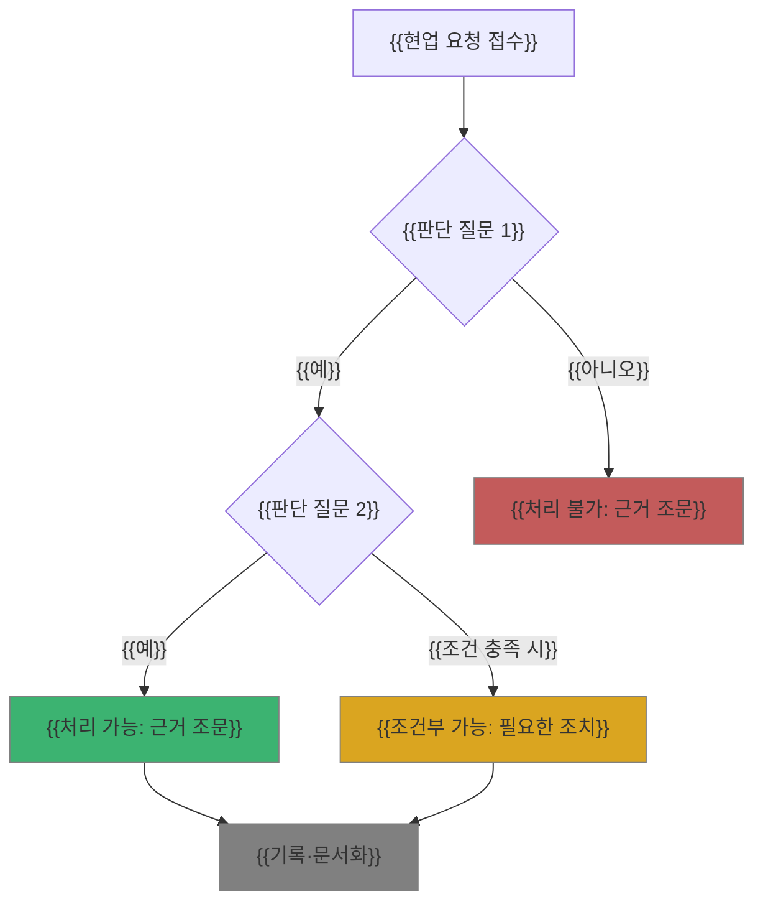

<!--
====================================================================
 챕터 템플릿 사용법
 1) 이 파일을 ./chapters/week{N}/ch{NN}_{english_snake_case}.md 로 복사합니다.
 2) {{ }} 자리표시자를 모두 채우고, "작성 가이드" HTML 주석은 지웁니다.
 3) 작성 규칙 전체는 ./templates/README.md 를 따릅니다.
 4) 정답·해설은 이 파일에 쓰지 않고 ./answers_and_explanations.md 의 #w{N}-ch{NN} 아래에 씁니다.
 5) 링크 경로는 챕터 파일 위치(./chapters/weekN/) 기준입니다. 루트까지는 ../../ 입니다.
====================================================================
-->

# Week {{N}} · Ch{{NN}}. {{챕터 제목}}

> [← 이전 챕터]({{이전_챕터_파일명}}) · [📚 전체 목차](../../README.md) · [다음 챕터 →]({{다음_챕터_파일명}})

| 항목 | 내용 |
|---|---|
| 예상 학습 시간 | {{60~90}}분 |
| 법령 기준일 | 2026-11-17 |
| 핵심 근거 | {{예: 개인정보 보호법 제17조·제26조, 시행령 제28조}} |
| 관련 용어 | {{예: [수탁자](../../glossary.md#수탁자), [제3자 제공](../../glossary.md#제3자-제공)}} |
| 선수 챕터 | {{예: Week 1 · Ch03 핵심 용어와 역할}} |

---

## 1. 학습 목표

<!-- 작성 가이드: 3개 이내. 모두 "~할 수 있다"로 끝냅니다. 관찰할 수 있는 행동 동사(구분한다·판단한다·작성한다·확인한다)를 씁니다. -->

이 챕터를 마치면 담당자님은 다음을 할 수 있습니다.

1. {{예: 현업의 개인정보 이전 요청이 제3자 제공인지 처리위탁인지 구분할 수 있다.}}
2. {{예: 처리위탁 시 문서에 반드시 넣어야 할 사항을 확인할 수 있다.}}
3. {{예: 제3자 제공 동의서의 필수 고지 항목을 작성할 수 있다.}}

---

## 2. 한 줄 비유

<!-- 작성 가이드: 딱 1줄. 비유가 법적 의미를 왜곡할 수 있으면 바로 아래에 "단, ~"로 한계를 밝힙니다. -->

> 💡 **{{예: 처리위탁은 "우리 집 이삿짐을 이삿짐센터에 맡기는 것", 제3자 제공은 "이삿짐을 이웃에게 줘 버리는 것"입니다.}}**

{{(선택) 단, 비유의 한계: ...}}

---

## 3. 개념 설명 및 법령 조문

<!-- 작성 가이드:
 - 조문마다 [조문 번호 → 원문 요지 → 쉬운 풀이 → 출처 각주] 순서를 지킵니다.
 - 원문 요지는 원문 문장을 크게 바꾸지 않고 핵심만 줄입니다. 쉬운 풀이는 신입이 읽는 말투로 씁니다.
 - 조문 번호·시행일은 references 원문과 반드시 대조합니다. 확인하지 못하면 ⚠️ 확인 필요를 답니다.
 - 시행 예정 조문(2027. 3. 9. / 2027. 7. 1.)은 "시행 예정"이라고 밝힙니다.
-->

### 3-1. {{개념 이름}}

{{개념을 2~4문단으로 설명합니다. 비유에서 출발해 법적 정의로 좁혀 갑니다.}}

### 3-2. 관련 조문

#### 📜 {{법령명}} 제{{N}}조({{조문 제목}})

| 구분 | 내용 |
|---|---|
| **원문 요지** | {{예: 개인정보처리자는 정보주체의 동의를 받은 경우 등에는 개인정보를 제3자에게 제공할 수 있다.}} |
| **쉬운 풀이** | {{예: 다른 회사가 '자기 목적'으로 쓰도록 넘길 때는, 원칙적으로 고객에게 따로 동의를 받아야 한다는 뜻입니다.}} |
| **시행일** | {{예: 2026. 9. 11. (현행)}} |
| **실무 포인트** | {{예: 동의서에 '제공받는 자'를 회사명으로 구체적으로 적어야 합니다.}} |

근거 원문은 각주를 참고하세요.[^law-{{N}}]

#### 📜 {{법령명}} 시행령 제{{N}}조({{조문 제목}})

| 구분 | 내용 |
|---|---|
| **원문 요지** | {{...}} |
| **쉬운 풀이** | {{...}} |
| **시행일** | {{...}} |
| **실무 포인트** | {{...}} |

근거 원문은 각주를 참고하세요.[^decree-{{N}}]

---

## 4. 사내 실무 적용

<!-- 작성 가이드:
 - 현업 부서가 담당자에게 실제로 묻는 상황극 Q&A를 1개 이상 씁니다.
 - 담당자의 답에는 ① 결론(가능 / 조건부 가능 / 불가) ② 근거 조문 ③ 다음 행동이 모두 들어가야 합니다.
 - 외부 컨설턴트 말투("귀사는~")를 쓰지 않습니다.
-->

### 🎭 상황극 1. {{예: 마케팅팀의 경품 배송 요청}}

> **📨 {{현업 부서}} {{직함}}**: "{{예: 이번 SNS 이벤트 당첨자 30명에게 경품을 보내려고 하는데요, 이름이랑 주소, 전화번호를 받아서 배송업체에 넘겨도 되죠?}}"

**🙋 담당자 답변**

| 구분 | 내용 |
|---|---|
| **결론** | {{✅ 가능 / ⚠️ 조건부 가능 / ❌ 불가}} — {{한 문장 요약}} |
| **근거** | {{예: 개인정보 보호법 제15조제1항제4호, 제26조}} |
| **다음 행동** | {{예: ① 수집 항목을 이름·주소·전화번호로 한정 ② 배송업체와 위탁계약서 확인 ③ 처리방침의 위탁 현황 갱신 ④ 경품 발송 후 ○일 이내 파기}} |

{{(선택) 답변의 이유를 2~3문단으로 풀어 줍니다.}}

### 🎭 상황극 2. {{(선택)}}

> **📨 {{현업 부서}}**: "{{...}}"

**🙋 담당자 답변**

| 구분 | 내용 |
|---|---|
| **결론** | {{...}} |
| **근거** | {{...}} |
| **다음 행동** | {{...}} |

---

## 5. 업무 흐름 / 판단 플로우

<!-- 작성 가이드:
 - Mermaid 다이어그램 1개 이상.
 - 모든 노드 텍스트와 엣지 라벨을 반드시 쌍따옴표로 감쌉니다. 노드 ID는 영문·숫자만 씁니다.
 - 배경색은 classDef로만, #808080 / #c35b5b / #3cb371 / #daa520 만 씁니다. 폰트 색은 지정하지 않습니다.
 - 아래 예시를 지우고 챕터 내용에 맞게 다시 그립니다.
-->



**그림 읽는 법**: {{다이어그램의 각 분기를 2~3줄로 설명합니다.}}

---

## 6. 개인정보보호위원회 처분 사례

<!-- 작성 가이드:
 - 사건 개요 → 위반 조항 → 처분 결과 → 교훈 순서를 지킵니다.
 - 출처는 의결 연월 + 보도자료 제목 또는 references 파일명을 씁니다.
 - 금액·날짜·조항은 references 원문과 대조합니다. 확인하지 못한 항목에는 ⚠️ 확인 필요를 붙입니다.
 - references에 맞는 사례가 없으면 일반 지식으로 보충하고 [출처: 일반 지식, 원문 확인 권장]을 붙입니다.
-->

### ⚖️ 사례: {{예: ㈜○○ 개인정보 유출사고}}

| 단계 | 내용 |
|---|---|
| **사건 개요** | {{무슨 일이 있었나 (2~3문장)}} |
| **위반 조항** | {{예: 개인정보 보호법 제29조(안전조치의무), 제34조(유출 통지·신고)}} |
| **처분 결과** | {{예: 과징금 ○○억 원, 과태료 ○○만 원, 시정명령, 공표명령}} |
| **교훈** | {{우리 회사 담당자가 오늘 바로 점검할 것 1~2가지}} |
| **출처** | {{예: 개인정보보호위원회 보도자료, 「○○○」(20YY. M. 의결)}}[^case-1] |

> 💬 **사수의 한마디**: {{이 사례를 우리 회사에 대입하면 어디가 약한 고리인지 한두 문장으로 짚어 줍니다.}}

---

## 7. 오답노트

<!-- 작성 가이드: 3행 이상. 신입이 실제로 할 법한 말투로 ❌ 칸을 씁니다. 근거 조문 칸을 비우지 않습니다. -->

| # | ❌ 잘못된 생각 | ✅ 올바른 이해 | 근거 조문 |
|---|---|---|---|
| 1 | "{{예: 배송업체에 넘기는 거니까 제3자 제공 동의를 받아야죠.}}" | {{예: 우리 회사의 배송 업무를 대신하는 것이므로 처리위탁입니다. 위탁 사실을 공개하면 되고 별도 제공 동의는 필요 없습니다.}} | {{예: 법 제26조}} |
| 2 | "{{...}}" | {{...}} | {{...}} |
| 3 | "{{...}}" | {{...}} | {{...}} |

---

## 8. 업무 체크리스트

<!-- 작성 가이드: 담당자가 사내에서 그대로 대입해 점검할 수 있게 씁니다. 항목마다 누가/무엇을/언제가 드러나게 씁니다. 필요하면 점검 주기나 근거를 괄호로 덧붙입니다. -->

**📋 {{체크리스트 이름: 예) 처리위탁 셀프 점검표}}**

| 점검 주기 | {{예: 위탁 계약 체결·갱신 시 / 연 1회}} | 점검자 | {{예: 개인정보보호 담당자}} | 점검일 | ____-__-__ |
|---|---|---|---|---|---|

- [ ] {{예: 위탁 업무 내용과 수탁자를 처리방침에 공개했다 (법 제26조제2항)}}
- [ ] {{...}}
- [ ] {{...}}
- [ ] {{...}}
- [ ] {{...}}

---

## 9. 실습 과제 / 퀴즈

<!-- 작성 가이드:
 - 객관식 3문항 + 서술형 또는 실습 1문항.
 - 정답과 해설은 절대 이 파일에 쓰지 않습니다. ./answers_and_explanations.md 의 #w{N}-ch{NN} 에만 씁니다.
 - 주차별 실습 주제는 templates/README.md 의 표를 따릅니다.
 - Windows 11 실습은 PowerShell 코드 블록과 GUI 경로(설정 > ... )를 함께 적습니다.
-->

### 객관식

**Q1.** {{문제}}

1. {{선택지}}
2. {{선택지}}
3. {{선택지}}
4. {{선택지}}

**Q2.** {{문제}}

1. {{선택지}}
2. {{선택지}}
3. {{선택지}}
4. {{선택지}}

**Q3.** {{문제}}

1. {{선택지}}
2. {{선택지}}
3. {{선택지}}
4. {{선택지}}

### 🛠️ {{서술형 / 실습}}

**Q4.** {{과제 설명: 상황, 주어진 자료, 제출물 형식을 구체적으로 씁니다.}}

{{(실습인 경우) 준비물·환경: Windows 11 Pro, 관리자 권한 필요 여부 등}}

```powershell
# {{(실습인 경우) 실행할 명령어와 설명}}
```

{{(제출 양식이 있으면) 표 양식}}

| {{열1}} | {{열2}} | {{열3}} |
|---|---|---|
| | | |

> ✅ 다 풀었다면 [정답 및 해설](../../answers_and_explanations.md#w{{N}}-ch{{NN}})에서 확인하세요. 틀린 문제는 **7. 오답노트**에 한 줄씩 추가하세요.

---

## 10. 더 읽을거리

<!-- 작성 가이드: references 폴더에 있는 자료는 파일명을 그대로 함께 씁니다. 없는 자료는 이름만 쓰고 (references 미보유)라고 표시합니다. -->

| 자료 | 발행 | references 파일명 | 이 챕터와의 관계 |
|---|---|---|---|
| {{예: 개인정보의 안전성 확보조치 기준 안내서}} | {{개인정보보호위원회, 2026. 11.}} | `{{개인정보의 안전성 확보조치 기준 안내서(2026.11).pdf}}` | {{예: 제5조 해설, pp.59~65}} |
| {{예: 표준 개인정보 보호지침}} | {{개인정보보호위원회 고시 제2025-4호, 2025. 4.}} | `{{표준 개인정보 보호지침(개인정보보호위원회고시)(제2025-4호)(20250411).pdf}}` | {{...}} |
| {{예: 아동·청소년 개인정보 보호 가이드라인}} | {{개인정보보호위원회}} | (references 미보유) | {{...}} |

---

> [← 이전 챕터]({{이전_챕터_파일명}}) · [📚 전체 목차](../../README.md) · [📖 용어집](../../glossary.md) · [다음 챕터 →]({{다음_챕터_파일명}})

<!-- 각주: 본문에서 쓴 키만 남기고 나머지는 지웁니다. 파일명은 references 폴더의 실제 파일명을 그대로 씁니다. -->

[^law-{{N}}]: [출처: 개인정보 보호법(법률)(제21445호)(20260911).pdf, 제{{N}}조제{{N}}항]
[^decree-{{N}}]: [출처: 개인정보 보호법 시행령(대통령령)(제36804호)(20261110).pdf, 제{{N}}조]
[^case-1]: [출처: {{references 보도자료 파일명}}, p.{{N}}]
