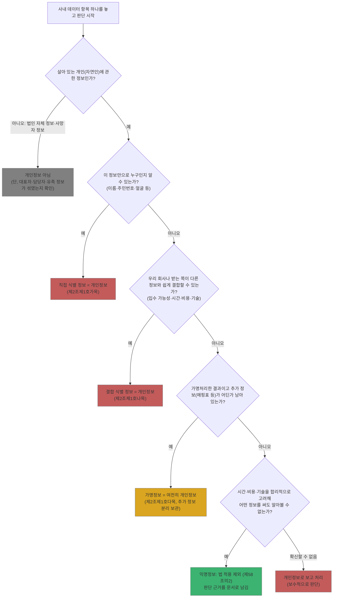

# Week 1 · Ch01. 개인정보의 정의와 판단 기준

> (첫 챕터) · [📚 전체 목차](../../README.md) · [다음 챕터 →](./ch02_개인정보_법체계_지도.md)

| 항목 | 내용 |
|---|---|
| 예상 학습 시간 | 70분 |
| 법령 기준일 | 2026-11-17 |
| 핵심 근거 | 개인정보 보호법 제2조제1호·제1호의2, 제28조의2, 제28조의4, 제58조의2 |
| 관련 용어 | [개인정보](../../용어집.md#개인정보), [가명정보](../../용어집.md#가명정보), [가명처리](../../용어집.md#가명처리), [익명정보](../../용어집.md#익명정보), [추가 정보](../../용어집.md#추가-정보), [행태정보](../../용어집.md#행태정보) |
| 선수 챕터 | 없음 (과정의 첫 챕터) |

---

## 1. 학습 목표

이 챕터를 마치면 담당자님은 다음을 할 수 있습니다.

1. 개인정보 보호법이 정한 개인정보의 세 가지 유형(직접 식별, 결합 식별, 가명정보)을 **구분할 수 있다**.
2. "다른 정보와 **쉽게 결합**할 수 있는가"를 입수 가능성·시간·비용·기술 기준으로 **판단할 수 있다**.
3. 사내 데이터 항목을 개인정보·가명정보·익명정보·개인정보 아님으로 **분류할 수 있다**.

---

## 2. 한 줄 비유

> 💡 **개인정보는 "퍼즐 조각"입니다. 조각 하나로는 그림이 안 보여도, 옆 서랍에 나머지 조각이 있으면 이미 그림이 보이는 것과 같습니다.**

단, 비유의 한계가 있습니다. 법이 말하는 "옆 서랍"은 **현실적으로 쉽게 꺼낼 수 있는 서랍**이어야 합니다. 이론상 어딘가에 있는 조각까지 모두 따지라는 뜻은 아닙니다. 이 기준은 3-2에서 다룹니다.

---

## 3. 개념 설명 및 법령 조문

### 3-1. 개인정보를 네 조각으로 나눠 읽기

법의 정의 문장을 네 조각으로 나누면, 어떤 데이터든 차례로 대입해 볼 수 있습니다.

| 요소 | 법 문언 | 쉬운 풀이 | 이런 경우는 해당 없음 |
|---|---|---|---|
| ① **살아 있는** | "살아 있는 개인에 관한" | 지금 살아 있는 사람의 정보 | 사망자 정보 (단, 아래 ⚠️ 참고) |
| ② **개인** | "개인에 관한" | 자연인(사람)의 정보 | 법인·단체 자체의 정보 (사업자등록번호, 회사 매출) |
| ③ **정보** | "정보로서" | 이름·숫자뿐 아니라 사진, 영상, 음성, 기록, 평가까지 형태를 가리지 않음 | — |
| ④ **알아볼 수 있는** | "개인을 알아볼 수 있는" | 그 정보로, 또는 쉽게 구할 수 있는 다른 정보와 합쳐서 **누구인지 특정**할 수 있음 | 시간·비용·기술을 합리적으로 고려해도 누구인지 알 수 없는 정보 (익명정보) |

> 📌 **위원회 해석**: 사망자 정보는 원칙적으로 개인정보가 아니지만, **유족과의 관계를 알 수 있는 정보**라면 살아 있는 **유족의 개인정보**입니다. 사망자 정보만으로는 관계를 알 수 없어도 다른 정보와 쉽게 결합해 알 수 있으면 마찬가지입니다. 또 법인·단체(**개인사업자 포함**)의 상호, 소재지 주소, 업무 연락처는 원칙적으로 개인정보가 아니지만, **대표·임직원의 이름·연락처**는 상황에 따라 개인정보로 취급될 수 있습니다. [출처: 1. 개인정보 질의응답 모음집(2025.12.).pdf, Q6 (인쇄 p.8, PDF p.18), Q10 (인쇄 p.12, PDF p.22)]

### 3-2. 관련 조문

> 📌 **조문 주소 읽는 법**: 우리나라 법령은 **조 → 항(①②) → 호(1. 2.) → 목(가. 나.)** 순서로 나뉩니다. "제2조제1호나목"은 "제2조 안의 제1호 안의 나목"이라는 **주소**입니다. 가목·나목·다목은 법이 붙인 **번호일 뿐 이름이 아닙니다**. 그래서 이 교재는 분류할 때 **직접 식별 정보(가목) / 결합 식별 정보(나목) / 가명정보(다목)**처럼 뜻이 드러나는 이름을 쓰고, 법 주소는 근거로만 적습니다. 의결서나 법령해석에서는 법 주소를 그대로 쓰므로 읽는 법은 꼭 익혀 두세요.

#### 📜 개인정보 보호법 제2조제1호 (개인정보의 정의)

| 구분 | 내용 |
|---|---|
| **원문 요지** | "개인정보"란 살아 있는 개인에 관한 정보로서 다음 중 하나에 해당하는 정보를 말한다. **가.** 성명, 주민등록번호 및 영상 등을 통하여 개인을 알아볼 수 있는 정보 **나.** 해당 정보만으로는 특정 개인을 알아볼 수 없더라도 다른 정보와 쉽게 결합하여 알아볼 수 있는 정보. 쉽게 결합할 수 있는지는 다른 정보의 입수 가능성 등 개인을 알아보는 데 소요되는 시간, 비용, 기술 등을 합리적으로 고려하여야 한다. **다.** 가목 또는 나목을 가명처리하여 추가 정보 없이는 특정 개인을 알아볼 수 없는 정보(가명정보) |
| **쉬운 풀이** | **가목**은 "보자마자 누군지 아는 정보"(이름, 주민번호, 얼굴 사진)입니다. **나목**은 "혼자서는 모르지만 회사가 쉽게 구할 수 있는 다른 정보와 합치면 누군지 아는 정보"(사번, 회원번호, 차량번호)입니다. **다목**은 "일부러 가렸지만 열쇠(추가 정보)만 있으면 다시 열리는 정보"(가명정보)입니다. 세 가지 모두 **개인정보**입니다. |
| **시행일** | 2026. 9. 11. 시행 법률 제21445호 기준 (정의 문언 자체는 아래 3-3의 개정 이후 바뀌지 않음) |
| **실무 포인트** | 현업이 "이름이 없으니까 괜찮아요"라고 하면 **나목**을 떠올리세요. 판단 질문은 "이름이 있나?"가 아니라 **"우리 회사(또는 받는 쪽)가 쉽게 누군지 알아낼 수 있나?"**입니다. |

근거 원문은 각주를 참고하세요.[^law-2-1]

#### 📜 개인정보 보호법 제2조제1호의2 (가명처리)

| 구분 | 내용 |
|---|---|
| **원문 요지** | "가명처리"란 개인정보의 일부를 삭제하거나 일부 또는 전부를 대체하는 등의 방법으로 추가 정보가 없이는 특정 개인을 알아볼 수 없도록 처리하는 것을 말한다. |
| **쉬운 풀이** | 이름을 지우거나, 회원번호를 무작위 일련번호로 바꾸거나, 나이를 "30대 초반"처럼 범주로 묶는 작업입니다. 원래대로 되돌리는 **열쇠(매핑표 등 추가 정보)**가 따로 남아 있는 것이 핵심입니다. |
| **시행일** | 2026. 9. 11. 시행 법률 제21445호 기준 |
| **실무 포인트** | 가명처리해도 **개인정보에서 벗어나지 않습니다.** 추가 정보는 가명정보와 **분리해서 보관**해야 합니다(법 제28조의4). |

근거 원문은 각주를 참고하세요.[^law-2-1-2] 가명정보 가이드라인도 같은 예시(이름 삭제, 상세 주소를 시·군 단위로 축소, 나이 범주화)를 들고 있습니다.[^pseudo-p18]

#### 📜 개인정보 보호법 제58조의2 (적용제외: 익명정보)

| 구분 | 내용 |
|---|---|
| **원문 요지** | 이 법은 시간·비용·기술 등을 합리적으로 고려할 때 다른 정보를 사용하여도 더 이상 개인을 알아볼 수 없는 정보에는 적용하지 아니한다. |
| **쉬운 풀이** | 열쇠를 버리는 것만으로는 부족합니다. **다른 어떤 정보를 합리적으로 가져와 맞춰 봐도** 누구인지 알 수 없을 때 비로소 익명정보이고, 그때만 개인정보 보호법이 적용되지 않습니다. |
| **시행일** | 2026. 9. 11. 시행 법률 제21445호 기준 |
| **실무 포인트** | "익명이라서 괜찮다"는 주장은 **입증할 책임이 회사 쪽**에 있다고 생각하고 판단 근거를 문서로 남기세요. 소수 인원 집단(예: "임원 중 40대 여성 1명")은 통계여도 누구인지 드러날 수 있습니다. |

근거 원문은 각주를 참고하세요.[^law-58-2]

#### 📜 개인정보 보호법 제28조의2·제28조의4 (가명정보의 처리와 안전조치)

| 구분 | 내용 |
|---|---|
| **원문 요지** | (제28조의2) 개인정보처리자는 **통계작성, 과학적 연구, 공익적 기록보존 등**을 위하여 정보주체의 동의 없이 가명정보를 처리할 수 있다. (제28조의4) 가명정보를 처리하는 경우 원래 상태로 복원하기 위한 **추가 정보를 별도로 분리하여 보관·관리**하는 등 안전성 확보에 필요한 조치를 하여야 한다. |
| **쉬운 풀이** | 가명정보는 "목적이 맞으면 동의 없이 쓸 수 있는 개인정보"입니다. 아무 목적에나 쓸 수 있는 정보가 아니고, 열쇠는 따로 잠가 둬야 합니다. |
| **시행일** | 2026. 9. 11. 시행 법률 제21445호 기준 |
| **실무 포인트** | 가명정보 활용 절차는 [W4-ch05](../4주차/ch05_가명정보_기본과_활용.md)에서 다룹니다. 이 챕터에서는 **"가명정보도 개인정보"**라는 점만 확실히 기억하세요. |

근거 원문은 각주를 참고하세요.[^law-28-2]

### 3-3. 한눈에 보는 세 가지 정보

| 구분 | 직접 식별 정보 (가목) · 결합 식별 정보 (나목) | 가명정보 (다목) | 익명정보 |
|---|---|---|---|
| 누구인지 알 수 있나? | 바로, 또는 쉽게 결합해서 알 수 있음 | **추가 정보가 있으면** 알 수 있음 | 합리적으로 어떤 정보를 써도 알 수 없음 |
| 개인정보인가? | ✅ 예 | ✅ **예** | ❌ 아니오 |
| 개인정보 보호법 적용 | 전부 적용 | 적용 (가명정보 특례 포함) | **적용 안 됨** |
| 동의 없이 쓸 수 있는 범위 | 법 제15조 등 적법 근거가 있을 때 | 통계작성·과학적 연구·공익적 기록보존 등 | 제한 없음 |
| 사내 예시 | 고객 명단, 사번이 있는 평가표, CCTV 영상 | 회원번호를 일련번호로 바꾼 구매이력 (매핑표는 보안팀 보관) | 시·도별 연령대별 회원 수 통계 (모든 칸의 인원이 충분히 큼) |

가명정보 가이드라인도 같은 구분을 씁니다. 개인정보는 동의나 법률이 허용한 범위에서만 처리할 수 있고, 가명정보는 재식별 위험 때문에 **여전히 개인정보로서 법의 적용을 받으며**, 익명정보는 법의 적용을 받지 않습니다.[^pseudo-p19]

### 3-4. "쉽게 결합"은 어떻게 판단하나

법은 판단 요소를 **다른 정보의 입수 가능성**과 **개인을 알아보는 데 드는 시간·비용·기술**로 정해 두었습니다(제2조제1호나목 후단). 실무에서는 아래 세 질문을 순서대로 던지면 됩니다.

| 질문 | "예"라면 | 사내 예시 |
|---|---|---|
| ① **우리 회사 안**에 이 정보와 맞춰 볼 수 있는 다른 정보가 있나? | 개인정보일 가능성 높음 | 사번 → 인사시스템, 회원번호 → 회원 DB, 차량번호 → 주차 등록 대장 |
| ② 이 정보를 **받는 쪽**이 맞춰 볼 수 있는 정보를 갖고 있거나 쉽게 구할 수 있나? | 개인정보일 가능성 높음 | 제휴사가 같은 회원번호 체계를 쓰는 경우 |
| ③ 정보 자체가 **드물거나 구체적**이어서, 조금만 찾아보면 누구인지 드러나나? | 개인정보일 가능성 높음 | "영업2팀 유일한 50대 차장", 소규모 지점의 하루 방문자 1명 |

> ⚠️ 확인 필요: ②처럼 "받는 쪽 기준"으로도 결합 가능성을 따져야 하는지는 참고자료의 조문에 명시되어 있지 않습니다. 이 교재는 실무상 안전한 쪽을 택해 **우리 회사와 받는 쪽을 모두** 고려하라고 안내합니다. `[출처: 일반 지식, 원문 확인 권장]`

> 🕒 **시행 예정 (2027. 3. 9.)**: 제2조에 제9호 "인공지능기술" 정의가 추가됩니다. 개인정보의 정의(제1호)는 그대로입니다. AI 개발 특례는 [W4-ch04](../4주차/ch04_AI와_생성형_AI_도입.md)에서 다룹니다. [출처: 개인정보 보호법(법률)(제21445호)(20260911).pdf, 제2조제9호 `[시행일: 2027. 3. 9.]`]

---

## 4. 사내 실무 적용

### 🎭 상황극 1. 인사팀의 "이름 뺐으니 괜찮죠?"

> **📨 인사팀 김 과장**: "올해 평가 결과를 외부 HR 컨설팅사에 보내서 보상 체계 분석을 맡기려고 해요. 이름은 다 지우고 **사번, 부서, 직급, 평가등급**만 남겼으니까 개인정보 아니죠? 그냥 메일로 보내도 되죠?"

**🙋 담당자 답변**

| 구분 | 내용 |
|---|---|
| **결론** | ⚠️ **조건부 가능** — 이 파일은 **개인정보**입니다. 보내는 것 자체는 가능하지만, 개인정보를 넘기는 절차를 밟아야 합니다. |
| **근거** | 개인정보 보호법 제2조제1호나목 (사번은 사내 인사시스템과 쉽게 결합됨) |
| **다음 행동** | ① 컨설팅사가 **우리 회사의 분석 업무를 대신**하는 것이면 처리위탁이므로 위탁계약서와 처리방침의 위탁 현황을 확인합니다([W2-ch03](../2주차/ch03_제3자_제공과_처리위탁_구분.md)). ② 분석에 사번이 꼭 필요한지 확인하고, 필요 없으면 **사번을 일련번호로 바꾸고** 매핑표는 인사팀이 보관합니다(가명처리). ③ 메일 대신 **암호화한 파일**이나 보안 전송 수단을 씁니다([W3-ch03](../3주차/ch03_암호화.md)). ④ 작은 부서는 부서+직급만으로 누구인지 드러나므로 부서를 상위 조직으로 묶습니다. |

**왜 개인정보인가요?** 사번은 그 자체로는 숫자일 뿐입니다. 하지만 우리 회사 인사시스템에서 1초면 이름과 연결됩니다. 입수 가능성·시간·비용·기술 어느 기준으로 봐도 **쉽게 결합할 수 있는 정보**입니다. 게다가 "부서 + 직급"만으로도 한두 명으로 좁혀지는 팀이 있다면, 사번을 지워도 누구인지 알 수 있습니다.

### 🎭 상황극 2. 마케팅팀의 "광고 ID는 그냥 숫자예요"

> **📨 마케팅팀 박 대리**: "앱에서 **광고 ID랑 방문한 화면 기록**만 모아서 관심사 분석하고, 그걸로 맞춤 푸시를 보내려고요. 이름이나 전화번호는 하나도 안 받아요. 동의 같은 건 필요 없죠?"

**🙋 담당자 답변**

| 구분 | 내용 |
|---|---|
| **결론** | ⚠️ **조건부 가능** — 광고 ID나 기기 식별값이 **회원 계정과 연결**되거나 맞춤 푸시처럼 **특정인에게 다시 닿는 데** 쓰이면 개인정보로 보고 처리해야 합니다. 적법 근거(대부분 동의)를 먼저 확보하세요. |
| **근거** | 개인정보 보호법 제2조제1호나목, 제15조제1항, 제22조 / 구글·메타 처분 사례(아래 6절) |
| **다음 행동** | ① 수집하는 식별값(광고 ID, 쿠키, 기기 ID)과 회원 DB의 연결 여부를 개발팀에 확인합니다. ② 연결된다면 행태정보 수집·이용 동의를 **구분해서**, 이해하기 쉬운 화면으로 받습니다([W2-ch01](../2주차/ch01_수집_이용의_적법_근거.md)). ③ 개인정보 처리방침에 수집 항목과 목적을 반영합니다([W2-ch06](../2주차/ch06_개인정보_처리방침_작성_실습.md)). |

**왜 그런가요?** 이름이 없어도 "같은 사람"을 계속 추적해 그 사람에게 메시지를 보낼 수 있다면, 회사는 그 사람을 **알아보고 있는** 것입니다. 개인정보보호위원회는 플랫폼이 이용자 식별 쿠키·토큰을 이용자 계정과 결합해 수집한 타사 행태정보를 **개인정보**로 보고 대규모 과징금을 부과했습니다.[^case-google-p4]

---

## 5. 판단 플로우

**그림 읽는 법**: 적색 칸에 도착하면 개인정보이므로 Week 2의 수집·이용·제공 규칙이 모두 적용됩니다. 황색(가명정보)은 개인정보이지만 목적이 맞으면 동의 없이 쓸 수 있는 특례가 있습니다. 녹색(익명정보)만 법 적용에서 벗어납니다. **확신이 서지 않으면 개인정보로 보는 쪽**이 실무에서 안전합니다.

---

## 6. 개인정보보호위원회 처분 사례

### ⚖️ 사례: 구글·메타의 동의 없는 타사 행태정보 수집 (2022. 9. 의결)

| 단계 | 내용 |
|---|---|
| **사건 개요** | 구글과 메타는 자사 서비스에 가입한 이용자가 **다른 웹사이트·앱에서 한 활동(타사 행태정보)**을 수집해 관심사를 추론하고 맞춤형 광고에 썼습니다. 이 과정에서 기기에 **이용자 식별 쿠키·토큰**을 생성하고, 광고 식별자를 이용자 계정과 결합하기도 했습니다. 구글은 가입 화면의 설정을 '옵션 더보기'에 가려 두고 기본값을 '동의'로 해 두었습니다. 메타는 694줄짜리 데이터 정책 전문을 스크롤 화면에 올려 두었을 뿐, 법정 고지사항을 따로 알리고 동의받지 않았습니다. |
| **위반 조항** | 의결 당시: 구 개인정보 보호법 **제39조의3제1항** (정보통신서비스 제공자의 이용자 개인정보 수집·이용 동의). 현행 법에서는 이 특례가 2023. 3. 14. 개정으로 삭제되어 **제15조제1항·제22조**(수집·이용 근거와 동의 방법)가 적용됩니다. |
| **처분 결과** | 시정명령, 과징금 총 **1,000억 4,700만 원** (구글 692억 4,100만 원, 메타 308억 600만 원), 처분 결과 공표. 보도자료는 이를 행태정보 수집·이용에 관한 첫 제재이자 당시 개인정보보호 법규 위반으로는 가장 큰 과징금이라고 밝혔습니다. |
| **교훈** | ① 이름이 없어도 **식별자(쿠키·광고 ID·계정)와 연결된 활동 기록은 개인정보**입니다. ② 개인정보라면 "알기 쉽게 알리고, 기본값이 아닌 **명확한 선택**으로 동의받는 것"까지가 의무입니다. |
| **출처** | 개인정보보호위원회 보도자료, 「개인정보위, 구글과 메타의 개인정보 불법 수집 제재」(2022. 9. 14. 의결·발표)[^case-google] |

> 💬 **사수의 한마디**: 우리 회사 앱에도 광고·분석 SDK가 들어가 있을 겁니다. 개발팀에 **"어떤 식별값을 수집하고, 회원 계정과 연결하나요?"** 한 줄만 물어봐도 이 사건과 같은 약점이 있는지 바로 알 수 있습니다.

---

## 7. 오답노트

| # | ❌ 잘못된 생각 | ✅ 올바른 이해 | 근거 조문 |
|---|---|---|---|
| 1 | "이름이랑 주민번호를 뺐으니까 개인정보 아니에요." | 사번·회원번호·차량번호처럼 **다른 정보와 쉽게 결합**해 누구인지 알 수 있으면 개인정보입니다. 판단 기준은 "이름이 있나"가 아니라 "알아볼 수 있나"입니다. | 법 제2조제1호나목 |
| 2 | "가명처리했으니 이제 개인정보 보호법 신경 안 써도 되죠." | 가명정보는 **여전히 개인정보**입니다. 통계작성·과학적 연구·공익적 기록보존 등 목적에서만 동의 없이 쓸 수 있고, 추가 정보는 분리 보관해야 합니다. | 법 제2조제1호다목, 제28조의2, 제28조의4 |
| 3 | "매핑표만 지우면 익명정보가 되는 거죠?" | 매핑표 삭제는 필요조건일 뿐입니다. **다른 정보를 합리적으로 써도** 알아볼 수 없어야 익명정보입니다. 희귀한 값, 작은 집단, 외부 공개 정보와의 대조 가능성까지 따져야 합니다.[^faq-p97] | 법 제58조의2 |
| 4 | "홈페이지에 공개된 연락처니까 개인정보가 아니에요." | 개인정보 정의에는 '비공개일 것'이라는 요건이 없습니다. **공개된 정보도 개인정보**입니다. 표준지침은 홈페이지 등 공개된 매체에서 수집한 개인정보를 "정보주체의 동의 의사가 명확히 표시되거나 … 사회통념상 동의 의사가 있었다고 인정되는 **범위 내에서만**" 이용할 수 있다고 정합니다. | 법 제2조제1호, 표준지침 제6조제4항 |
| 5 | "우리는 고객 정보만 관리하면 돼요. 직원 정보는 인사팀 일이죠." | 직원, 지원자, 협력사 담당자도 모두 **정보주체**입니다. 인사기록, 출입 기록, CCTV 영상도 관리 대상입니다. | 법 제2조제1호·제3호 |

---

## 8. 업무 체크리스트

**📋 개인정보 해당성 셀프 점검표**

| 점검 주기 | 신규 데이터 수집·분석·외부 전달 요청이 들어올 때마다 | 점검자 | 개인정보보호 담당자 | 점검일 | ____-__-__ |
|---|---|---|---|---|---|

- [ ] 요청 부서에서 **실제 데이터 샘플(열 이름 포함)**을 받아 항목 목록을 만들었다
- [ ] 항목마다 "살아 있는 개인에 관한 정보인가"를 확인하고, 법인 정보 안에 섞인 **대표자·담당자 개인정보**를 따로 표시했다 (법 제2조제1호)
- [ ] 사번·회원번호·기기 ID·광고 ID처럼 **사내 다른 시스템과 연결되는 식별값**을 모두 찾아 표시했다 (제2조제1호나목)
- [ ] 데이터를 **받는 쪽**이 결합할 수 있는 정보를 갖고 있는지 요청 부서에 확인했다
- [ ] 작은 집단(소수 부서, 희귀 직급, 소규모 지점)처럼 **조합하면 특정되는 항목**이 있는지 확인했다
- [ ] "가명정보"라고 주장하는 데이터의 **추가 정보(매핑표)가 어디에 누구 관리로 보관**되는지 확인했다 (제28조의4)
- [ ] "익명정보"라고 판단한 경우 그 **판단 근거(처리 방법, 남은 항목, 결합 가능성 검토 결과)를 문서로 남겼다** (제58조의2)
- [ ] 판단이 애매한 항목은 **개인정보로 분류**하고 CPO에게 보고했다
- [ ] 판단 결과를 요청 부서에 "개인정보 / 가명정보 / 익명정보 / 해당 없음"과 근거 조문으로 회신했다

---

## 9. 실습 과제 / 퀴즈

### 객관식

**Q1.** 우리 회사(직원 300명, 인사시스템 운영 중) 기준으로, 다음 중 개인정보 보호법상 **개인정보에 해당하지 않을 가능성이 가장 높은 것**은?

1. 이름 없이 얼굴만 나온 사원증 사진 파일
2. 사번·부서·평가등급만 남긴 인사평가 엑셀
3. 전국 시·도별, 10세 단위 연령대별 회원 수를 집계한 표 (모든 칸이 수천 명 이상)
4. 회원번호를 일련번호로 바꾸고, 매핑표는 보안팀이 별도 서버에 보관 중인 구매이력 파일

**Q2.** 개인정보 보호법 제2조제1호나목은 "쉽게 결합할 수 있는지 여부"를 판단할 때 고려할 요소를 정하고 있습니다. 다음 중 **조문에 고려 요소로 적혀 있지 않은 것**은?

1. 다른 정보의 입수 가능성
2. 개인을 알아보는 데 소요되는 시간
3. 개인을 알아보는 데 소요되는 비용
4. 정보주체가 수집에 동의했는지 여부

**Q3.** 가명정보에 관한 설명으로 **옳은 것**은?

1. 가명정보는 개인정보가 아니므로 개인정보 보호법이 적용되지 않는다.
2. 가명정보는 추가 정보 없이는 특정 개인을 알아볼 수 없도록 처리한 정보로서, 여전히 개인정보에 해당한다.
3. 분석 편의를 위해 추가 정보(매핑표)는 가명정보와 같은 폴더에 함께 보관하는 것이 원칙이다.
4. 가명처리를 하면 마케팅을 포함한 어떤 목적으로든 정보주체 동의 없이 이용할 수 있다.

### 🛠️ 실습: 사내 데이터 항목 분류하기

**Q4.** 아래는 우리 회사(온라인 쇼핑몰 운영, 직원 300명) 각 부서가 보유한 데이터입니다. 각 항목을 **① 직접 식별 정보 (제2조제1호가목) ② 결합 식별 정보 (제2조제1호나목) ③ 가명정보 (제2조제1호다목) ④ 익명정보 (제58조의2) ⑤ 개인정보 아님** 중 하나로 분류하고, **판단 근거를 한 줄로** 쓰세요. 상황에 따라 답이 달라지는 항목은 "어떤 조건이면 무엇인지"를 쓰면 됩니다.

| # | 부서 | 데이터 | 분류 | 판단 근거 |
|---|---|---|---|---|
| 1 | 고객센터 | 상담 통화 녹음 파일 (고객 이름은 언급되지 않고 파일명이 회원번호) | | |
| 2 | 영업팀 | 법인 고객사의 사업자등록번호와 회사 대표 전화번호 | | |
| 3 | 영업팀 | 법인 고객사 구매 담당자의 이름·직통번호·이메일 | | |
| 4 | 총무팀 | 출입 게이트 로그 (사원증 카드번호, 출입 시각) | | |
| 5 | 데이터팀 | 회원 ID를 해시값으로 바꾼 구매이력 분석 파일 (원래 ID와의 매핑표는 보안팀이 별도 보관) | | |
| 6 | 경영지원팀 | 매장별 일 방문객 수 (숫자만, 매장당 하루 수백 명) | | |
| 7 | 인사팀 | 3년 전 퇴사한 직원의 인사기록 (해당 직원은 생존) | | |
| 8 | 고객센터 | 2019년 사망한 고객의 주문 이력 (배송지는 고객 본인 주소) | | |
| 9 | 마케팅팀 | 비로그인 방문자의 웹 쿠키 ID별 방문 페이지 기록 | | |
| 10 | 경영지원팀 | "영업2팀 차장 직급 평균 연봉" (영업2팀 차장은 1명) | | |

> ✅ 다 풀었다면 [정답 및 해설](../../정답과_해설.md#w1-ch01)에서 확인하세요. 틀린 문제는 **7. 오답노트**에 한 줄씩 추가하세요.

---

## 10. 더 읽을거리

| 자료 | 발행 | 참고자료 파일명 | 이 챕터와의 관계 |
|---|---|---|---|
| 가명정보 처리 가이드라인 [본권] | 개인정보보호위원회, 2026. 3. | `가명정보 처리 가이드라인(2026.03.).pdf` | PDF p.17~20: 개인정보·가명정보·익명정보 구분 / PDF p.96~97: 자주 묻는 질문(익명처리, 추가 정보 삭제) |
| 표준 개인정보 보호지침 | 개인정보보호위원회 고시 제2025-4호, 2025. 4. | `표준 개인정보 보호지침(개인정보보호위원회고시)(제2025-4호)(20250411).pdf` | 제2조: 처리, 개인정보처리자, 개인정보취급자 등 용어 정의 |
| 개인정보위 보도자료 「구글과 메타의 개인정보 불법 수집 제재」 | 개인정보보호위원회, 2022. 9. | `220915 (조간) 개인정보위, 구글과 메타의 개인정보 불법 수집 제재(조사1과).pdf` | 6절 처분 사례 원문, 참고 1의 행태정보 수집 구조도 |
| 개인정보 보호법 해설서 / 개인정보 처리 통합 안내서 | 개인정보보호위원회 | (참고자료 미보유) | 개인정보 해당성 판단 사례 (사망자, 법인, 공개 정보 등) |

---

> (첫 챕터) · [📚 전체 목차](../../README.md) · [📖 용어집](../../용어집.md) · [다음 챕터 →](./ch02_개인정보_법체계_지도.md)

[^law-2-1]: [출처: [개인정보 보호법(법률)(제21445호)(20260911).pdf](<../../참고자료/개인정보 보호법(법률)(제21445호)(20260911).pdf>), 제2조제1호]
[^law-2-1-2]: [출처: [개인정보 보호법(법률)(제21445호)(20260911).pdf](<../../참고자료/개인정보 보호법(법률)(제21445호)(20260911).pdf>), 제2조제1호의2]
[^law-58-2]: [출처: [개인정보 보호법(법률)(제21445호)(20260911).pdf](<../../참고자료/개인정보 보호법(법률)(제21445호)(20260911).pdf>), 제58조의2 `[본조신설 2020. 2. 4.]`]
[^law-28-2]: [출처: [개인정보 보호법(법률)(제21445호)(20260911).pdf](<../../참고자료/개인정보 보호법(법률)(제21445호)(20260911).pdf>), 제28조의2제1항, 제28조의4제1항]
[^pseudo-p18]: [출처: [가명정보 처리 가이드라인(2026.03.).pdf](<../../참고자료/가명정보 처리 가이드라인(2026.03.).pdf>), PDF p.18]
[^pseudo-p19]: [출처: [가명정보 처리 가이드라인(2026.03.).pdf](<../../참고자료/가명정보 처리 가이드라인(2026.03.).pdf>), PDF p.18~19]
[^faq-p97]: [출처: [가명정보 처리 가이드라인(2026.03.).pdf](<../../참고자료/가명정보 처리 가이드라인(2026.03.).pdf>), PDF p.97 Q&A "가명정보에서 추가정보를 삭제할 경우 익명정보로 볼 수 있는지 여부"] / ⚠️ 확인 필요: 이 Q&A의 답변 본문은 PDF 글꼴 문제로 텍스트를 추출할 수 없어 원문을 직접 확인하지 못했습니다. 오답노트 3번은 법 제58조의2 문언을 근거로 썼습니다. PDF를 열어 답변 내용과 일치하는지 확인하세요.
[^case-google-p4]: [출처: [220915 (조간) 개인정보위, 구글과 메타의 개인정보 불법 수집 제재(조사1과).pdf](<../../참고자료/220915 (조간) 개인정보위, 구글과 메타의 개인정보 불법 수집 제재(조사1과).pdf>), p.4 「참고 1」 "이용자 식별 쿠키(웹)·이용자 식별 토큰(앱) 등을 생성하며, 모바일 광고 식별자 등을 수집하여 이용자 계정과 결합하는 경우도 있음"]
[^case-google]: [출처: [220915 (조간) 개인정보위, 구글과 메타의 개인정보 불법 수집 제재(조사1과).pdf](<../../참고자료/220915 (조간) 개인정보위, 구글과 메타의 개인정보 불법 수집 제재(조사1과).pdf>), p.1~2 (사건 개요·과징금), p.5~6 「참고 2」 (행위사실·시정조치·위반 조항 "보호법 제39조의3제1항")] / 현행 조항 대응: [출처: [개인정보 보호법(법률)(제21445호)(20260911).pdf](<../../참고자료/개인정보 보호법(법률)(제21445호)(20260911).pdf>), 제15조제1항, 제22조, 제6장 삭제 <2023. 3. 14.>]
