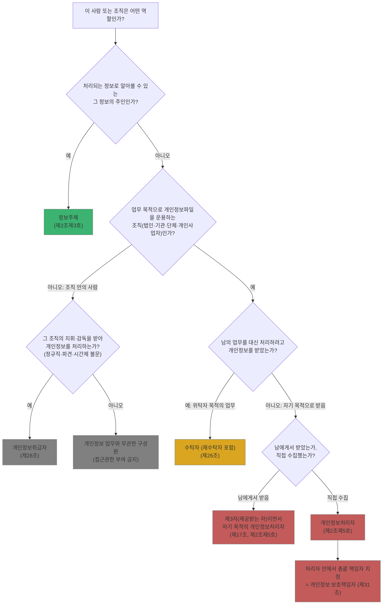

# Week 1 · Ch03. 핵심 용어와 역할

> [← 이전 챕터](./ch02_개인정보_법체계_지도.md) · [📚 전체 목차](../../README.md) · [다음 챕터 →](./ch04_보호_원칙과_처리자의_기본_의무.md)

| 항목 | 내용 |
|---|---|
| 예상 학습 시간 | 75분 |
| 법령 기준일 | 2026-11-17 |
| 핵심 근거 | 개인정보 보호법 제2조제3호·제5호, 제26조, 제28조, 제30조의3, 제31조, 제31조의2 / 시행령 제32조, [별표 1] / 표준지침 제2조, 제15조, 제22조 |
| 관련 용어 | [정보주체](../../용어집.md#정보주체), [개인정보처리자](../../용어집.md#개인정보처리자), [개인정보취급자](../../용어집.md#개인정보취급자), [개인정보 보호책임자](../../용어집.md#개인정보-보호책임자), [위탁자](../../용어집.md#위탁자), [수탁자](../../용어집.md#수탁자), [재수탁자](../../용어집.md#재수탁자), [국내대리인](../../용어집.md#국내대리인), [사업주 또는 대표자의 책임](../../용어집.md#사업주-또는-대표자의-책임) |
| 선수 챕터 | [W1-ch01](./ch01_개인정보의_정의와_판단_기준.md), [W1-ch02](./ch02_개인정보_법체계_지도.md) |

---

## 1. 학습 목표

이 챕터를 마치면 담당자님은 다음을 할 수 있습니다.

1. 정보주체·개인정보처리자·개인정보취급자·수탁자·개인정보 보호책임자를 **사내 조직과 사람에 대입해 구분할 수 있다**.
2. 개인정보 보호책임자(CPO)의 **지정 대상, 업무, 이사회 의결·신고 의무**를 확인할 수 있다.
3. 위탁 관계에서 위탁자와 수탁자가 각각 **무엇을 책임지는지** 설명할 수 있다.

---

## 2. 한 줄 비유

> 💡 **정보주체는 "짐 주인", 개인정보처리자는 "짐을 맡은 창고 회사", 개인정보취급자는 "창고 직원", 수탁자는 "창고 회사가 부른 운송 협력업체", 개인정보 보호책임자(CPO)는 "창고 보안 총책임자"입니다.**

단, 비유의 한계가 있습니다. 창고 짐과 달리 개인정보는 **주인(정보주체)이 맡긴 뒤에도 계속 권리를 행사**합니다. 열람·정정·삭제·처리정지를 요구할 수 있습니다([W4-ch02](../4주차/ch02_정보주체_권리_행사_대응.md)). 또 협력업체(수탁자)가 사고를 내면 창고 회사(위탁자)도 책임을 집니다.

---

## 3. 개념 설명 및 법령 조문

### 3-1. 등장인물 한눈에 보기

| 역할 | 한 줄 정의 | 우리 회사에서는 | 근거 |
|---|---|---|---|
| **정보주체** | 처리되는 정보로 알아볼 수 있는, 그 정보의 주인 | 고객, 회원, 직원, 입사 지원자, 협력사 담당자 | 법 제2조제3호 |
| **개인정보처리자** | 업무 목적으로 개인정보파일을 운용하려고 스스로 또는 남을 통해 개인정보를 처리하는 기관·법인·단체·개인 | **우리 회사(법인) 자체** | 법 제2조제5호 |
| **사업주 또는 대표자** | 개인정보의 안전한 처리와 정보주체 권리 보호의 **최종 책임자** (2026. 9. 11. 신설) | 대표이사 | 법 제30조의3 |
| **개인정보 보호책임자 (CPO)** | 개인정보 처리·보호 업무를 **총괄**해서 담당하는 사람 | 지정된 임원 (예: CISO 겸 CPO, 법무 담당 임원) | 법 제31조, 영 제32조 |
| **개인정보 보호 담당자** (실무자) | CPO를 도와 고충처리·상담 등 실무를 처리하는 사람. 법률상 독립된 지위는 아님 | **담당자님** | 표준지침 제22조제2항 ("개인정보 보호 업무를 처리하는 담당자") |
| **개인정보취급자** | 처리자의 지휘·감독을 받아 개인정보를 처리하는 임직원·파견근로자·시간제근로자 등 | 상담원, 인사 담당자, DB 관리자, 마케터, **인턴·파견직 포함** | 법 제28조제1항, 표준지침 제2조제6호 |
| **위탁자** | 개인정보 처리 업무를 남에게 맡기는 쪽 | 업무를 외주 준 우리 회사 | 법 제26조제2항 |
| **수탁자 (재수탁자 포함)** | 위탁받아 처리하는 자. 수탁자에게서 다시 위탁받은 자도 포함 | 콜센터 대행사, 배송업체, 급여 아웃소싱사, 클라우드 운영 대행사 | 법 제26조제2항 |
| **제3자 (제공받는 자)** | 개인정보를 **자기 목적**으로 쓰려고 넘겨받는 자 | 제휴사, 보험사, 공동 마케팅 파트너 | 법 제17조 → [W2-ch03](../2주차/ch03_제3자_제공과_처리위탁_구분.md) |
| **국내대리인** | 국내에 주소·영업소가 없는 일정 규모 이상 해외 사업자가 지정하는 국내 대리인 | 우리가 쓰는 해외 SaaS 사업자 쪽 역할 | 법 제31조의2 |

> 💡 **"처리자"와 "취급자"는 이것만 기억하세요**: 처리자는 **조직**(우리 회사), 취급자는 그 조직 안에서 개인정보를 만지는 **사람**입니다. 과징금은 처리자에게 부과되고, 취급자는 사내 교육·감독·권한 관리의 대상입니다.

### 3-2. 관련 조문

> 📌 **조문 주소 읽는 법**: 조 → 항(①②) → 호(1. 2.) → 목(가. 나.). 자세한 설명은 [W1-ch01 3-2](./ch01_개인정보의_정의와_판단_기준.md#3-2-관련-조문)를 보세요.

#### 📜 개인정보 보호법 제28조 (개인정보취급자에 대한 감독)

| 구분 | 내용 |
|---|---|
| **원문 요지** | ① 개인정보처리자는 임직원, 파견근로자, 시간제근로자 등 처리자의 지휘·감독을 받아 개인정보를 처리하는 자(개인정보취급자)의 **범위를 최소한으로 제한**하고, 적절한 관리·감독을 하여야 한다. ② 개인정보취급자에게 **정기적으로 필요한 교육**을 실시하여야 한다. |
| **쉬운 풀이** | 고용 형태와 상관없이 **회사의 지시를 받고 개인정보를 만지면 모두 취급자**입니다. 회사는 취급자 수를 줄이고, 감독하고, 정기 교육을 해야 합니다. |
| **시행일** | 2026. 9. 11. 시행 법률 제21445호 기준 |
| **실무 포인트** | 표준지침 제15조는 이를 구체화합니다. 취급자 수와 처리 범위를 업무상 필요한 한도로 최소화하고, 접근권한을 차등 부여하고, **보안서약서**를 받고, 인사이동 시 권한을 변경·말소하라는 내용입니다.[^std-15] |

근거 원문은 각주를 참고하세요.[^law-28]

#### 📜 개인정보 보호법 제31조 (개인정보 보호책임자의 지정 등) — 2026년 개정 반영

| 구분 | 내용 |
|---|---|
| **원문 요지** | ① 처리자는 개인정보 처리·보호 업무를 총괄할 **CPO를 지정**해야 한다. 단, 시행령 기준(소상공인)에 해당하면 지정하지 않을 수 있고, ② 이때는 **사업주 또는 대표자가 CPO**가 된다. ③ 매출액·보유 규모 등이 시행령 기준에 해당하는 처리자는 CPO 지정·변경·해제 시 **이사회 의결**(법인 한정)을 거치고 위원회에 **신고**해야 한다. ④ CPO 업무: 1. 보호 계획 수립·시행 2. 전문 인력 관리·예산 확보 3. 대표자·이사회 보고 4. 실태 정기 조사·개선 5. 불만 처리·피해 구제 6. 내부통제시스템 구축 7. 교육 계획 수립·시행 8. 개인정보파일 보호·관리·감독 9. 시행령으로 정한 업무. ⑦ 처리자는 CPO에게 정당한 이유 없이 불이익을 주면 안 되고, **독립적 업무 수행을 보장**해야 한다. |
| **쉬운 풀이** | CPO는 **"이름만 걸어 두는 자리"가 아니라** 계획·예산·보고·조사·고충·통제·교육을 총괄하는 자리입니다. 대기업 등은 CPO를 바꿀 때 이사회까지 거쳐야 합니다. |
| **시행일** | 2026. 9. 11. 시행 법률 제21445호 기준 (제3항 신설, 업무 조항이 제3항 → **제4항**으로 이동) |
| **실무 포인트** | 시행령 제32조제5항은 CPO 업무에 **처리방침 수립·변경·시행, 인적·물적 자원과 정보의 관리, 보유기간이 지난 개인정보의 파기**를 더합니다. 담당자님의 실무 대부분이 이 목록 안에 있습니다. |

근거 원문은 각주를 참고하세요.[^law-31]

#### 📜 개인정보 보호법 시행령 제32조 (개인정보 보호책임자의 지정 등)

| 구분 | 내용 |
|---|---|
| **원문 요지** | ① 지정 면제 대상은 「소상공인기본법」상 **소상공인**이다. ② 민간 처리자의 CPO는 **사업주·대표자** 또는 **임원**(임원이 없으면 개인정보 처리 업무 담당 부서장)으로 지정한다. 제3항 처리자는 이 중 [별표 1] 자격을 갖춘 사람을 지정해야 한다. ③ 이사회 의결·신고 대상: 연간 매출액등 **1,800억 원 초과**이면서 **민감정보·고유식별정보 5만 명 이상** 또는 **개인정보 100만 명 이상** 처리자(각급 학교·의료기관 제외), 재학생 2만 명 이상 대학, 상급종합병원, 공공시스템운영기관. ④ 지정·변경·해제 사유가 생긴 날부터 **6개월 이내**에 신고서를 제출한다(부득이하면 1년 범위에서 연장 가능). ⑦ 독립성 보장을 위해 정보 접근 보장, 대표자·이사회 **직접 보고 체계**, 적합한 조직·자원 제공을 준수한다. |
| **쉬운 풀이** | 일반 회사의 CPO는 **임원급**이어야 합니다. 일정 규모 이상 회사는 자격(경력 4년 이상, 그중 개인정보보호 경력 2년 이상)까지 갖춘 사람을 이사회 의결로 지정하고 6개월 안에 신고합니다. |
| **시행일** | 2026. 11. 10. 시행 대통령령 제36804호 기준 (제3항·제4항 등 2026. 9. 10. 개정) |
| **실무 포인트** | 우리 회사가 제3항 기준에 해당하는지 **매출액과 보유 규모**를 재무·IT 부서와 함께 확인하세요. 해당하면 CPO 교체 일정에 이사회 일정을 넣어야 합니다. |

근거 원문은 각주를 참고하세요.[^decree-32] [^decree-annex1]

**[별표 1] CPO 자격 요약** (제3항 처리자에게 적용)

| 요건 | 내용 |
|---|---|
| 총 경력 | 개인정보보호 + 정보보호 + 정보기술 경력 합계 **4년 이상** |
| 필수 경력 | 그중 **개인정보보호 경력 2년 이상** |
| 학위 인정 | 관련 박사 2년, 석사 1년, 학사 6개월 (여러 학위 중 하나만 인정) |
| 중복 기간 | 같은 기간에 두 업무가 겹치면 하나만 인정 |

#### 📜 개인정보 보호법 제26조 (업무위탁에 따른 개인정보의 처리 제한) — 역할 관련 조항

| 구분 | 내용 |
|---|---|
| **원문 요지** | ② 위탁자는 위탁 업무 내용과 **수탁자(재수탁자 포함)**를 정보주체가 언제든 쉽게 확인할 수 있게 **공개**해야 한다. ④ 위탁자는 수탁자를 **교육**하고, 처리 현황 점검 등으로 **감독**해야 한다. ⑥ 수탁자가 다시 위탁하려면 **위탁자의 동의**를 받아야 한다. ⑦ 수탁자가 위탁 업무와 관련해 법을 위반해 생긴 손해배상책임에 대해서는 수탁자를 **위탁자의 소속 직원으로 본다**. ⑧ 수탁자에게는 제15조~제18조, 제29조(안전조치), 제31조, 제34조 등 처리자 의무 다수가 **준용**된다. |
| **쉬운 풀이** | 일을 맡겨도 **책임은 같이 집니다.** 위탁자는 공개·교육·감독 의무가 있고, 수탁자도 처리자와 거의 같은 의무를 집니다. |
| **시행일** | 2026. 9. 11. 시행 법률 제21445호 기준 (제8항 준용 목록 2026. 3. 10. 개정) |
| **실무 포인트** | 위탁·제공의 구분과 위탁 계약서 작성은 [W2-ch03](../2주차/ch03_제3자_제공과_처리위탁_구분.md)에서 다룹니다. 이 챕터에서는 **"수탁자 관리·감독은 위탁자의 의무"**라는 점만 기억하세요. |

근거 원문은 각주를 참고하세요.[^law-26]

#### 📜 개인정보 보호법 제30조의3 (사업주 또는 대표자의 책임) — 2026. 9. 11. 신설

| 구분 | 내용 |
|---|---|
| **원문 요지** | 개인정보처리자의 사업주 또는 대표자는 개인정보의 안전한 처리와 정보주체의 권리 보호에 대한 **최종적인 책임자**로서, 개인정보 보호에 필요한 **전문 인력과 충분한 예산의 지원** 등 총괄적인 관리 조치를 실효성 있게 하여야 한다. |
| **쉬운 풀이** | CPO가 총괄하더라도 **최종 책임은 대표**에게 있다는 점을 법에 적었습니다. |
| **시행일** | 2026. 9. 11. (법률 제21445호로 신설) |
| **실무 포인트** | 보안 솔루션 예산이나 담당 인력 충원을 요청할 때 **"법 제30조의3에 따른 대표자의 인력·예산 지원 의무"**를 근거로 적을 수 있습니다. CPO 업무(제31조제4항제2호 "전문 인력의 관리 및 예산의 확보", 제3호 "대표자 및 이사회 보고")와 짝을 이룹니다. |

근거 원문은 각주를 참고하세요.[^law-30-3]

#### 📜 개인정보 보호법 제31조의2 (국내대리인의 지정)

| 구분 | 내용 |
|---|---|
| **원문 요지** | ① 국내에 주소·영업소가 없는 처리자로서 시행령 기준에 해당하는 자는 고충 처리, 유출 통지·신고, 자료 제출을 대리하는 **국내대리인**을 **문서로** 지정해야 한다. ② 국내대리인은 국내에 주소·영업소가 있어야 하고, 처리자가 국내에 법인 등을 두고 있으면 **그 법인 중에서** 지정해야 한다. |
| **쉬운 풀이** | 해외 사업자도 한국 사람의 개인정보를 대량으로 다루면 **한국에 연락 창구**를 둬야 합니다. 국내 자회사가 있으면 그 회사를 창구로 삼아야 합니다. |
| **시행일** | 2026. 9. 11. 시행 법률 제21445호 기준 (제2항 후단은 2025. 4. 1. 개정) |
| **실무 포인트** | 해외 SaaS를 도입할 때 **"한국 국내대리인이 누구인가"**를 처리방침에서 확인하세요([W4-ch03](../4주차/ch03_국외_이전과_클라우드_SaaS.md)). |

근거 원문은 각주를 참고하세요.[^law-31-2]

---

## 4. 사내 실무 적용

### 🎭 상황극 1. 고객지원팀의 "인턴은 취급자 아니죠?"

> **📨 고객지원팀 최 파트장**: "다음 주에 **방학 인턴 2명**이 와요. 상담 이력 조회하는 법을 가르치려고 하는데, 계정 새로 만들기 번거로우니 제 계정으로 같이 보게 하면 안 될까요? 정직원도 아니니까 개인정보취급자 교육이나 서약서는 안 받아도 되죠?"

**🙋 담당자 답변**

| 구분 | 내용 |
|---|---|
| **결론** | ❌ **계정 공유는 불가** / ⚠️ **인턴의 개인정보 처리는 조건부 가능**. 인턴도 회사의 지휘·감독을 받아 개인정보를 처리하면 **개인정보취급자**입니다. |
| **근거** | 개인정보 보호법 제28조(임직원·파견근로자·**시간제근로자 등**), 표준지침 제15조(최소 범위, 보안서약서), 안전성 확보조치 기준 제5조제4항(취급자별 계정 발급, 공유 금지) |
| **다음 행동** | ① 인턴이 정말 상담 이력을 봐야 하는지 업무 범위를 먼저 정합니다. 교육용이면 **가명·샘플 데이터**로 대체합니다. ② 필요하다면 인턴마다 **개인 계정**을 **조회 전용·최소 권한**으로 발급하고, 종료일에 맞춰 **말소 예정일**을 등록합니다([W3-ch02](../3주차/ch02_접근권한_관리와_접근통제.md)). ③ 첫 출근일에 **개인정보 보호 교육**을 하고 **보안서약서**를 받습니다. ④ 권한 부여·말소 내역을 권한 관리대장에 기록합니다. |

**왜 그런가요?** 법은 취급자를 고용 형태가 아니라 **"지휘·감독을 받아 개인정보를 처리하는가"**로 정합니다. 계정을 공유하면 접속기록에 누가 무엇을 했는지 남지 않습니다. 사고가 나면 원인을 추적할 수 없고, 그 자체로 안전조치 위반입니다.

### 🎭 상황극 2. 경영기획팀의 "CPO는 아무 팀장이나 하면 되죠?"

> **📨 경영기획팀 한 차장**: "이번에 조직 개편하면서 CPO를 새로 정해야 하는데, 정보보안팀 **팀장님**(임원 아님)으로 하려고요. 대표님 결재만 받으면 끝나는 거죠? 우리 회사는 작년 매출 2,500억 원이고 회원이 150만 명쯤 돼요."

**🙋 담당자 답변**

| 구분 | 내용 |
|---|---|
| **결론** | ❌ **현재 안으로는 불가** — 우리 회사는 **이사회 의결·신고 대상**일 가능성이 높고, CPO는 원칙적으로 **임원**이어야 합니다. |
| **근거** | 개인정보 보호법 제31조제1항·제3항, 시행령 제32조제2항제2호(사업주·대표자 또는 임원, 임원이 없을 때만 부서장), 제32조제3항제1호(매출액등 1,800억 원 초과 + 100만 명 이상), 제32조제4항(6개월 내 신고), [별표 1](자격 요건) |
| **다음 행동** | ① 재무팀에 **"연간 매출액등"** 산정 기준과 금액을 확인합니다. ② CPO 후보를 **임원** 중에서 고르고, [별표 1] 자격(총 4년, 개인정보보호 2년)을 경력증명으로 확인합니다. ③ 이사회 안건으로 올리고, 의결 후 **6개월 이내** 위원회에 신고서를 제출하는 일정을 잡습니다. ④ 지정되면 처리방침과 홈페이지에 CPO 성명·부서·연락처를 공개합니다(표준지침 제22조). ⑤ 정보보안팀 팀장은 CPO를 보좌하는 실무 책임자로 둘 수 있습니다. |

**왜 그런가요?** 시행령은 민간 CPO를 "사업주 또는 대표자" 또는 "임원"으로 정하고, **임원이 없는 경우에만** 부서장을 허용합니다. 매출액등 1,800억 원을 넘고 100만 명 이상의 개인정보를 처리하면 2026. 9. 11.부터 이사회 의결과 신고가 필요합니다.

> 📌 "매출액등"의 뜻은 시행령 제31조의2제1항제1호에 있습니다. **매출액**을 말하고, 매출액을 산정하지 않는 경우에는 「법인세법」 제4조제3항제1호의 **수익사업에서 생기는 소득**을 말합니다. 이 정의는 제32조에도 그대로 쓰입니다.[출처: 개인정보 보호법 시행령(대통령령)(제36804호)(20261110).pdf, 제31조의2제1항제1호]
>
> ⚠️ 확인 필요: 다만 "연간" 매출액을 **어느 회계연도** 기준으로, **개별·연결** 중 어느 재무제표로 볼지는 시행령 원문에 적혀 있지 않습니다. 실제 판단은 재무·법무 부서와 함께 하고, 필요하면 위원회에 질의하세요.

---

## 5. 역할 판별 플로우

**그림 읽는 법**: 먼저 **정보의 주인인지**, 다음으로 **조직인지 사람인지**, 마지막으로 **누구의 목적으로 처리하는지**를 묻습니다. 수탁자(황색)와 제3자(적색)를 가르는 질문 "누구의 목적인가?"는 Week 2에서 다시 자세히 다룹니다. 한 회사가 업무에 따라 **처리자이면서 동시에 다른 회사의 수탁자**일 수도 있습니다.

---

## 6. 개인정보보호위원회 처분 사례

### ⚖️ 사례: 테무의 수탁자 관리·감독 소홀과 국내대리인 미지정 (2025. 5. 의결)

| 단계 | 내용 |
|---|---|
| **사건 개요** | 해외직구 서비스 테무는 상품 배송을 위해 한국·중국·싱가포르·일본 등 여러 사업자에게 개인정보 처리를 **위탁·보관**했습니다. 그런데 국외 위탁 사실을 처리방침에 공개하거나 이용자에게 알리지 않았고, 수탁사에 **안전관리 교육이나 처리 현황 점검 등 관리·감독을 하지 않았습니다.** 2023년 말 기준 하루 평균 290만 명의 한국 이용자가 있었는데도 **국내대리인을 지정하지 않았고**, 회원 탈퇴 절차를 **7단계**로 복잡하게 만들었습니다. 한국 판매자 입점 과정에서는 신분증·얼굴 동영상을 수집하고 법적 근거 없이 주민등록번호를 처리했습니다. |
| **위반 조항** | 보도자료 붙임 기준: 국외이전 **§28의8①**, 국내대리인 지정 의무 **§31의2①**, 위탁 공개 **§26②**, 수탁자 교육·관리감독 **§26④**, 권리행사 방법 및 절차 **§38④** (이상 Whaleco Technology Limited) / 주민등록번호 처리 제한 **§24의2①** (Elementary Innovation Pte. Ltd.) |
| **처분 결과** | 과징금 총 **13억 6,900만 원** (Whaleco 8억 7,900만 원, Elementary Innovation 4억 9,000만 원), 과태료 **1,760만 원** (Whaleco), 시정명령, 개선권고 (국내 법인을 국내대리인으로 지정할 것 등) |
| **교훈** | ① 위탁해도 **수탁자 교육·점검은 위탁자의 의무**로 남습니다. 해 놓지 않으면 그 자체로 처분 대상입니다. ② 역할을 정하는 의무(국내대리인 지정, 수탁자 공개)를 빠뜨리면 정보주체가 **누구에게 권리를 행사해야 할지 모르게** 됩니다. ③ 탈퇴 절차를 수집 절차보다 어렵게 만들면 권리행사 방해가 됩니다(→ [W4-ch02](../4주차/ch02_정보주체_권리_행사_대응.md)). |
| **출처** | 개인정보보호위원회 보도자료, 「국외이전 규정 등 개인정보 보호법 위반한 테무에 13억 6,900만 원 과징금 부과」(2025. 5. 14. 의결, 5. 15. 보도)[^case-temu] |

> 💬 **사수의 한마디**: 우리 회사의 수탁사 목록을 펴 보세요. **작년에 교육 자료를 보냈거나 점검 체크리스트를 받은 기록**이 있는 수탁사가 몇 곳인가요? 기록이 없다면 테무와 같은 약점입니다. 수탁자 점검 방법은 [W2-ch03](../2주차/ch03_제3자_제공과_처리위탁_구분.md)에서 구체적으로 다룹니다.

---

## 7. 오답노트

| # | ❌ 잘못된 생각 | ✅ 올바른 이해 | 근거 조문 |
|---|---|---|---|
| 1 | "인턴·파견직은 정직원이 아니라 개인정보취급자가 아니에요." | 고용 형태와 무관하게 **회사의 지휘·감독을 받아 개인정보를 처리하면** 취급자입니다. 교육·서약·최소 권한·개인 계정 모두 적용됩니다. | 법 제28조제1항, 표준지침 제15조 |
| 2 | "콜센터를 외주 줬으니 거기서 사고 나면 그 회사 책임이죠." | 위탁자는 수탁자를 **교육·감독할 의무**가 있습니다. 수탁자가 위탁 업무와 관련해 법을 위반해 생긴 손해배상책임에 대해서는 수탁자를 **위탁자의 소속 직원으로 봅니다**. | 법 제26조제4항·제7항 |
| 3 | "CPO는 보안팀장 아무나 지정하고 대표 결재만 받으면 돼요." | 민간 CPO는 원칙적으로 **대표자 또는 임원**입니다. 일정 규모 이상이면 **[별표 1] 자격 + 이사회 의결 + 6개월 내 신고**가 필요합니다. | 법 제31조제3항, 영 제32조제2항~제4항, 영 [별표 1] |
| 4 | "수탁자는 시키는 일만 하니까 개인정보 보호법 의무는 위탁자만 지죠." | 수탁자에게도 수집·이용 제한, 안전조치, CPO 지정, 유출 통지·신고 등 처리자 의무가 **준용**됩니다. 위탁 범위를 넘어 이용·제공하면 안 되고, 재위탁하려면 위탁자 동의가 필요합니다. | 법 제26조제5항·제6항·제8항 |
| 5 | "CPO를 지정했으니 개인정보 문제는 이제 대표님과 상관없어요." | 2026. 9. 11.부터 사업주·대표자는 **최종 책임자**로서 인력·예산을 지원해야 합니다. CPO는 대표자·이사회에 **직접 보고**할 수 있어야 합니다. | 법 제30조의3, 제31조제4항제3호, 영 제32조제7항 |

---

## 8. 업무 체크리스트

**📋 사내 개인정보 역할 지정 현황 점검표**

| 점검 주기 | 연 1회 + 조직 개편·CPO 변경·신규 위탁 시 | 점검자 | 개인정보보호 담당자 (CPO 보고) | 점검일 | ____-__-__ |
|---|---|---|---|---|---|

- [ ] 우리 회사가 시행령 제32조제3항(이사회 의결·신고) 대상인지 **매출액등과 처리 인원**으로 확인하고 결과를 기록했다
- [ ] CPO가 **대표자 또는 임원**으로 지정되어 있고, 대상 처리자라면 [별표 1] 자격을 증빙으로 확인했다
- [ ] 대상 처리자라면 CPO 지정·변경에 대한 **이사회 의결 기록과 위원회 신고서(6개월 이내)** 사본을 보관하고 있다
- [ ] 처리방침·홈페이지에 CPO의 **성명·부서·연락처**와 실제 고충을 처리할 수 있는 연락처가 공개되어 있다 (표준지침 제22조)
- [ ] CPO가 대표자·이사회에 **직접 보고하는 체계**(보고 주기, 보고 양식)가 문서로 있다 (영 제32조제7항)
- [ ] **개인정보취급자 명단**(부서, 고용 형태, 처리 시스템, 권한 범위)이 최신이며 인턴·파견·계약직이 빠짐없이 들어 있다 (법 제28조)
- [ ] 취급자 전원에게서 **보안서약서**를 받았고, 연간 **정기 교육** 이수 기록이 있다 (법 제28조제2항, 표준지침 제15조제3항)
- [ ] **수탁자 목록**(재수탁자 포함)과 위탁 업무 내용이 처리방침에 공개되어 있다 (법 제26조제2항)
- [ ] 수탁자별 **교육 실시·처리 현황 점검 기록**이 연 1회 이상 있다 (법 제26조제4항)
- [ ] 우리 회사가 쓰는 해외 서비스의 **국내대리인** 정보를 확인했다 (법 제31조의2)

---

## 9. 실습 과제 / 퀴즈

### 객관식

**Q1.** 우리 회사(온라인 쇼핑몰)에서 **개인정보취급자에 해당하지 않는 사람**은?

1. 고객 주문 내역을 조회하는 정규직 상담원
2. 파견업체 소속으로 우리 회사 고객센터에서 상담 시스템을 쓰는 상담원
3. 방학 동안 고객 문의 답변 업무를 돕는 시간제 인턴
4. 우리 쇼핑몰에서 상품을 주문한 회원

**Q2.** 임원이 있는 일반 민간 회사가 시행령 제32조제2항에 따라 개인정보 보호책임자(CPO)로 **지정할 수 없는 사람**은?

1. 대표이사
2. 「상법」상 집행임원
3. 개인정보 업무를 맡은 등기 임원
4. 개인정보 업무를 담당하는 부서의 과장

**Q3.** 우리 회사가 콜센터 업무를 맡긴 A사가 업무 일부를 B사에 **다시 맡기려고** 합니다. 개인정보 보호법상 A사가 반드시 해야 하는 것은?

1. B사가 우리 회사 고객 전원에게서 개인별 동의를 받게 한다.
2. 우리 회사(위탁자)의 동의를 받는다.
3. 개인정보보호위원회에 재위탁 신고를 한다.
4. 아무 절차 없이 재위탁할 수 있다. 수탁자 정의에 재수탁자가 포함되기 때문이다.

### 🛠️ 실습: 사내 역할 구분하기

**Q4.** 아래 사람·조직이 각 상황에서 개인정보 보호법상 **어떤 역할**인지 고르세요. 선택지는 **정보주체 / 개인정보처리자 / 개인정보취급자 / 개인정보 보호책임자 / 위탁자 / 수탁자 / 재수탁자 / 제3자(제공받는 자) / 해당 없음**입니다. 하나가 여러 역할을 가질 수 있습니다. 판단 근거를 한 줄로 쓰세요.

| # | 사람·조직 (상황) | 역할 | 판단 근거 |
|---|---|---|---|
| 1 | 우리 회사 (자사몰 회원 정보를 직접 수집·관리) | | |
| 2 | 우리 회사 정보보호 담당 상무 (CPO로 이사회 의결 후 지정됨) | | |
| 3 | 우리 회사 물류팀 파견직 직원 (배송지 출력 업무) | | |
| 4 | 택배사 C (우리 회사 주문을 배송, 배송 목적 외 이용 금지 계약) | | |
| 5 | 택배사 C가 지역 배송을 다시 맡긴 지역 대리점 D | | |
| 6 | 제휴 보험사 E (우리 회원 중 동의자 명단을 받아 자사 보험 상품 마케팅에 사용) | | |
| 7 | 우리 회사 직원 F (본인의 급여 정보가 인사시스템에 있음) | | |
| 8 | 우리 회사 재무팀 직원 G (업무상 고객 정보에 접근할 일이 없고 권한도 없음) | | |

> ✅ 다 풀었다면 [정답 및 해설](../../정답과_해설.md#w1-ch03)에서 확인하세요. 틀린 문제는 **7. 오답노트**에 한 줄씩 추가하세요.

---

## 10. 더 읽을거리

| 자료 | 발행 | 참고자료 파일명 | 이 챕터와의 관계 |
|---|---|---|---|
| 개인정보 보호법 시행령 [별표 1] 개인정보 보호책임자의 자격 | 2026. 9. 10. 개정 | `[별표 1] 개인정보 보호책임자의 자격(제32조제2항 각 호 외의 부분 후단 관련)(개인정보 보호법 시행령).pdf` | CPO 경력 요건, 학위 인정 기준 |
| 개인정보 보호법 시행령 | 대통령령 제36804호 | `개인정보 보호법 시행령(대통령령)(제36804호)(20261110).pdf` | 제32조(CPO 지정·신고·독립성), 제32조의3(국내대리인 대상) |
| 표준 개인정보 보호지침 | 고시 제2025-4호 | `표준 개인정보 보호지침(개인정보보호위원회고시)(제2025-4호)(20250411).pdf` | 제2조(용어), 제15조(취급자 감독), 제16조·제17조(수탁자 선정·보호조치), 제22조(CPO 공개) |
| 개인정보의 안전성 확보조치 기준 | 고시 제2026-9호 | `개인정보의 안전성 확보조치 기준(개인정보보호위원회고시)(제2026-9호)(20260701).pdf` | 제4조제1항제2호·제3호(내부 관리계획의 CPO·취급자 역할), 제5조제4항(계정 공유 금지) |
| 개인정보위 보도자료 (테무) | 개인정보보호위원회, 2025. 5. | `250515 (석간) 국외이전 규정 등 개인정보 보호법 위반한 테무에 13억 6,900만 원 과징금 부과(조사1과).pdf` | 6절 처분 사례 원문, p.5 위반 조항 표 |
| 해외사업자의 개인정보 보호법 적용 안내서 | 개인정보보호위원회 | (참고자료 미보유) | 국내대리인 등 해외 사업자 의무 |

---

> [← 이전 챕터](./ch02_개인정보_법체계_지도.md) · [📚 전체 목차](../../README.md) · [📖 용어집](../../용어집.md) · [다음 챕터 →](./ch04_보호_원칙과_처리자의_기본_의무.md)

[^law-28]: [출처: [개인정보 보호법(법률)(제21445호)(20260911).pdf](<../../참고자료/개인정보 보호법(법률)(제21445호)(20260911).pdf>), 제28조제1항·제2항]
[^std-15]: [출처: [표준 개인정보 보호지침(개인정보보호위원회고시)(제2025-4호)(20250411).pdf](<../../참고자료/표준 개인정보 보호지침(개인정보보호위원회고시)(제2025-4호)(20250411).pdf>), 제15조제1항~제3항]
[^law-31]: [출처: [개인정보 보호법(법률)(제21445호)(20260911).pdf](<../../참고자료/개인정보 보호법(법률)(제21445호)(20260911).pdf>), 제31조제1항~제10항 (제3항 <신설 2026. 3. 10.>, 제4항 <개정 2023. 3. 14., 2026. 3. 10.>)]
[^decree-32]: [출처: [개인정보 보호법 시행령(대통령령)(제36804호)(20261110).pdf](<../../참고자료/개인정보 보호법 시행령(대통령령)(제36804호)(20261110).pdf>), 제32조제1항~제7항 (제3항 <신설 2026. 9. 10.>, 제4항 <개정 2026. 9. 10.>)]
[^decree-annex1]: [출처: [\[별표 1\] 개인정보 보호책임자의 자격(제32조제2항 각 호 외의 부분 후단 관련)(개인정보 보호법 시행령).pdf](<../../참고자료/[별표 1] 개인정보 보호책임자의 자격(제32조제2항 각 호 외의 부분 후단 관련)(개인정보 보호법 시행령).pdf>), 제1호~제4호 및 비고]
[^law-26]: [출처: [개인정보 보호법(법률)(제21445호)(20260911).pdf](<../../참고자료/개인정보 보호법(법률)(제21445호)(20260911).pdf>), 제26조제2항·제4항~제8항]
[^law-30-3]: [출처: [개인정보 보호법(법률)(제21445호)(20260911).pdf](<../../참고자료/개인정보 보호법(법률)(제21445호)(20260911).pdf>), 제30조의3 [본조신설 2026. 3. 10.]]
[^law-31-2]: [출처: [개인정보 보호법(법률)(제21445호)(20260911).pdf](<../../참고자료/개인정보 보호법(법률)(제21445호)(20260911).pdf>), 제31조의2제1항·제2항 (<개정 2023. 3. 14., 2025. 4. 1., 2026. 3. 10.>)]
[^case-temu]: [출처: [250515 (석간) 국외이전 규정 등 개인정보 보호법 위반한 테무에 13억 6,900만 원 과징금 부과(조사1과).pdf](<../../참고자료/250515 (석간) 국외이전 규정 등 개인정보 보호법 위반한 테무에 13억 6,900만 원 과징금 부과(조사1과).pdf>), p.1 (처분 개요), p.2~3 (조사 결과), p.3 (처분 내용), p.5 「붙임」 위반 및 시정조치 내역]
