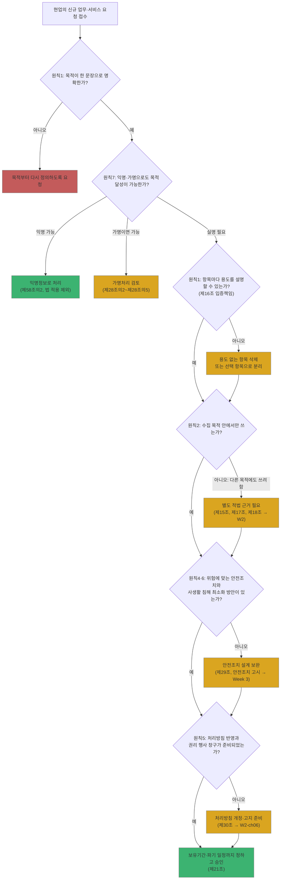

# Week 1 · Ch04. 개인정보 보호 원칙과 처리자의 기본 의무

> [← 이전 챕터](./ch03_핵심_용어와_역할.md) · [📚 전체 목차](../../README.md) · [다음 챕터 →](./ch05_보호위원회의_역할과_제재_체계.md)

| 항목 | 내용 |
|---|---|
| 예상 학습 시간 | 70분 |
| 법령 기준일 | 2026-11-17 |
| 핵심 근거 | 개인정보 보호법 제3조, 제4조, 제16조, 제21조, 제29조 / 표준지침 제4조 |
| 관련 용어 | [개인정보 보호 원칙](../../용어집.md#개인정보-보호-원칙), [필수 정보 / 선택 정보](../../용어집.md#필수-선택-정보), [안전성 확보조치](../../용어집.md#안전성-확보조치), [파기](../../용어집.md#파기), [익명정보](../../용어집.md#익명정보), [가명정보](../../용어집.md#가명정보) |
| 선수 챕터 | [W1-ch01](./ch01_개인정보의_정의와_판단_기준.md), [W1-ch03](./ch03_핵심_용어와_역할.md) |

---

## 1. 학습 목표

이 챕터를 마치면 담당자님은 다음을 할 수 있습니다.

1. 법 제3조의 **8가지 개인정보 보호 원칙**을 사내 업무 예시와 연결해 설명할 수 있다.
2. 각 원칙이 **어떤 개별 의무 조문**으로 구체화되는지 찾을 수 있다.
3. 현업의 신규 업무 요청에서 **원칙 위반 요소**(과다 수집, 목적 외 이용, 불필요한 보관 등)를 찾아낼 수 있다.

---

## 2. 한 줄 비유

> 💡 **개인정보 보호 원칙은 "요리사의 위생 수칙"입니다. 필요한 재료만 사고, 정한 요리에만 쓰고, 신선하게 관리하고, 안전하게 보관하고, 남으면 버리는 것. 개별 조문은 이 수칙을 구체화한 "주방 점검표"입니다.**

단, 비유의 한계가 있습니다. 위생 수칙은 권고처럼 들리지만, 개인정보 보호 원칙은 **법률에 적힌 의무**입니다. 원칙 조문(제3조)을 직접 근거로 한 제재 규정은 없습니다. 하지만 원칙을 어기면 거의 언제나 **어떤 개별 조문의 위반**이 됩니다(3-3 참고).

---

## 3. 개념 설명 및 법령 조문

### 3-1. 관련 조문

> 📌 **조문 주소 읽는 법**: 조 → 항(①②) → 호(1. 2.) → 목(가. 나.). 자세한 설명은 [W1-ch01 3-2](./ch01_개인정보의_정의와_판단_기준.md#3-2-관련-조문)를 보세요.

#### 📜 개인정보 보호법 제3조 (개인정보 보호 원칙)

| 항 | 원문 요지 | 쉬운 풀이 (한 단어) |
|---|---|---|
| ① | 처리 **목적을 명확**하게 하고, 그 목적에 필요한 범위에서 **최소한의 개인정보만** 적법하고 정당하게 수집해야 한다. | **목적 명확·최소 수집** |
| ② | 처리 목적에 필요한 범위에서 적합하게 처리해야 하며, **목적 외 용도로 활용하면 안 된다**. | **목적 내 이용** |
| ③ | 처리 목적에 필요한 범위에서 **정확성, 완전성, 최신성**이 보장되도록 해야 한다. | **정확·최신** |
| ④ | 처리 방법·종류 등에 따라 권리 침해 가능성과 **위험 정도를 고려**해 **안전하게 관리**해야 한다. | **위험 기반 안전 관리** |
| ⑤ | **처리방침** 등 처리에 관한 사항을 **공개**하고, 열람청구권 등 **정보주체의 권리를 보장**해야 한다. | **투명성·권리 보장** |
| ⑥ | 정보주체의 **사생활 침해를 최소화**하는 방법으로 처리해야 한다. | **사생활 침해 최소화** |
| ⑦ | 익명·가명으로 처리해도 목적을 달성할 수 있으면, **익명처리가 가능하면 익명**으로, 익명으로 안 되면 **가명**으로 처리되도록 해야 한다. | **익명 > 가명 > 실명** |
| ⑧ | 법령상 책임과 의무를 준수·실천해 **정보주체의 신뢰**를 얻도록 노력해야 한다. | **책임·신뢰** |

| 구분 | 내용 |
|---|---|
| **시행일** | 2026. 9. 11. 시행 법률 제21445호 기준 (제5항 <개정 2023. 3. 14.>, 제7항 <개정 2020. 2. 4.>) |
| **실무 포인트** | 원칙은 **조문이 애매할 때의 판단 기준**입니다. 현업 요청에 "법 어디에도 금지라고 안 써 있는데요?"라는 반론이 오면, 먼저 어느 원칙에 걸리는지 보고 그 원칙을 구체화한 조문을 찾으세요(3-3). |

근거 원문은 각주를 참고하세요.[^law-3] 표준지침 제4조도 같은 8개 원칙을 정하면서 몇 군데를 더 구체적으로 씁니다. 예를 들어 ③에 "고의 또는 과실로 부당하게 변경 또는 훼손되지 않도록", ④에 "그에 상응하는 적절한 기술적·관리적 및 물리적 보호조치", ⑥·⑦에 "적법하게 처리하는 경우에도"라는 문구가 있습니다.[^std-4]

#### 📜 개인정보 보호법 제4조 (정보주체의 권리)

| 구분 | 내용 |
|---|---|
| **원문 요지** | 정보주체는 다음 권리를 가진다. 1. 처리에 관한 **정보를 제공받을** 권리 2. 동의 여부·범위를 **선택·결정**할 권리 3. 처리 여부 **확인**, **열람**(사본 발급 포함) 및 **전송**을 요구할 권리 4. **처리정지, 정정·삭제, 파기**를 요구할 권리 5. 피해를 신속·공정하게 **구제**받을 권리 6. 완전히 **자동화된 결정을 거부**하거나 설명 등을 요구할 권리 |
| **쉬운 풀이** | 처리자의 의무는 대부분 이 여섯 가지 권리의 **뒷면**입니다. 정보주체에게 "알 권리"가 있으니 처리자는 "알릴 의무"(처리방침, 고지)가 있는 식입니다. |
| **시행일** | 2026. 9. 11. 시행 법률 제21445호 기준 (<개정 2023. 3. 14.>) |
| **실무 포인트** | 권리 행사 대응 절차(10일 기한 등)는 [W4-ch02](../4주차/ch02_정보주체_권리_행사_대응.md)에서 다룹니다. |

근거 원문은 각주를 참고하세요.[^law-4]

#### 📜 개인정보 보호법 제16조제1항 (최소 수집의 입증책임)

| 구분 | 내용 |
|---|---|
| **원문 요지** | 처리자는 수집 근거에 해당해 개인정보를 수집하는 경우에도 그 목적에 필요한 **최소한의 개인정보**를 수집해야 한다. 이 경우 최소한의 개인정보 수집이라는 **입증책임은 개인정보처리자가 부담**한다. |
| **쉬운 풀이** | "이 항목이 왜 필요한가?"를 **회사가 증명**해야 합니다. 정보주체가 "왜 이걸 받느냐"고 증명할 필요가 없습니다. |
| **시행일** | 2026. 9. 11. 시행 법률 제21445호 기준 |
| **실무 포인트** | 수집 항목마다 **"용도 한 줄"**을 적은 수집 항목표를 만들어 두면 이 입증책임에 대비할 수 있습니다. 용도를 못 쓰는 항목은 빼세요. |

근거 원문은 각주를 참고하세요.[^law-16]

### 3-2. 원칙은 직접 처벌되나?

| 질문 | 답 | 근거 |
|---|---|---|
| 제3조(원칙)를 근거로 직접 과징금·과태료를 부과하는 조항이 있나? | **없습니다.** 법 제64조의2(과징금)~제76조(과태료 특례) 어디에도 제3조·제4조를 인용한 제재 규정이 없습니다. | 법 제64조의2~제76조 원문 대조[^law-sanction] |
| 그럼 원칙은 지키지 않아도 되나? | **아닙니다.** "~하여야 한다"로 적힌 법률상 의무입니다. 또 원칙을 어기면 대부분 그 원칙을 구체화한 **개별 조문 위반**이 되고, 그 조문에는 제재가 있습니다. | 아래 3-3 표 |
| 위원회는 원칙을 어떻게 쓰나? | 개별 조문의 해석 기준이자, 시정명령·개선권고의 방향을 정하는 근거로 쓰는 것으로 보입니다. | ⚠️ 확인 필요 `[출처: 일반 지식, 원문 확인 권장]` |

### 3-3. 원칙 → 개별 의무 조문 지도 (이 교재의 로드맵)

8개 원칙이 어떤 조문으로 구체화되는지 정리했습니다. **이 표가 Week 2~4의 목차**이기도 합니다.

| 원칙 (제3조) | 구체화한 대표 조문 | 어기면 걸리는 제재 예시 | 자세히 배우는 곳 |
|---|---|---|---|
| ① 목적 명확·최소 수집 | 제15조(수집·이용 근거), 제16조(최소 수집, 입증책임), 제22조(동의 방법) | 제15조제1항 위반 처리 → 과징금 대상(제64조의2제1항제1호) | [W2-ch01](../2주차/ch01_수집_이용의_적법_근거.md) |
| ② 목적 내 이용 | 제17조(제공), 제18조(목적 외 이용·제공 제한), 제26조(위탁) | 제17조제1항·제18조 위반 → 과징금 대상(제64조의2제1항제1호) | [W2-ch03](../2주차/ch03_제3자_제공과_처리위탁_구분.md) |
| ③ 정확·최신 | 제36조(정정·삭제) | 정정·삭제 요구에 필요한 조치를 하지 않음 → 과태료 대상(제75조, 제36조제2항 위반) | [W4-ch02](../4주차/ch02_정보주체_권리_행사_대응.md) |
| ④ 위험 기반 안전 관리 | 제23조·제24조(민감·고유식별정보), 제29조(안전조치의무), 안전조치 고시 | 유출 + 안전조치 미흡 → 과징금 대상(제64조의2제1항제9호) | [W2-ch02](../2주차/ch02_민감정보_고유식별정보_주민등록번호.md), Week 3 전체 |
| ⑤ 투명성·권리 보장 | 제30조(처리방침), 제35조~제38조(열람·정정·삭제·처리정지 등) | 처리방침을 정하지 않거나 공개하지 않음 → 과태료 대상(제75조, 제30조제1항·제2항 위반) | [W2-ch06](../2주차/ch06_개인정보_처리방침_작성_실습.md), [W4-ch02](../4주차/ch02_정보주체_권리_행사_대응.md) |
| ⑥ 사생활 침해 최소화 | 제23조(민감정보), 제25조·제25조의2(영상정보처리기기) | 민감정보 무단 처리 → 과징금 대상(제64조의2제1항제3호) | [W2-ch02](../2주차/ch02_민감정보_고유식별정보_주민등록번호.md), [W3-ch06](../3주차/ch06_영상정보처리기기_운영.md) |
| ⑦ 익명 > 가명 > 실명 | 제2조제1호다목, 제28조의2~제28조의5, 제58조의2 | 가명정보로 특정 개인을 알아보려는 처리 → 과징금 대상(제64조의2제1항제6호) | [W4-ch05](../4주차/ch05_가명정보_기본과_활용.md) |
| ⑧ 책임·신뢰 | 제30조의3(대표자 책임), 제31조(CPO), 제28조(취급자 감독) | — | [W1-ch03](./ch03_핵심_용어와_역할.md), [W3-ch01](../3주차/ch01_내부_관리계획과_취급자_교육.md) |
| (원칙 ①②④의 마무리) | **제21조(파기)**: 보유기간 경과·목적 달성 시 **지체 없이** 파기, 복구 불가능하게, 보존 의무가 있으면 분리 보관 | 파기하지 않음 → 과태료 대상(제75조, 제21조제1항 위반), 분리 보관하지 않음 → 과태료 대상(제21조제3항 위반) (골프존 사례) | [W2-ch05](../2주차/ch05_보유기간_관리와_파기.md) |

> ⚠️ 확인 필요: 원칙과 조문의 짝짓기는 이 교재가 학습용으로 정리한 것입니다. 법이 공식적으로 정한 대응 관계는 아닙니다. 제재 예시 열의 과징금 대상 호 번호는 법 제64조의2제1항 원문으로, 과태료 대상 조문(제21조제1항·제3항, 제30조제1항·제2항, 제36조제2항)은 법 제75조 원문으로 확인했습니다.[^law-64-2] 금액 구간은 [W1-ch05](./ch05_보호위원회의_역할과_제재_체계.md)에서 다룹니다.

### 3-4. 처리자의 기본 의무: 생애주기 한 장 요약

```
수집 ──► 이용·제공 ──► 보관·관리 ──► 공개·권리 대응 ──► 파기
제15·16·22조  제17·18·26조   제29조·고시     제30·35~38조        제21조
(W2-ch01)     (W2-ch03)      (Week 3)        (W2-ch06, W4-ch02)  (W2-ch05)
                      └─ 사고가 나면: 제34조 유출 통지·신고 (W4-ch01)
```

---

## 4. 사내 실무 적용

### 🎭 상황극 1. 영업팀의 "혹시 모르니까 다 받아 두죠"

> **📨 영업팀 서 과장**: "B2C 렌털 상담 신청 폼을 새로 만드는데요. 나중에 쓸 일이 있을지 모르니까 **이름, 연락처, 주소에 생년월일, 직장명, 연 소득, 결혼 여부, 자녀 수**까지 다 필수로 받아 두려고요. 어차피 고객이 직접 입력하는 거라 문제없죠?"

**🙋 담당자 답변**

| 구분 | 내용 |
|---|---|
| **결론** | ⚠️ **조건부 가능** — 상담에 **실제로 필요한 항목만 필수**로 받아야 합니다. "나중에 쓸지도 몰라서"는 수집 목적이 될 수 없습니다. |
| **근거** | 개인정보 보호법 제3조제1항(목적 명확·최소 수집), 제16조제1항(최소 수집 입증책임은 처리자), 제16조제2항·제3항(필요 최소한 외 정보는 동의하지 않을 수 있음을 알리고, 거부했다고 서비스를 거부하면 안 됨) |
| **다음 행동** | ① 상담 목적을 한 문장으로 정합니다(예: "렌털 상담 회신 및 방문 일정 조율"). ② 항목마다 용도를 적어 봅니다. 이름·연락처(회신), 주소(방문 상담 시)는 용도가 분명합니다. 직장명·연 소득·결혼 여부·자녀 수는 용도가 없으면 **삭제**합니다. ③ 맞춤 제안 등 별도 목적이 있으면 그 항목을 **선택 항목**으로 분리하고, 거부해도 상담은 받을 수 있게 합니다. ④ 수집 항목표(항목 / 필수·선택 / 용도 / 보유기간)를 남깁니다 → [W2-ch01](../2주차/ch01_수집_이용의_적법_근거.md) |

**왜 그런가요?** 제16조제1항은 최소 수집의 **입증책임을 회사**에 지웁니다. 위원회가 "연 소득이 상담에 왜 필요했나요?"라고 물을 때 답할 수 없으면 과다 수집입니다. 또 많이 모을수록 유출 시 피해와 제재가 커집니다(원칙 ④).

### 🎭 상황극 2. 개발팀의 "운영 데이터로 테스트하는 게 제일 정확해요"

> **📨 개발팀 윤 책임**: "새 결제 모듈 테스트를 해야 하는데, 가짜 데이터로는 버그가 잘 안 잡혀요. **운영 DB 회원 테이블을 통째로 개발 서버에 복사**해서 테스트하고, 끝나면 그냥 두려고요. 개발 서버도 사내망이라 괜찮죠?"

**🙋 담당자 답변**

| 구분 | 내용 |
|---|---|
| **결론** | ❌ **현재 방식은 불가** — 실명 운영 데이터를 통째로 복사해 방치하는 것은 여러 원칙과 의무에 걸립니다. 꼭 필요하면 **가명·익명 처리 + 최소 범위 + 테스트 후 파기** 조건으로 검토합니다. |
| **근거** | 개인정보 보호법 제3조제2항(목적 내 이용), 제3조제4항(위험 기반 안전 관리), 제3조제7항(익명 > 가명 > 실명), 제21조제1항(목적 달성 시 지체 없이 파기), 제29조(안전조치의무) |
| **다음 행동** | ① 테스트에 필요한 **열과 건수**를 정해 최소화합니다. ② 이름·연락처·계좌 등은 **가명처리하거나 합성(가짜) 값으로 대체**합니다. ③ 개발 서버에도 운영과 같은 수준의 **접근통제·접속기록**을 적용합니다. ④ 테스트 종료일에 **파기**하고 파기 기록을 남깁니다. ⑤ 이 절차를 개발 표준(테스트 데이터 관리 지침)에 넣습니다. |

**왜 그런가요?** 실제로 위원회는 한 통신사가 운영 데이터를 개발기·검수기로 옮겨 테스트한 뒤 일부를 방치해, **2008년에 생성된 정보 등 1천만 건 이상의 개인정보가 조사 시점까지 남아 있었던** 사실을 지적했습니다.[^case-lgu-p2] "사내망이니까 괜찮다"는 생각이 오래 쌓이면 이렇게 됩니다.

---

## 5. 원칙 기반 신규 업무 사전 검토 플로우



**그림 읽는 법**: 질문 순서가 곧 원칙의 우선순위입니다. **목적 → 익명·가명 가능성 → 최소 항목 → 목적 내 이용 → 안전 → 공개 → 파기** 순서로 묻습니다. 황색 칸은 "막는 것"이 아니라 **보완해서 진행**하는 단계입니다. 담당자는 현업의 일을 멈추는 사람이 아니라 **안전하게 진행시키는 사람**입니다.

---

## 6. 개인정보보호위원회 처분 사례

### ⚖️ 사례: ㈜골프존 랜섬웨어 유출과 파기 의무 위반 (2024. 5. 의결)

| 단계 | 내용 |
|---|---|
| **사건 개요** | 해커가 직원들의 가상사설망(VPN) 계정정보(서버 관리자 계정 포함)를 탈취해 업무망의 **파일서버**에 원격 접속했습니다. 그리고 파일을 빼내 다크웹에 공개했습니다. 이 파일서버는 Windows 공유폴더 기능으로 **임직원 PC에 공유**되던 서버였습니다. 서비스 이용자와 임직원 약 **221만 명 이상**의 개인정보가 유출되었고, 일부는 주민등록번호(5,831명)와 계좌번호(1,647명)도 포함되었습니다. 조사 결과 회사는 파일서버에 주민등록번호 등 다량의 개인정보가 공유되고 있다는 사실을 **인지하지 못했고**, 주민등록번호를 **암호화하지 않고** 보관했습니다. 또 보유기간이 지났거나 목적을 달성해 불필요해진 **최소 38만여 명의 개인정보를 파기하지 않았습니다**(현재 회원으로 확인되지 않는 준회원 383,365명, 보유 근거가 없는 퇴사자 2,916명, 인턴·전문연구요원 채용 관련 1,159명 등). |
| **위반 조항** | 보도자료 붙임 기준: 개인정보 파기 **§21①**, 주민등록번호 처리제한 **§24의2②**(암호화), 안전조치의무 **§29** |
| **처분 결과** | 과징금 **75억 400만 원**(제29조 안전조치의무 위반), 과태료 **540만 원**(제21조 파기의무 위반), 시정명령(실질적인 내부관리계획 수립·시행, 공유설정 등 안전조치, **CPO의 위상과 역할 강화**, 전 직원 정기 교육), **공표명령** |
| **원칙 관점의 교훈** | ① **원칙 ①·②의 마무리는 파기**입니다. 필요 없어진 정보를 쌓아 두면 사고 때 피해 규모가 커집니다. 38만 명은 애초에 남아 있지 않아야 할 정보였습니다. ② **원칙 ④(위험 기반 안전 관리)**는 고객 서비스 시스템만의 이야기가 아닙니다. 보도자료는 "다양한 고객정보를 취급하는 **내부 업무영역**에서도 철저한 개인정보 보호조치가 적용되어야 함"을 강조했습니다. ③ 처분에서 **CPO 역할 강화**가 시정명령에 들어갔습니다. 원칙 ⑧(책임)이 조직 차원의 요구로 나타난 것입니다. |
| **참고** | 보도자료는 이 처분을 2023년 개정 법(과징금 상한을 "위반행위 관련 매출액 3%"에서 "**전체 매출액 3%**"로 상향하고, 위반행위와 관련 없는 매출액은 제외) 규정이 **실질적으로 적용된 첫 사례**라고 소개했습니다. 공표명령도 2023. 9. 15. 시행된 개정법으로 신설된 처분이라고 밝혔습니다. |
| **출처** | 개인정보보호위원회 보도자료, 「개인정보위, ㈜골프존 개인정보 유출사고에 대해 과징금 75억 원, 과태료 540만 원 및 시정명령 부과」(2024. 5. 8. 의결, 5. 9. 보도)[^case-golfzon] |

> 💬 **사수의 한마디**: 담당자님 회사의 **공유 폴더**와 **파일서버**에 무엇이 들어 있는지 아는 사람이 있나요? "퇴사자 명단_2019.xlsx", "채용지원자_최종.zip" 같은 파일이 아무도 모르게 남아 있는 경우가 정말 많습니다. Week 3에서 직접 찾아보는 실습을 합니다.

---

## 7. 오답노트

| # | ❌ 잘못된 생각 | ✅ 올바른 이해 | 근거 조문 |
|---|---|---|---|
| 1 | "고객이 직접 입력하는 거니까 많이 받아도 문제없어요." | 고객이 입력해도 **수집하는 주체는 회사**입니다. 목적에 필요한 최소한만 받아야 하고, 최소라는 **입증책임은 회사**에 있습니다. | 법 제3조제1항, 제16조제1항 |
| 2 | "원칙 조문은 처벌 조항이 없으니 참고만 하면 돼요." | 원칙은 "~하여야 한다"로 적힌 **법률상 의무**입니다. 또 원칙을 어기면 대개 제15조·제21조·제29조 같은 **개별 조문 위반**이 되고, 그 조문에는 과징금·과태료가 있습니다. | 법 제3조, 제64조의2, 제75조 |
| 3 | "나중에 필요할 수도 있으니 지우지 말고 보관해 두죠." | 보유기간이 지나거나 목적을 달성하면 **지체 없이 파기**해야 합니다. 다른 법령에 보존 의무가 있을 때만 예외이고, 그때도 **분리 보관**해야 합니다. 골프존은 38만여 명의 불필요한 정보를 파기하지 않아 과태료를 받았습니다. | 법 제21조제1항·제3항 |
| 4 | "사내 업무용 파일이니까 고객 시스템만큼 보안 신경 안 써도 돼요." | 원칙 ④는 처리 방법·종류에 따른 **위험 정도**를 따집니다. 사내 파일서버, 공유 폴더, 개발 서버도 개인정보가 있으면 안전조치 대상입니다. | 법 제3조제4항, 제29조 |
| 5 | "실명 데이터가 제일 정확하니까 분석도 실명으로 하죠." | 익명·가명으로도 목적을 달성할 수 있으면 **익명 우선, 다음 가명**으로 처리해야 합니다. "정확해서"는 실명을 쓸 이유가 되지 못합니다. | 법 제3조제7항 |

---

## 8. 업무 체크리스트

**📋 신규 업무 개인정보 원칙 사전 검토표** (현업 요청서에 첨부해 쓰세요)

| 요청 부서 | | 업무명 | | 검토일 | ____-__-__ |
|---|---|---|---|---|---|

- [ ] **[원칙 ①]** 처리 목적을 한 문장으로 적었다
- [ ] **[원칙 ①]** 수집 항목마다 **용도**를 한 줄씩 적었고, 용도를 적지 못한 항목은 삭제했다 (제16조제1항 입증책임)
- [ ] **[원칙 ①]** 필수 항목과 선택 항목을 나눴고, 선택 항목을 거부해도 서비스를 받을 수 있다 (제16조제2항·제3항)
- [ ] **[원칙 ②]** 수집 목적 밖의 이용·제공 계획이 있는지 확인했고, 있으면 별도 적법 근거를 검토했다 (제17조·제18조)
- [ ] **[원칙 ③]** 정보가 틀렸을 때 고객이 정정할 경로가 있다 (제36조)
- [ ] **[원칙 ④]** 처리할 정보의 민감도(민감·고유식별·금융정보 여부)와 규모를 적고, 그에 맞는 안전조치를 정했다 (제29조)
- [ ] **[원칙 ⑤]** 개인정보 처리방침에 반영할 내용(항목·목적·보유기간·위탁·제공)을 정리했다 (제30조)
- [ ] **[원칙 ⑥]** 사생활 침해를 줄일 방법(마스킹, 화면 표시 최소화, 열람 권한 축소)을 적용했다
- [ ] **[원칙 ⑦]** 익명 또는 가명으로 대체할 수 있는지 검토했고, 실명이 필요한 이유를 기록했다
- [ ] **[원칙 ⑧ + 파기]** 보유기간과 **파기 예정일·파기 담당자**를 정했다 (제21조)
- [ ] 검토 결과를 CPO에게 보고하고 승인 기록을 남겼다

---

## 9. 실습 과제 / 퀴즈

### 객관식

**Q1.** 다음 중 개인정보 보호법 **제3조(개인정보 보호 원칙)에 규정되어 있지 않은 것**은?

1. 처리 목적에 필요한 범위에서 최소한의 개인정보만 적법하고 정당하게 수집해야 한다.
2. 익명처리가 가능하면 익명으로, 익명처리로 목적을 달성할 수 없으면 가명으로 처리되도록 해야 한다.
3. 처리 목적에 필요한 범위에서 개인정보의 정확성, 완전성 및 최신성이 보장되도록 해야 한다.
4. 개인정보를 수집할 때는 정보주체에게 반드시 금전적 보상을 제공해야 한다.

**Q2.** 현업 부서가 회원 가입 시 "직장명"을 필수 항목으로 받겠다고 합니다. 이 항목이 목적에 필요한 최소한의 정보라는 **입증책임은 누구에게 있습니까?**

1. 정보주체(회원)
2. 개인정보처리자(우리 회사)
3. 개인정보보호위원회
4. 입증책임에 관한 규정이 없다.

**Q3.** 마케팅팀이 "지역별 구매 트렌드 보고서"를 만들려고 합니다. 법 제3조제7항에 따라 담당자가 **가장 먼저 검토해야 할 것**은?

1. 실명 고객 데이터를 그대로 분석팀에 넘길 수 있는지
2. 고객 전원에게서 분석 동의를 새로 받을 수 있는지
3. 익명처리한 데이터로 보고서 목적을 달성할 수 있는지
4. 가명처리한 데이터의 결합을 결합전문기관에 신청할 수 있는지

### 🛠️ 실습: 원칙 위반 찾기

**Q4.** 아래는 현업 부서에서 들어온 요청 3건입니다. 각 요청에서 **위반되거나 위반 우려가 있는 원칙**(제3조 몇 항인지)을 모두 찾고, **고쳐야 할 점**을 쓰세요.

> **요청 A (인사팀)**: "입사 지원서 양식을 바꾸려고 해요. 이름, 연락처, 학력, 경력 외에 **가족 관계, 부모님 직업, 본적, 키·몸무게**도 필수로 받을게요. 불합격자 서류는 **혹시 다음 채용 때 참고**하려고 계속 보관하고요."
>
> **요청 B (마케팅팀)**: "**배송을 위해 받은 고객 주소**로 우리 동네 신규 매장 오픈 전단을 우편으로 보내려고요. 이미 갖고 있는 주소니까 따로 절차는 필요 없죠?"
>
> **요청 C (CS팀)**: "상담원 교육 자료에 **실제 고객 상담 녹취록**을 이름·전화번호 그대로 넣어서 신입 상담원 20명에게 USB로 나눠 주려고요."

| 요청 | 위반·우려 원칙 (제3조 ○항) | 관련 개별 조문 | 고쳐야 할 점 |
|---|---|---|---|
| A | | | |
| B | | | |
| C | | | |

> ✅ 다 풀었다면 [정답 및 해설](../../정답과_해설.md#w1-ch04)에서 확인하세요. 틀린 문제는 **7. 오답노트**에 한 줄씩 추가하세요.

---

## 10. 더 읽을거리

| 자료 | 발행 | 참고자료 파일명 | 이 챕터와의 관계 |
|---|---|---|---|
| 개인정보 보호법 | 법률 제21445호 | `개인정보 보호법(법률)(제21445호)(20260911).pdf` | 제3조, 제4조, 제16조, 제21조, 제29조, 제64조의2 |
| 표준 개인정보 보호지침 | 고시 제2025-4호 | `표준 개인정보 보호지침(개인정보보호위원회고시)(제2025-4호)(20250411).pdf` | 제4조: 원칙을 더 구체적으로 풀어 쓴 문언 |
| 개인정보위 보도자료 (골프존) | 개인정보보호위원회, 2024. 5. | `240509 (석간) 개인정보위, ㈜골프존 개인정보 유출사고에 대해 과징금 75억 원, 과태료 540만 원 및 시정명령 부과(조사1과).pdf` | 6절 처분 사례 원문, p.4 위반 조항 표 |
| 개인정보위 보도자료 (엘지유플러스) | 개인정보보호위원회, 2023. 7. | `230713 (조간) 개인정보위, ㈜엘지유플러스 개인정보 유출사고에 대해 과징금 68억 원, 과태료 2,700만 원 및 시정명령 부과(조사2과)FN.pdf` | 상황극 2의 운영 데이터 방치 사례(p.2) |
| 가명정보 처리 가이드라인 | 개인정보보호위원회, 2026. 3. | `가명정보 처리 가이드라인(2026.03.).pdf` | 원칙 ⑦(익명·가명 우선)의 실무 방법 |

---

> [← 이전 챕터](./ch03_핵심_용어와_역할.md) · [📚 전체 목차](../../README.md) · [📖 용어집](../../용어집.md) · [다음 챕터 →](./ch05_보호위원회의_역할과_제재_체계.md)

[^law-3]: [출처: [개인정보 보호법(법률)(제21445호)(20260911).pdf](<../../참고자료/개인정보 보호법(법률)(제21445호)(20260911).pdf>), 제3조제1항~제8항]
[^std-4]: [출처: [표준 개인정보 보호지침(개인정보보호위원회고시)(제2025-4호)(20250411).pdf](<../../참고자료/표준 개인정보 보호지침(개인정보보호위원회고시)(제2025-4호)(20250411).pdf>), 제4조제1항~제8항]
[^law-4]: [출처: [개인정보 보호법(법률)(제21445호)(20260911).pdf](<../../참고자료/개인정보 보호법(법률)(제21445호)(20260911).pdf>), 제4조제1호~제6호 (<개정 2023. 3. 14.>)]
[^law-16]: [출처: [개인정보 보호법(법률)(제21445호)(20260911).pdf](<../../참고자료/개인정보 보호법(법률)(제21445호)(20260911).pdf>), 제16조제1항~제3항]
[^law-sanction]: [출처: [개인정보 보호법(법률)(제21445호)(20260911).pdf](<../../참고자료/개인정보 보호법(법률)(제21445호)(20260911).pdf>), 제64조의2~제76조 전문 대조 결과 제3조·제4조 인용 없음]
[^law-64-2]: [출처: [개인정보 보호법(법률)(제21445호)(20260911).pdf](<../../참고자료/개인정보 보호법(법률)(제21445호)(20260911).pdf>), 제64조의2제1항제1호~제9호, 제75조 (제21조제1항·제3항, 제30조제1항·제2항, 제36조제2항 위반 과태료 규정)]
[^case-lgu-p2]: [출처: [230713 (조간) 개인정보위, ㈜엘지유플러스 개인정보 유출사고에 대해 과징금 68억 원, 과태료 2,700만 원 및 시정명령 부과(조사2과)FN.pdf](<../../참고자료/230713 (조간) 개인정보위, ㈜엘지유플러스 개인정보 유출사고에 대해 과징금 68억 원, 과태료 2,700만 원 및 시정명령 부과(조사2과)FN.pdf>), p.2 "운영 데이터(개인정보 포함)를 개발기, 검수기로 옮겨 테스트를 진행한 후, 일부 데이터를 방치해 '08년에 생성된 정보 등 1천만 건 이상의 개인정보가 조사 시점까지 남아 있었다"]
[^case-golfzon]: [출처: [240509 (석간) 개인정보위, ㈜골프존 개인정보 유출사고에 대해 과징금 75억 원, 과태료 540만 원 및 시정명령 부과(조사1과).pdf](<../../참고자료/240509 (석간) 개인정보위, ㈜골프존 개인정보 유출사고에 대해 과징금 75억 원, 과태료 540만 원 및 시정명령 부과(조사1과).pdf>), p.1 (사고 경위·유출 규모), p.2 (안전조치·파기 위반, 시정명령), p.3 (개정법 첫 적용 사례), p.4 「붙임」 위반 조항 표]
