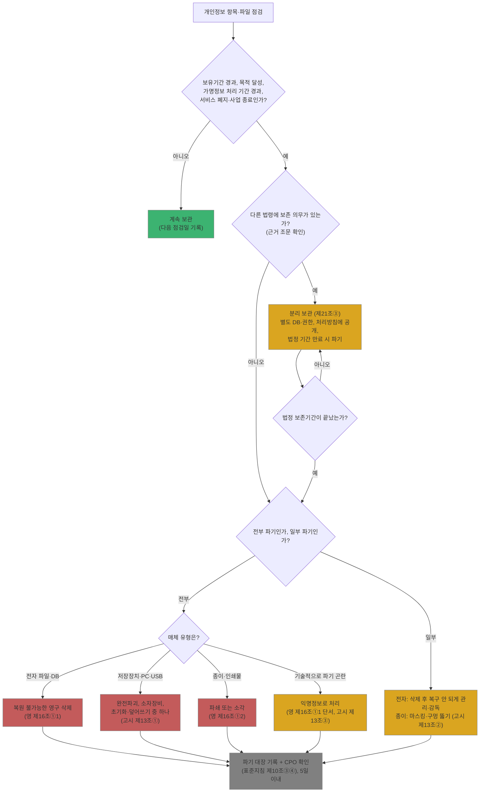

# Week 2 · Ch05. 보유기간 관리와 파기

> [← 이전 챕터](./ch04_아동_개인정보_처리.md) · [📚 전체 목차](../../README.md) · [다음 챕터 →](./ch06_개인정보_처리방침_작성_실습.md)

| 항목 | 내용 |
|---|---|
| 예상 학습 시간 | 75분 |
| 법령 기준일 | 2026-11-17 |
| 핵심 근거 | 개인정보 보호법 제15조제2항제3호, 제21조 / 시행령 제16조 / 안전성 확보조치 기준 제13조 / 표준지침 제10조, 제11조 |
| 관련 용어 | [보유기간](../../용어집.md#보유기간), [파기](../../용어집.md#파기), [분리보관](../../용어집.md#분리보관), [익명정보](../../용어집.md#익명정보), [보조저장매체](../../용어집.md#보조저장매체) |
| 선수 챕터 | [W2-ch01](./ch01_수집_이용의_적법_근거.md), [W1-ch04](../1주차/ch04_보호_원칙과_처리자의_기본_의무.md) |

---

## 1. 학습 목표

이 챕터를 마치면 담당자님은 다음을 할 수 있습니다.

1. 개인정보의 **보유기간**을 정하고, 다른 법령의 **보존 의무**가 있을 때 분리 보관 기준을 적용할 수 있다.
2. 전자 파일·종이 문서·저장매체별로 **법령이 인정하는 파기 방법**을 고를 수 있다.
3. 사내 **보유기간표**와 **파기 대장**을 작성하고 관리할 수 있다.

---

## 2. 한 줄 비유

> 💡 **개인정보 보유기간은 "냉장고 음식의 유통기한"입니다. 기한이 지나면 지체 없이 버려야 하고, 법이 "더 보관하라"고 정한 음식은 따로 칸을 나눠 이름표를 붙여 둡니다.**

단, 비유의 한계가 있습니다. 음식은 휴지통에 버리면 끝이지만, 개인정보는 **복구할 수 없게** 버려야 합니다. 휴지통에 넣은 파일, 포맷만 한 하드디스크, 통째로 버린 서류 박스는 "버린 것"이 아닙니다.

---

## 3. 개념 설명 및 법령 조문

### 3-1. 관련 조문

> 📌 **조문 주소 읽는 법**: 조 → 항(①②) → 호(1. 2.) → 목(가. 나.). 자세한 설명은 [W1-ch01 3-2](../1주차/ch01_개인정보의_정의와_판단_기준.md#3-2-관련-조문)를 보세요.

#### 📜 개인정보 보호법 제21조 (개인정보의 파기)

| 구분 | 내용 |
|---|---|
| **원문 요지** | ① **보유기간의 경과**, 개인정보의 **처리 목적 달성**, **가명정보의 처리 기간 경과** 등 개인정보가 불필요하게 되었을 때에는 **지체 없이** 파기해야 한다. 단, **다른 법령에 따라 보존**해야 하는 경우는 예외. ② 파기할 때는 **복구 또는 재생되지 않도록** 조치해야 한다. ③ 제1항 단서에 따라 보존하는 경우에는 해당 개인정보 또는 개인정보파일을 다른 개인정보와 **분리하여** 저장·관리해야 한다. ④ 파기 방법·절차는 시행령으로 정한다. |
| **쉬운 풀이** | 필요 없어지면 **바로**, **되살릴 수 없게** 지웁니다. 법 때문에 남겨야 하는 것만 **따로 떼어** 보관합니다. |
| **시행일** | 2026. 9. 11. 시행 법률 제21445호 기준 (제1항 <개정 2023. 3. 14.>) |
| **실무 포인트** | 파기하지 않으면 **3천만 원 이하**, 분리 보관하지 않으면 **1천만 원 이하** 과태료 대상입니다(법 제75조제2항제4호, 제4항제2호). 더 큰 위험은 사고 때입니다. 지웠어야 할 정보까지 유출되면 피해 규모와 과징금이 함께 커집니다(골프존 사례 → [W1-ch04](../1주차/ch04_보호_원칙과_처리자의_기본_의무.md)). |

근거 원문은 각주를 참고하세요.[^law-21]

#### 📜 표준지침 제10조·제11조 (파기 절차와 법령에 따른 보존)

| 구분 | 내용 |
|---|---|
| **원문 요지** | (제10조) ① 보유기간 경과, 처리 목적 달성, 가명정보 처리 기간 경과, **서비스 폐지, 사업 종료** 등으로 불필요하게 되었을 때에는 정당한 사유가 없는 한 그로부터 **5일 이내**에 파기해야 한다. ② "복원이 불가능한 방법"이란 **현재의 기술수준에서 사회통념상 적정한 비용으로** 복원이 불가능하도록 조치하는 방법이다. ③ 파기에 관한 사항을 **기록·관리**해야 한다. ④ **CPO는 파기 후 결과를 확인**해야 한다. (제11조) ① 법령에 근거해 보존해야 하면 **물리적 또는 기술적 방법으로 분리**해 저장·관리해야 한다. ② 분리 보관한다는 점을 **처리방침 등을 통해** 정보주체가 알 수 있게 해야 한다. |
| **쉬운 풀이** | 법의 "지체 없이"를 실무에서는 **5일 이내**로 봅니다. 파기는 **기록**하고 CPO가 **확인**합니다. |
| **시행일** | 2025. 4. 11. 시행 고시 제2025-4호 기준 |
| **실무 포인트** | 파기 대장에 최소한 **파기 일시, 대상(파일명·건수), 파기 사유, 방법, 담당자, CPO 확인**을 남기세요. |

근거 원문은 각주를 참고하세요.[^std-10-11]

#### 📜 시행령 제16조 + 안전성 확보조치 기준 제13조 (파기 방법)

| 대상 | 시행령 제16조제1항 | 안전조치 고시 제13조 |
|---|---|---|
| **전자적 파일** | 복원이 불가능한 방법으로 **영구 삭제**. 기술적 특성으로 영구 삭제가 현저히 곤란하면 **익명정보(법 제58조의2)로 처리**해 복원 불가능하게 | ① 다음 중 하나: 1. **완전파괴**(소각·파쇄 등) 2. 전용 **소자장비**로 삭제 3. 복원되지 않도록 **초기화 또는 덮어쓰기** |
| **기록물·인쇄물·서면 등** | **파쇄 또는 소각** | (위 ①의 1. 완전파괴) |
| **일부만 파기** | — | ② 전자 파일: 삭제 후 복구·재생되지 않도록 **관리·감독** / 그 외: 해당 부분을 **마스킹, 구멍 뚫기** 등으로 삭제 |
| **파기가 기술적으로 현저히 곤란** | 익명정보로 처리 | ③ 익명정보로 처리해 복원 불가능하게 |

근거 원문은 각주를 참고하세요.[^decree-16] [^safety-13]

> 💡 **"복원 불가능"의 기준**: 표준지침 제10조제2항은 "현재의 기술수준에서 **사회통념상 적정한 비용으로** 복원이 불가능"하면 된다고 정합니다. 국가 정보기관 수준의 포렌식까지 막으라는 뜻은 아닙니다. 다만 **휴지통 비우기, 빠른 포맷, 파일명 변경**은 일반 복구 도구로 되살릴 수 있으므로 해당하지 않습니다. `[출처: 일반 지식, 원문 확인 권장]` (복구 도구에 관한 설명)

### 3-2. 보유기간 정하기

| 단계 | 할 일 | 근거 |
|---|---|---|
| ① 목적별로 정하기 | 처리 목적마다 **"언제 목적이 끝나는가"**를 정합니다(예: 회원 관리 → 탈퇴 시, 이벤트 → 경품 발송 후 3개월) | 법 제15조제2항제3호, 제21조제1항 |
| ② 법정 보존기간 확인 | 다른 법령이 보존을 요구하는 기록을 찾습니다 | 법 제21조제1항 단서 |
| ③ 고지·공개 | 동의서와 처리방침에 **끝나는 시점**이 보이게 적습니다 | 법 제15조제2항, 제30조 |
| ④ 분리 보관 설계 | 법정 보존 정보는 운영 DB에서 떼어 **별도 DB·별도 권한**으로 관리합니다 | 법 제21조제3항, 표준지침 제11조 |
| ⑤ 자동 파기 | 보유기간이 끝나면 자동으로 파기되는 **배치·정책**을 만듭니다 | 법 제21조제1항 ("지체 없이") |

**참고: 처리방침 작성지침이 예시로 든 법정 보존기간** (근거 법령 원문으로 확인)

| 기록 | 기간 | 근거 법령 | 누가 지키나 |
|---|---|---|---|
| 표시·광고에 관한 기록 | 6개월 | 「전자상거래 등에서의 소비자보호에 관한 법률 시행령」 제6조제1항제1호 | 전자상거래 사업자 (통신판매중개자는 자기 시스템에서 처리한 기록 범위) |
| 계약 또는 청약철회 등에 관한 기록 | 5년 | 같은 항 제2호 | 〃 |
| 대금결제 및 재화등의 공급에 관한 기록 | 5년 | 같은 항 제3호 | 〃 |
| 소비자의 불만 또는 분쟁처리에 관한 기록 | 3년 | 같은 항 제4호 | 〃 |
| 인터넷 로그기록자료, 접속지 추적자료 | **3개월 이상** | 「통신비밀보호법」 제15조의2제2항, **같은 법 시행령 제41조제2항제2호** | **전기통신사업자** (「전기통신사업법」에 따른 사업자) |

근거 원문은 각주를 참고하세요.[^policy-p33][^ecom-tc] 전자상거래법 시행령 제6조의 기간은 위원회 질의응답 모음집도 같은 내용으로 안내합니다 [출처: 1. 개인정보 질의응답 모음집(2025.12.).pdf, Q59 (인쇄 p.70, PDF p.80)]. 이 기록들은 다른 개인정보와 **분리 보관**해야 합니다(법 제21조제3항, 전자상거래법 시행령 제6조제2항제3호도 동의를 철회한 소비자의 기록을 따로 보존하도록 정함).

> 💡 **통신비밀보호법의 3개월은 성격이 다릅니다.** 수사기관의 통신사실 확인자료 요청에 협조하기 위해 **전기통신사업자**가 "3개월 **이상**" 보관하라는 **최소 기간**입니다. 3개월이 지나면 반드시 지워야 한다는 뜻이 아닙니다. 또 모든 회사가 아니라 전기통신사업자에게 적용됩니다.
>
> **우리 회사가 전기통신사업자인가?** 전기통신사업법은 전기통신사업자를 "이 법에 따라 **등록 또는 신고**(신고가 면제된 경우 포함)를 하고 전기통신역무를 제공하는 자"로 정합니다. 전기통신역무는 전기통신설비로 **타인의 통신을 매개**하거나 설비를 타인의 통신용으로 제공하는 것이고, 전화·인터넷접속 같은 기간통신역무 **외의** 역무가 **부가통신역무**입니다. 부가통신사업을 하려면 과학기술정보통신부장관에게 **신고**해야 하고, 소규모 사업자는 신고한 것으로 봅니다.[^telecom]
>
> 👉 **실무 확인 방법**: 회사가 **부가통신사업 신고**를 했는지(또는 신고 면제 대상인지) 법무·대관 부서에 먼저 물어보세요. 신고했다면 전기통신사업자로 보고 접속 로그를 **3개월 이상** 보관합니다.
>
> ⚠️ 확인 필요: 소규모 사업자의 신고 면제 기준(자본금 등)은 전기통신사업법 **시행령**에 있어 확인하지 못했습니다. 또 쇼핑몰처럼 판매가 주된 서비스가 "타인의 통신을 매개"하는지는 서비스 구성(게시판, 메시지 기능 등)에 따라 달라지는 해석 문제입니다.

---

## 4. 사내 실무 적용

### 🎭 상황극 1. 회원서비스팀의 "탈퇴 회원 정보, 재가입 방지용으로 남겨도 되죠?"

> **📨 회원서비스팀 유 대리**: "탈퇴하자마자 다시 가입해서 **신규가입 쿠폰을 반복으로 받는** 사람이 많아요. 그래서 탈퇴 회원의 이름, 휴대폰 번호, 이메일, 주문 내역을 **전부 3년 동안 그대로** 회원 DB에 두려고요. 괜찮죠?"

**🙋 담당자 답변**

| 구분 | 내용 |
|---|---|
| **결론** | ⚠️ **조건부 가능** — 탈퇴 즉시 원칙적으로 파기해야 합니다. 쿠폰 부정 이용 방지 목적이라면 **필요한 최소 정보**(예: 휴대폰 번호의 일방향 암호화값)만 **짧은 기간** 남길 수 있는지 검토합니다. 전자상거래법상 보존 기록(주문·결제)은 **분리 보관**합니다. "전부, 그대로, 회원 DB에"는 안 됩니다. |
| **근거** | 개인정보 보호법 제21조제1항(목적 달성 시 지체 없이 파기)·제3항(분리 보관), 제15조제1항제6호(정당한 이익: 명백히 우선 + 상당한 관련 + 합리적 범위), 제16조제1항(최소 수집), 표준지침 제10조제1항(5일 이내), 제11조(분리 보관과 공개) |
| **다음 행동** | ① 탈퇴 시 남길 정보를 **목적별로** 나눕니다. **주문·결제 기록**: 전자상거래법 보존 의무 → 별도 DB로 분리, 접근 권한 최소화, 기간 만료 시 파기. **부정 이용 방지**: 재가입 판별에 필요한 최소 값만, 기간을 정해(예: 수개월) 보관. 정당한 이익 근거라면 판단 기록을 남깁니다. **나머지**(이름, 이메일, 마케팅 정보 등): 5일 이내 파기. ② 처리방침에 탈퇴 후 보관 항목·목적·기간을 공개합니다(표준지침 제11조제2항). ③ 탈퇴 처리 배치에 **분리·파기 로직**을 넣고 파기 대장을 자동 기록합니다. |

**왜 그런가요?** 탈퇴는 회원 관리라는 **목적이 달성된** 시점입니다. 부정 이용 방지는 정당한 목적이 될 수 있지만, 그 목적에 **필요한 범위**만큼만 남길 수 있습니다. 위원회 질의응답에서 확인되는 기준은 두 가지입니다. ① 탈퇴 후 남긴 정보(예: 회원번호)가 그것만으로 또는 다른 정보와 쉽게 결합해도 **누구인지 알 수 없다면** 개인정보가 아니므로 파기하지 않아도 됩니다(Q64). 그런데 휴대폰 번호 해시값은 재가입자의 번호를 같은 방식으로 해시해 **대조하려고** 남기는 것이므로 개인정보로 보고 관리해야 합니다. ② 다른 사안(계약이 체결되지 않은 경우)에서 위원회는 처리자의 **정당한 이익**(제15조제1항제6호)을 위해 필요하면 "합리적인 기간 내에서" 보유한 뒤 파기할 수 있다고 안내합니다(Q66). [출처: 1. 개인정보 질의응답 모음집(2025.12.).pdf, Q64 (인쇄 p.75), Q66 (인쇄 p.77)]
>
> ⚠️ 확인 필요: 쿠폰 부정 이용 방지가 정당한 이익에 해당하는지, 적정 보관 기간이 얼마인지를 직접 다룬 위원회 해석은 찾지 못했습니다. `[출처: 일반 지식, 원문 확인 권장]`

### 🎭 상황극 2. IT팀의 "리스 PC 반납할 때 포맷만 하면 되죠?"

> **📨 IT팀 진 주임**: "리스 계약이 끝난 노트북 **50대**를 다음 주에 반납해요. 영업팀이 고객 엑셀 파일을 많이 저장해 두던 PC들인데, Windows **초기화(빠른 포맷)**만 하고 보내면 되죠? 하드디스크를 부수면 리스사에 변상해야 해서요."

**🙋 담당자 답변**

| 구분 | 내용 |
|---|---|
| **결론** | ⚠️ **조건부 가능** — 빠른 포맷은 복원될 수 있어 **파기가 아닙니다.** 물리 파괴를 할 수 없다면 **복원되지 않도록 초기화 또는 덮어쓰기**를 하고, 그 결과를 **기록**해야 합니다. |
| **근거** | 개인정보 보호법 제21조제2항(복구·재생되지 않도록), 시행령 제16조제1항제1호, 안전조치 고시 제13조제1항제3호("데이터가 복원되지 않도록 초기화 또는 덮어쓰기 수행"), 표준지침 제10조제2항·제3항 |
| **다음 행동** | ① 저장장치를 **완전 삭제(덮어쓰기)**하는 방법을 정합니다. 예: Windows 11 "이 PC 초기화"에서 **"드라이브 정리(Clean the drive)"** 옵션 선택, 또는 전문 삭제 도구 사용 `[출처: 일반 지식, 원문 확인 권장]` ② BitLocker가 켜져 있던 PC라면 암호화 상태에서 초기화하는 것도 보호에 도움이 됩니다 → [W3-ch07](../3주차/ch07_윈도우11_실습.md) ③ PC마다 **시리얼 번호, 삭제 방법, 일시, 담당자**를 파기 대장에 기록하고 CPO 확인을 받습니다. ④ 리스사와 계약에 **반납 장비의 데이터 삭제 책임**과 삭제 확인서 조항이 있는지 확인합니다. 리스사가 삭제를 대행하면 **처리위탁**이므로 위탁 문서가 필요합니다 → [W2-ch03](./ch03_제3자_제공과_처리위탁_구분.md) |

**왜 그런가요?** 고시 제13조제1항은 파기 방법으로 **완전파괴, 소자, 초기화·덮어쓰기** 세 가지를 인정합니다. 물리 파괴를 못 해도 **"복원되지 않도록" 하는 초기화·덮어쓰기**라면 됩니다. 핵심은 "복원되지 않도록"입니다. 안내서는 SSD 같은 **메모리 저장장치**에는 고시 제13조제1항의 **제1호(완전파괴) 또는 제3호(복원되지 않도록 초기화·덮어쓰기)**를 적용하라고 설명합니다. 자기장을 쓰는 소자장비(제2호)는 메모리 저장장치에 맞지 않기 때문입니다.[^guide-p116] ⚠️ SSD에서 어떤 초기화 방식이 "복원되지 않는" 수준인지는 장비 특성에 따라 다를 수 있으니 IT 보안 담당과 정하세요. `[출처: 일반 지식, 원문 확인 권장]`

---

## 5. 보유기간 만료·파기 판단 플로우

**그림 읽는 법**: 적색 칸이 **실제 파기**입니다. 어느 방법이든 마지막에는 **파기 대장 기록과 CPO 확인**(회색)으로 모입니다. 황색의 분리 보관은 "파기를 미루는 것"일 뿐이므로, 법정 기간이 끝나면 다시 파기 경로로 돌아옵니다.

---

## 6. 개인정보보호위원회 처분 사례

### ⚖️ 사례: ㈜엘지유플러스의 테스트 데이터 방치와 파기 의무 위반 (2023. 7. 의결)

| 단계 | 내용 |
|---|---|
| **사건 개요** | 2023년 1월 해커가 불법거래 사이트에 엘지유플러스 고객 개인정보 약 60만 건(중복 제거 시 약 30만 건)을 공개했습니다. 분석 결과 유출된 개인정보는 **297,117건**(중복 제거)이었고, 휴대전화번호·성명·주소·생년월일·이메일·아이디·USIM 고유번호 등 **26개 항목**이었습니다. 유출 시점은 2018년 6월경으로 확인되었습니다. 조사 과정에서 고객인증시스템(CAS)의 **운영 데이터를 개발기·검수기로 옮겨 테스트한 뒤 일부를 방치**해, **2008년에 생성된 정보 등 1천만 건 이상의 개인정보가 조사 시점까지 남아 있었던** 사실이 드러났습니다. 이 밖에 단종 소프트웨어 사용, 보안장비 미설치·정책 미적용, 2009년·2018년 업로드된 웹셸 방치, 접근권한·접속기록 관리 부실도 확인되었습니다. |
| **위반 조항** | 보도자료 참고1 표 기준: 개인정보의 파기 **법 §21①, 영 §16** / 안전조치의무 **법 §29, 영 §48조의2, 고시 §4·§5**(접근권한 부여·변경·말소 내역 보관 소홀, 침입차단·탐지시스템 운영 소홀, 비밀번호 작성규칙 미적용, 접속기록 보존·관리 소홀) / 유출 통지·신고 **구 법 §39조의4①, 영 §48조의4**(24시간 이내 유출 통지하지 않음) |
| **처분 결과** | 과징금 **68억 45만 2천 원**, 과태료 **2,700만 원**, 시정조치 명령(CPO 역할·위상 강화, 보호 조직 전문성 제고, 내부관리계획 재정립, 시스템 전반 점검 등), 결과 공표 |
| **파기 관점의 교훈** | ① **테스트용 복사본도 개인정보**이고, 테스트가 끝나면 **목적이 달성된 것**이므로 파기 대상입니다. ② 운영 DB만 보면 안 됩니다. **개발·검수·백업·분석 서버**에 남은 복사본이 가장 오래 방치됩니다. ③ 위원회는 최근 3년 내 위반 이력(수탁자 관리·감독 소홀, 접근통제 위반으로 2020. 12. 처분)도 함께 언급했습니다. 반복 위반은 2026년 개정법에서 **가중 과징금** 사유입니다 → [W1-ch05](../1주차/ch05_보호위원회의_역할과_제재_체계.md) |
| **출처** | 개인정보보호위원회 보도자료, 「개인정보위, ㈜엘지유플러스 개인정보 유출사고에 대해 과징금 68억 원, 과태료 2,700만 원 및 시정명령 부과」(2023. 7. 12. 의결·발표)[^case-lgu] |

> 💬 **사수의 한마디**: 파기 점검을 할 때 개발팀에 **"개발·검수·스테이징 서버에 운영 데이터 복사본이 있나요?"**를 꼭 물으세요. 대부분 "아마 없을 거예요"라고 답하지만, 실제로 찾아보면 몇 년 전 복사본이 나오는 경우가 많습니다.

---

## 7. 오답노트

| # | ❌ 잘못된 생각 | ✅ 올바른 이해 | 근거 조문 |
|---|---|---|---|
| 1 | "보유기간 끝난 정보는 연말에 한꺼번에 지우면 돼요." | 불필요하게 되면 **지체 없이** 파기해야 하고, 표준지침은 이를 **5일 이내**로 정합니다. 연 1회 일괄 파기로는 부족합니다. 자동 파기를 설계하세요. | 법 제21조제1항, 표준지침 제10조제1항 |
| 2 | "법 때문에 5년 보관해야 하니까 회원 DB에 그대로 두면 되죠." | 다른 법령 때문에 보존하는 정보는 다른 개인정보와 **분리해서** 저장·관리하고, 그 사실을 처리방침 등에 알려야 합니다. | 법 제21조제3항, 표준지침 제11조 |
| 3 | "휴지통 비우고 빠른 포맷 했으니 파기 끝이에요." | 복구·재생되지 않도록 해야 합니다. 저장장치는 완전파괴·소자·**복원되지 않도록 초기화·덮어쓰기** 중 하나를 써야 합니다. | 법 제21조제2항, 영 제16조제1항, 안전조치 고시 제13조제1항 |
| 4 | "테스트 서버에 있는 건 운영 데이터가 아니니 파기 대상이 아니에요." | 테스트용 복사본도 개인정보이고, 테스트가 끝나면 목적이 달성된 것입니다. 엘지유플러스는 개발기·검수기에 남은 1천만 건 이상의 정보로 파기 위반 판단을 받았습니다. | 법 제21조제1항, 영 제16조 |
| 5 | "파기했다는 기록까지 남길 필요는 없죠." | 파기에 관한 사항을 **기록·관리**하고, **CPO가 파기 결과를 확인**해야 합니다. 기록이 없으면 조사 때 파기했다는 사실을 증명할 수 없습니다. | 표준지침 제10조제3항·제4항 |
| 6 | "보유기간은 '관련 법령에 따른 기간'이라고 쓰면 충분해요." | 동의서와 처리방침에는 **끝나는 시점**을 알 수 있게 구체적으로 써야 합니다. 법정 보존이면 **근거 법령과 기간**을 함께 적습니다. | 법 제15조제2항제3호, 제30조, 작성지침 p.33~34 |

---

## 8. 업무 체크리스트

**📋 보유기간·파기 셀프 점검표**

| 점검 주기 | 월 1회 파기 대장 확인 + 연 1회 보유기간표 전면 재검토 | 점검자 | 개인정보보호 담당자 (CPO 확인) | 점검일 | ____-__-__ |
|---|---|---|---|---|---|

- [ ] 사내 개인정보파일마다 **목적, 보유기간, 파기 시점, 파기 담당자**를 적은 **보유기간표**가 있다
- [ ] 법정 보존 정보마다 **근거 법령 조문과 기간**을 법무팀과 확인해 기록했다 (법 제21조제1항 단서)
- [ ] 법정 보존 정보는 운영 DB와 **분리된 저장소·권한**으로 관리되고, 처리방침에 그 사실이 공개되어 있다 (제21조제3항, 표준지침 제11조)
- [ ] 회원 탈퇴, 이벤트 종료, 채용 종료 등 **목적 달성 시점에 자동 파기**가 동작한다 (5일 이내, 표준지침 제10조제1항)
- [ ] 개발·검수·스테이징·백업·분석 서버에 **운영 데이터 복사본**이 남아 있지 않은지 확인했다
- [ ] 파일서버·공유 폴더·개인 PC에 남은 **오래된 개인정보 파일**(퇴사자, 지원자, 이벤트 명단)을 찾아 정리했다
- [ ] 종이 문서는 **파쇄 또는 소각**하고, 외부 파쇄 업체를 쓰면 **위탁 계약과 파기 확인서**가 있다 (영 제16조제1항제2호)
- [ ] 폐기·반납하는 PC·서버·USB는 **완전파괴, 소자, 복원 불가능한 초기화·덮어쓰기** 중 하나로 처리한다 (고시 제13조제1항)
- [ ] **파기 대장**에 일시·대상·건수·사유·방법·담당자가 기록되고, **CPO 확인**이 있다 (표준지침 제10조제3항·제4항)
- [ ] 동의서·처리방침의 보유기간 문구가 **구체적**이다 (법 제15조제2항제3호)

---

## 9. 실습 과제 / 퀴즈

### 객관식

**Q1.** 표준지침 제10조제1항에 따라 개인정보가 불필요하게 되었을 때 **정당한 사유가 없는 한 파기해야 하는 기한**은?

1. 그로부터 5일 이내
2. 그로부터 30일 이내
3. 그해 연말까지
4. 정보주체가 파기를 요구할 때까지

**Q2.** 다른 법령에 따라 개인정보를 파기하지 않고 보존해야 하는 경우의 처리로 **옳은 것**은?

1. 보존 기간 동안 마케팅에도 계속 이용할 수 있다.
2. 다른 개인정보와 분리하여 저장·관리해야 한다.
3. 보존 사실을 정보주체에게 알릴 필요는 없다.
4. 보존 기간이 끝나도 회사가 원하면 계속 보관할 수 있다.

**Q3.** 안전성 확보조치 기준 제13조제1항에 따른 **저장장치의 개인정보 파기 방법이 아닌 것**은?

1. 소각·파쇄 등 완전파괴
2. 전용 소자장비를 이용한 삭제
3. 데이터가 복원되지 않도록 초기화 또는 덮어쓰기
4. 파일을 휴지통으로 이동한 뒤 휴지통 비우기

### 🛠️ 실습: 보유기간표 작성

**Q4.** 우리 회사(온라인 쇼핑몰)의 아래 개인정보에 대해 **보유기간표**를 작성하세요. 법정 보존기간은 3-2절의 작성지침 예시를 참고하세요.

| # | 개인정보 (처리 목적) | 보유기간 | 근거 (동의 / 계약 / 법령 조문) | 만료 후 처리 (파기 / 분리 보관) | 파기 방법 |
|---|---|---|---|---|---|
| 1 | 회원 정보 (회원 관리) | | | | |
| 2 | 주문·결제 기록 (주문 처리) | | | | |
| 3 | 고객 불만 상담 기록 (분쟁 처리) | | | | |
| 4 | 이벤트 응모자 정보 (경품 지급) | | | | |
| 5 | 홈페이지 접속 로그 (서비스 운영) | | | | |
| 6 | 불합격 입사지원서 (채용) | | | | |
| 7 | 종이 반품 신청서 (반품 처리) | | | | |

> ✅ 다 풀었다면 [정답 및 해설](../../정답과_해설.md#w2-ch05)에서 확인하세요. 틀린 문제는 **7. 오답노트**에 한 줄씩 추가하세요.

---

## 10. 더 읽을거리

| 자료 | 발행 | 참고자료 파일명 | 이 챕터와의 관계 |
|---|---|---|---|
| 개인정보 보호법 | 법률 제21445호 | `개인정보 보호법(법률)(제21445호)(20260911).pdf` | 제21조, 제75조제2항제4호·제4항제2호 |
| 개인정보 보호법 시행령 | 대통령령 제36804호 | `개인정보 보호법 시행령(대통령령)(제36804호)(20261110).pdf` | 제16조(파기 방법) |
| 개인정보의 안전성 확보조치 기준 | 고시 제2026-9호 | `개인정보의 안전성 확보조치 기준(개인정보보호위원회고시)(제2026-9호)(20260701).pdf` | 제13조(파기 방법 상세) |
| 개인정보의 안전성 확보조치 기준 안내서 | 개인정보보호위원회, 2026. 11. | `개인정보의 안전성 확보조치 기준 안내서(2026.11).pdf` | 제13조 해설(목차상 p.108) |
| 표준 개인정보 보호지침 | 고시 제2025-4호 | `표준 개인정보 보호지침(개인정보보호위원회고시)(제2025-4호)(20250411).pdf` | 제10조(5일·기록·CPO 확인), 제11조(분리 보관·공개) |
| 2026 개인정보 처리방침 작성지침 | 개인정보보호위원회, 2026. 4. | `2026 개인정보 처리방침 작성지침.pdf` | PDF p.33~36(보유기간 작성 예시와 법정 보존기간) |
| 개인정보위 보도자료 (엘지유플러스) | 개인정보보호위원회, 2023. 7. | `230713 (조간) 개인정보위, ㈜엘지유플러스 개인정보 유출사고에 대해 과징금 68억 원, 과태료 2,700만 원 및 시정명령 부과(조사2과)FN.pdf` | 6절 처분 사례, p.4 위반 조항 표 |

---

> [← 이전 챕터](./ch04_아동_개인정보_처리.md) · [📚 전체 목차](../../README.md) · [📖 용어집](../../용어집.md) · [다음 챕터 →](./ch06_개인정보_처리방침_작성_실습.md)

[^law-21]: [출처: [개인정보 보호법(법률)(제21445호)(20260911).pdf](<../../참고자료/개인정보 보호법(법률)(제21445호)(20260911).pdf>), 제21조제1항~제4항 (제1항 <개정 2023. 3. 14.>), 제75조제2항제4호·제4항제2호]
[^std-10-11]: [출처: [표준 개인정보 보호지침(개인정보보호위원회고시)(제2025-4호)(20250411).pdf](<../../참고자료/표준 개인정보 보호지침(개인정보보호위원회고시)(제2025-4호)(20250411).pdf>), 제10조제1항~제4항, 제11조제1항·제2항]
[^decree-16]: [출처: [개인정보 보호법 시행령(대통령령)(제36804호)(20261110).pdf](<../../참고자료/개인정보 보호법 시행령(대통령령)(제36804호)(20261110).pdf>), 제16조제1항·제2항]
[^safety-13]: [출처: [개인정보의 안전성 확보조치 기준(개인정보보호위원회고시)(제2026-9호)(20260701).pdf](<../../참고자료/개인정보의 안전성 확보조치 기준(개인정보보호위원회고시)(제2026-9호)(20260701).pdf>), 제13조제1항~제3항]
[^guide-p116]: [출처: [개인정보의 안전성 확보조치 기준 안내서(2026.11).pdf](<../../참고자료/개인정보의 안전성 확보조치 기준 안내서(2026.11).pdf>), PDF p.116 (인쇄 p.108) 제13조 해설 "메모리 저장장치의 경우에는, 제1호 … 제3호 … 내용을 적용하여야 한다"]
[^policy-p33]: [출처: [2026 개인정보 처리방침 작성지침.pdf](<../../참고자료/2026 개인정보 처리방침 작성지침.pdf>), PDF p.33~34 보유기간 작성 예시 (전자상거래법 시행령 제6조, 통신비밀보호법 제15조의2제2항 인용)]
[^ecom-tc]: [출처: [전자상거래 등에서의 소비자보호에 관한 법률 시행령(대통령령)(제36507호)(20260721).pdf](<../../참고자료/전자상거래 등에서의 소비자보호에 관한 법률 시행령(대통령령)(제36507호)(20260721).pdf>), 제6조제1항·제2항] / [출처: [통신비밀보호법(법률)(제21989호)(20261002).pdf](<../../참고자료/통신비밀보호법(법률)(제21989호)(20261002).pdf>), 제2조제11호마목·사목, 제15조의2] / [출처: [통신비밀보호법 시행령(대통령령)(제36728호)(20261002).pdf](<../../참고자료/통신비밀보호법 시행령(대통령령)(제36728호)(20261002).pdf>), 제41조제2항]
[^telecom]: [출처: [전기통신사업법(법률)(제21503호)(20261001).pdf](<../../참고자료/전기통신사업법(법률)(제21503호)(20261001).pdf>), 제2조제6호·제8호·제11호·제12호, 제22조제1항·제5항]
[^case-lgu]: [출처: [230713 (조간) 개인정보위, ㈜엘지유플러스 개인정보 유출사고에 대해 과징금 68억 원, 과태료 2,700만 원 및 시정명령 부과(조사2과)FN.pdf](<../../참고자료/230713 (조간) 개인정보위, ㈜엘지유플러스 개인정보 유출사고에 대해 과징금 68억 원, 과태료 2,700만 원 및 시정명령 부과(조사2과)FN.pdf>), p.1 (유출 규모·항목·시점), p.2 (위반 사항: 개발기·검수기 데이터 방치), p.3 (시정명령, 최근 3년 위반 이력), p.4 「참고1」 위반 조항 표]
