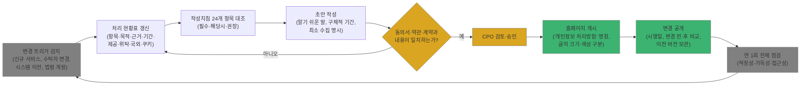

# Week 2 · Ch06. 개인정보 처리방침 작성·공개 실습

> [← 이전 챕터](./ch05_보유기간_관리와_파기.md) · [📚 전체 목차](../../README.md) · [다음 챕터 →](../3주차/ch01_내부_관리계획과_취급자_교육.md)

| 항목 | 내용 |
|---|---|
| 예상 학습 시간 | 90분 (실습 포함) |
| 법령 기준일 | 2026-11-17 |
| 핵심 근거 | 개인정보 보호법 제30조, 제30조의2 / 시행령 제31조, 제31조의2 / 표준지침 제18조~제21조 / 2026 개인정보 처리방침 작성지침 |
| 관련 용어 | [개인정보 처리방침](../../용어집.md#개인정보-처리방침), [위탁자](../../용어집.md#위탁자), [수탁자](../../용어집.md#수탁자), [국외 이전](../../용어집.md#국외-이전), [개인정보 보호책임자](../../용어집.md#개인정보-보호책임자), [국내대리인](../../용어집.md#국내대리인) |
| 선수 챕터 | [W2-ch01](./ch01_수집_이용의_적법_근거.md) ~ [W2-ch05](./ch05_보유기간_관리와_파기.md) (Week 2 전체 내용이 처리방침에 들어갑니다) |

---

## 1. 학습 목표

이 챕터를 마치면 담당자님은 다음을 할 수 있습니다.

1. 법 제30조와 시행령 제31조가 정한 **처리방침 필수 기재 사항**을 빠짐없이 확인할 수 있다.
2. 처리방침을 **공개·변경**하는 방법과 위원회의 **처리방침 평가** 기준을 설명할 수 있다.
3. 사내 개인정보 처리 현황을 바탕으로 **처리방침 초안**을 작성할 수 있다.

---

## 2. 한 줄 비유

> 💡 **개인정보 처리방침은 "식당 주방 공개 안내판"입니다. 어떤 재료를(항목) 왜 쓰고(목적), 언제까지 보관하며(보유기간), 어느 협력업체에 맡기는지(위탁)를 손님이 보이는 곳에 걸어 두는 것입니다.**

단, 비유의 한계가 있습니다. 안내판에 적은 내용과 실제 주방이 다르면 문제가 됩니다. 처리방침은 **실제 처리 현황과 일치**해야 하고, 처리방침과 계약 내용이 다르면 **정보주체에게 유리한 쪽**이 적용됩니다(법 제30조제3항).

---

## 3. 개념 설명 및 법령 조문

### 3-1. 관련 조문

> 📌 **조문 주소 읽는 법**: 조 → 항(①②) → 호(1. 2.) → 목(가. 나.). 자세한 설명은 [W1-ch01 3-2](../1주차/ch01_개인정보의_정의와_판단_기준.md#3-2-관련-조문)를 보세요.

#### 📜 개인정보 보호법 제30조 (개인정보 처리방침의 수립 및 공개)

| 구분 | 내용 |
|---|---|
| **원문 요지** | ① 다음 사항이 포함된 처리방침을 정해야 한다: 1. **처리 목적** 2. **처리 및 보유 기간** 3. **제3자 제공**(해당 시) 3의2. **파기 절차·방법**(법정 보존 시 보존 근거와 항목 포함) 3의3. **민감정보 공개 가능성**과 비공개 선택 방법(해당 시) 4. **처리위탁**(해당 시) 4의2. **가명정보** 처리(해당 시) 5. 정보주체와 **법정대리인의 권리·의무와 행사 방법** 6. **CPO 성명** 또는 보호 업무·고충 처리 부서의 명칭과 연락처 7. 쿠키 등 **자동 수집 장치**의 설치·운영과 거부(해당 시) 8. 시행령으로 정한 사항. ② 수립·변경 시 정보주체가 쉽게 확인할 수 있게 **공개**해야 한다. ③ 처리방침과 계약 내용이 다르면 **정보주체에게 유리한 것**을 적용한다. ④ 위원회는 **작성지침**을 정해 준수를 권장할 수 있다. |
| **쉬운 풀이** | 처리방침은 Week 2에서 배운 모든 내용(근거, 항목, 보유기간, 제공·위탁, 파기, 아동)의 **요약본**이자 **대외 약속**입니다. |
| **시행일** | 2026. 9. 11. 시행 법률 제21445호 기준 (<개정 2023. 3. 14.>) |
| **실무 포인트** | 처리방침을 정하지 않거나 공개하지 않으면 **1천만 원 이하 과태료** 대상입니다(법 제75조제4항제8호). 하지만 더 흔한 문제는 **처리방침은 있는데 실제와 다른 것**입니다(6절 사례). |

근거 원문은 각주를 참고하세요.[^law-30]

#### 📜 개인정보 보호법 시행령 제31조 (처리방침의 내용 및 공개방법)

| 구분 | 내용 |
|---|---|
| **원문 요지** | ① 법 제30조제1항제8호의 "대통령령으로 정한 사항": 1. **처리하는 개인정보의 항목** 2. 국외 이전 시 **국외 이전의 근거**와 법 제28조의8제2항 각 호의 사항 3. **안전성 확보 조치** 4. 국외에서 국내 정보주체의 개인정보를 직접 수집해 처리하는 경우 **처리 국가명**. ② 처리방침은 **인터넷 홈페이지에 지속적으로 게재**해야 한다. ③ 홈페이지에 게재할 수 없으면 사업장 게시, 관보·신문, 연 2회 이상 간행물·청구서, 계약서 기재 중 하나 이상으로 공개한다. |
| **시행일** | 2026. 11. 10. 시행 대통령령 제36804호 기준 |

근거 원문은 각주를 참고하세요.[^decree-31]

#### 📜 표준지침 제18조~제21조 (작성 기준, 기재 사항, 공개, 변경)

| 조 | 원문 요지 | 실무 포인트 |
|---|---|---|
| 제18조 | 법 제30조제1항과 영 제31조제1항의 사항을 **명시적으로 구분**하되, **알기 쉬운 용어**로 **구체적이고 명확하게** 표현. 처리하는 개인정보가 목적에 필요한 **최소한**이라는 점을 밝혀야 함 | 법조문 문구를 그대로 복사하지 말 것 |
| 제19조 | 기재 사항 17가지를 **모두 포함** (목적, 항목, 보유기간, 제공, 추가적 이용·제공 판단 기준, 자동 수집 장치, 파기, 민감정보 공개, 위탁, 가명정보, 안전조치, **처리방침 변경**, CPO 연락처, **국내대리인**, 권리 행사 방법, **열람청구 접수 부서**, **권익침해 구제방법**) | 법률·시행령 사항 + 표준지침 추가 사항을 합쳐 체크 |
| 제20조 | 홈페이지에 지속적으로 게재. **"개인정보 처리방침"이라는 명칭**을 쓰고, **글자 크기·색상** 등으로 다른 고지사항과 **구분** | 홈페이지 하단 링크를 굵게·색상으로 강조 |
| 제21조 | 변경 시 **변경 및 시행 시기, 변경 내용**을 지속적으로 공개하고, **변경 전·후를 비교**해 공개 | 이전 버전 보기 + 신구 대비표 |

근거 원문은 각주를 참고하세요.[^std-18-21]

#### 📜 개인정보 보호법 제30조의2 + 시행령 제31조의2 (처리방침 평가)

| 구분 | 내용 |
|---|---|
| **원문 요지** | 위원회는 처리방침에 대해 1. 포함해야 할 사항을 **적정하게** 정하고 있는지 2. **알기 쉽게** 작성했는지 3. 정보주체가 **쉽게 확인**할 수 있는 방법으로 공개하는지를 평가하고, 개선이 필요하면 **개선을 권고**할 수 있다. 평가 대상은 처리자의 유형·매출액, 민감·고유식별정보 등 처리 규모, 처리의 법적 근거·방식, 법 위반 발생 여부, **아동·청소년 등 정보주체의 특성**을 고려해 선정하고, 평가 개시 **10일 전**까지 평가계획을 통보한다. |
| **시행일** | 법 제30조의2 [본조신설 2023. 3. 14.] |
| **실무 포인트** | 평가 기준 세 가지(**적정성·가독성·접근성**)를 사내 처리방침 점검표의 큰 틀로 쓰세요. |

근거 원문은 각주를 참고하세요.[^law-30-2]

### 3-2. 작성지침의 기재 사항 24개 (작성 순서)

2026 작성지침은 처리방침에 들어갈 항목을 다음 순서로 안내합니다. "해당시"는 실제로 그 처리를 하는 경우에만 쓰고, 해당 사항이 없으면 **"처리하지 않는다"**고 적는 것도 가능합니다.[^policy-p17]

| # | 기재 사항 | 구분 | 이 교재에서 배운 곳 |
|---|---|---|---|
| 1 | 제목 및 서문 | | — |
| 2 | 개인정보의 처리 목적 | 필수 | W2-ch01 |
| 3 | 처리하는 개인정보의 항목 | 필수 | W2-ch01 |
| 4 | 14세 미만 아동의 개인정보 처리 | 해당시 | W2-ch04 |
| 5 | 개인정보의 처리 및 보유 기간 | 필수 | W2-ch05 |
| 6 | 파기 절차 및 방법 | 필수 | W2-ch05 |
| 7 | 제3자 제공 | 해당시 | W2-ch03 |
| 8 | 추가적인 이용·제공이 지속적으로 발생 시 판단 기준 | 해당시 | W2-ch01 |
| 9 | 처리업무의 위탁 | 해당시 | W2-ch03 |
| 10 | 국외 수집 및 이전 | 해당시 | W4-ch03 |
| 11 | 안전성 확보조치 | 필수 | Week 3 |
| 12 | 민감정보의 공개 가능성 및 비공개 선택 방법 | 해당시 | W2-ch02 |
| 13 | 가명정보 처리 | 해당시 | W4-ch05 |
| 14 | 자동 수집 장치(쿠키 등)의 설치·운영 및 거부 | 해당시 | W1-ch01 (행태정보) |
| 15 | 제3자가 자동 수집 장치로 행태정보를 수집하도록 허용하는 경우 | 권장·해당시 | W1-ch01 |
| 16 | 정보주체와 법정대리인의 권리·의무 및 행사방법 | 필수 | W4-ch02 |
| 17 | 자동화된 결정 | 해당시 | W4-ch02 |
| 18 | CPO 성명 또는 담당·고충처리 부서 | 필수 | W1-ch03 |
| 19 | 국내대리인 지정 | 해당시 | W1-ch03 |
| 20 | 정보주체의 권익침해에 대한 구제방법 | 권장 | W4-ch02 |
| 21 | 고정형 영상정보처리기기 운영·관리 | 해당시 | W3-ch06 |
| 22 | 이동형 영상정보처리기기 운영·관리 | 해당시 | W3-ch06 |
| 23 | 자율적으로 정한 처리 기준·보호조치 | 권장 | — |
| 24 | 처리방침의 변경 | 필수 | — |

> ⚠️ 확인 필요: 표의 "필수" 표시는 작성지침 p.17 표에서 "해당시"·"권장" 표시가 없는 항목을 이 교재가 "필수"로 옮긴 것입니다. 원문 표에는 "필수"라는 단어가 따로 적혀 있지 않습니다. 작성지침은 또 처리방침을 **제목 → 서문 → 본문** 순으로 구성하고, 본문 시작 부분에 **하이퍼링크 목차**를 두라고 권장합니다(p.18). 주요 내용을 기호로 요약하는 **"주요 개인정보 처리 표시(라벨링)"** 방법도 안내합니다(목차상 Ⅴ장).

> ⚠️ 작성지침(2026. 4.)은 2026. 9. 11. 개정법 시행 전에 나와, 법 제31조의 **옛 항 번호**를 인용하는 부분이 있습니다(CPO 업무: 옛 제31조제3항 → 현행 **제4항**). 처리방침에 조문 번호를 적을 때는 현행 법령으로 확인하세요 → [근거 우선순위](../../템플릿/README.md#3-1-근거의-우선순위)

> 🕒 **시행 예정 (2027. 3. 9.)**: 위원회 심의·의결을 받아 AI 개발에 개인정보를 이용하는 회사는 **이용 목적과 개인정보의 유형을 처리방침에 포함**해야 합니다(제28조의12제5항). → [W4-ch04](../4주차/ch04_AI와_생성형_AI_도입.md) [출처: 개인정보 보호법(법률)(제21445호)(20260911).pdf, 제28조의12제5항 `[시행일: 2027. 3. 9.]`]

---

## 4. 사내 실무 적용

### 🎭 상황극 1. 마케팅팀의 "처리방침은 다른 회사 것 복사해서 회사 이름만 바꾸면 되죠?"

> **📨 마케팅팀 홍 과장**: "새로 여는 브랜드몰 처리방침이 필요한데, 비슷한 쇼핑몰 처리방침을 **복사해서 회사 이름만** 바꾸면 되지 않나요? 어차피 다 비슷하잖아요."

**🙋 담당자 답변**

| 구분 | 내용 |
|---|---|
| **결론** | ❌ **그대로 복사는 불가** — 처리방침은 **우리 회사의 실제 처리 현황**을 적은 문서여야 합니다. 다른 회사의 수탁자·보유기간·항목이 그대로 들어가면 사실과 다른 공개가 됩니다. 작성지침의 **틀**은 참고하되 내용은 우리 현황으로 채웁니다. |
| **근거** | 개인정보 보호법 제30조제1항(처리방침에 포함할 사항), 제30조제3항(계약과 다르면 정보주체에게 유리한 쪽 적용), 제30조의2(적정성 평가), 표준지침 제18조제1항(구체적이고 명확하게) |
| **다음 행동** | ① 브랜드몰의 **개인정보 처리 현황표**부터 만듭니다(수집 경로, 항목, 목적, 근거, 보유기간, 제공처, 수탁자, 국외 이전, 쿠키·SDK). ② 작성지침 p.17의 24개 항목 순서대로 초안을 씁니다. ③ 수탁자 목록은 **계약서와 대조**합니다. ④ 처리방침과 **회원가입 동의서·약관의 내용이 일치**하는지 확인합니다. ⑤ CPO 승인 후 홈페이지 하단에 **"개인정보 처리방침"** 명칭으로 굵게 게시합니다(표준지침 제20조). |

**왜 그런가요?** 법 제30조제3항 때문에 처리방침에 쓴 내용은 회사를 **구속**합니다. 예를 들어 복사한 처리방침에 "보유기간 1년"이라고 적혀 있고 실제로 5년 보관하면, 정보주체에게 유리한 "1년"이 적용될 수 있습니다. 또 다른 회사의 수탁자 이름이 남아 있으면 사실과 다른 공개가 됩니다.

### 🎭 상황극 2. IT팀의 "새 클라우드로 옮겼는데 처리방침도 고쳐야 하나요?"

> **📨 IT팀 기 팀장**: "회원 DB를 국내 IDC에서 **해외 리전의 클라우드**로 옮겼어요. 시스템만 바뀐 거라 고객한테 알릴 건 없고, 처리방침도 그대로 둬도 되죠?"

**🙋 담당자 답변**

| 구분 | 내용 |
|---|---|
| **결론** | ❌ **그대로 두면 안 됩니다** — 클라우드 사업자는 **수탁자**이고, 해외 리전 저장은 **국외 이전(보관)**에 해당할 수 있습니다. 처리방침의 **위탁 현황**과 **국외 이전 사항**을 개정하고, 변경 내용을 **신구 대비**로 공개해야 합니다. |
| **근거** | 개인정보 보호법 제26조제2항(수탁자 공개), 제28조의8제1항(국외로 제공·처리위탁·**보관**하는 것이 "이전"), 시행령 제31조제1항제2호(국외 이전의 근거와 제28조의8제2항 사항을 처리방침에 기재), 표준지침 제21조(변경 시 변경 전·후 비교 공개) |
| **다음 행동** | ① 클라우드 사업자와의 위탁 계약을 확인합니다. ② 국외 이전 요건을 확인합니다. 계약 이행을 위한 처리위탁·보관이면 제28조의8제2항 사항을 처리방침에 공개하거나 정보주체에게 알리는 방법을 쓸 수 있습니다(제28조의8제1항제3호) → [W4-ch03](../4주차/ch03_국외_이전과_클라우드_SaaS.md) ③ 처리방침의 위탁·국외 이전 항목을 개정하고 **시행일**을 정합니다. ④ 변경 전·후 비교표와 함께 공개하고, **이전 버전**도 열람할 수 있게 둡니다. |

**왜 그런가요?** 애플은 해외 수탁자(알리페이)를 처리방침에 공개하지 않아 과징금과 과태료를 받았습니다 → [W2-ch03](./ch03_제3자_제공과_처리위탁_구분.md). 시스템 변경은 IT팀의 일이지만, **처리방침 변경은 개인정보보호 담당자의 일**입니다. IT 변경 관리 절차에 "개인정보 처리방침 영향 검토" 항목을 넣으세요.

---

## 5. 처리방침 작성·개정 업무 흐름

**그림 읽는 법**: 처리방침은 한 번 쓰고 끝나는 문서가 아니라 **순환하는 업무**입니다. 가장 중요한 단계는 왼쪽의 **"변경 트리거 감지"**입니다. 신규 서비스·수탁자 변경·시스템 이전 소식이 담당자에게 자동으로 오도록 IT·구매·법무 부서의 절차에 연결해 두세요.

---

## 6. 개인정보보호위원회 처분 사례

### ⚖️ 사례: 테무의 처리방침 미공개와 자진 개정 (2025. 5. 의결) — "처리방침" 관점

> 이 사례는 [W1-ch03](../1주차/ch03_핵심_용어와_역할.md#6-개인정보보호위원회-처분-사례)에서 "역할(수탁자 감독, 국내대리인)" 관점으로 봤습니다. 여기서는 **"처리방침에 무엇을 빠뜨렸는가"**의 관점으로 다시 봅니다.

| 단계 | 내용 |
|---|---|
| **사건 개요** | 테무는 상품 배송을 위해 한국·중국·싱가포르·일본 등 다수 사업자에게 개인정보 처리를 위탁하거나 보관했습니다. 그런데 **국외 사업자에게 위탁하는 사실을 개인정보 처리방침에 공개하거나 이용자에게 알리지 않았습니다.** 보도자료는 "보호법에서는 계약 이행을 위해서 국외 사업자에게 개인정보 처리 위탁 또는 보관 등이 필요할 경우 **처리방침에 해당 사실을 공개**하거나 이용자에게 전자우편 등으로 알려야 한다"고 설명합니다. 국내대리인도 지정하지 않았고, 회원 탈퇴 절차를 7단계로 복잡하게 만들었습니다. 조사 과정에서 테무는 **처리방침을 개정**해 국외이전 사실과 수탁자, 국내대리인을 공개하고 회원 탈퇴 절차를 일부 개선하는 등 자진 시정했습니다. |
| **위반 조항** | 보도자료 붙임 기준: 국외이전 **§28의8①**, 국내대리인 지정 의무 **§31의2①**, 개인정보 처리 업무 위탁 공개 **§26②**, 수탁자 교육·관리감독 **§26④**, 권리행사의 방법 및 절차 **§38④** 등 |
| **처분 결과** | 과징금 총 13억 6,900만 원, 과태료 1,760만 원, 시정명령 및 개선권고("국외 이전을 포함한 개인정보 처리위탁 현황과 개인정보 처리 흐름을 **투명하게 공개**") |
| **처리방침 관점의 교훈** | ① 처리방침의 **위탁·국외 이전 항목이 실제와 다르면** 그 자체로 위반(§26②)이 되고, 국외 이전 위반(§28의8①)과도 연결됩니다. ② 조사가 시작된 뒤 처리방침을 고쳐도 **처분은 피할 수 없습니다.** 자진 시정은 감경 요소일 뿐입니다. ③ 시정명령의 핵심 문구가 **"처리 흐름을 투명하게 공개"**였습니다. 처리방침의 목적이 바로 그것입니다. |
| **출처** | 개인정보보호위원회 보도자료, 「국외이전 규정 등 개인정보 보호법 위반한 테무에 13억 6,900만 원 과징금 부과」(2025. 5. 14. 의결, 5. 15. 보도)[^case-temu] |

> 💬 **사수의 한마디**: 처리방침 점검의 핵심은 **"수탁자 목록"과 "실제 계약서 목록"을 나란히 놓고 대조하는 것**입니다. 구매팀에서 개인정보가 오가는 외주 계약 목록을 받아 처리방침과 비교해 보세요. 빠진 곳이 거의 항상 나옵니다.

---

## 7. 오답노트

| # | ❌ 잘못된 생각 | ✅ 올바른 이해 | 근거 조문 |
|---|---|---|---|
| 1 | "다른 회사 처리방침 복사해서 이름만 바꾸면 돼요." | 처리방침은 **우리 회사의 실제 처리 현황**이어야 합니다. 계약과 다르면 정보주체에게 유리한 쪽이 적용되고, 위원회 평가에서 **적정성** 문제로 개선 권고를 받을 수 있습니다. | 법 제30조제1항·제3항, 제30조의2제1항제1호 |
| 2 | "법조문을 그대로 옮겨 적는 게 제일 정확하죠." | **알기 쉬운 용어**로 **구체적이고 명확하게** 써야 합니다. 법조문 나열은 **가독성** 평가에서 불리합니다. 아동 동의 확인 방법도 법령 문구 대신 **실제 쓰는 방법**을 적어야 합니다. | 표준지침 제18조제1항, 법 제30조의2제1항제2호, 작성지침 p.31 |
| 3 | "처리방침 바꿀 때는 새 버전으로 덮어쓰면 끝이에요." | **변경 및 시행 시기, 변경 내용**을 공개하고, **변경 전·후를 비교**해 보여 줘야 합니다. | 표준지침 제21조 |
| 4 | "수탁자는 처리방침에 '배송업체 등'이라고만 써도 돼요." | 위탁 업무 내용과 **수탁자를 정보주체가 언제든 쉽게 확인**할 수 있게 공개해야 합니다. "등"으로 뭉뚱그리면 누가 수탁자인지 알 수 없습니다. | 법 제26조제2항, 영 제28조제2항 |
| 5 | "해외 서버로 옮긴 건 시스템 문제라 처리방침과 상관없어요." | 국외 **보관**도 국외 이전입니다. 국외 이전의 근거와 제28조의8제2항 사항을 처리방침에 적어야 합니다. | 법 제28조의8제1항, 영 제31조제1항제2호 |
| 6 | "처리방침 링크는 홈페이지 맨 아래 작은 글씨로 두면 돼요." | **"개인정보 처리방침"** 명칭을 쓰고 **글자 크기·색상** 등으로 다른 고지사항과 구분해 쉽게 확인할 수 있게 해야 합니다. | 표준지침 제20조제1항, 법 제30조의2제1항제3호 |

---

## 8. 업무 체크리스트

**📋 개인정보 처리방침 셀프 점검표** (위원회 평가 기준: 적정성·가독성·접근성)

| 점검 주기 | 변경 발생 시 즉시 + 연 1회 전체 점검 | 점검자 | 개인정보보호 담당자 (CPO 승인) | 점검일 | ____-__-__ |
|---|---|---|---|---|---|

**[적정성: 빠짐없이, 사실대로]**
- [ ] 법 제30조제1항 각 호, 영 제31조제1항 각 호, 표준지침 제19조의 기재 사항이 **모두** 들어 있다 (해당 없으면 "처리하지 않음" 명시)
- [ ] **처리 항목·목적·보유기간**이 실제 수집 화면·동의서와 일치한다
- [ ] **동의 없이 처리하는 항목과 근거**가 동의 항목과 구분되어 있다 (법 제22조제3항)
- [ ] **수탁자 목록**이 실제 계약서 목록과 일치한다 (재수탁자 포함) (법 제26조제2항)
- [ ] **제3자 제공** 현황(제공받는 자·목적·항목·기간)이 실제와 일치한다
- [ ] **국외 이전·국외 보관**이 있다면 근거와 제28조의8제2항 사항이 있다 (영 제31조제1항제2호)
- [ ] **법정 보존** 정보의 보존 근거와 항목이 파기 항목에 있다 (법 제30조제1항제3호의2)
- [ ] **CPO 성명** 또는 담당·고충처리 부서의 연락처가 최신이다 (법 제30조제1항제6호)
- [ ] 쿠키·SDK 등 **자동 수집 장치**와 거부 방법이 있다 (해당 시) (법 제30조제1항제7호)

**[가독성: 알기 쉽게]**
- [ ] 법조문 나열이 아니라 **쉬운 말**로 썼고, 보유기간 등이 **구체적**이다 (표준지침 제18조제1항)
- [ ] 처리하는 정보가 목적에 필요한 **최소한**이라는 점을 밝혔다 (표준지침 제18조제2항)
- [ ] 본문 앞에 **하이퍼링크 목차**가 있다 (작성지침 p.18 권장)

**[접근성: 쉽게 찾게]**
- [ ] 홈페이지에 **"개인정보 처리방침"** 명칭으로, 글자 크기·색상으로 **구분**해 지속 게재한다 (영 제31조제2항, 표준지침 제20조)
- [ ] 변경 시 **시행일, 변경 내용, 변경 전·후 비교표**를 공개하고 **이전 버전**을 볼 수 있다 (표준지침 제21조)

---

## 9. 실습 과제 / 퀴즈

### 객관식

**Q1.** 개인정보 보호법 제30조제1항에 따라 처리방침에 **반드시 포함해야 하는 사항이 아닌 것**은? (해당되는 경우에만 정하는 사항은 해당한다고 가정)

1. 개인정보의 처리 목적
2. 개인정보의 처리 및 보유 기간
3. 개인정보 보호책임자의 성명 또는 고충사항을 처리하는 부서의 명칭과 연락처
4. 회사의 연간 영업이익과 주요 주주 현황

**Q2.** 처리방침의 내용과 회사·정보주체 간 계약의 내용이 **다른 경우** 법 제30조제3항에 따라 적용되는 것은?

1. 항상 계약의 내용
2. 항상 처리방침의 내용
3. 정보주체에게 유리한 것
4. 나중에 작성된 것

**Q3.** 표준지침 제21조에 따라 처리방침을 **변경할 때** 공개해야 하는 것으로 **옳은 것**은?

1. 변경된 최신 처리방침만 게시하면 된다.
2. 변경 및 시행 시기, 변경된 내용을 공개하고, 변경 전·후를 비교하여 공개한다.
3. 변경 사실을 위원회에 신고하고 승인을 받은 뒤 게시한다.
4. 변경 사항은 회원에게 개별 동의를 받은 뒤에만 시행할 수 있다.

### 🛠️ 실습: 처리방침 초안 작성

**Q4.** 아래 가상 회사의 처리 현황을 바탕으로 **개인정보 처리방침 초안**을 작성하세요. 작성지침 p.17의 24개 항목 중 **해당하는 항목만** 순서대로 쓰고, 해당하지 않는 항목은 "처리하지 않음"을 표시하세요. 분량은 A4 2~3쪽 정도입니다.

> **가상 회사: ㈜A리빙 (온라인 생활용품 쇼핑몰, 직원 80명)**
> - **회원가입**: 이름, 아이디, 비밀번호, 휴대전화번호, 이메일 (계약 이행 근거로 처리) / 선택: 생일(생일 쿠폰), 광고 수신 동의(문자·이메일)
> - **주문·배송**: 수령인 이름, 주소, 연락처, 결제 정보(결제대행사가 처리)
> - **14세 미만**: 가입 불가 정책 (가입 시 생년월일로 확인하지 않고, 약관 동의 화면에서 "만 14세 이상입니다" 확인)
> - **보유기간**: 회원정보는 탈퇴 시까지 / 주문·결제 기록 5년, 소비자 불만·분쟁 기록 3년(전자상거래법), 접속 로그 3개월(통신비밀보호법)
> - **수탁자**: ㈜B택배(배송), ㈜C페이(결제 처리), ㈜D콜(고객센터 운영), E클라우드코리아(서버 운영, 서버 위치: 서울 리전)
> - **제3자 제공**: 없음
> - **국외 이전**: 없음
> - **쿠키**: 로그인 유지, 장바구니, 방문 통계 분석 도구 사용
> - **CPO**: 경영지원본부장 김○○ 상무 / 개인정보보호 담당: 정보보호팀 (02-000-0000, privacy@a-living.example)
> - **안전조치**: 내부 관리계획 수립, 접근권한 관리, 비밀번호 일방향 암호화, 접속기록 보관, 보안 프로그램 설치

> 💡 실습 팁: 위 현황에는 **보완이 필요한 점**이 하나 숨어 있습니다(14세 미만 확인 방식). 초안 끝에 **"개선 필요 사항"**으로 따로 적어 보세요.

> ✅ 다 풀었다면 [정답 및 해설](../../정답과_해설.md#w2-ch06)에서 확인하세요. 틀린 문제는 **7. 오답노트**에 한 줄씩 추가하세요.

---

## 10. 더 읽을거리

| 자료 | 발행 | 참고자료 파일명 | 이 챕터와의 관계 |
|---|---|---|---|
| 2026 개인정보 처리방침 작성지침 | 개인정보보호위원회, 2026. 4. | `2026 개인정보 처리방침 작성지침.pdf` | 처리방침 작성의 기본서. PDF p.16~18(기재 사항·구성), Part Ⅲ(항목별 작성 방법과 예시), 부록(아동용 처리방침, 라벨링) |
| 개인정보 보호법 | 법률 제21445호 | `개인정보 보호법(법률)(제21445호)(20260911).pdf` | 제30조, 제30조의2, 제75조제4항제8호 |
| 개인정보 보호법 시행령 | 대통령령 제36804호 | `개인정보 보호법 시행령(대통령령)(제36804호)(20261110).pdf` | 제31조(내용·공개 방법), 제31조의2(평가) |
| 표준 개인정보 보호지침 | 고시 제2025-4호 | `표준 개인정보 보호지침(개인정보보호위원회고시)(제2025-4호)(20250411).pdf` | 제18조~제21조 |
| 개인정보위 보도자료 (테무) | 개인정보보호위원회, 2025. 5. | `250515 (석간) 국외이전 규정 등 개인정보 보호법 위반한 테무에 13억 6,900만 원 과징금 부과(조사1과).pdf` | 6절 처분 사례, p.2~3(처리방침 미공개, 자진 개정) |

---

> [← 이전 챕터](./ch05_보유기간_관리와_파기.md) · [📚 전체 목차](../../README.md) · [📖 용어집](../../용어집.md) · [다음 챕터 →](../3주차/ch01_내부_관리계획과_취급자_교육.md)

[^law-30]: [출처: [개인정보 보호법(법률)(제21445호)(20260911).pdf](<../../참고자료/개인정보 보호법(법률)(제21445호)(20260911).pdf>), 제30조제1항~제4항, 제75조제4항제8호]
[^decree-31]: [출처: [개인정보 보호법 시행령(대통령령)(제36804호)(20261110).pdf](<../../참고자료/개인정보 보호법 시행령(대통령령)(제36804호)(20261110).pdf>), 제31조제1항~제3항]
[^std-18-21]: [출처: [표준 개인정보 보호지침(개인정보보호위원회고시)(제2025-4호)(20250411).pdf](<../../참고자료/표준 개인정보 보호지침(개인정보보호위원회고시)(제2025-4호)(20250411).pdf>), 제18조~제21조]
[^law-30-2]: [출처: [개인정보 보호법(법률)(제21445호)(20260911).pdf](<../../참고자료/개인정보 보호법(법률)(제21445호)(20260911).pdf>), 제30조의2제1항·제2항] / [출처: [개인정보 보호법 시행령(대통령령)(제36804호)(20261110).pdf](<../../참고자료/개인정보 보호법 시행령(대통령령)(제36804호)(20261110).pdf>), 제31조의2제1항~제4항]
[^policy-p17]: [출처: [2026 개인정보 처리방침 작성지침.pdf](<../../참고자료/2026 개인정보 처리방침 작성지침.pdf>), PDF p.16~17 「기재 사항」 표, p.18 「처리방침의 구성」]
[^case-temu]: [출처: [250515 (석간) 국외이전 규정 등 개인정보 보호법 위반한 테무에 13억 6,900만 원 과징금 부과(조사1과).pdf](<../../참고자료/250515 (석간) 국외이전 규정 등 개인정보 보호법 위반한 테무에 13억 6,900만 원 과징금 부과(조사1과).pdf>), p.2 (국외 위탁 미공개, 보호법 설명), p.3 (자진 시정, 처분 내용, 시정명령·개선권고), p.5 「붙임」 위반 조항 표]
