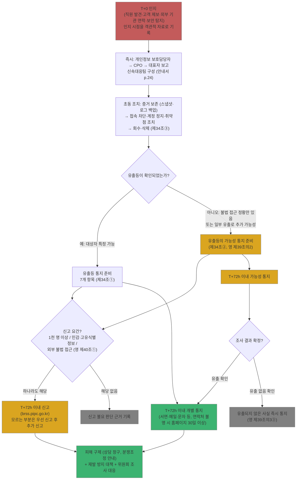

# Week 4 · Ch01. 개인정보 유출 등 사고 대응

> [← 이전 챕터](../3주차/ch07_윈도우11_실습.md) · [📚 전체 목차](../../README.md) · [다음 챕터 →](./ch02_정보주체_권리_행사_대응.md)

| 항목 | 내용 |
|---|---|
| 예상 학습 시간 | 100분 (실습 포함) |
| 법령 기준일 | 2026-11-17 |
| 핵심 근거 | 개인정보 보호법 제23조제2항, 제34조, 제34조의2 / 시행령 제39조, 제39조의2, 제39조의3, 제40조 / 안전성 확보조치 기준 제4조제1항제14호 / **개인정보 유출등 대응 안내서(2026. 9.)** |
| 관련 용어 | [개인정보 유출등](../../용어집.md#개인정보-유출등), [개인정보 유출등의 가능성 통지](../../용어집.md#개인정보-유출등의-가능성-통지), [72시간](../../용어집.md#72시간), [개인정보 유출등 대응 매뉴얼](../../용어집.md#개인정보-유출등-대응-매뉴얼), [노출된 개인정보의 삭제·차단](../../용어집.md#노출된-개인정보), [법정손해배상](../../용어집.md#법정손해배상) |
| 선수 챕터 | Week 3 전체 (특히 [W3-ch04 접속기록](../3주차/ch04_접속기록_보관과_점검.md)) |

---

## 1. 학습 목표

이 챕터를 마치면 담당자님은 다음을 할 수 있습니다.

1. 사고가 **유출등**인지, **유출등의 가능성**인지 판단하고 각각의 **통지·신고 요건과 72시간 기한**을 적용할 수 있다.
2. 법정 항목(7개)을 빠짐없이 담은 **정보주체 통지문**과 **신고 내용**의 초안을 작성할 수 있다.
3. 인지부터 재발 방지까지 **초동 대응 타임라인**을 사내 역할에 맞게 운영할 수 있다.

---

## 2. 한 줄 비유

> 💡 **유출 사고 대응은 "화재 대응"과 같습니다. ① 불을 끄고(긴급 차단) ② 화재 현장을 보존하고(증거 보전) ③ 주민에게 대피를 알리고(정보주체 통지) ④ 소방서에 신고합니다(위원회 신고). 그리고 이 모든 것을 "불을 알게 된 때부터 72시간" 안에 시작해야 합니다.**

단, 비유의 한계가 있습니다. 화재는 눈에 보이지만 유출은 **보이지 않습니다.** 그래서 "언제 알았는가(인지 시점)"를 **객관적 자료로 증명**할 수 있어야 하고(안내서 p.34), 유출이 확실하지 않아도 **가능성만으로** 알려야 하는 경우가 있습니다(2026. 9. 11. 신설, 법 제34조제2항).

---

## 3. 개념 설명 및 법령 조문

### 3-1. "유출등"이란

| 구분 | 내용 | 근거 |
|---|---|---|
| **법률상 범위** | 개인정보의 **분실·도난·유출·위조·변조·훼손** | 법 제23조제2항 ("이하 '유출등'이라 한다") |
| **유출의 뜻** | 법령이나 처리자의 자유로운 의사에 의하지 않고 개인정보가 처리자의 **관리·통제권을 벗어나** 제3자가 그 **내용을 알 수 있는 상태**에 이른 것 | 표준지침 제25조, 안내서 용어 정의 |
| **예시** | 해킹, 메일 오발송, 노트북·USB 분실, 서류 분실, 내부자 무단 반출, 홈페이지 노출, **데이터 위·변조, 랜섬웨어로 인한 훼손** | 안내서 |

> ⚠️ **법령과 지침이 다릅니다**: 표준지침(2025. 4.) 제25조는 '유출등'을 "분실·도난·유출"로만 정의합니다. 2026. 3. 10. 개정된 **법 제23조제2항**은 **위조·변조·훼손**까지 포함합니다. 이 교재는 [최신 법령 우선 원칙](../../템플릿/README.md#3-1-근거의-우선순위)에 따라 **법률의 정의**를 따릅니다. 유출등 대응 안내서(2026. 9.)도 위조·변조·훼손을 용어 정의에 포함합니다.[^law-23-2] [^guide-p6]

### 3-2. 관련 조문

> 📌 **조문 주소 읽는 법**: 조 → 항(①②) → 호(1. 2.) → 목(가. 나.). 자세한 설명은 [W1-ch01 3-2](../1주차/ch01_개인정보의_정의와_판단_기준.md#3-2-관련-조문)를 보세요.

#### 📜 개인정보 보호법 제34조 (개인정보 유출등의 통지·신고) + 시행령

| 항 | 원문 요지 | 시행령 세부 |
|---|---|---|
| ① **유출등 통지** | 유출등이 되었음을 **알게 되었을 때** 지체 없이 해당 정보주체에게 다음을 알려야 한다: 1. 유출등이 된 **항목** 2. 유출등이 된 **시점과 경위** 3. 피해 최소화를 위해 **정보주체가 할 수 있는 방법** 4. 처리자의 **대응조치 및 피해 구제절차** 5. 신고 등을 접수할 **담당부서·연락처** 6. 손해배상·법정손해배상 청구, 분쟁조정 등 **정보주체의 법적 권리와 행사 방법** 7. 그 밖에 시행령 사항. 연락처를 알 수 없는 등 정당한 사유가 있으면 갈음 조치 가능 | **영 제39조**: 서면등의 방법으로 **72시간 이내**. 예외(사유 해소 후 **즉시**): ① 확산·추가 유출 방지를 위한 접속경로 차단·취약점 보완·회수·삭제 등 **긴급 조치**가 필요한 경우 ② **천재지변** 등 부득이한 경우. 항목·시점·경위를 확인하지 못했으면 **확인된 내용과 제3호~제6호를 우선 통지**하고 추가 확인 즉시 통지. 연락처를 모르면 홈페이지 **30일 이상 게시**로 갈음 |
| ② **유출등의 가능성 통지** (2026. 9. 11. 신설) | 개인정보 유형, 영향, 위험 정도를 고려해 시행령이 정한 **유출등의 가능성**을 알게 되었을 때 지체 없이 가능성이 있는 **모든 정보주체**에게 피해 최소화 정보 등을 알려야 한다 | **영 제39조의2**: 대상 ① 처리시스템·취급자 정보기기에 **불법적인 접근**이 발생해 유출 정황이 있으나 **정보주체를 특정하기 곤란**한 경우(→ 불법 접근을 알게 된 때) ② 일부 유출이 확인되어 **다른 정보주체도** 유출되었을 수 있다고 인정되는 경우(→ 그 사실을 알게 된 때). 통지 사항: 항목, 의심 시점·경위, 제1항 제3호~제5호, **확정 시 추가 통지하겠다는 사실**. **영 제39조의3**: **72시간 이내** 통지(천재지변 등만 예외). 기한 내 실제 유출 확인 시 일반 통지로 갈음. **유출되지 않은 것으로 확인되면 그 사실을 즉시 통지** |
| ③ **피해 최소화** | 유출등이 된 경우 개인정보의 **회수·삭제** 등 피해 확산 방지 조치를 포함한 대책을 마련하고 필요한 조치를 해야 한다 | — |
| ④ **신고** | 유출등이 있음을 알게 되었을 때 시행령에 따라 제1항 각 호 사항을 지체 없이 **보호위원회 또는 전문기관(한국인터넷진흥원)**에 신고 | **영 제40조**: **72시간 이내** 서면등으로 신고. 대상(어느 하나): ① **1천 명 이상** ② **민감정보·고유식별정보** ③ 처리시스템·취급자 정보기기에 대한 **외부로부터의 불법적인 접근**. 천재지변 등은 사유 해소 후 즉시. 경로가 확인되어 **회수·삭제 등으로 권익 침해 가능성이 현저히 낮아진 경우**는 신고하지 않을 수 있음. 구체 내용을 확인 못 했으면 **우선 신고 후 추가 신고** |

근거 원문은 각주를 참고하세요.[^law-34] [^decree-39-40]

#### 📜 개인정보 보호법 제34조의2 (노출된 개인정보의 삭제·차단)

| 구분 | 내용 |
|---|---|
| **원문 요지** | 고유식별정보, 계좌정보, 신용카드정보 등이 정보통신망을 통해 **공중에 노출되지 않도록** 해야 하고, 노출되면 위원회 또는 **한국인터넷진흥원**(영 제40조의2)의 요청에 따라 삭제·차단 등 필요한 조치를 해야 한다. |
| **실무 포인트** | 게시판 첨부파일, 검색엔진에 색인된 파일, 공개 클라우드 스토리지 링크 등이 대표적 노출 경로입니다. |

근거 원문은 각주를 참고하세요.[^law-34-2]

### 3-3. 통지·신고 한눈에 비교

안내서의 "한눈에 보는 유출등 대응"을 정리하면 다음과 같습니다.[^guide-p6]

| 구분 | ① 유출등 통지 | ② 유출등의 가능성 통지 | ③ 유출등 신고 |
|---|---|---|---|
| **요건** | 유출등이 된 사실을 알게 된 경우 (정보주체 **1명 이상**) | (어느 하나) 불법 접근으로 유출 정황이 있으나 정보주체 특정 곤란 / 일부 유출 확인으로 다른 정보주체의 유출 가능성 인정 | (어느 하나) **1천 명 이상** / **민감·고유식별정보** / **외부 불법 접근** |
| **대상** | 유출등이 된 정보주체에게 **개별 통지** | 유출등의 가능성이 있는 정보주체에게 **개별 통지** | **개인정보보호위원회**(또는 한국인터넷진흥원) |
| **기한** | 인지 후 **72시간 내** | 가능성 인지 후 **72시간 내** | 인지 후 **72시간 내** |
| **지연 사유** | 긴급 조치 필요 / 천재지변 등 → 해소 후 **즉시** | **천재지변 등에 한정** | 천재지변 등 → 해소 후 즉시 |
| **내용** | 7개 항목 (항목, 시점·경위, 피해 최소화 방법, 대응조치·구제절차, 담당부서, **법적 권리**, 기타) | 항목, 의심 시점·경위, 피해 최소화 방법, 대응조치·구제절차, 담당부서, **확정 시 추가 통지 예정 사실** (법적 권리·구제 정보는 포함하지 않음) | 통지 사항과 같음. 확인 못 한 부분은 **우선 신고 → 추가 신고** |
| **방법** | 서면·전자우편·팩스·전화·문자 등. 연락처를 모르는 등 정당한 사유 시 **홈페이지 30일 이상 게시** | 유출등 통지와 같음 | **개인정보 유출신고 시스템(brss.pipc.go.kr)** |
| **후속** | — | 확정 시 72시간 내 유출등 통지, 또는 **유출등이 없었던 사실 통지** | 회수·삭제로 권익 침해 가능성이 현저히 낮아지면 신고하지 않을 수 있음 |

> ⚠️ 확인 필요: 신고 창구를 표준지침(2025. 4.) 제28조제3항은 "개인정보 포털(www.privacy.go.kr)"로, 유출등 대응 안내서(2026. 9.)는 "개인정보 유출신고 시스템(brss.pipc.go.kr)"으로 안내합니다. 이 교재는 더 최근 자료인 안내서를 따릅니다. 사고 당일에는 위원회 누리집에서 최신 신고 창구를 확인하세요.

### 3-4. 72시간은 언제부터 세나: 인지 시점

| 기준 | 안내서 설명 |
|---|---|
| **"알게 된 때"** | 유출등의 **발생 시점**이 아니라 **인지 시점**부터 셉니다. 가능성 통지는 불법 접근을 알게 된 때 또는 일부 유출 사실을 알게 된 때부터 셉니다. |
| **증명** | 인지 시점을 **객관적 자료**(민원 접수 일시, 유출 제보·확인 일시, 침해행위자의 협박 메일 수신·확인 일시 등)로 입증할 수 있어야 합니다. |
| **72시간 초과 시** | 지연 사유와 정당성을 **객관적인 자료로 소명**할 수 있어야 합니다. |
| **신고서 작성** | 유출 시점과 인지 시점을 **날짜와 시간까지** 구분해 적습니다(예: 인지 시점 2026-08-03 10:00). |

근거 원문은 각주를 참고하세요.[^guide-p34] [^guide-p47]

**안내서가 든 "정당하지 않은 통지 지연" 사례**[^guide-p34]

| 사례 | 상황 | 왜 문제인가 |
|---|---|---|
| 1 | 회원정보 유출을 인지한 뒤 분석으로 **직원정보 유출도 충분히 알 수 있었는데** 직원에게 2개월 넘게 통지하지 않음 | 정보주체 유형이 달라도 알게 된 때부터 72시간 |
| 2 | 외부 기관 메일로 다크웹에서 자사 회원 DB가 발견된 사실을 확인하고도 **72시간을 넘겨** 통지 | 외부 제보도 인지 시점 |
| 3 | 근거 자료가 웹 로그 2줄뿐이라 대상자 파악이 어렵다는 이유로 **4일 경과** 후 통지 | 구체 내용을 몰라도 **확인된 내용부터 우선 통지** |
| 4 | 경찰이 해커 검거 때까지 통지를 유보해 달라고 **구두 요청**해 30일 이상 지연 | 수사상 보류 요청이 있으면 **위원회에 신고 후 협의**하고 사유를 소명해야 함 |

---

## 4. 사내 실무 적용

### 🎭 상황극 1. 마케팅팀의 "메일 오발송인데 신고까지 해야 하나요?"

> **📨 마케팅팀 은 대리 (금요일 오후 5시)**: "VIP 고객 **350명**에게 이벤트 안내 메일을 보내면서, 실수로 **전체 명단 엑셀**(이름·휴대폰·주소·구매액)을 첨부해서 350명 모두에게 보냈어요. 해킹도 아니고 실수인데, 신고까지 해야 하나요?"

**🙋 담당자 답변**

| 구분 | 내용 |
|---|---|
| **결론** | ⚠️ **통지는 필수, 신고는 요건 검토 결과 "신고 대상 아님"으로 보임** — 350명의 정보가 다른 고객들에게 노출되었으므로 **유출등**이고, 350명 전원에게 **72시간 내 통지**해야 합니다. 신고 요건(1천 명 이상 / 민감·고유식별정보 / 외부 불법 접근)에는 해당하지 않습니다. |
| **근거** | 개인정보 보호법 제34조제1항(통지), 제3항(회수·삭제 등 피해 최소화), 시행령 제39조(72시간), 제40조제1항(신고 요건 3가지), 안내서 FAQ p.46("시스템 오류 또는 담당자 실수로 1천명 미만 … 민감정보·고유식별정보 미포함 → 신고 요건에 해당하지 않습니다") |
| **다음 행동** | ① **인지 시점**(오발송 확인 시각)을 기록합니다. 금요일 17시 인지면 **월요일 17시**가 72시간입니다. 주말도 포함됩니다. ② 메일 시스템에서 **발송 회수**를 시도하고, 회수가 안 되면 수신자 전원에게 **삭제 요청** 메일을 보냅니다(안내서 p.30). ③ 350명에게 **7개 항목**을 담은 통지문을 발송합니다. ④ 통지·회수 내역을 기록하고 CPO에게 보고합니다. ⑤ 재발 방지: 대량 발송은 **숨은 참조·개별 발송** 시스템 사용, 첨부파일 검사 등. |

**왜 그런가요?** 통지 의무는 **1명이라도** 유출등이 되면 생깁니다. 신고는 규모·정보 유형·원인에 따른 별도 요건입니다. 둘을 혼동해 "신고 대상이 아니니 아무것도 안 해도 된다"고 판단하는 것이 가장 흔한 실수입니다. ⚠️ 만약 첨부파일에 **주민등록번호 등 고유식별정보**가 있었다면 1천 명 미만이어도 **신고 대상**입니다.

### 🎭 상황극 2. 보안팀의 "해킹 흔적은 있는데 뭐가 나갔는지 아직 몰라요"

> **📨 보안팀 하 책임 (화요일 오전 9시)**: "어젯밤 23시에 **회원 DB 서버에 외부 IP의 비정상 접속**과 대용량 트래픽이 탐지됐어요. 실제로 어떤 회원 정보가 나갔는지는 **포렌식에 일주일**은 걸린다는데, 결과 나올 때까지 기다렸다가 신고하면 되죠?"

**🙋 담당자 답변**

| 구분 | 내용 |
|---|---|
| **결론** | ❌ **기다리면 안 됩니다** — 외부 불법 접근으로 유출 정황이 있지만 정보주체를 특정하기 곤란하면 **유출등의 가능성 통지** 대상입니다. 기한은 **불법 접근을 알게 된 때(어젯밤 23시)부터 72시간**입니다. 신고도 **확인된 내용으로 우선 신고**하고 추가 확인 시 추가 신고합니다. |
| **근거** | 개인정보 보호법 제34조제2항, 시행령 제39조의2제1항제1호, 제39조의3제1항(72시간, 천재지변만 예외), 제40조제1항제3호·제2항(외부 불법 접근 → 신고, 우선 신고) |
| **다음 행동** | ① **인지 시점(월 23:00)**을 탐지 로그로 확정·기록합니다. 기한은 **목요일 23:00**입니다. ② **신속대응팀**을 소집합니다(CPO 총괄, 보안·법무·고객지원·홍보). ③ 접속 차단 전 **증거 보존**(스냅샷, 로그 백업)을 하고 나서 차단합니다. ④ 가능성 있는 정보주체 범위를 정합니다(해당 DB의 전체 회원 등). ⑤ **가능성 통지문**을 발송합니다(항목, 의심 시점·경위, 피해 최소화 방법, 대응조치, 담당부서, 확정 시 추가 통지 예정). ⑥ 유출신고 시스템으로 **우선 신고**합니다. ⑦ 포렌식으로 확정되면 **유출등 통지**(7개 항목), 유출이 없었던 것으로 확인되면 **그 사실을 즉시 통지**합니다. |

**왜 그런가요?** 2026. 9. 11. 신설된 가능성 통지는 정확히 이런 상황을 위한 제도입니다. SK텔레콤은 2025. 4. 19. 유출을 인지하고도 72시간 내 통지하지 않고, 5. 9.에 "가능성" 통지, 7. 28.에 "확정" 통지를 해 과태료를 받았습니다.[^case-skt] 시행령 제39조의3제1항은 가능성 통지의 지연 사유를 **천재지변 등으로 한정**합니다. "포렌식 중"은 지연 사유가 아닙니다.

---

## 5. 유출 사고 대응 타임라인 (인지 후 72시간)

**그림 읽는 법**: 가장 중요한 칸은 맨 위의 **인지 시점 기록**입니다. 모든 72시간 기한이 여기서 시작합니다. 가운데 분기에서 **확정되지 않았다고 기다리지 말고** 황색의 가능성 통지로 갑니다. 통지(정보주체)와 신고(위원회)는 **별개의 의무**로 나란히 진행합니다.

---

## 6. 개인정보보호위원회 처분 사례

### ⚖️ 사례: ㈜카카오의 오픈채팅 이용자 정보 유출과 신고·통지 의무 위반 (2024. 5. 의결)

| 단계 | 내용 |
|---|---|
| **사건 개요** | 2023년 3월 카카오톡 오픈채팅 이용자의 개인정보가 불법 거래되고 있다는 언론보도가 있었습니다. 조사 결과 해커는 오픈채팅방의 취약점을 이용해 참여자 정보를 얻고, 친구추가 기능과 불법 프로그램 등으로 이용자 정보를 확보했습니다. 그리고 이 정보를 '회원일련번호'를 기준으로 결합해 개인정보 파일을 만들어 판매했습니다. 카카오는 "익명채팅"이라고 홍보하면서도 일반채팅과 오픈채팅 이용자를 **같은 회원일련번호**로 식별했습니다. 2020. 8. 이전 오픈채팅방은 임시ID를 **암호화하지 않았고**, 이후 방은 암호화했지만 게시판에 입력하면 **평문으로 노출되는 취약점**이 있었습니다. 그리고 **2023. 3. 언론보도와 위원회 조사 과정에서 유출 사실을 인지했는데도 유출 신고와 이용자 통지를 하지 않았습니다.** |
| **위반 조항** | 보도자료 붙임 기준 (舊 보호법, 법률 제16930호, 2020. 8. 5. 시행): 안전조치의무 **§29**, 개인정보 유출 신고·통지 의무 **§39의4①** |
| **처분 결과** | 과징금 **151억 4,196만 원**(안전조치의무 위반), 과태료 **780만 원**(유출 신고·통지 의무 위반 등), **이용자 대상 유출 통지 시정명령**, 결과 공표 |
| **교훈** | ① **언론보도·조사 착수도 인지 시점**이 됩니다. "아직 우리 조사 결과가 안 나왔다"는 통지·신고를 미룰 이유가 되지 않습니다. ② 신고·통지를 하지 않으면 과태료와 별도로 **통지하라는 시정명령**까지 받습니다. 결국 해야 할 일을 늦게, 더 불리한 상황에서 하게 됩니다. ③ "익명"이라고 홍보한 서비스도 내부 식별자가 연결되면 개인정보입니다 → [W1-ch01](../1주차/ch01_개인정보의_정의와_판단_기준.md) |
| **출처** | 개인정보보호위원회 보도자료, 「개인정보위, ㈜카카오에 과징금 151억 원, 과태료 780만 원 부과」(2024. 5. 22. 의결, 5. 23. 보도)[^case-kakao] |

> 💬 **사수의 한마디**: 사고 대응에서 가장 흔한 실수는 **"확실해질 때까지 기다리자"**입니다. 위원회 사례를 보면 늦은 통지·신고는 거의 항상 따로 제재를 받습니다. 사고 대응 매뉴얼 첫 장에 **"인지 시각을 적고, 72시간 카운트다운을 시작한다"**를 크게 써 두세요.

---

## 7. 오답노트

| # | ❌ 잘못된 생각 | ✅ 올바른 이해 | 근거 조문 |
|---|---|---|---|
| 1 | "1천 명 미만이고 실수니까 아무것도 안 해도 돼요." | **신고** 요건에 해당하지 않을 뿐, 유출등이 된 정보주체에게는 **1명이라도 통지**해야 합니다. | 법 제34조제1항, 영 제39조·제40조, 안내서 FAQ p.46 |
| 2 | "72시간은 유출이 발생한 때부터 세죠? 몇 달 전 일이니 이미 늦었어요." | 72시간은 **알게 된 때**부터 셉니다. 인지 시점을 객관적 자료로 기록하고 즉시 대응하세요. | 영 제39조제1항, 안내서 p.34 |
| 3 | "포렌식 결과가 나올 때까지 통지를 미뤄도 돼요." | 확정 전이라도 불법 접근 정황이 있으면 **가능성 통지**(72시간, 천재지변만 예외) 대상입니다. 유출 통지·신고도 확인된 내용부터 **우선** 해야 합니다. | 법 제34조제2항, 영 제39조제2항, 제39조의3, 제40조제2항 |
| 4 | "통지문에 '일부 고객의 회원정보 일부가 유출'이라고 쓰면 되죠." | 유출된 **항목을 누락 없이** 구체적으로 써야 합니다. "등"으로 생략하거나 "전화번호"로 통칭하면 안 됩니다. | 법 제34조제1항제1호, 안내서 p.36 통지문 작성 준수사항 |
| 5 | "랜섬웨어로 파일이 암호화만 됐고 밖으로 나간 건 없으니 유출이 아니에요." | 법률상 '유출등'에는 **훼손**도 포함됩니다. 반출 여부와 별도로 대응해야 합니다. | 법 제23조제2항 |
| 6 | "경찰이 수사 중이라 통지하지 말라고 했으니 기다리면 돼요." | 수사기관의 보류 요청이 있으면 **위원회에 신고한 뒤 협의**하고 지연 사유를 소명해야 합니다. 구두 요청만으로 임의 지연하면 안 됩니다. | 안내서 p.34 사례 4 |

---

## 8. 업무 체크리스트

**📋 유출 사고 대응 준비·실행 점검표**

| 점검 주기 | 준비 항목: 반기 1회 / 실행 항목: 사고 발생 시 | 점검자 | 개인정보보호 담당자 (CPO 총괄) | 점검일 | ____-__-__ |
|---|---|---|---|---|---|

**[평소 준비]**
- [ ] **유출사고 대응 계획**(매뉴얼)이 내부 관리계획에 있다. 1천 명 이상 처리자는 필수다 (고시 제4조제1항제14호, 표준지침 제29조)
- [ ] 전 직원이 유출 의심 시 **누구에게 어떻게 신고**하는지 안다 (안내서 p.24)
- [ ] **신속대응팀** 구성원(CPO, 보안, 법무, 고객지원, 홍보)과 비상연락망이 최신이다
- [ ] **통지문·가능성 통지문·신고 내용** 양식이 7개 항목 기준으로 준비되어 있다
- [ ] 대량 통지 수단(문자·메일 발송 시스템)과 **홈페이지 공지** 절차가 준비되어 있다
- [ ] 로그 **자동 삭제를 즉시 멈추는 방법**을 IT팀이 알고 있다 (안내서 p.27)
- [ ] 연 1회 이상 **모의훈련**을 한다 → [W4-ch06](./ch06_A사_유출사고_종합_모의훈련.md)

**[사고 발생 시]**
- [ ] **인지 시점**을 날짜·시간까지 객관적 자료와 함께 기록했다
- [ ] 증거 보존(스냅샷·로그 백업) 후 차단·계정 정지·취약점 조치를 했다
- [ ] 회수·삭제 조치를 하고 결과를 기록했다 (법 제34조제3항)
- [ ] 유출등 / 가능성 / 해당 없음을 판단하고 근거를 기록했다
- [ ] 통지 대상과 **72시간 기한**을 계산했다 (주말·공휴일 포함)
- [ ] 신고 요건 3가지(1천 명, 민감·고유식별, 외부 불법 접근)를 검토하고 결과를 기록했다
- [ ] 통지문에 **7개 항목**이 모두 있다 (가능성 통지는 6개 사항)
- [ ] 72시간을 넘긴다면 **지연 사유와 객관적 자료**를 준비했다
- [ ] 수탁자에서 발생한 사고라면 수탁자의 보고 경로와 우리 회사의 통지·신고 책임을 확인했다

---

## 9. 실습 과제 / 퀴즈

### 객관식

**Q1.** 시행령 제40조제1항에 따른 **유출등 신고 대상이 아닌 것**은?

1. 1천 명 이상의 정보주체에 관한 개인정보가 유출등이 된 경우
2. 고유식별정보가 유출등이 된 경우
3. 외부로부터의 불법적인 접근으로 개인정보가 유출등이 된 경우
4. 담당자의 실수로 민감정보·고유식별정보가 없는 회원 50명의 이름·연락처가 메일로 오발송된 경우

**Q2.** 법 제34조제1항에 따라 **유출등 통지문에 포함해야 하는 사항이 아닌 것**은?

1. 유출등이 된 개인정보의 항목
2. 유출등이 된 시점과 그 경위
3. 손해배상·법정손해배상 청구 및 분쟁조정 등 정보주체의 법적 권리와 행사 방법
4. 사고를 일으킨 직원의 성명과 징계 내용

**Q3.** 2026. 9. 11. 신설된 **유출등의 가능성 통지**에 관한 설명으로 옳은 것은?

1. 유출이 확정된 경우에만 통지한다.
2. 불법적인 접근으로 유출 정황이 있으나 정보주체 특정이 곤란한 경우, 그 접근을 알게 된 때부터 72시간 이내에 통지한다.
3. 포렌식 조사 중이면 조사가 끝날 때까지 통지를 미룰 수 있다.
4. 가능성 통지를 한 뒤 유출되지 않은 것으로 확인되어도 따로 알릴 필요는 없다.

### 🛠️ 실습: 유출 시나리오 대응

**Q4.** 아래 시나리오를 읽고 ① **유출등 해당 여부와 유형**(유출등 / 가능성 / 해당 없음) ② **통지 대상·기한** ③ **신고 여부·기한·근거** ④ **정보주체 통지문 초안**(7개 항목 포함)을 작성하세요.

> **시나리오: ㈜B몰 (온라인 쇼핑몰, 회원 12만 명)**
> - **2026. 11. 10.(화) 14:20** 고객센터에 "B몰에만 쓰는 이메일로 피싱 메일이 왔다"는 민원이 3건 접수됨
> - **같은 날 16:00** 보안팀 확인 결과, 2026. 11. 8.(일) 새벽 외부 IP가 웹 취약점(SQL 인젝션)으로 회원 DB에 접근해 **회원 약 3,200명**의 **이름·이메일·휴대전화번호·주소**를 조회·추출한 기록이 확인됨
> - 비밀번호는 일방향 암호화(SHA-256 + 솔트)되어 있었고, 카드번호는 결제대행사가 보관해 B몰 DB에 없음
> - 3,200명 외 다른 회원 정보까지 추출되었는지는 **추가 분석 중**

> ✅ 다 풀었다면 [정답 및 해설](../../정답과_해설.md#w4-ch01)에서 확인하세요. 틀린 문제는 **7. 오답노트**에 한 줄씩 추가하세요.

---

## 10. 더 읽을거리

| 자료 | 발행 | 참고자료 파일명 | 이 챕터와의 관계 |
|---|---|---|---|
| 개인정보 유출등 대응 안내서 | 개인정보보호위원회, 2026. 9. | `개인정보 유출등 대응 안내서(2026.9.).pdf` | 핵심 자료. 한눈에 보기(PDF p.6), 신속대응팀(p.24~26), 증거 보존(p.27), 회수·삭제(p.29~30), 통지 기한·지연 사례(p.34), 통지문 예시(p.36), 가능성 통지문 예시(p.42), 신고 FAQ(p.46), 신고서 작성(p.47~48) |
| 개인정보 보호법 | 법률 제21445호 | `개인정보 보호법(법률)(제21445호)(20260911).pdf` | 제23조제2항, 제34조, 제34조의2, 제39조의2 |
| 개인정보 보호법 시행령 | 대통령령 제36804호 | `개인정보 보호법 시행령(대통령령)(제36804호)(20261110).pdf` | 제39조, 제39조의2, 제39조의3, 제40조, 제40조의2 |
| 표준 개인정보 보호지침 | 고시 제2025-4호 | `표준 개인정보 보호지침(개인정보보호위원회고시)(제2025-4호)(20250411).pdf` | 제25조~제29조 (⚠️ 2026년 법 개정 전 문언, 법령 우선) |
| 개인정보위 보도자료 (카카오) | 개인정보보호위원회, 2024. 5. | `240523 (석간) 개인정보위, ㈜카카오에 과징금 151억 원, 과태료 780만 원 부과(조사2과) FN.pdf` | 6절 처분 사례, p.4 위반 조항 표 |
| 개인정보위 보도자료 (SK텔레콤) | 개인정보보호위원회, 2025. 8. | `250828 (석간) 개인정보위  ‘SK텔레콤 개인정보 유출사고’ 제재처분 의결(조사2과)_최종(붙임 포함).pdf` | p.6~7, p.11 통지 지연 판단 |

---

> [← 이전 챕터](../3주차/ch07_윈도우11_실습.md) · [📚 전체 목차](../../README.md) · [📖 용어집](../../용어집.md) · [다음 챕터 →](./ch02_정보주체_권리_행사_대응.md)

[^law-23-2]: [출처: [개인정보 보호법(법률)(제21445호)(20260911).pdf](<../../참고자료/개인정보 보호법(법률)(제21445호)(20260911).pdf>), 제23조제2항 (<개정 2026. 3. 10.>)] / ⚠️ 비교: [[표준 개인정보 보호지침(개인정보보호위원회고시)(제2025-4호)(20250411).pdf](<../../참고자료/표준 개인정보 보호지침(개인정보보호위원회고시)(제2025-4호)(20250411).pdf>), 제25조]
[^guide-p6]: [출처: [개인정보 유출등 대응 안내서(2026.9.).pdf](<../../참고자료/개인정보 유출등 대응 안내서(2026.9.).pdf>), PDF p.6 「한눈에 보는 유출등 대응 안내서」 및 용어 정의]
[^law-34]: [출처: [개인정보 보호법(법률)(제21445호)(20260911).pdf](<../../참고자료/개인정보 보호법(법률)(제21445호)(20260911).pdf>), 제34조제1항~제5항 (<개정 2023. 3. 14., 2026. 3. 10.>, 제2항 <신설 2026. 3. 10.>)]
[^decree-39-40]: [출처: [개인정보 보호법 시행령(대통령령)(제36804호)(20261110).pdf](<../../참고자료/개인정보 보호법 시행령(대통령령)(제36804호)(20261110).pdf>), 제39조제1항~제3항, 제39조의2, 제39조의3 ([본조신설 2026. 9. 10.]), 제40조제1항~제3항]
[^law-34-2]: [출처: [개인정보 보호법(법률)(제21445호)(20260911).pdf](<../../참고자료/개인정보 보호법(법률)(제21445호)(20260911).pdf>), 제34조의2] / [출처: [개인정보 보호법 시행령(대통령령)(제36804호)(20261110).pdf](<../../참고자료/개인정보 보호법 시행령(대통령령)(제36804호)(20261110).pdf>), 제40조의2]
[^guide-p34]: [출처: [개인정보 유출등 대응 안내서(2026.9.).pdf](<../../참고자료/개인정보 유출등 대응 안내서(2026.9.).pdf>), PDF p.34 「통지 기한」, 인지 시점 입증, 「통지 지연 사례」 1~4]
[^guide-p47]: [출처: [개인정보 유출등 대응 안내서(2026.9.).pdf](<../../참고자료/개인정보 유출등 대응 안내서(2026.9.).pdf>), PDF p.47~48 신고 기한, 인지 시점 객관적 자료, 신고서 작성(유출 시점·인지 시점 구분)]
[^case-skt]: [출처: [250828 (석간) 개인정보위  ‘SK텔레콤 개인정보 유출사고’ 제재처분 의결(조사2과)_최종(붙임 포함).pdf](<../../참고자료/250828 (석간) 개인정보위  ‘SK텔레콤 개인정보 유출사고’ 제재처분 의결(조사2과)_최종(붙임 포함).pdf>), p.6~7 (유출 통지 지연, 가능성·확정 통지 일자), p.11 「붙임 4」]
[^case-kakao]: [출처: [240523 (석간) 개인정보위, ㈜카카오에 과징금 151억 원, 과태료 780만 원 부과(조사2과) FN.pdf](<../../참고자료/240523 (석간) 개인정보위, ㈜카카오에 과징금 151억 원, 과태료 780만 원 부과(조사2과) FN.pdf>), p.1 (조사 배경·유출 과정), p.2~3 (안전조치 위반, 신고·통지 위반, 시정명령), p.4 「붙임」 위반 조항 표]
